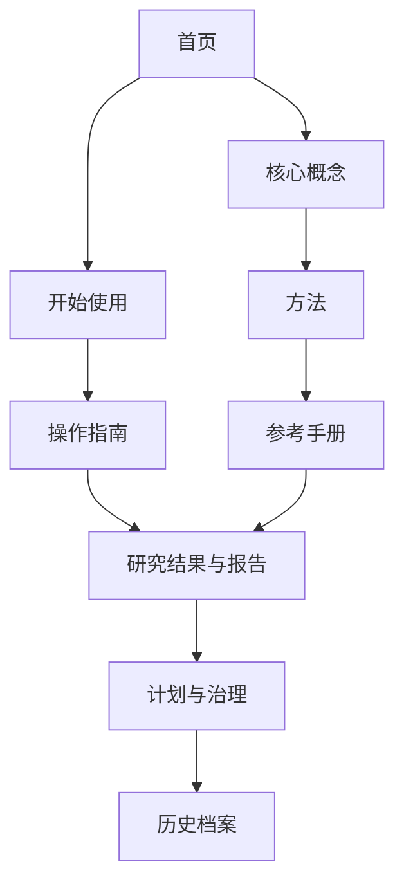

<!--
  Documentation map and reader routes for phc2d.
  Author: fangtoast
  Email: fangtoast@foxmail.com
  Copyright (c) 2026 fangtoast. All rights reserved.
-->

<a id="docs-book-home"></a>

# 文档总览

本页是从 GitHub 浏览 `docs/` 时的目录，也是文档站各章节的职责说明。第一次运行请从[快速上手](开始/快速上手.md)开始；核查实验结论请直接进入[研究结果与报告](results/README.md)。

## 按任务选择入口

| 你现在要做什么 | 入口 | 读完后应知道什么 |
|---|---|---|
| 安装并检查仓库 | [开始使用](开始/README.md) | 环境层级、最小命令与 smoke 边界 |
| 理解研究闭环 | [核心概念](概念/README.md) | 数据、代理、候选与 replay 的关系 |
| 理解某类方法 | [方法](方法/README.md) | 方法输入输出、作用和局限 |
| 执行具体任务 | [操作指南](指南/README.md) | 前置条件、步骤、产物和停止条件 |
| 查询精确定义 | [参考手册](参考/README.md) | CLI、schema、模型与公式合同 |
| 判断项目做到了哪里 | [研究结果与报告](results/README.md) | 按研究大类展开实际结果、失败、证据边界和综合快照 |
| 了解计划与规则 | [计划索引](planning/README.md) · [协作治理](collaboration.md) | 尚未完成的 gate 与维护约束 |
| 追溯被替代路线 | [历史档案](历史档案.md) | 哪些材料只保留历史价值、不能覆盖当前证据 |

## 信息架构



主导航按读者任务组织。“研究结果与报告”把 `results/` 的单项证据和 `reports/` 的综合叙述放在同一棵可展开导航树中；两类文件仍保留各自的证据职责和物理目录。

## 权威顺序

冲突时按以下顺序判断项目事实：

```text
实际 run / solver / metrics / checkpoint
  > 当前代码、配置、测试和 CLI
  > 经筛选的结果报告
  > TODO 与研究计划
  > 综合报告和聊天摘要
```

计划不能证明实验完成，smoke 不能证明模型有效，surrogate 不能替代 replay，较低 residual 不能单独证明 inverse 收益。

## 维护入口

- 页面职责与文风：[工程约定](conventions.md)
- 证据、人机协作与人工接受：[协作治理](collaboration.md)
- 构建与审计：[CLI 与配置](参考/CLI与配置.md#报告维护命令)
- 当前研究状态：仓库根目录的 `PROJECT_MAP.md`
