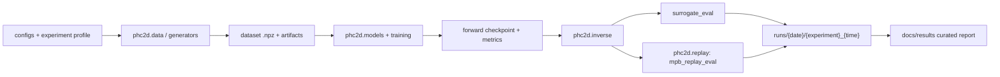

<!--
  Architecture notes for the unified phc2d workspace.
  Author: fangtoast
  Email: fangtoast@foxmail.com
  Copyright (c) 2026 fangtoast. All rights reserved.
-->

# phc2d 架构说明

| Metadata | Value |
|---|---|
| Status | Draft L4 architecture update |
| Audience | 开发者、研究生与 AI 协作代理 |
| Owner | 研究生维护并确认架构接受 |
| Last reviewed | 2026-08-13 |
| Reading time | 10 minutes |

本文说明统一工作目录、依赖边界、数据流、实验流与验证边界，面向维护者和 AI 协作代理。实验结论与结果解读放在 [`results/`](results)，全项目阅读顺序见 [`README.md`](README.md)。

**目录：** [一、核心边界](#一核心边界) · [二、统一流水线](#二统一流水线) · [三、CLI 与输出](#三cli-与输出) · [四、历史实现](#四历史实现) · [五、验证边界](#五验证边界)

---

## 一、核心边界

| 区域 | 路径 | 责任 |
|---|---|---|
| 公共包 | [`../src/phc2d`](../src/phc2d) | 数据协议、结构生成、模型注册、训练/逆向配置、MPB replay helper、plot、run 输出 |
| 复现实验 profile | [`../experiments/reproduction/wang2026`](../experiments/reproduction/wang2026) | Wang 等 2026 论文复现的配置与说明 |
| 研究实验 profile | [`../experiments/research`](../experiments/research) | forward benchmark、dispersion inverse、near-field、MPB replay 等后续研究 |
| 历史实现 | Git history | 旧 `pod_deeponet` / `ai4phc` 分裂式实现已从活跃目录移除 |

`phc2d` 是唯一公共代码入口。论文复现和后续研究不再通过顶层目录隔离，而是通过 `ExperimentSpec.family = reproduction | research` 与配置 profile 区分。

### 模型包边界

[`phc2d.models`](../src/phc2d/models) 采用“稳定公共接口—注册机制—内置目录—模型实现”四层结构：

| 层 | 路径 | 责任 |
|---|---|---|
| 公共接口 | [`models/__init__.py`](../src/phc2d/models/__init__.py) | 对训练、评估和报告暴露稳定的 registry 与 identity API |
| 注册机制 | [`models/registry.py`](../src/phc2d/models/registry.py) | 只维护注册、构建、查询和 lazy factory，不内嵌模型清单 |
| 内置目录 | [`models/catalog/`](../src/phc2d/models/catalog) | 按 forward、query、field、full-cell 分组维护 `ModelSpec` |
| 族内实现 | [`band_mlp.py`](../src/phc2d/models/band_mlp.py)、[`band_cnn.py`](../src/phc2d/models/band_cnn.py)、[`band_operators.py`](../src/phc2d/models/band_operators.py)、[`query.py`](../src/phc2d/models/query.py)、`field_*` 与 `full_cell_*` | 一个文件只维护一个模型族或一组紧密共享的算子 |

`baselines.py`、`field.py` 和 `full_cell_upgrades.py` 仅作为历史导入路径的薄兼容门面。移动实现不会改变 registry name、`state_dict` key 或既有 architecture fingerprint；新的模块归属与兼容身份由测试同时约束。PyTorch 仍只在实际构建模型时 lazy import。

---

## 二、统一流水线



统一数据接口：

| 字段 | 要求 |
|---|---|
| `rho` | 结构输入，通常为 wedge 表示 |
| `Wh` | 能带标签或代理目标 |
| `idx_train` / `idx_val` / `idx_test` | 数据划分 |
| `config_yaml` | 生成或训练配置快照 |
| `metadata_jsonl` | 样本元信息；旁路文件可放在 `*_artifacts/metadata.jsonl` |

每个样本 metadata 至少记录 generator、seed、grid size、fill fraction、symmetry、连通域、孔洞、最小特征尺寸与 postprocess steps。

---

## 三、CLI 与输出

统一入口是 `phc2d`：

```text
phc2d.cli.__init__       稳定公共入口
  -> cli.parser          轻量顶层 parser 组装
  -> cli.main            命令分派
  -> cli.commands.*      data / forward / query / models / inverse /
                         replay / hpc / plot / report 域内参数与执行
```

命令域模块只在执行对应命令后导入训练、求解器或报告 backend。新增命令应进入所属域模块，不再向顶层 `main()` 追加分支。CLI 架构测试固定全部命令名、公共入口兼容性和模块规模边界。

| 命令 | 作用 |
|---|---|
| `phc2d data generate` | 数据生成 |
| `phc2d forward train` | forward surrogate 训练 |
| `phc2d forward eval` | forward checkpoint 评估 |
| `phc2d inverse train` | dispersion inverse 训练 |
| `phc2d inverse eval` | surrogate-side inverse 评估 |
| `phc2d replay mpb` | MPB replay / formal validation wrapper |
| `phc2d plot` | medium、band、metric、field 图 |
| `phc2d report` | 人工报告生成入口 |

运行产物统一写入：

```text
runs/{yyyymmdd}/{experiment_id}_{YYYYMMDDHHmm}/
```

标准文件：`run.log`、`run.meta.json`、`config.resolved.yaml`、`results.json`、`metrics.json`、`history.csv`、`figures/`。

---

## 四、历史实现

旧 `legacy/reproduction` 和 `research/ai4phc` 顶层目录不再作为活跃工作目录保留。历史代码通过 Git history 追溯；需要恢复某个旧脚本时，先把可复用逻辑迁入 `src/phc2d`，再通过 `phc2d` CLI 暴露。

不再新增 `pod-repro-*` 或 `ai4phc-*` 入口。所有新入口都应挂在 `phc2d` 下。

---

## 五、验证边界

后续测试与正式验证统一使用 WSL `Ubuntu` + conda `meep_env`，包括：

- `python -m compileall`
- `pytest -q tests`
- CLI `--help`
- 不调用 MPB/Meep 的数据 schema、plot、run-dir、NumPy/PyTorch smoke
- MPB 数据生成
- MPB/FEM 对比
- near-field 生成
- inverse MPB replay
- 正式 benchmark smoke 中的 MPB/Meep 部分

Windows `.venv` 只作为编辑期临时调试便利，不再作为后续测试验收环境。汇报时必须明确写出 **WSL `meep_env` tests** 与 **WSL `meep_env` MPB validation**；前者仍不能替代后者的物理验证含义。

---

## 六、本轮架构调整记录

解决了什么问题：拆除 `models` 和 CLI 中“一个文件同时维护多个模型族、目录清单或命令域”的单体结构。

为什么采用这个方案：先保持公共 API、命令名、checkpoint schema 和历史模型身份不变，再移动内部职责，可把 L4 可维护性改进与 L3 实验证据隔离。

改变了项目哪一层/哪一模块：仅修改 L4 的 `phc2d.models`、`phc2d.cli`、对应测试与本架构说明；未修改数据、训练配置、模型数学结构、checkpoint 或研究结论。

使用什么证据验证：模型/CLI 合约测试、历史 architecture fingerprint 固定值、Ruff、compileall、CLI help 与完整 pytest；正式结果以本次实际验证记录为准。

最大风险、未知或下一 gate：`inverse/benchmark.py`、`inverse/runner.py` 与 `forward/runner.py` 仍是高耦合大模块。后续应分别冻结 stage 输入输出与 golden artifact 合同后再拆分，不能与本次纯结构迁移混为一次修改。扁平 configs/tests 和重复 I/O helper 也保留为独立后续切片。
