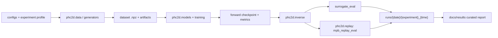

<!--
  Architecture notes for the unified phc2d workspace.
  Author: fangtoast
  Email: fangtoast@foxmail.com
  Copyright (c) 2026 fangtoast. All rights reserved.
-->

# phc2d 架构说明

## 摘要
- **目的**：基于原始记录保留实验链路与指标定义，对文档进行中文化结构化重构。
- **状态**：已完成中文主语体补充，原始英文命令、路径、文件名、模型字段与数值保持原文不变。
- **文件角色**：Project Docs | **原始语言比例**：英中混合（17%）
- **证据入口**：runs/{date}/{experiment}_{time}"；runs/{yyyymmdd}/{experiment_id}_{YYYYMMDDHHmm}/；run.meta.json；config.resolved.yaml；results.json


本文说明本仓库重构后的工作目录、依赖边界、数据流、实验流与验证边界。它面向后续维护者和 AI 协作代理；实验结论与结果解读放在 [`results/`](results)。

**目录：** [一、核心边界](#一核心边界) · [二、统一流水线](#二统一流水线) · [三、CLI 与输出](#三cli-与输出) · [四、历史实现](#四历史实现) · [五、验证边界](#五验证边界)

---

## 一、核心边界

| 区域 | 路径 | 责任 |
|---|---|---|
| 公共包 | [`../src/phc2d`](../src/phc2d) | 数据协议、结构生成、模型注册、训练/逆向配置、MPB replay helper、plot、run 输出 |
| 复现实验 profile | [`../experiments/reproduction/wang2026`](../experiments/reproduction/wang2026) | Wang 等 2026 论文复现的配置与说明 |
| 研究实验 profile | [`../experiments/research`](../experiments/research) | forward benchmark、dispersion inverse、near-field、MPB replay 等后续研究 |
| 历史实现 | Git history | 旧 `pod_deeponet` / `ai4phc` 分裂式实现已从活跃目录移除 |

`phc2d` 是唯一公共代码入口。论文复现和后续研究不再通过顶层目录隔离，而是通过 `ExperimentSpec.family = reproduction | research` 与配置 profile 区分。

---

## 二、统一流水线



统一数据接口：

| 字段 | 要求 |
|---|---|
| `rho` | 结构输入，通常为 wedge 表示 |
| `Wh` | 能带标签或代理目标 |
| `idx_train` / `idx_val` / `idx_test` | 数据划分 |
| `config_yaml` | 生成或训练配置快照 |
| `metadata_jsonl` | 样本元信息；旁路文件可放在 `*_artifacts/metadata.jsonl` |

每个样本 metadata 至少记录 generator、seed、grid size、fill fraction、symmetry、连通域、孔洞、最小特征尺寸与 postprocess steps。

---

## 三、CLI 与输出

统一入口是 `phc2d`：

| 命令 | 作用 |
|---|---|
| `phc2d data generate` | 数据生成 |
| `phc2d forward train` | forward surrogate 训练 |
| `phc2d forward eval` | forward checkpoint 评估 |
| `phc2d inverse train` | dispersion inverse 训练 |
| `phc2d inverse eval` | surrogate-side inverse 评估 |
| `phc2d replay mpb` | MPB replay / formal validation wrapper |
| `phc2d plot` | medium、band、metric、field 图 |
| `phc2d report` | 人工报告生成入口 |

运行产物统一写入：

```text
runs/{yyyymmdd}/{experiment_id}_{YYYYMMDDHHmm}/
```

标准文件：`run.log`、`run.meta.json`、`config.resolved.yaml`、`results.json`、`metrics.json`、`history.csv`、`figures/`。

---

## 四、历史实现

旧 `legacy/reproduction` 和 `research/ai4phc` 顶层目录不再作为活跃工作目录保留。历史代码通过 Git history 追溯；需要恢复某个旧脚本时，先把可复用逻辑迁入 `src/phc2d`，再通过 `phc2d` CLI 暴露。

不再新增 `pod-repro-*` 或 `ai4phc-*` 入口。所有新入口都应挂在 `phc2d` 下。

---

## 五、验证边界

后续测试与正式验证统一使用 WSL `Ubuntu` + conda `meep_env`，包括：

- `python -m compileall`
- `pytest -q tests`
- CLI `--help`
- 不调用 MPB/Meep 的数据 schema、plot、run-dir、NumPy/PyTorch smoke
- MPB 数据生成
- MPB/FEM 对比
- near-field 生成
- inverse MPB replay
- 正式 benchmark smoke 中的 MPB/Meep 部分

Windows `.venv` 只作为编辑期临时调试便利，不再作为后续测试验收环境。汇报时必须明确写出 **WSL `meep_env` tests** 与 **WSL `meep_env` MPB validation**；前者仍不能替代后者的物理验证含义。