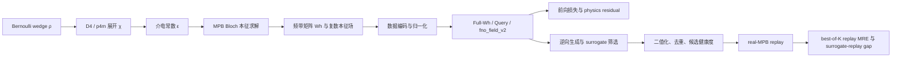

<!--
  End-to-end physics and data formula guide for the unified phc2d workspace.
  Author: fangtoast
  Email: fangtoast@foxmail.com
  Copyright (c) 2026 fangtoast. All rights reserved.
-->

# phc2d 端到端物理与数据公式手册

> 日期：2026-08-03
>
> 范围：当前统一仓库已经实现的结构生成、MPB 数据、数据表示、场物理、训练损失、逆向筛选与 real-MPB replay。
>
> 非目标：本文不展开 MaxwellNet、cINN、diffusion 等参考模型，也不重复模型架构报告。

本文回答的是“一个结构如何变成可训练数据、模型优化的量是什么、最终又由什么物理证据复核”。公式按当前源码与 V2 配置逐项回链；通用定义与当前配置常数严格分开。模型清单和结果状态仍以 [`phc2d_model_inventory_v1.yaml`](phc2d_model_inventory_v1.yaml) 及 [`phc2d_project_full_introduction_20260724.md`](phc2d_project_full_introduction_20260724.md) 为准。

## 1. 公式分类、条目模板与统一符号

### 1.1 六类公式不能混用

| 类别 | 回答的问题 | 例子 | 证据含义 |
|---|---|---|---|
| 物理定律 | 连续介质中必须满足什么 | Maxwell curl–curl、Bloch 周期条件 | 物理模型 |
| 数值离散 | 连续方程如何在网格上计算 | MPB 平面波离散、Bloch 回绕中心差分 | 求解或残差近似 |
| 数据变换 | 数组如何生成、编码和归一化 | p4m 展开、复场六通道、z-score | 数据表示 |
| 训练损失 | 参数更新最小化什么 | MSE、phase-invariant field loss、PINO loss | 优化目标 |
| 评价指标 | 结果如何报告和比较 | MRE、ordering violation、replay gap | 性能证据 |
| 当前配置常数 | 本轮数据或实验采用什么数值 | $p=0.32$、$N_k=31$、$N_b=10$、$16\times16$ | 可更换配置，不是定律 |

后续新增公式时，统一记录五项：**公式含义、符号与形状、归一化或单位、源码/配置来源、当前状态**。同名数值若出现在训练和 replay 中，也必须分别标注证据层级。

### 1.2 统一符号

| 符号 | 含义 | 典型形状或单位 |
|---|---|---|
| $\rho$、$\rho_{\rm wedge}$ | 独立楔区的连续或二值结构变量 | $[N_w]$，无量纲 |
| $\chi$ | p4m 展开后的材料占据指示量 | $[N_x,N_y]$，通常为 $0/1$ |
| $\varepsilon$ | 相对介电常数网格 | $[N_x,N_y]$，无量纲 |
| $\mathbf k=(k_x,k_y)$ | MPB reduced reciprocal coordinate | $[2]$，无量纲 |
| $N_k$ | 路径上的 $\mathbf k$ 点数 | 当前 V2 为 $31$ |
| $N_b$ | 保留的频带数 | 当前 V2 为 $10$ |
| $W_h$ | 全路径频带矩阵 | $[N_k,N_b]$ |
| $\omega$ | 角频率；上下文注明是否为物理量或归一化量 | rad/s，或归一化单位 |
| $f$ | MPB 无量纲频率 | $f=\omega a/(2\pi c)=a/\lambda$ |
| $\mathbf E,\mathbf H$ | 复数 Bloch 本征场 | 场网格上的复数组 |
| $K$ | 每个逆向条件采样的候选数 | 配置或评估参数 |

这里的 $31$、$10$、$16\times16$ 都只是当前 V2 数据配置。代码中的形状应由 schema、dataset metadata、`DataRepresentationSpec`、`TargetSpec` 或配置派生，不能解释为模型硬编码。

## 2. 结构生成与 MPB 数据构造

### 2.1 Bernoulli wedge 采样

当前 V2 `legacy_random` 生成器对楔区各变量独立采样：

$$
\rho_i\sim\operatorname{Bernoulli}(p_{\rm high}),\qquad
\Pr(\rho_i=1)=p_{\rm high}.
$$

- **含义**：先只在 p4m 独立楔区产生二值材料变量。
- **当前配置**：$p_{\rm high}=0.32$，seed 为 `20260619`；这是数据分布参数，不是物理常数。
- **来源**：[`query_dataset_v2_pilot_10000.yaml`](../../configs/research/query_dataset_v2_pilot_10000.yaml)。
- **状态**：当前 V2 数据生成流程已实现。

### 2.2 wedge 长度、半边尺寸与完整网格

对偶数正方形网格，令半边尺寸为 $m$，完整边长为 $n=2m$。三角楔区变量数为

$$
N_w=\sum_{r=1}^{m}r=\frac{m(m+1)}{2},\qquad
m=\frac{\sqrt{8N_w+1}-1}{2},\qquad n=2m.
$$

当前 $n=16$，所以 $m=8$、$N_w=36$。`infer_square_grid_shape_from_wedge_length` 会验证反解结果确为整数三角数，而不是默认假设固定尺寸。

### 2.3 $D_4$/p4m 八种对称展开

令像素坐标为 $(r,c)$，$L=n-1$。当前 lifting 对每个楔区像素应用八个方形对称变换：

$$
\begin{aligned}
&(r,c),\ (c,L-r),\ (L-r,L-c),\ (L-c,r),\\
&(r,L-c),\ (L-r,c),\ (c,r),\ (L-c,L-r).
\end{aligned}
$$

所有像素轨道赋同一 $\rho_i$，得到完整占据网格 $\chi=\operatorname{Lift}_{p4m}(\rho)$。边界或对称轴上的重复坐标自然合并。

- **归一化/单位**：纯索引映射，无物理单位。
- **来源**：[`data/lift.py`](../../src/phc2d/data/lift.py)。
- **状态**：当前统一数据路径的实际实现。

### 2.4 从占据量到介电常数

$$
\varepsilon(\mathbf r)=\varepsilon_{\rm air}+
\left(\varepsilon_{\rm material}-\varepsilon_{\rm air}\right)\chi(\mathbf r).
$$

当前配置为 $\varepsilon_{\rm air}=1.0$、$\varepsilon_{\rm material}=8.9$。$\chi=0$ 对应空气，$\chi=1$ 对应材料；连续候选则对应两者之间的插值，送入 MPB replay 前仍需按 replay 协议二值化。

- **来源**：[`data/lift.py`](../../src/phc2d/data/lift.py)、[`query_dataset_v2_pilot_10000.yaml`](../../configs/research/query_dataset_v2_pilot_10000.yaml)。
- **状态**：通用映射已实现；材料数值属于当前配置。

### 2.5 MPB 像素块的尺寸、中心与填充率

当前 MPB block geometry 强制正方形网格 $N_x=N_y=n$，每个材料像素对应周期胞内一个块：

$$
\Delta x=\Delta y=\frac{1}{n},
$$

$$
x_i=-\frac12+\left(i+\frac12\right)\Delta x,qquad
y_j=-\frac12+\left(j+\frac12\right)\Delta y.
$$

块尺寸为 $(\Delta x,\Delta y)$，中心为 $(x_i,y_j)$。二值结构的离散填充率是

$$
\phi=\frac{1}{N_xN_y}\sum_{i,j}\chi_{ij}.
$$

源码只为高介电像素建立材料块，空气是背景介质。当前 V2 的 $16\times16$ 是配置派生尺寸，MPB `resolution=64` 是每晶格常数的求解离散率，二者不是同一个网格概念。

- **来源**：[`solvers/mpb.py`](../../src/phc2d/solvers/mpb.py)。
- **状态**：real MPB 数据与 replay 共用的几何构造。

### 2.6 结构健康度与候选距离

对阈值化结构 $b_{ij}=\mathbf 1[\rho_{ij}\ge\tau]$，两候选的归一化 Hamming 距离为

$$
d_H(b^{(p)},b^{(q)})=
\frac{1}{N}\sum_{u=1}^{N}\mathbf 1[b_u^{(p)}\ne b_u^{(q)}].
$$

候选集平均 diversity 为所有无序候选对距离的均值；unique rate 为不同二值向量数除以候选数。当前健康检查还报告最近邻 Hamming 的 mean、min、p10。

对四邻域二值网格，材料面积（像素数）和当前实现的内部界面总变差为

$$
A=\sum_u b_u,
\qquad
P_{\rm TV}=\sum_{(u,v)\in\mathcal E_{\rm internal}}|b_u-b_v|.
$$

其中 $\mathcal E_{\rm internal}$ 只包含网格内部的水平和垂直邻接边；当前字段名是 `total_variation`，不含外边界项，因此不能误称为完整几何周长。连通域数 $C$ 由值为 1 的像素四连通分量计数，并报告最大连通域占材料面积比例 $A_{\max}/\max(A,1)$、最小连通域像素数和孤立像素数。这些是结构描述量或筛选量，不是 Maxwell 方程。具体统计以 [`inverse/morphology.py`](../../src/phc2d/inverse/morphology.py) 和 [`inverse/candidates.py`](../../src/phc2d/inverse/candidates.py) 的实现字段为准。

### 2.7 数据划分

当前 10,000 样本 V2 pilot 的划分是

$$
N=N_{\rm train}+N_{\rm val}+N_{\rm test}
=6875+2500+625.
$$

比例约为 $68.75\%/25\%/6.25\%$。这是当前数据配置，不是任意数据集必须遵守的比例。

## 3. MPB 与 Bloch 本征问题

### 3.1 Maxwell curl–curl 本征方程

无源、线性、非磁性介质中的磁场本征问题可写为

$$
\nabla\times\left(\frac{1}{\varepsilon(\mathbf r)}
\nabla\times\mathbf H_{n\mathbf k}(\mathbf r)\right)
=\left(\frac{\omega_{n\mathbf k}}{c}\right)^2
\mathbf H_{n\mathbf k}(\mathbf r).
$$

等价的电场形式在当前 TE 场残差中写成

$$
\nabla\times\nabla\times\mathbf E
-\left(\frac{\omega}{c}\right)^2\varepsilon\mathbf E=0.
$$

- **含义**：给定周期介电结构与 Bloch 波矢，求允许的本征频率和本征场。
- **状态**：MPB 求解完整本征问题；训练中的有限差分 residual 只是对预测场的离散一致性检查。

### 3.2 Bloch 周期条件

对任意晶格矢量 $\mathbf R$，

$$
\mathbf F_{n\mathbf k}(\mathbf r+\mathbf R)
=e^{i\mathbf k\cdot\mathbf R}\mathbf F_{n\mathbf k}(\mathbf r),
\qquad \mathbf F\in\{\mathbf E,\mathbf H\}.
$$

代码中的 $\mathbf k$ 使用 MPB reduced reciprocal coordinates，因此跨越单位胞 $x/y$ 边界的相位分别为

$$
p_x=e^{i2\pi k_x},\qquad p_y=e^{i2\pi k_y}.
$$

### 3.3 $\Gamma-X-M-\Gamma$ 路径与累计弧长

当前方形晶格路径节点为

$$
\Gamma=(0,0),\qquad X=(0.5,0),\qquad
M=(0.5,0.5),\qquad \Gamma_{\rm end}=(0,0).
$$

对离散点 $\mathbf k_0,\ldots,\mathbf k_{N_k-1}$，绘图横坐标使用累计弧长

$$
s_0=0,qquad
s_j=s_{j-1}+\|\mathbf k_j-\mathbf k_{j-1}\|_2.
$$

当前 V2 每段共享端点，总计 $N_k=31$，segment index 为 $0$–$10$、$10$–$20$、$20$–$30$。首尾都是 $\Gamma$，但它们是路径上两个不同位置：索引 $0$ 和 $30$；不能因坐标相同而去重。

- **来源**：[`query_dataset_v2_pilot_10000.yaml`](../../configs/research/query_dataset_v2_pilot_10000.yaml)、[`query_dataset_v2_pilot_10000_mpb.kpath.v1.json`](../../data/metadata/query_dataset_v2_pilot_10000_mpb.kpath.v1.json)。
- **状态**：当前 V2 k-path 约定。

### 3.4 MPB 无量纲频率

$$
f_{jn}=\frac{\omega_{jn}a}{2\pi c}=\frac{a}{\lambda_{jn}}.
$$

$a$ 是晶格常数。当前配置取 $a=1$；输出仍应称为 MPB dimensionless frequency，而不是 Hz。若改变 $a$，同一无量纲结果可按实际尺度还原波长。

### 3.5 TE/TM、guard bands 与 $W_h$

MPB 按配置选择 TE 或 TM parity 求解。当前 V2 是 TE，要求保留 $N_b=10$ 条频带，同时额外求解 $N_g=4$ 条 guard bands：

$$
N_{\rm solve}=N_b+N_g=14.
$$

每个 $\mathbf k_j$ 的有效频率先按升序对齐，再截取前 $N_b$ 条：

$$
f_{j,(1)}\le f_{j,(2)}\le\cdots\le f_{j,(N_b)},
$$

$$
W_h=\left[f_{jn}\right]
\in\mathbb R^{N_k\times N_b}.
$$

guard bands 用于提高截断边界附近的稳健性，不改变最终 target 的形状。MPB 是产生 `Wh` 和场标签的物理本征求解器；Full-Wh、Query 和 field 网络只是从有限数据学习的近似代理，不能替代 real-MPB 证据。

- **来源**：[`solvers/mpb.py`](../../src/phc2d/solvers/mpb.py)、[`query_dataset_v2_pilot_10000.yaml`](../../configs/research/query_dataset_v2_pilot_10000.yaml)。
- **状态**：当前数据生成与 replay 已实现。

## 4. 数据表示与归一化

### 4.1 Full-Wh 与 Query 样本

Full-Wh 前向任务是

$$
F_{\phi}^{\rm full}:\rho\longmapsto \widehat W_h,qquad
\widehat W_h\in\mathbb R^{N_k\times N_b}.
$$

Query 任务把每个结构和单个查询点组成样本：

$$
F_{\psi}^{\rm query}:(\rho,\mathbf k)longmapsto
\widehat{\mathbf w}(\mathbf k),qquad
\widehat{\mathbf w}\in\mathbb R^{N_b}.
$$

两者可在相同离散 k-path 上重排比较，但输入接口和训练样本粒度不同。

### 4.2 field 输入和 context

当前 `fno_field_v2` 的网格输入为 5 通道：归一化介电常数加周期坐标编码，

$$
\widetilde\varepsilon=
\frac{\varepsilon-\varepsilon_{\min}}
{\varepsilon_{\max}-\varepsilon_{\min}},
$$

$$
\mathbf x_{\rm grid}=
[\widetilde\varepsilon,sin(2\pi x),\cos(2\pi x),
\sin(2\pi y),\cos(2\pi y)].
$$

context 为

$$
\mathbf c=
\left[\frac{k_x}{k_{\rm scale}},
\frac{k_y}{k_{\rm scale}},
\widetilde b\right],
$$

其中当前 $k_{\rm scale}=0.5$，band 范围为 one-based 2–10，$\widetilde b$ 是依据该范围缩放的 band context。5、3 和 6 分别是当前字段配置的 `grid_channels`、`context_dim` 和 `field_channels`，应由配置读取。

### 4.3 频率变换

场模型的频率头学习 log-frequency z-score：

$$
y_f=\frac{\log f-\mu_{\log f}}{\sigma_{\log f}},
\qquad
\widehat f=\exp(\sigma_{\log f}\widehat y_f+\mu_{\log f}).
$$

$\mu_{\log f}$ 和 $\sigma_{\log f}$ 必须由训练集统计得到，并随 checkpoint/metadata 保存；不能从验证或测试集重新估计。

- **来源**：[`forward/field_eigen_v2.py`](../../src/phc2d/forward/field_eigen_v2.py)、[`field_eigen_te_pino_b4_repair_validation_9216.yaml`](../../configs/research/field_eigen_te_pino_b4_repair_validation_9216.yaml)。
- **状态**：当前 field 数据制度已实现。

## 5. 本征场与 adapted PINO

### 5.1 复数场六实通道

当前 TE 样本保存 $E_x,E_y,H_z$ 三个复分量，并编码为

$$
\mathbf y_{\rm field}=
[\Re E_x,\Re E_y,\Re H_z,\Im E_x,\Im E_y,\Im H_z]
\in\mathbb R^{6\times N_x^f\times N_y^f}.
$$

这是可逆的数据编码，不把复场当作六个互不相关的物理量。

### 5.2 能量归一化与公共相位固定

电场先满足离散化后的能量归一化

$$
\int_{\Omega}\mathbf E^*(\mathbf r)\cdot
\varepsilon(\mathbf r)\mathbf E(\mathbf r)\,dA=1.
$$

随后选择确定性 anchor $a$，对 E/H 同乘公共相位：

$$
(\mathbf E,\mathbf H)\leftarrow
e^{-i\arg(a)}(\mathbf E,\mathbf H).
$$

这样消除本征向量任意全局相位造成的标签跳变，同时保留 E/H 的相对相位。

- **来源**：[`data/field_eigen.py`](../../src/phc2d/data/field_eigen.py)、[`physics/eigen_residual.py`](../../src/phc2d/physics/eigen_residual.py)。
- **状态**：当前本征场数据规范化实现。

### 5.3 带 Bloch 相位回绕的中心差分

内部网格使用中心差分

$$
D_xu_{i,j}=\frac{u_{i+1,j}-u_{i-1,j}}{2\Delta x}.
$$

在 $x$ 边界，越过右边界的样本乘 $p_x=e^{i2\pi k_x}$，越过左边界的样本乘 $p_x^*$；$y$ 方向同理。这一回绕是 Bloch 条件的数值离散，不是普通 periodic padding。

### 5.4 TE curl–curl 残差

定义

$$
C_z=D_xE_y-D_yE_x.
$$

当前 TE E-field residual 的两个分量为

$$
r_x=D_yC_z-\Omega^2\varepsilon E_x,qquad
r_y=-D_xC_z-\Omega^2\varepsilon E_y,
$$

其中 $\Omega=2\pi f$ 与 MPB 的无量纲频率约定一致。残差能量、尺度能量和相对残差为

$$
R^2=\sum_{i,j}(|r_x|^2+|r_y|^2)\Delta x\Delta y,
$$

$$
S^2=\sum_{i,j}\left(
|\Omega^2\varepsilon E_x|^2+|\Omega^2\varepsilon E_y|^2
\right)\Delta x\Delta y,
$$

$$
r_{\rm rel}=\frac{R}{\max(S,10^{-12})}.
$$

边界相对残差使用同一公式，但求和区域限制到网格外圈 $\partial\Omega_h$。它用于识别 Bloch 回绕处的误差集中。

### 5.5 Rayleigh 频率

令离散 curl–curl 算子结果为 $\mathcal L_h\mathbf E$，Rayleigh 商给出

$$
\Omega_R^2=
\frac{\Re\langle\mathbf E,\mathcal L_h\mathbf E\rangle}
{\langle\mathbf E,\varepsilon\mathbf E\rangle},
\qquad
f_R=\frac{\sqrt{\max(\Omega_R^2,0)}}{2\pi}.
$$

只有 $\Omega_R^2>0$ 时标记为有效。Rayleigh consistency 比较预测频率与 $f_R$，但它仍依赖该离散算子，不能当作一次独立 MPB 求解。

### 5.6 相位不变 E/H 场损失

对预测复场 $\widehat{\mathbf E}$ 与目标 $\mathbf E$，先由介电加权电场内积求公共相位

$$
\alpha=
\frac{\langle\widehat{\mathbf E},\mathbf E\rangle_{\varepsilon}}
{|\langle\widehat{\mathbf E},\mathbf E\rangle_{\varepsilon}|+\epsilon},
\qquad
\langle\mathbf A,\mathbf B\rangle_{\varepsilon}
=\sum\mathbf A^*\varepsilon\mathbf B,
$$

并把同一个 $\alpha$ 同时用于 E/H，以保留两者的相对相位：

$$
\mathcal L_E=
\frac{\|\alpha\widehat{\mathbf E}-\mathbf E\|_{\varepsilon}^2}
{\|\mathbf E\|_{\varepsilon}^2+\epsilon},
\qquad
\mathcal L_H=
\frac{\|\alpha\widehat{\mathbf H}-\mathbf H\|_2^2}
{\|\mathbf H\|_2^2+\epsilon}.
$$

频率监督为

$$
\mathcal L_f=\operatorname{MSE}(\widehat y_f,y_f).
$$

当前 field data loss 为

$$
\mathcal L_{\rm data}=1.0\left(0.5\mathcal L_E+0.5\mathcal L_H\right)
+0.1\mathcal L_f.
$$

### 5.7 PINO residual、归一化与 Rayleigh 项

对分辨率 $q$ 的相对残差平方 $r_{{\rm rel},q}^2$ 和由验证集 real-MPB 场校准的 solver floor $s_q$，

$$
\mathcal L_{{\rm res},q}=
\mathbb E\left[\log\left(1+\frac{r_{{\rm rel},q}^2}{s_q^2}\right)\right],
$$

$$
\mathcal L_{{\rm norm},q}=
\mathbb E\left[(\|\widehat{\mathbf E}\|_{\varepsilon,h}-1)^2\right],
$$

$$
\mathcal L_{{\rm phys},q}=
\mathcal L_{{\rm res},q}+0.1\mathcal L_{{\rm norm},q}.
$$

当前多分辨率候选为 $64,96,128$。每个 batch 只轮换选择一个高分辨率 $q_{\rm hi}\in\{96,128\}$，再与监督分辨率 64 聚合：

$$
\mathcal L_{\rm phys}^{\rm multi}=
\frac{\mathcal L_{64}+2\mathcal L_{q_{\rm hi}}}{3}.
$$

若启用 Rayleigh 项，

$$
\mathcal L_R=
\operatorname{MSE}(\log \widehat f,\log f_R).
$$

当前 P4 权重为 $0$，P5 权重为 $0.05$。physics frequency 默认 `detach`，即 residual 不通过频率头反向传播。

### 5.8 $\lambda_{\rm pde}$ warmup-ramp

令 warmup epoch 为 $T_w$、ramp 长度为 $T_r$、目标权重为 $\lambda_*$，则

$$
\lambda_{\rm pde}(t)=
\begin{cases}
0, & t\le T_w,\\
\lambda_*\dfrac{t-T_w}{T_r}, & T_w<t<T_w+T_r,\\
\lambda_*, & t\ge T_w+T_r.
\end{cases}
$$

总损失为

$$
\mathcal L_{\rm field}=\mathcal L_{\rm data}
+\lambda_{\rm pde}(t)\mathcal L_{\rm phys}^{\rm multi}
+\lambda_R\mathcal L_R.
$$

当前 $T_w=20$、$T_r=20$、$\lambda_*=0.01$。这些数值来自 repair-validation 配置，不是 PINO 的普适定义。

> **证据边界**：仓库中的 adapted PINO 是 `fno_field_v2` 的训练制度，不是另一套 faithful PINO 架构。它当前不能进入 inverse reranking。physics residual 下降只表明预测场更符合该离散残差；它不等于 inverse-design 收益，也不等于 real-MPB replay 通过。

- **来源**：[`forward/field_eigen_v2.py`](../../src/phc2d/forward/field_eigen_v2.py)、[`physics/torch_eigen_residual.py`](../../src/phc2d/physics/torch_eigen_residual.py)、[`field_eigen_te_pino_b4_repair_validation_9216.yaml`](../../configs/research/field_eigen_te_pino_b4_repair_validation_9216.yaml)。
- **状态**：已实现的训练/验证制度；inverse 使用状态为 blocked。

## 6. 前向任务、损失与评价指标

令误差 $e_i=\widehat y_i-y_i$，总标量数为 $M$：

$$
\operatorname{MSE}=\frac1M\sum_i e_i^2,
\qquad
\operatorname{MAE}=\frac1M\sum_i|e_i|,
$$

$$
\operatorname{RMSE}=\sqrt{\operatorname{MSE}},
\qquad
L_{2,\rm rel}=\frac{\|\widehat{\mathbf y}-\mathbf y\|_2}
{\|\mathbf y\|_2+\epsilon}.
$$

当前主要频带 MRE 排除常见的近零第一带，从 one-based band 2 到 $N_b$：

$$
\operatorname{MRE}_{2:N_b}=
\frac{1}{N_k(N_b-1)}
\sum_{j=1}^{N_k}\sum_{n=2}^{N_b}
\frac{|\widehat W_{h,jn}-W_{h,jn}|}
{|W_{h,jn}|+\epsilon}.
$$

频带顺序违反率检查同一 k 点上的相邻带：

$$
\operatorname{OV}=
\frac{1}{N_k(N_b-1)}
\sum_{j,n}\mathbf 1[\widehat W_{h,j,n+1}<\widehat W_{h,j,n}].
$$

当前 Full-Wh `band_aware` loss 把逐元素 MSE、band 2–$N_b$ 相对误差、相邻带排序惩罚和沿 k-path 的平滑项组合为

$$
\begin{aligned}
\mathcal L_{\rm band}={}&w_{\rm mse}\operatorname{MSE}(\widehat W_h,W_h)
+w_{\rm rel}\operatorname{mean}_{j,n\ge2}
\frac{|\widehat W_{h,jn}-W_{h,jn}|}{|W_{h,jn}|+\epsilon}\\
&+w_{\rm ord}\operatorname{mean}_{j,n}
\operatorname{ReLU}(\widehat W_{h,jn}-\widehat W_{h,j,n+1})\\
&+w_{\rm smooth}\operatorname{mean}_{j,n}
(\widehat W_{h,j+1,n}-\widehat W_{h,jn})^2.
\end{aligned}
$$

实现默认权重为 $1.0,0.5,0.05,0.02$，可由 config `loss_params` 覆盖；若 `loss_name=mse`，训练则使用普通 MSE。指标实现分别位于 [`forward/runner.py`](../../src/phc2d/forward/runner.py) 和 [`query/runner.py`](../../src/phc2d/query/runner.py)。

## 7. 逆向生成、目标桥接与候选筛选

### 7.1 条件生成映射与投影

当前生成器抽象为

$$
G_\theta(W_h^*,m,z)\longmapsto\widehat\rho,
$$

其中 $W_h^*$ 是目标频带，$m$ 是混合模式或分支 context，$z$ 是 latent。连续候选的硬二值投影为

$$
b_i=\mathbf 1[\widehat\rho_i\ge\tau],
$$

当前 $\tau=0.5$。候选去重以投影后的二值向量为 key；需要保留多样性时，再施加最小 pairwise/nearest-neighbor Hamming 间隔。

### 7.2 频带目标与 cross-surrogate consistency

主 surrogate 的目标误差为 band 2–$N_b$ 的相对误差

$$
\mathcal L_{\rm surrogate}=
\operatorname{mean}_{j,n\ge2}
\frac{|F_{\rm full}(\widehat\rho)_{jn}-W^*_{h,jn}|}
{|W^*_{h,jn}|+\epsilon}.
$$

Full-Wh 与 Query 在相同查询网格上的一致性项为

$$
\mathcal L_{\rm cross}=
\operatorname{mean}_{j,n\ge2}
\frac{|F_{\rm full}(\widehat\rho)_{jn}
-F_{\rm query}(\widehat\rho,\mathbf k_j)_n|}
{|F_{\rm query}(\widehat\rho,\mathbf k_j)_n|+\epsilon}.
$$

实现中 secondary 输出 detach，因此该项只通过候选和 primary 路径提供梯度。

### 7.3 soft complete-gap descriptor

对相邻频带 $n,n+1$，用 softmax/softmin 近似全路径最大下边缘与最小上边缘：

$$
L_n^{\max}\approx T\log\sum_j e^{W_{h,jn}/T},
\qquad
U_{n+1}^{\min}\approx-T\log\sum_j e^{-W_{h,j,n+1}/T}.
$$

归一化 complete-gap descriptor 为

$$
g_n=
\frac{U_{n+1}^{\min}-L_n^{\max}}
{\left(|U_{n+1}^{\min}|+|L_n^{\max}|\right)/2+\epsilon},
$$

$$
\mathcal L_{\rm gap}=\operatorname{MSE}(\widehat{\mathbf g},\mathbf g^*).
$$

$T$ 是平滑温度；该 descriptor 是可微训练代理，不等于 MPB 重新求解得到的真实带隙。

### 7.4 连续/二值 diversity、latent response 与 collision

对同一条件的 $K$ 个连续候选，平均 pairwise 距离记为

$$
d_{\rm cont}=\frac{2}{K(K-1)}
\sum_{p<q}\frac{\|\widehat\rho^{(p)}-\widehat\rho^{(q)}\|_1}{N}.
$$

连续 diversity hinge loss 为

$$
\mathcal L_{\rm div}=\max(0,d^*_{\rm cont}-d_{\rm cont}).
$$

二值 diversity 使用带温度的 soft-binary proxy 替代 $\mathbf1[\cdot]$ 以保留梯度，并用同类 hinge 约束到目标 Hamming。latent response 约束不同 $z$ 的输出标准差：

$$
\mathcal L_{\rm latent}=
\max(0,\sigma^*_{\rho|z}-\operatorname{mean}_u\operatorname{Std}_z[\widehat\rho_u]).
$$

collision 项对每个候选的最近邻 soft-Hamming 距离 $d_i^{\rm nn}$ 施加

$$
\mathcal L_{\rm coll}=
\frac{\sum_i q_i\max(0,d^*_{\rm nn}-d_i^{\rm nn})}
{\sum_i q_i+\epsilon},
$$

其中 $q_i$ 由候选 surrogate quality 的 softmax 得到；当前配置 `quality_detach=true`，不让质量权重本身形成捷径梯度。

### 7.5 当前 Objective-Bridge 总目标

$$
\begin{aligned}
\mathcal L_{\rm obj}={}&
1.0\mathcal L_{\rm surrogate}
+0.03\mathcal L_{\rm recon}
+0.2\mathcal L_{\rm div}\\
&+0.5\mathcal L_{\rm bin-div}
+0.25\mathcal L_{\rm latent}
+0.9\mathcal L_{\rm coll}\\
&+0.2\mathcal L_{\rm cross}
+0.2\mathcal L_{\rm gap}.
\end{aligned}
$$

当前每个条件用于目标计算的候选数为 16；连续 diversity、二值 diversity、latent response 和最近邻 Hamming 目标分别为 $0.05$、$0.08$、$0.04$、$0.05$。这些都是 [`a2_inverse_objective_bridge_seed0_v1.yaml`](../../configs/research/a2_inverse_objective_bridge_seed0_v1.yaml) 的当前配置常数。

- **来源**：[`inverse/objective.py`](../../src/phc2d/inverse/objective.py)、[`inverse/candidates.py`](../../src/phc2d/inverse/candidates.py)。
- **状态**：Objective-Bridge 当前启用项。`fno2d_band_v2` 是 primary frozen surrogate/ranker，`fno2d_query_v2` 是 consistency gate。
- **排除项**：MPB replay 不属于 $\mathcal L_{\rm obj}$，也不通过训练图反向传播；adapted PINO 当前不是 inverse ranker。

## 8. real-MPB replay 与最终评价

对经过投影、去重与筛选的候选，real-MPB replay 明确重新调用求解器：

$$
\widehat W_h^{\rm MPB,(k)}=
\operatorname{MPB}(\widehat\rho^{(k)}).
$$

第 $k$ 个候选的 replay MRE 为

$$
e_k^{\rm replay}=
\operatorname{mean}_{j,n\ge2}
\frac{|\widehat W_{h,jn}^{\rm MPB,(k)}-W^*_{h,jn}|}
{|W^*_{h,jn}|+\epsilon}.
$$

best-of-$K$ replay 指标是

$$
\operatorname{best\_of\_K\_replay\_mre}
=\min_{1\le k\le K}e_k^{\rm replay}.
$$

同一候选池的 surrogate 指标为

$$
\operatorname{best\_of\_K\_surrogate\_mre}
=\min_{1\le k\le K}e_k^{\rm surrogate},
$$

两者差为

$$
\operatorname{surrogate\_replay\_gap}=
\operatorname{best\_of\_K\_replay\_mre}
-\operatorname{best\_of\_K\_surrogate\_mre}.
$$

三者必须分别报告。实际结果键若以 `_pct` 结尾，则是以上无量纲比值再乘 $100\%$。surrogate 排名好只说明模型内预测好；physics residual 低只说明场的离散一致性好；只有同候选池、同预算的 real-MPB replay 才能提供相应的物理复核证据。

当前 Objective-Bridge 评估配置使用 `requested_k=128`，并对筛选后的 top 5 做 replay；这些是当前实验预算，不是公式中的固定 $K$。评估配置见 [`a2_inverse_objective_bridge_seed0_test625_v1.yaml`](../../configs/research/a2_inverse_objective_bridge_seed0_test625_v1.yaml)。

## 9. 源码与配置索引

| 公式组 | 主要来源 | 归一化/当前配置 | 当前状态 |
|---|---|---|---|
| wedge 几何、$D_4$/p4m、$\varepsilon(\chi)$ | [`data/lift.py`](../../src/phc2d/data/lift.py) | V2 `16×16`、$\varepsilon\in[1.0,8.9]$ | 已实现 |
| MPB 像素与频带求解 | [`solvers/mpb.py`](../../src/phc2d/solvers/mpb.py) | resolution 64、TE、10+4 bands | 已实现 |
| V2 采样和 k-path | [`query_dataset_v2_pilot_10000.yaml`](../../configs/research/query_dataset_v2_pilot_10000.yaml) | $p=0.32$、$N_k=31$ | 已实现配置 |
| 复场数据规范化 | [`data/field_eigen.py`](../../src/phc2d/data/field_eigen.py) | E-energy norm、公共相位 | 已实现 |
| NumPy 场残差 | [`physics/eigen_residual.py`](../../src/phc2d/physics/eigen_residual.py) | Bloch finite difference | 已实现诊断 |
| Torch/PINO 场残差 | [`physics/torch_eigen_residual.py`](../../src/phc2d/physics/torch_eigen_residual.py) | solver-floor scaled | 已实现训练项 |
| field 编码和训练制度 | [`forward/field_eigen_v2.py`](../../src/phc2d/forward/field_eigen_v2.py) | 5+3 输入、6 输出、log-$f$ | 已实现；inverse blocked |
| 前向/Query 指标 | [`forward/runner.py`](../../src/phc2d/forward/runner.py)、[`query/runner.py`](../../src/phc2d/query/runner.py) | band 2–$N_b$ MRE | 已实现 |
| 逆向目标 | [`inverse/objective.py`](../../src/phc2d/inverse/objective.py) | Objective-Bridge 权重 | 已实现 |
| 候选去重和健康度 | [`inverse/candidates.py`](../../src/phc2d/inverse/candidates.py) | threshold 0.5、Hamming | 已实现 |
| real-MPB replay | [`replay/runner.py`](../../src/phc2d/replay/runner.py)、[`solvers/mpb.py`](../../src/phc2d/solvers/mpb.py) | same-pool/same-budget | 已实现流程；结果须逐 run 审核 |

## 10. 维护与证据边界检查表

新增或修改公式时，应同时回答：

1. 它是物理定律、离散方法、数据变换、训练损失、评价指标，还是当前配置常数？
2. 输入输出形状从哪里派生？是否误把 $31$、$10$ 或 $16\times16$ 写成硬编码？
3. 频率是 Hz、角频率，还是 MPB 的 $a/\lambda$？band 索引是一基还是零基？
4. 归一化统计来自训练集、配置还是 real-MPB 校准？
5. 它能证明 surrogate 拟合、field physics consistency，还是 real-MPB replay？三者不能互换。
6. 若涉及 adapted PINO，是否明确它属于 `fno_field_v2` 训练制度，且当前不能进入 inverse reranking？
7. 若涉及 inverse，是否分别报告 `best_of_k_surrogate_mre`、`best_of_k_replay_mre` 与 `surrogate_replay_gap`？

本文只整理当前已实现主线。尚未接入当前运行流程的参考架构，应在模型清单或专门研究计划中维护，不能以一条参考公式写成“项目已经实现”。
