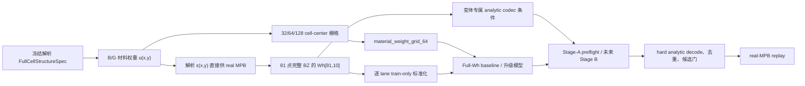

<!--
  End-to-end physics and data formula guide for the unified phc2d workspace.
  Author: fangtoast
  Email: fangtoast@foxmail.com
  Copyright (c) 2026 fangtoast. All rights reserved.
-->

<a id="phc2d-physics-data-formula-guide"></a>
<a id="formula-guide-home"></a>

# phc2d 端到端物理与数据公式手册

| Metadata | Value |
|---|---|
| Status | Draft；等待人类负责人接受本次全胞同步修订 |
| Created | 2026-08-03 |
| Evidence updated | 2026-08-13 |
| Primary layer | L2 方法架构；读取 L3 结果但不改变实验状态 |
| Audience | 研究生、导师、模型与数据实现维护者 |
| Reading time | 约 35 分钟 |

> 范围：当前统一仓库已经实现的全胞双路线结构生成、MPB 数据、Full-Wh 正向模型、场物理、训练损失、解析参数逆向预检与 real-MPB replay 合同。
>
> 非目标：本文不把 threshold proxy、CPU preflight、Stage-B 计划或 surrogate 指标写成 real-MPB inverse 验证，也不展开 MaxwellNet、cINN、diffusion 等参考模型。

本文回答的是“一个解析周期结构如何变成可训练数据、模型优化的量是什么、最终又由什么物理证据复核”。公式按当前源码、全胞 50k 冻结配置与 V2 专用分支逐项回链；通用定义与当前配置常数严格分开。模型清单和结果状态仍以 [`phc2d_model_inventory_v1.yaml`](phc2d_model_inventory_v1.yaml)、[全胞模型报告](全胞双路线正向与逆向模型报告_20260810.md)及 [`PROJECT_MAP.md`](../../PROJECT_MAP.md) 为准。

[项目地图](../../PROJECT_MAP.md) · [文档目录](../README.md) · [完整项目报告](phc2d_project_full_introduction_20260724.md#project-report-home) · [当前实验进展](../results/README.md)

> 本手册冻结公式、数据与评价定义，不把历史数值自动升级为修正后结果。当前可引用结果和阻塞状态仍以结果索引及源 artifacts 为准。



| 路线 | 输入结构与主训练字段 | 物理标签 | 固定 split | 当前角色 |
|---|---|---|---|---|
| B full-cell 50k | binary `FullCellStructureSpec`；`material_weight_grid_64` | real-MPB `Wh[81,10]` | 40k/5k/5k | 当前正向正式主证据 |
| G full-cell 50k | graded `FullCellStructureSpec`；`material_weight_grid_64` | real-MPB `Wh[81,10]` | 40k/5k/5k | 当前正向正式主证据 |
| full-cell inverse 10k | 变体专属解析参数 codec；条件 `Wh[81,10]` | hard decode 后未来 real-MPB replay | 8k/1k/1k | codec、CPU/WSL preflight 已过；正式训练未执行 |
| p4m V2 10k | `rho_wedge[36]` / `epsilon_grid[16,16]` | `Wh[31,10]` 或场标签 | 6875/2500/625 | 历史基线、Query 与 Field/PINO 专用分支 |

## 1. 公式分类、条目模板与统一符号

### 1.1 六类公式不能混用

| 类别 | 回答的问题 | 例子 | 证据含义 |
|---|---|---|---|
| 物理定律 | 连续介质中必须满足什么 | Maxwell curl–curl、Bloch 周期条件 | 物理模型 |
| 数值离散 | 连续方程如何在网格上计算 | MPB 平面波离散、Bloch 回绕中心差分 | 求解或残差近似 |
| 数据变换 | 数组如何生成、编码和归一化 | full-cell 解析结构、p4m 展开、复场六通道、z-score | 数据表示 |
| 训练损失 | 参数更新最小化什么 | MSE、phase-invariant field loss、PINO loss | 优化目标 |
| 评价指标 | 结果如何报告和比较 | MRE、ordering violation、replay gap | 性能证据 |
| 当前配置常数 | 本轮数据或实验采用什么数值 | BZ `9×9`、输入 64、$N_b=10$、split 40k/5k/5k | 可更换配置，不是定律 |

后续新增公式时，统一记录五项：**公式含义、符号与形状、归一化或单位、源码/配置来源、当前状态**。同名数值若出现在训练和 replay 中，也必须分别标注证据层级。

### 1.2 统一符号

| 符号 | 含义 | 典型形状或单位 |
|---|---|---|
| $S$ | 可序列化解析周期结构 `FullCellStructureSpec` | generator family、参数、材料与 provenance |
| $u(\mathbf r)$ | full-cell 材料权重 | $[0,1]$；B route 为二值，G route 为连续 |
| $\rho$、$\rho_{\rm wedge}$ | p4m 专用分支的独立楔区变量 | $[N_w]$，无量纲 |
| $\chi$ | p4m 展开后的材料占据指示量 | $[N_x,N_y]$，通常为 $0/1$ |
| $\varepsilon$ | 相对介电常数网格 | $[N_x,N_y]$，无量纲 |
| $\mathbf k=(k_x,k_y)$ | MPB reduced reciprocal coordinate | $[2]$，无量纲 |
| $N_k$ | Bloch 波矢点数 | 当前 full-cell 为 $81$；p4m V2 路径为 $31$ |
| $N_b$ | 保留的频带数 | 当前两条路线均为 $10$ |
| $W_h$ | Full-Wh 频带矩阵 | 当前 full-cell 为 $[81,10]$ |
| $\omega$ | 角频率；上下文注明是否为物理量或归一化量 | rad/s，或归一化单位 |
| $f$ | MPB 无量纲频率 | $f=\omega a/(2\pi c)=a/\lambda$ |
| $\mathbf E,\mathbf H$ | 复数 Bloch 本征场 | 场网格上的复数组 |
| $K$ | 每个逆向条件采样的候选数 | 配置或评估参数 |

这里的 $81$、$31$、$10$、$64\times64$ 与 $16\times16$ 都只是相应数据合同的配置值。代码中的形状应由 schema、dataset metadata、`DataRepresentationSpec`、`TargetSpec` 或配置派生，不能解释为模型硬编码。

<a id="formula-structure-data"></a>

## 2. 结构生成与 MPB 数据构造

### 2.1 当前全胞解析结构合同

当前主数据不再从固定像素拓扑出发，而是先冻结可完整重建的解析周期结构

$$
S=(\text{family},\text{material kind},\boldsymbol\eta,
\varepsilon_{\rm air},\varepsilon_{\rm mat},\text{provenance}),
$$

其中 $\boldsymbol\eta$ 是变体专属参数。`sample_id` 标识样本，`geometry_hash` 对去除易变 metadata
后的 canonical JSON 求 SHA-256。相同 $S$ 同时驱动解析材料回调、32/64/128 栅格、inverse codec
和 replay；PNG、某个 raster 或 padding 后的参数数组都不是结构真值。

- **来源**：[`data/full_cell.py`](../../src/phc2d/data/full_cell.py)、[全胞模型报告](全胞双路线正向与逆向模型报告_20260810.md)。
- **状态**：数据合同已实现；B/G 50k real-MPB 数据已冻结并用于正式正向评估，但本轮不新增
  50k WSL 跨环境物理验收主张。仓库明确通过固定 WSL 验收的是两份 full-cell 10k 数据。

### 2.2 周期坐标与 Fourier 基

对单位周期胞 $[-\tfrac12,\tfrac12)^2$，中心 $c$ 到坐标 $t$ 的最短周期差定义为

$$
d_{\mathbb T}(t,c)=\operatorname{mod}\!\left(t-c+\frac12,1\right)-\frac12.
$$

二维周期 Fourier 场写为

$$
q_F(x,y)=\sum_{\ell}
\left[a_\ell\cos 2\pi(m_\ell x+n_\ell y)
+b_\ell\sin 2\pi(m_\ell x+n_\ell y)\right].
$$

该基同时用于 G route 的连续扰动和 B route 的 spectral-threshold family。$m_\ell,n_\ell$
是冻结的整数 mode，$a_\ell,b_\ell$ 是解析参数。

### 2.3 G route：RBF–Fourier–logistic 连续介质

第 $r$ 个周期椭圆 RBF 的旋转局部坐标为

$$
\begin{aligned}
\Delta x_r&=d_{\mathbb T}(x,c_{x,r}),\qquad
\Delta y_r=d_{\mathbb T}(y,c_{y,r}),\\
x_r'&=\cos\alpha_r\,\Delta x_r+\sin\alpha_r\,\Delta y_r,\\
y_r'&=-\sin\alpha_r\,\Delta x_r+\cos\alpha_r\,\Delta y_r.
\end{aligned}
$$

未压缩场和连续材料权重为

$$
q_G(x,y)=\sum_r A_r
\exp\!\left[-\frac12\left(
\frac{x_r'^2}{\sigma_{x,r}^2}+\frac{y_r'^2}{\sigma_{y,r}^2}
\right)\right]+\lambda_F q_F(x,y),
$$

$$
u_G(x,y)=\sigma\!\left(\frac{q_G(x,y)-\beta}{T}\right),
\qquad \sigma(z)=\frac{1}{1+e^{-z}}.
$$

实现把 logistic 输入截断到 $[-60,60]$，并要求 $T>0$。当前 G route 包含一核和二核
`graded_rbf_fourier` 两个 inverse 变体；采样器通过二分搜索 $\beta$ 使审计网格上的
$\operatorname{mean}(u_G)$ 接近冻结的目标材料比例。$u_G\in[0,1]$ 表示连续 graded medium。

### 2.4 B route：周期星形空气孔

对第 $h$ 个空气孔中心 $(c_{x,h},c_{y,h})$，令
$\Delta x_h=d_{\mathbb T}(x,c_{x,h})$、$\Delta y_h=d_{\mathbb T}(y,c_{y,h})$、
$d_h=\sqrt{\Delta x_h^2+\Delta y_h^2}$、
$\theta_h=\operatorname{atan2}(\Delta y_h,\Delta x_h)$。孔边界为

$$
R_h(\theta)=r_{0,h}\exp\!\left[
\sum_m\left(a_m\cos m\theta+b_m\sin m\theta\right)
\right].
$$

一个或多个孔的 binary material weight 为

$$
u_B^{\rm polar}(x,y)=
1-\mathbf 1\!\left[\bigvee_h d_h\le R_h(\theta_h)\right].
$$

即孔内为空气权重 0，孔外为材料权重 1。当前对应单孔与双孔两个解析 inverse 变体。

### 2.5 B route：Fourier spectral threshold

自由形状二值 family 先计算周期 Fourier 场，再按阈值硬投影：

$$
u_B^{\rm spectral}(x,y)=\mathbf 1[q_F(x,y)\ge\tau].
$$

采样时每个独立实 Fourier mode 的系数尺度使用低通包络

$$
s_{mn}=\exp\!\left[-\left(
\frac{\sqrt{m^2+n^2}}{k_c}
\right)^4\right],
\qquad a_{mn},b_{mn}\sim\mathcal N(0,s_{mn}^2),
$$

随后把审计网格上的 $q_F$ 标准差归一到 1，并以冻结分位数选择 $\tau$。这些采样辅助量保留在
provenance 中，但 hard geometry 由归一化后的 Fourier 系数和 $\tau$ 唯一确定。

训练数据生成中的频率包络、目标空气比例和结构健康门属于采样合同；真正进入 MPB 的仍是冻结
Fourier 系数与阈值定义出的解析二值函数。供未来 Stage-B 求导的 soft 版本为

$$
\widetilde u_B^{\rm spectral}(x,y)
=\sigma\!\left(\frac{q_F(x,y)-\tau}{T_b}\right),
$$

但 candidate freeze 与 MPB replay 必须使用 hard analytic decoder，不能把 soft raster 当成物理几何。

### 2.6 介电映射、cell-center 重采样与物理真值

三类结构共享材料映射

$$
\varepsilon_S(x,y)=\varepsilon_{\rm air}
+(\varepsilon_{\rm mat}-\varepsilon_{\rm air})u_S(x,y).
$$

对 $R_x\times R_y$ 栅格，cell-center 坐标为

$$
x_j=-\frac12+\frac{j+\tfrac12}{R_x},\qquad
y_i=-\frac12+\frac{i+\tfrac12}{R_y},
$$

并保存 $u_S(x_j,y_i)$ 与 $\varepsilon_S(x_j,y_i)$。当前 HDF5 同步保存 32、64、128
三种分辨率，正向主训练读取 `material_weight_grid_64`。real MPB 则在求解器查询位置直接调用
$\varepsilon_S(x,y)$；因此神经网络 raster resolution、256×256 结构审计栅格与 MPB
`resolution=64` 是三个不同概念。

### 2.7 样本身份、分层 split 与 HDF5 合同

每条 50k lane 满足

$$
N=N_{\rm train}+N_{\rm val}+N_{\rm test}
=40000+5000+5000.
$$

split 先按 generator family/stratum 分层，再以 `SHA256(sample_id)` 稳定排序，并用
largest-remainder 修正精确总数；三组索引必须互斥且恰好覆盖所有样本。B/G 使用不同文件、
不同 split hash 和不同 train-only normalization，同一行号不代表成对结构。

| 字段 | 形状 | 角色 |
|---|---|---|
| `sample_id`、`family_id`、`material_kind` | `[N]` | 样本身份、分层与路线语义 |
| `structure_json` | `[N]` | 完整解析结构与 replay 真值 |
| `params`、`param_mask` | `[N,P]` | 审计/兼容参数；不替代变体专属 codec |
| `material_weight_grid_{32,64,128}` | `[N,R,R]` | 同一解析 $u_S$ 的同步重采样 |
| `epsilon_grid_{32,64,128}` | `[N,R,R]` | 同一解析 $\varepsilon_S$ 的同步重采样 |
| `k_points`、`k_grid_index` | `[81,2]` | reduced coordinate 与整数网格索引 |
| `Wh` | `[N,81,10]` | real-MPB TE Full-Wh 标签 |
| `idx_train/val/test` | 一维索引 | 冻结且互斥的数据划分 |

- **来源**：[`generators/full_cell.py`](../../src/phc2d/generators/full_cell.py)、[`data/full_cell.py`](../../src/phc2d/data/full_cell.py)、[`data/full_cell_generation.py`](../../src/phc2d/data/full_cell_generation.py)、[`forward/full_cell.py`](../../src/phc2d/forward/full_cell.py)。
- **状态**：B/G 50k HDF5 与正式正向评估已完成；数据通过物理门不等于 inverse replay 已完成。

### 2.8 历史 p4m：Bernoulli wedge 采样

当前 V2 `legacy_random` 生成器对楔区各变量独立采样：

$$
\rho_i\sim\operatorname{Bernoulli}(p_{\rm high}),\qquad
\Pr(\rho_i=1)=p_{\rm high}.
$$

- **含义**：先只在 p4m 独立楔区产生二值材料变量。
- **当前配置**：$p_{\rm high}=0.32$，seed 为 `20260619`；这是数据分布参数，不是物理常数。
- **来源**：[`query_dataset_v2_pilot_10000.yaml`](../../configs/research/query_dataset_v2_pilot_10000.yaml)。
- **状态**：已实现的历史 p4m V2 数据生成流程。

### 2.9 历史 p4m：wedge 长度、半边尺寸与完整网格

对偶数正方形网格，令半边尺寸为 $m$，完整边长为 $n=2m$。三角楔区变量数为

$$
N_w=\sum_{r=1}^{m}r=\frac{m(m+1)}{2},\qquad
m=\frac{\sqrt{8N_w+1}-1}{2},\qquad n=2m.
$$

当前 $n=16$，所以 $m=8$、$N_w=36$。`infer_square_grid_shape_from_wedge_length` 会验证反解结果确为整数三角数，而不是默认假设固定尺寸。

### 2.10 历史 p4m：$D_4$/p4m 八种对称展开

令像素坐标为 $(r,c)$，$L=n-1$。当前 lifting 对每个楔区像素应用八个方形对称变换：

$$
\begin{aligned}
&(r,c),\ (c,L-r),\ (L-r,L-c),\ (L-c,r),\\
&(r,L-c),\ (L-r,c),\ (c,r),\ (L-c,L-r).
\end{aligned}
$$

所有像素轨道赋同一 $\rho_i$，得到完整占据网格 $\chi=\operatorname{Lift}_{p4m}(\rho)$。边界或对称轴上的重复坐标自然合并。

- **归一化/单位**：纯索引映射，无物理单位。
- **来源**：[`data/lift.py`](../../src/phc2d/data/lift.py)。
- **状态**：已实现的 p4m lifting；不是当前 full-cell 解析结构生成器。

### 2.11 历史 p4m：从占据量到介电常数

$$
\varepsilon(\mathbf r)=\varepsilon_{\rm air}+
\left(\varepsilon_{\rm material}-\varepsilon_{\rm air}\right)\chi(\mathbf r).
$$

当前配置为 $\varepsilon_{\rm air}=1.0$、$\varepsilon_{\rm material}=8.9$。$\chi=0$ 对应空气，$\chi=1$ 对应材料；连续候选则对应两者之间的插值，送入 MPB replay 前仍需按 replay 协议二值化。

- **来源**：[`data/lift.py`](../../src/phc2d/data/lift.py)、[`query_dataset_v2_pilot_10000.yaml`](../../configs/research/query_dataset_v2_pilot_10000.yaml)。
- **状态**：通用映射已实现；材料数值属于当前配置。

### 2.12 历史 p4m：MPB 像素块的尺寸、中心与填充率

当前 MPB block geometry 强制正方形网格 $N_x=N_y=n$，每个材料像素对应周期胞内一个块：

$$
\Delta x=\Delta y=\frac{1}{n},
$$

$$
x_i=-\frac12+\left(i+\frac12\right)\Delta x,\qquad
y_j=-\frac12+\left(j+\frac12\right)\Delta y.
$$

块尺寸为 $(\Delta x,\Delta y)$，中心为 $(x_i,y_j)$。二值结构的离散填充率是

$$
\phi=\frac{1}{N_xN_y}\sum_{i,j}\chi_{ij}.
$$

源码只为高介电像素建立材料块，空气是背景介质。当前 V2 的 $16\times16$ 是配置派生尺寸，MPB `resolution=64` 是每晶格常数的求解离散率，二者不是同一个网格概念。

- **来源**：[`solvers/mpb.py`](../../src/phc2d/solvers/mpb.py)。
- **状态**：real MPB 数据与 replay 共用的几何构造。

### 2.13 通用候选健康度与距离

对阈值化结构 $b_{ij}=\mathbf 1[\rho_{ij}\ge\tau]$，两候选的归一化 Hamming 距离为

$$
d_H(b^{(p)},b^{(q)})=
\frac{1}{N}\sum_{u=1}^{N}\mathbf 1[b_u^{(p)}\ne b_u^{(q)}].
$$

候选集平均 diversity 为所有无序候选对距离的均值；unique rate 为不同二值向量数除以候选数。当前健康检查还报告最近邻 Hamming 的 mean、min、p10。

对四邻域二值网格，材料面积（像素数）和当前实现的内部界面总变差为

$$
A=\sum_u b_u,
\qquad
P_{\rm TV}=\sum_{(u,v)\in\mathcal E_{\rm internal}}|b_u-b_v|.
$$

其中 $\mathcal E_{\rm internal}$ 只包含网格内部的水平和垂直邻接边；当前字段名是 `total_variation`，不含外边界项，因此不能误称为完整几何周长。连通域数 $C$ 由值为 1 的像素四连通分量计数，并报告最大连通域占材料面积比例 $A_{\max}/\max(A,1)$、最小连通域像素数和孤立像素数。这些是结构描述量或筛选量，不是 Maxwell 方程。具体统计以 [`inverse/morphology.py`](../../src/phc2d/inverse/morphology.py) 和 [`inverse/candidates.py`](../../src/phc2d/inverse/candidates.py) 的实现字段为准。

### 2.14 历史 p4m V2 数据划分

当前 10,000 样本 V2 pilot 的划分是

$$
N=N_{\rm train}+N_{\rm val}+N_{\rm test}
=6875+2500+625.
$$

比例约为 $68.75\%/25\%/6.25\%$。这是当前数据配置，不是任意数据集必须遵守的比例。

<a id="formula-mpb-bloch"></a>

## 3. MPB 与 Bloch 本征问题

### 3.1 Maxwell curl–curl 本征方程

无源、线性、非磁性介质中的磁场本征问题可写为

$$
\nabla\times\left(\frac{1}{\varepsilon(\mathbf r)}
\nabla\times\mathbf H_{n\mathbf k}(\mathbf r)\right)
=\left(\frac{\omega_{n\mathbf k}}{c}\right)^2
\mathbf H_{n\mathbf k}(\mathbf r).
$$

等价的电场形式在当前 TE 场残差中写成

$$
\nabla\times\nabla\times\mathbf E
-\left(\frac{\omega}{c}\right)^2\varepsilon\mathbf E=0.
$$

- **含义**：给定周期介电结构与 Bloch 波矢，求允许的本征频率和本征场。
- **状态**：MPB 求解完整本征问题；训练中的有限差分 residual 只是对预测场的离散一致性检查。

### 3.2 Bloch 周期条件

对任意晶格矢量 $\mathbf R$，

$$
\mathbf F_{n\mathbf k}(\mathbf r+\mathbf R)
=e^{i\mathbf k\cdot\mathbf R}\mathbf F_{n\mathbf k}(\mathbf r),
\qquad \mathbf F\in\{\mathbf E,\mathbf H\}.
$$

代码中的 $\mathbf k$ 使用 MPB reduced reciprocal coordinates，因此跨越单位胞 $x/y$ 边界的相位分别为

$$
p_x=e^{i2\pi k_x},\qquad p_y=e^{i2\pi k_y}.
$$

### 3.3 当前全胞 $9\times9$ 完整第一布里渊区网格

`build_full_bz_grid(n)` 要求 $n$ 为正奇数，并按整数索引生成 centered、无边界重复的方形网格：

$$
\mathcal I_n=
\left\{-\frac{n-1}{2},\ldots,\frac{n-1}{2}\right\}^2,
\qquad
\mathbf k_{pq}=\left(\frac{p}{n},\frac{q}{n}\right),
\quad(p,q)\in\mathcal I_n.
$$

当前 $n=9$，所以 $p,q\in\{-4,\ldots,4\}$、$N_k=n^2=81$。这些是 MPB reduced
reciprocal coordinates；方形晶格上若 $\mathbf a_i\cdot\mathbf b_j=2\pi\delta_{ij}$，则

$$
\mathbf k_{\rm phys}=k_x\mathbf b_1+k_y\mathbf b_2,
\qquad
\mathbf k=\frac{a}{2\pi}\mathbf k_{\rm phys}.
$$

因此跨单位胞相位仍是 $e^{i2\pi k_x}$、$e^{i2\pi k_y}$。$9\times9$ 网格覆盖完整方形
第一 BZ 的离散内部代表点，不是 $\Gamma-X-M-\Gamma$ 高对称路径，也不应按路径累计弧长绘图。

- **来源**：[`data/full_cell.py`](../../src/phc2d/data/full_cell.py)、两条 50k 冻结数据合同。
- **状态**：当前 full-cell `Wh[81,10]` 的物理坐标合同。

### 3.4 历史 p4m：$\Gamma-X-M-\Gamma$ 路径与累计弧长

当前方形晶格路径节点为

$$
\Gamma=(0,0),\qquad X=(0.5,0),\qquad
M=(0.5,0.5),\qquad \Gamma_{\rm end}=(0,0).
$$

对离散点 $\mathbf k_0,\ldots,\mathbf k_{N_k-1}$，绘图横坐标使用累计弧长

$$
s_0=0,\qquad
s_j=s_{j-1}+\|\mathbf k_j-\mathbf k_{j-1}\|_2.
$$

MPB 数据中的 $\mathbf k=(k_x,k_y)$ 与第 3.3 节使用同一 reduced reciprocal coordinate
约定，故方形晶格上 $\mathbf k=(a/2\pi)\mathbf k_{\rm phys}$；这与代码中的 Bloch 回绕因子
$e^{i2\pi k_x}$、$e^{i2\pi k_y}$ 一致。

当前 V2 每段共享端点，总计 $N_k=31$，segment index 为 $0$–$10$、$10$–$20$、$20$–$30$。首尾都是 $\Gamma$，但它们是路径上两个不同位置：索引 $0$ 和 $30$；不能因坐标相同而去重。

- **来源**：[`query_dataset_v2_pilot_10000.yaml`](../../configs/research/query_dataset_v2_pilot_10000.yaml)、[`query_dataset_v2_pilot_10000_mpb.kpath.v1.json`](../../data/metadata/query_dataset_v2_pilot_10000_mpb.kpath.v1.json)。
- **状态**：已实现的 p4m V2/Field 专用 k-path 约定。

### 3.5 MPB 无量纲频率

$$
f_{jn}=\frac{\omega_{jn}a}{2\pi c}=\frac{a}{\lambda_{jn}}.
$$

$a$ 是晶格常数。当前配置取 $a=1$；输出仍应称为 MPB dimensionless frequency，而不是 Hz。若改变 $a$，同一无量纲结果可按实际尺度还原波长。

### 3.6 TE/TM、guard bands 与 $W_h$

MPB 按配置选择 TE 或 TM parity 求解。当前 full-cell 与 p4m V2 主数据均为 TE，要求保留
$N_b=10$ 条频带，同时额外求解 $N_g=4$ 条 guard bands：

$$
N_{\rm solve}=N_b+N_g=14.
$$

每个 $\mathbf k_j$ 的有效频率先按升序对齐，再截取前 $N_b$ 条：

$$
f_{j,(1)}\le f_{j,(2)}\le\cdots\le f_{j,(N_b)},
$$

$$
W_h=\left[f_{jn}\right]
\in\mathbb R^{N_k\times N_b}.
$$

guard bands 用于提高截断边界附近的稳健性，不改变最终 target 的形状。full-cell 的
$N_k=81$，p4m V2 路径的 $N_k=31$；两者不能按相同行号或 k 索引互换。MPB 是产生 `Wh`
和场标签的物理本征求解器；Full-Wh、Query 和 field 网络只是从有限数据学习的近似代理，
不能替代 real-MPB 证据。

- **来源**：[`solvers/mpb.py`](../../src/phc2d/solvers/mpb.py)、[`query_dataset_v2_pilot_10000.yaml`](../../configs/research/query_dataset_v2_pilot_10000.yaml)。
- **状态**：full-cell 与 p4m 的 10+4 band 求解均已实现；具体几何入口和 k 集合按各自合同区分。

<a id="formula-representation"></a>

## 4. 数据表示与归一化

### 4.1 当前 full-cell Full-Wh 表示

对 lane $\ell\in\{B,G\}$，当前正向主任务为

$$
F_{\phi}^{(\ell)}:
u_{S,64}\in[0,1]^{64\times64}
\longmapsto
\widehat W_h^{(\ell)}\in\mathbb R^{N_k\times N_b},
$$

其中当前 $N_k=81$、$N_b=10$。图像模型在 batch 维外增加单通道轴；展平模型使用相同
row-major 栅格的向量形式。输入 `material_weight_grid_64` 不再额外按数据集统计标准化；target
则按对应 lane 的 train split 在每个 $(k,b)$ 位置独立标准化：

$$
\mu_{kb}^{(\ell)}=\frac1{N_{\rm train}}
\sum_{i\in\mathcal T_\ell}W_{i,kb}^{(\ell)},
$$

$$
\sigma_{kb}^{(\ell)}=max\!\left(
\sqrt{\frac1{N_{\rm train}}
\sum_{i\in\mathcal T_\ell}
\left(W_{i,kb}^{(\ell)}-\mu_{kb}^{(\ell)}\right)^2},10^{-6}\right),
$$

$$
Z_{i,kb}^{(\ell)}=
\frac{W_{i,kb}^{(\ell)}-\mu_{kb}^{(\ell)}}
{\sigma_{kb}^{(\ell)}}.
$$

validation/test 不参与 $\mu,\sigma$ 拟合。dual-lane 模型仍分别保存 B/G 两套统计量；共享参数
不等于共享 normalization。

- **来源**：[`forward/full_cell.py`](../../src/phc2d/forward/full_cell.py)、[`forward/full_cell_dual_lane.py`](../../src/phc2d/forward/full_cell_dual_lane.py)。
- **状态**：50k 正向训练与评估的当前数据接口。

### 4.2 历史 p4m：Full-Wh 与 Query 样本

Full-Wh 前向任务是

$$
F_{\phi}^{\rm full}:\rho\longmapsto \widehat W_h,\qquad
\widehat W_h\in\mathbb R^{N_k\times N_b}.
$$

Query 任务把每个结构和单个查询点组成样本：

$$
F_{\psi}^{\rm query}:(\rho,\mathbf k)\longmapsto
\widehat{\mathbf w}(\mathbf k),\qquad
\widehat{\mathbf w}\in\mathbb R^{N_b}.
$$

两者可在相同离散 k-path 上重排比较，但输入接口和训练样本粒度不同。

### 4.3 Field/PINO 专用输入和 context

当前 `fno_field_v2` 的网格输入为 5 通道：归一化介电常数加周期坐标编码，

$$
\widetilde\varepsilon=
\frac{\varepsilon-\varepsilon_{\min}}
{\varepsilon_{\max}-\varepsilon_{\min}},
$$

$$
\mathbf x_{\rm grid}=
[\widetilde\varepsilon,sin(2\pi x),\cos(2\pi x),
\sin(2\pi y),\cos(2\pi y)].
$$

context 为

$$
\mathbf c=
\left[\frac{k_x}{k_{\rm scale}},
\frac{k_y}{k_{\rm scale}},
\widetilde b\right],
$$

其中当前 $k_{\rm scale}=0.5$，band 范围为 one-based 2–10，$\widetilde b$ 是依据该范围缩放的 band context。5、3 和 6 分别是当前字段配置的 `grid_channels`、`context_dim` 和 `field_channels`，应由配置读取。

### 4.4 Field/PINO 专用频率变换

场模型的频率头学习 log-frequency z-score：

$$
y_f=\frac{\log f-\mu_{\log f}}{\sigma_{\log f}},
\qquad
\widehat f=\exp(\sigma_{\log f}\widehat y_f+\mu_{\log f}).
$$

$\mu_{\log f}$ 和 $\sigma_{\log f}$ 必须由训练集统计得到，并随 checkpoint/metadata 保存；不能从验证或测试集重新估计。

- **来源**：[`forward/field_eigen_v2.py`](../../src/phc2d/forward/field_eigen_v2.py)、[`field_eigen_te_pino_b4_repair_validation_9216.yaml`](../../configs/research/field_eigen_te_pino_b4_repair_validation_9216.yaml)。
- **状态**：当前 field 数据制度已实现。

<a id="formula-field-pino"></a>

## 5. 本征场与 adapted PINO

### 5.1 复数场六实通道

当前 TE 样本保存 $E_x,E_y,H_z$ 三个复分量，并编码为

$$
\mathbf y_{\rm field}=
[\Re E_x,\Re E_y,\Re H_z,\Im E_x,\Im E_y,\Im H_z]
\in\mathbb R^{6\times N_x^f\times N_y^f}.
$$

这是可逆的数据编码，不把复场当作六个互不相关的物理量。

### 5.2 能量归一化与公共相位固定

对广义电场本征问题，电场空间使用介电常数分布作为度规：

$$
\langle\mathbf E_1,\mathbf E_2\rangle_{\varepsilon}
=\int_{\Omega}\mathbf E_1^*(\mathbf r)\cdot
\varepsilon(\mathbf r)\mathbf E_2(\mathbf r)\,dA,
\qquad
\|\mathbf E\|_{\varepsilon}
=\sqrt{\langle\mathbf E,\mathbf E\rangle_{\varepsilon}}.
$$

在场网格上，对分量 $c\in\{x,y\}$ 的离散形式为

$$
\langle\mathbf E_1,\mathbf E_2\rangle_{\varepsilon,h}
=\sum_{i,j}\sum_c
E_{1,c}(i,j)^*\varepsilon_{ij}E_{2,c}(i,j)\,\Delta x\Delta y.
$$

其中复数模平方满足

$$
|a+ib|^2=a^2+b^2.
$$

数据生成先用同一个正实缩放因子同时缩放 E/H，使电场满足

$$
\|\mathbf E\|_{\varepsilon,h}^2
=\sum_{i,j}\varepsilon_{ij}
\left(|E_x(i,j)|^2+|E_y(i,j)|^2\right)
\Delta x\Delta y=1.
$$

Bloch 本征模存在全局复相位自由度：

$$
(\mathbf E,\mathbf H)\sim
e^{i\theta}(\mathbf E,\mathbf H).
$$

当前数据生成实现随后把归一化 E 数组展平，在所有空间点与电场分量中取
$|E|$ 最大位置的复分量作为 anchor $a$；`numpy.argmax` 在并列最大值时取展平顺序中的
第一个位置。再对 E/H 同乘公共相位：

$$
(\mathbf E,\mathbf H)\leftarrow
e^{-i\arg(a)}(\mathbf E,\mathbf H).
$$

因此，“anchor 由 E 场最大值位置确定”这一判断基本准确，但更精确的说法是
“由 E 场**模长最大**的空间点—分量确定”。该规范使所选 anchor 为非负实数，适合单场落盘、
复现与可视化；它只为每个样本选定一个相位代表。若两个位置的模长接近或发生交换，anchor
索引及其相位可能跳变，所以它既不保证标签沿参数或 $\mathbf k$ 路径连续，也不应作为两个场
之间 $L_2$ 距离或相似性的对齐规则。

两个场的比较采用介电加权最大重叠相位规范。按本文内积约定，令

$$
c_{12}=\langle\mathbf E_1,\mathbf E_2\rangle_{\varepsilon,h},
\qquad
e^{i\theta_*}=\frac{c_{12}^*}{|c_{12}|}
=e^{-i\arg c_{12}},\qquad c_{12}\ne0,
$$

则 $e^{i\theta_*}$ 使

$$
\left\|\mathbf E_1-e^{i\theta}\mathbf E_2\right\|_{\varepsilon,h}^2
$$

取得最小值，且

$$
\min_\theta
\left\|\mathbf E_1-e^{i\theta}\mathbf E_2\right\|_{\varepsilon,h}^2
=\|\mathbf E_1\|_{\varepsilon,h}^2
+\|\mathbf E_2\|_{\varepsilon,h}^2
-2|c_{12}|.
$$

当 $c_{12}=0$ 时任意相位都给出同一距离；当 $|c_{12}|$ 接近零时，相对相位数值不稳定。
实现应保留小量保护，并把低重叠样本作为诊断项，而不是从任一场的 anchor 推断相对相位。
第 5.6 节的训练损失与报告指标已经按此最大重叠规则
对齐预测场和真值，并把由 E 得到的同一相位施加到 H；因此当前场比较不依赖两个场各自的
anchor。

若后续要求同一非简并模沿 $\mathbf k$ 路径连续，可只对首个参考场使用单场 anchor，随后令每个
场与前一个已对齐场按最大重叠规则递推对齐。该 parallel-transport 式连续规范**尚未在当前数据
生成链路实现**；在能带交叉、近简并或模态次序交换处，逐模相位对齐仍不充分，应先做模态匹配，
必要时对简并子空间做整体对齐。

无论采用单场 anchor 还是两场最大重叠，H 都不独立归一化或独立定相；它沿用由 E 得到的缩放
和相位，以保留 E/H 的相对相位及 Maxwell 关系。

- **来源**：[`data/field_eigen.py`](../../src/phc2d/data/field_eigen.py)、[`forward/field_eigen_v2.py`](../../src/phc2d/forward/field_eigen_v2.py)、[`physics/eigen_residual.py`](../../src/phc2d/physics/eigen_residual.py)、[电场度规勘误](../results/field-physics/field_electric_metric_correction_20260803.md)。
- **状态**：单场最大模长 anchor 与两场最大重叠比较均已实现；沿 $\mathbf k$ 路径的连续规范及简并子空间对齐尚未实现。

### 5.3 带 Bloch 相位回绕的中心差分

内部网格使用中心差分

$$
D_xu_{i,j}=\frac{u_{i+1,j}-u_{i-1,j}}{2\Delta x}.
$$

在 $x$ 边界，越过右边界的样本乘 $p_x=e^{i2\pi k_x}$，越过左边界的样本乘 $p_x^*$；$y$ 方向同理。这一回绕是 Bloch 条件的数值离散，不是普通 periodic padding。

### 5.4 TE curl–curl 残差

定义

$$
C_z=D_xE_y-D_yE_x.
$$

当前 TE E-field residual 的两个分量为

$$
r_x=D_yC_z-\Omega^2\varepsilon E_x,\qquad
r_y=-D_xC_z-\Omega^2\varepsilon E_y,
$$

其中 $\Omega=2\pi f$ 与 MPB 的无量纲频率约定一致。残差能量、尺度能量和相对残差为

$$
R^2=\sum_{i,j}(|r_x|^2+|r_y|^2)\Delta x\Delta y,
$$

$$
S^2=\sum_{i,j}\left(
|\Omega^2\varepsilon E_x|^2+|\Omega^2\varepsilon E_y|^2
\right)\Delta x\Delta y,
$$

$$
r_{\rm rel}=\frac{R}{\max(S,10^{-12})}.
$$

边界相对残差使用同一公式，但求和区域限制到网格外圈 $\partial\Omega_h$。它用于识别 Bloch 回绕处的误差集中。

第 5.2 节归一化的是
$\sum\varepsilon(|E_x|^2+|E_y|^2)\Delta x\Delta y=1$，而这里

$$
S^2=\Omega^4\sum\varepsilon^2
(|E_x|^2+|E_y|^2)\Delta x\Delta y,
$$

多了 $\Omega^4$ 且介电权重变为 $\varepsilon^2$，所以 $S$ 一般不等于 1。保留 $R/S$ 可以消除
场整体幅度和方程右端尺度的影响；它不能因 E 的能量归一化而退化为 absolute residual。

### 5.5 Rayleigh 频率

令离散 curl–curl 算子结果为 $\mathcal L_h\mathbf E$，Rayleigh 商给出

$$
\Omega_R^2=
\frac{\Re\langle\mathbf E,\mathcal L_h\mathbf E\rangle}
{\langle\mathbf E,\varepsilon\mathbf E\rangle},
\qquad
f_R=\frac{\sqrt{\max(\Omega_R^2,0)}}{2\pi}.
$$

只有 $\Omega_R^2>0$ 时标记为有效。Rayleigh consistency 比较预测频率与 $f_R$，但它仍依赖该离散算子，不能当作一次独立 MPB 求解。

### 5.6 相位不变 E/H 场损失

对第 $n$ 个样本的预测复场 $\widehat{\mathbf E}_n$ 与目标 $\mathbf E_n$，先由介电加权电场内积求最大重叠公共相位

$$
\alpha_n=
\frac{\langle\widehat{\mathbf E}_n,\mathbf E_n\rangle_{\varepsilon,h}}
{\max\!\left(|\langle\widehat{\mathbf E}_n,\mathbf E_n\rangle_{\varepsilon,h}|,\delta\right)}.
$$

这里取 $\mathbf E_1=\mathbf E_n$、$\mathbf E_2=\widehat{\mathbf E}_n$；利用内积的共轭对称性，上式与第 5.2 节的
$e^{-i\arg\langle\mathbf E_1,\mathbf E_2\rangle}$ 完全等价。代码求相位时省略了每个网格点共有的
$\Delta x\Delta y$，因为该正实因子在通常的非退化分支中约去。当前实现取 $\delta=10^{-12}$；
当内积模长小于 $\delta$ 时，$|\alpha_n|<1$，这是防止除零的数值保护，不再是严格的单位模相位。
对齐场为

$$
(\widehat{\mathbf E}_n^{\rm align},
\widehat{\mathbf H}_n^{\rm align})
=\alpha_n(\widehat{\mathbf E}_n,\widehat{\mathbf H}_n).
$$

同一个 $\alpha_n$ 同时用于 E/H，以保留两者的相对相位。报告中的逐样本 relative $L_2$ 为

$$
e_{E,n}=
\frac{\|\widehat{\mathbf E}_n^{\rm align}-\mathbf E_n\|_{\varepsilon,h}}
{\|\mathbf E_n\|_{\varepsilon,h}+\delta},
\qquad
e_{H,n}=
\frac{\|\widehat{\mathbf H}_n^{\rm align}-\mathbf H_n\|_{2,h}}
{\|\mathbf H_n\|_{2,h}+\delta}.
$$

最终指标先逐样本计算，再取算术平均：

$$
\overline e_E=\frac1B\sum_{n=1}^{B}e_{E,n},
\qquad
\overline e_H=\frac1B\sum_{n=1}^{B}e_{H,n}.
$$

训练时使用的是相对 $L_2$ 的平方并在 batch 上求均值：

$$
\mathcal L_E=\frac1B\sum_{n=1}^{B}e_{E,n}^2,
\qquad
\mathcal L_H=\frac1B\sum_{n=1}^{B}e_{H,n}^2.
$$

因此训练日志中的 $\mathcal L_E$、$\mathcal L_H$ 不能直接和报告中的 $\overline e_E$、$\overline e_H$ 比较。对满足第 5.2 节新契约的目标 E，$\|\mathbf E_n\|_{\varepsilon,h}=1$，所以带 $\Delta x\Delta y$ 的 E relative $L_2$ 理论分母为 1。实现仍显式计算分母，以兼容旧 HDF5、`complex64` 落盘误差和契约审计；指标代码在分子、分母中同时省略公共的 $\Delta x\Delta y$，所以其原始离散和分母不必数值等于 1，但最终比值与上式相同。H 未独立归一化，因此其分母一般不为 1。

频率监督为

$$
\mathcal L_f=\operatorname{MSE}(\widehat y_f,y_f).
$$

> **实现核对：** 在当前 `field_eigen_v2` 训练器中，$y_f$ 不是原始频率，而是 MPB 无量纲频率 $f$ 的对数标准化值：$y_f=(\log f-\mu_{\log f})/\sigma_{\log f}$；$\widehat y_f$ 是模型 frequency head 的直接输出。预测的物理表示通过 $\widehat f=\exp(\sigma_{\log f}\widehat y_f+\mu_{\log f})$ 还原。因此 $\mathcal L_f$ 是在标准化 log-frequency 空间中的 MSE。$\mu_{\log f}$ 和 $\sigma_{\log f}$ 由训练归一化集合计算；启用 dense frequency supervision 时，该集合还包含实现加载的 dense-frequency 训练样本。

当前 field data loss 为

$$
\mathcal L_{\rm data}=1.0\left(0.5\mathcal L_E+0.5\mathcal L_H\right)
+0.1\mathcal L_f.
$$

> **概念边界：** $\mathcal L_E$、$\mathcal L_H$ 和 $\mathcal L_f$ 都通过预测值与 real-MPB 标签比较，因而全部属于监督数据误差；$\mathcal L_E/\mathcal L_H$ 使用介电加权、公共相位对齐等物理合适的度量，但不直接衡量 Maxwell 方程是否满足。当前实现中真正称为 physics loss 的是下一节由离散 Maxwell residual 与场归一化项组成的 $\mathcal L_{\rm phys}$；$\mathcal L_R$ 则是额外的 Rayleigh 一致性项。

### 5.7 PINO residual、归一化与 Rayleigh 项

对分辨率 $q$ 的相对残差平方 $r_{{\rm rel},q}^2$ 和由验证集 real-MPB 场校准的 solver floor $s_q$，

$$
\mathcal L_{{\rm res},q}=
\mathbb E\left[\log\left(1+\frac{r_{{\rm rel},q}^2}{s_q^2}\right)\right],
$$

$$
\mathcal L_{{\rm norm},q}=
\mathbb E\left[(\|\widehat{\mathbf E}\|_{\varepsilon,q}-1)^2\right],
$$

$$
\mathcal L_{{\rm phys},q}=
\mathcal L_{{\rm res},q}+0.1\mathcal L_{{\rm norm},q}.
$$

> **实现核对：** 当前训练器直接从配置项 `physics_solver_floor_factors` 读取 $s_{64}=1$、$s_{96}=1.6675113730849558$、$s_{128}=2.479351271327766$。请检查这些数值的来源及含义。

当前多分辨率候选为 $64,96,128$。每个 batch 只轮换选择一个高分辨率 $q_{\rm hi}\in\{96,128\}$，再与监督分辨率 64 聚合：

$$
\mathcal L_{\rm phys}^{\rm multi}=
\frac{\mathcal L_{64}+2\mathcal L_{q_{\rm hi}}}{3}.
$$

若启用 Rayleigh 项，

$$
\mathcal L_R=
\operatorname{MSE}(\log \widehat f,\log f_R).
$$

当前 P4 权重为 $0$，P5 权重为 $0.05$。physics frequency 默认 `detach`，即 residual 不通过频率头反向传播。

> **实现核对：** P1--P5 是递进的实验候选标签，而不是同一个权重的五档取值：P1 使用频率监督权重 $0.1$ 并阻断 PDE 项到频率头的梯度，P2 使用权重 $0.5$ 并保留该梯度，P3 使用权重 $0.5$ 并阻断该梯度；随后 P4 沿用 P1 的设置，加入 dense-$k$ 频率监督和多分辨率 PDE 项，P5 再加入 Rayleigh 一致性项。因此这里所称 P4、P5 的“权重”专指 Rayleigh 一致性系数 $\lambda_R$：P4 取 $0$，P5 取 $0.05$；两者都保留 $\lambda_{\rm pde}$。

### 5.8 $\lambda_{\rm pde}$ warmup-ramp

令 warmup epoch 为 $T_w$、ramp 长度为 $T_r$、目标权重为 $\lambda_*$，则

$$
\lambda_{\rm pde}(t)=
\begin{cases}
0, & t\le T_w,\\
\lambda_*\dfrac{t-T_w}{T_r}, & T_w<t<T_w+T_r,\\
\lambda_*, & t\ge T_w+T_r.
\end{cases}
$$

总损失为

$$
\mathcal L_{\rm field}=\mathcal L_{\rm data}
+\lambda_{\rm pde}(t)\mathcal L_{\rm phys}^{\rm multi}
+\lambda_R\mathcal L_R.
$$

当前 $T_w=20$、$T_r=20$、$\lambda_*=0.01$。这些数值来自 repair-validation 配置，不是 PINO 的普适定义。

### 5.9 residual–frequency 校准与跨分辨率诊断

低 Maxwell residual 只有在它能可靠指示较小的真实频率误差时，才可能成为排序依据。当前 B4 诊断令每个评估记录的 residual 为 $r_i$、frequency MRE 为 $e_i$，使用带并列秩平均处理的 Spearman 相关：

$$
\rho_s=\operatorname{Corr}
\left(\operatorname{Rank}(r_i),\operatorname{Rank}(e_i)\right).
$$

若 residual 越低通常对应 frequency MRE 越低，则期望 $\rho_s>0$。代码按 `source_sample_id` 整组有放回重采样，而不是把同一结构的 k/band 行当作相互独立样本。对 $N_{\rm boot}$ 次 bootstrap 得到的 $\rho_s^{(b)}$，95% 区间为

$$
\operatorname{CI}_{95\%}(\rho_s)=
\left[Q_{0.025}\left(\{\rho_s^{(b)}\}\right),
Q_{0.975}\left(\{\rho_s^{(b)}\}\right)\right].
$$

当前 dense-k 配置使用 $N_{\rm boot}=1000$。除相关系数外，还比较 residual 最低和最高四分位的频率误差。令 $Q_{0.25}(r)$、$Q_{0.75}(r)$ 为 residual 四分位点：

$$
\overline e_{\rm low}=
\operatorname{mean}\{e_i:r_i\le Q_{0.25}(r)\},
\qquad
\overline e_{\rm high}=
\operatorname{mean}\{e_i:r_i\ge Q_{0.75}(r)\},
$$

$$
I_{\rm quartile}=100\%
\frac{\overline e_{\rm high}-\overline e_{\rm low}}
{\max(\overline e_{\rm high},10^{-12})}.
$$

$I_{\rm quartile}>0$ 才表示低 residual 组的频率误差更小。当前准入门要求每个 seed 的 Spearman bootstrap CI 下界严格大于 0，且 $I_{\rm quartile}\ge10\%$。

跨分辨率迁移以 64 为基准。对任一越小越好的指标 $m$，分辨率 $q$ 的相对变化为

$$
\Delta_m(q)=100\%
\left(\frac{m_q}{\max(m_{64},10^{-12})}-1\right).
$$

$\Delta_m>0$ 表示退化，$\Delta_m<0$ 表示改善。当前阈值是 frequency MRE 退化不超过 $2\%$、residual median 退化不超过 $20\%$。

- **来源**：[`forward/field_eigen_b4.py`](../../src/phc2d/forward/field_eigen_b4.py)、[`field_eigen_te_b4_dense_k_gate.yaml`](../../configs/research/field_eigen_te_b4_dense_k_gate.yaml)、[`field_eigen_te_b4_dense_k_admission_20260722.md`](../results/field-physics/field_eigen_te_b4_dense_k_admission_20260722.md)。
- **状态**：校准与跨分辨率公式已实现；当前准入结果仍为 blocked。旧场度规下的 B3/B4 数值只能保留为历史诊断，不能自动升级为修正后结论。

> **证据边界**：仓库中的 adapted PINO 是 `fno_field_v2` 的训练制度，不是另一套 faithful PINO 架构。它当前不能进入 inverse reranking。physics residual 下降只表明预测场更符合该离散残差；它不等于 inverse-design 收益，也不等于 real-MPB replay 通过。

- **来源**：[`forward/field_eigen_v2.py`](../../src/phc2d/forward/field_eigen_v2.py)、[`physics/torch_eigen_residual.py`](../../src/phc2d/physics/torch_eigen_residual.py)、[`field_eigen_te_pino_b4_repair_validation_9216.yaml`](../../configs/research/field_eigen_te_pino_b4_repair_validation_9216.yaml)、[电场度规勘误](../results/field-physics/field_electric_metric_correction_20260803.md)。
- **状态**：已实现的训练/验证制度；inverse 使用状态为 blocked。

<a id="formula-forward-metrics"></a>

## 6. 前向任务、损失与评价指标

### 6.1 当前 full-cell 训练目标与 checkpoint 选择

独立 lane 模型直接预测第 4.1 节的标准化 target $Z$，训练损失为完整矩阵 MSE：

$$
\mathcal L_{\rm full}^{(\ell)}=
\frac{1}{B N_kN_b}
\sum_{i=1}^{B}\sum_{k=1}^{N_k}\sum_{b=1}^{N_b}
\left(\widehat Z_{i,kb}^{(\ell)}-Z_{i,kb}^{(\ell)}\right)^2.
$$

当前 dual-lane loader 每个 batch 各取 32 个 B/G 样本并拼接后使用同一 MSE，因此在等 batch
大小下等价于

$$
\mathcal L_{\rm joint}=\frac12\mathcal L_{\rm full}^{(B)}
+\frac12\mathcal L_{\rm full}^{(G)}.
$$

联合模型共享参数，但每条 lane 的 $Z^{(\ell)}$ 仍由本 lane train split 的 $\mu^{(\ell)}$、
$\sigma^{(\ell)}$ 定义。独立模型按 validation bands 2–10 MRE 选择 checkpoint；联合模型按两条
lane validation MRE 的算术平均选择。test 不参与训练、标准化、head 选择或 checkpoint 选择。

### 6.2 Dense 与 k-conditioned Full-Wh 输出头

设编码器得到结构向量 $z_S\in\mathbb R^d$。当前正式获选的 dense head 为

$$
\widehat Z=\operatorname{reshape}_{N_k\times N_b}
\left(W\operatorname{LN}(z_S)+b\right).
$$

已实现但本轮未获选的 k-conditioned head 先构造坐标 Fourier 特征

$$
\varphi(\mathbf k)=
\left[\mathbf k,
\{\sin(2\pi\nu\mathbf k),\cos(2\pi\nu\mathbf k)\}_{\nu\in\mathcal F}
\right],
$$

再与 band embedding $e_b$ 形成 query：

$$
q_{kb}=Q([\varphi(\mathbf k_k),e_b]),\qquad
h_{ikb}=\operatorname{LN}(Pz_{S_i}+q_{kb}),
$$

$$
\widehat Z_{i,kb}=R(h_{ikb}).
$$

当前 $\mathcal F=\{1,2,4,8\}$，但频率集合和维度均从配置读取。接口上可传入重排或子集
`k_points` 不等于已经证明 unseen-k 泛化；五个 50k 升级模型的 validation head selection 全部选择
`dense`。

### 6.3 `mlp_mixer_band_v1`

输入先自适应平均池化到配置 token grid，再投影并加 learned position：

$$
T^{(0)}=P_{\rm in}\operatorname{vec}_{\rm token}
\left(\operatorname{AAP}(u_S)\right)+P_{\rm pos}.
$$

第 $l$ 个 Mixer block 依次做 token 与 channel mixing：

$$
\widetilde T^{(l)}=T^{(l)}+
\operatorname{DropPath}\!\left(gamma_l^{\rm tok}odot
M_l^{\rm tok}(\operatorname{LN}(T^{(l)})^\top)^\top\right),
$$

$$
T^{(l+1)}=\widetilde T^{(l)}+
\operatorname{DropPath}\!\left(gamma_l^{\rm ch}odot
M_l^{\rm ch}(\operatorname{LN}(\widetilde T^{(l)}))\right).
$$

最终对 token 求均值得到 $z_S$。adaptive pooling 解释了它能接受不同 raster shape，但不是物理
resolution invariance 证明。

### 6.4 `res_mlp_gated_v2`

输入按 row-major 展平并投影。Pre-LN gated residual block 为

$$
n_l=\operatorname{LN}(h_l),\qquad
g_l=\operatorname{GELU}(W_gn_l+b_g)odot(W_vn_l+b_v),
$$

$$
h_{l+1}=h_l+
\operatorname{DropPath}\!\left(gamma_l\odot W_pg_l\right).
$$

该模型已实现并完成正式评估，但 G lane 相对直接 ResMLP 基线退化；负结果必须保留，不能把
“更深、门控、Pre-LN”写成普遍提升规律。

### 6.5 `convnext_band_v1`

每个 ConvNeXt block 只在 depthwise kernel 前显式周期填充：

$$
v_l=\operatorname{DWConv}_{7\times7}
\left(\operatorname{CircularPad}(x_l)\right),
$$

$$
x_{l+1}=x_l+
\operatorname{DropPath}\!\left[
\gamma_l\odot W_2\operatorname{GELU}
\left(W_1\operatorname{LN}(v_l)\right)
\right].
$$

stem 是无 padding 的 patch projection；stage 间 downsample 是 GroupNorm、平均池化和 $1\times1$
投影，不能概括成每一层都做 circular convolution。该模型是当前 B/G native 64×64 held-out
共同最优，但 32/128 直接输入诊断明显退化。

### 6.6 `tfno2d_band_v3` 的 Tucker 频谱分支

对 Fourier 输入 $\widehat x_{i,yx}$，截断窗口内的频谱卷积为

$$
\widehat v_{o,yx}=\sum_i
\widehat x_{i,yx}\,W_{ioyx}.
$$

复权重使用 Tucker 因子化：

$$
W_{ioyx}=\sum_{a,b,c,d}
U^{\rm in}_{ia}U^{\rm out}_{ob}U^y_{yc}U^x_{xd}
\mathcal G_{abcd},
$$

并为第一 Fourier 轴的正、负窗口维护独立因子。第 $l$ 个 operator block 将 spectral、周期局部
卷积和 channel MLP 三分支按可学习 sigmoid gate 合并：

$$
\pi_{l,r}=\sigma(g_{l,r}),\qquad
\Delta_l=\frac{\sum_{r\in\{\rm spec,local,ch\}}\pi_{l,r}B_{l,r}(n_l)}
{\max(\sum_r\pi_{l,r},10^{-6})},
$$

$$
x_{l+1}=\operatorname{GELU}
\left(x_l+\operatorname{DropPath}(\Delta_l)\right).
$$

它是项目原生 Tucker-factorized FNO-style 模型，不是 NeuralOperator 官方 TFNO 的忠实复刻。

### 6.7 `dual_lane_band_operator_v1` 的 lane FiLM

联合模型在每个 operator block 中由 lane embedding $e_\ell$ 产生

$$
[\gamma_\ell,\beta_\ell]=A e_\ell,
\qquad
n_l'=n_l\odot(1+\gamma_\ell)+\beta_\ell,
$$

再将 $n_l'$ 送入第 6.6 节的三分支。B/G 分别编码为 lane 0/1。该模型在训练时同时见过两条
lane，因此 B→G/G→B 的 cross-lane 指标对它不适用；当前正式结果优于旧 FNO，但未达到替代两个
最佳独立模型的 joint gate。

### 6.8 Headline 指标、promotion 与诊断边界

令标量误差 $e_q=\widehat y_q-y_q$、总标量数为 $M$，通用回归指标为

$$
\operatorname{MSE}=\frac1M\sum_q e_q^2,\qquad
\operatorname{MAE}=\frac1M\sum_q |e_q|,
$$

$$
\operatorname{RMSE}=\sqrt{\operatorname{MSE}},\qquad
L_{2,\rm rel}=\frac{\|\widehat{\mathbf y}-\mathbf y\|_2}
{\|\mathbf y\|_2+\epsilon}.
$$

反标准化后，bands 2–$N_b$ 的样本总体 MRE 为

$$
\operatorname{MRE}_{2:N_b}(\%)=
100\cdot\frac{1}{N N_k(N_b-1)}
\sum_{i,k,b=2}^{N_b}
\frac{|\widehat W_{i,kb}-W_{i,kb}|}
{\max(|W_{i,kb}|,10^{-8})}.
$$

对越小越好的指标，候选 B 相对参考 A 的改善率为

$$
I_{A\to B}=100\%
\frac{m_A-m_B}{\max(|m_A|,10^{-12})}.
$$

正式 promotion 先在每个 held-out sample 上对三个固定 seed 的误差取均值，再构造升级模型减基线
的逐样本差，并在 sample 轴做 10,000 次 paired bootstrap；不同 lane 不混合重采样。cross-lane
误差写作

$$
E_{B\to G}=\operatorname{MRE}
\left(D_G;\theta_B,\mu_B,\sigma_B\right),
$$

其中 checkpoint 与 normalization 都沿用训练 lane。输入分辨率退化写作

$$
D_{64\to R}=100\%
\left(\frac{\operatorname{MRE}(u_{S,R};\theta_{64})}
{\operatorname{MRE}(u_{S,64};\theta_{64})}-1\right),
\quad R\in\{32,128\}.
$$

它只改变同一解析结构的神经网络输入 raster，不重算 MPB 标签，不能称为 MPB 收敛、物理跨分辨率
验证或 real-MPB replay。50k final-fit 是训练重叠 monitor；threshold proxy 尚无成功提交的作业，
二者都不是 held-out winner 或物理 inverse 证据。

### 6.9 历史 p4m `band_aware` loss

旧 Full-Wh 路线曾组合 MSE、相对误差、频带排序和沿高对称 k-path 的平滑项：

$$
\begin{aligned}
\mathcal L_{\rm band}={}&w_{\rm mse}\operatorname{MSE}(\widehat W_h,W_h)
+w_{\rm rel}\operatorname{mean}_{j,n\ge2}
\frac{|\widehat W_{h,jn}-W_{h,jn}|}{|W_{h,jn}|+\epsilon}\\
&+w_{\rm ord}\operatorname{mean}_{j,n}
\operatorname{ReLU}(\widehat W_{h,jn}-\widehat W_{h,j,n+1})\\
&+w_{\rm smooth}\operatorname{mean}_{j,n}
(\widehat W_{h,j+1,n}-\widehat W_{h,jn})^2.
\end{aligned}
$$

这是 p4m 高对称路径实验的历史实现，不是当前 full-cell 50k 升级训练目标。若未来重新研究这些
权重，应在固定 validation 协议中记录每项未加权量级、加权贡献与梯度量级；不得根据 test 或
replay 临时调权。
<a id="formula-inverse"></a>

## 7. 逆向生成、目标桥接与候选筛选

### 7.1 当前 full-cell inverse 的五个解析变体

full-cell inverse 不预测统一 padding 参数向量，而是为五个变体分别拟合 codec：

| 变体 | 学习的物理标量数 | 解析 family |
|---|---:|---|
| `binary_polar_holes_1` | 11 | 单周期星形空气孔 |
| `binary_polar_holes_2` | 22 | 双周期星形空气孔 |
| `binary_spectral_threshold` | 289 | Fourier 系数与 threshold |
| `graded_rbf_fourier_1` | 57 | 单 RBF core + Fourier + logistic |
| `graded_rbf_fourier_2` | 63 | 双 RBF core + Fourier + logistic |

固定的 hole count、mode order 和 $(m,n)$ 从变体模板恢复；生成辅助字段不作为独立几何自由度。
每个 codec 只使用该变体 train split 拟合，并保存 codec version、模板、参数名、边界与统计量。

### 7.2 参数编码、hard decode 与 soft raster

中心坐标 $c\in[-\tfrac12,\tfrac12)$ 编码为

$$
\operatorname{enc}_{\rm per}(c)=
[\sin(2\pi c),\cos(2\pi c)],
$$

角度 $\alpha\in[0,2\pi)$ 编码为

$$
\operatorname{enc}_{\rm ang}(\alpha)=
[\sin\alpha,\cos\alpha].
$$

普通标量使用 train-only robust location $q_{0.5}$ 与 scale

$$
s_{\rm rob}=\frac{q_{0.95}-q_{0.05}}{2},
\qquad
z=\frac{x-q_{0.5}}{s_{\rm rob}},
$$

正值参数先取 $\log x$ 再使用同一 robust 变换。若 robust scale 退化，代码依次回退到标准差和
1。周期/角度解码用 `atan2`；hard decode 还必须满足 train-only 扩边后的冻结物理范围，并重建
可序列化 `FullCellStructureSpec`。

对 binary 变体，soft raster 只服务可微训练。spectral family 使用第 2.5 节的 sigmoid；polar
family对孔边界有符号距离使用温度化 sigmoid。最终 candidate、geometry hash 与 MPB replay 一律
使用 hard analytic decode。G route 直接复用第 2.3 节的解析连续公式，不从 raster 反推参数。

### 7.3 Stage-A 条件、三种方法与 $m/z$ 分工

条件 `Wh[81,10]` 使用所属 route 的 train-only $(\mu,\sigma)$ 标准化后展平为 810 维：

$$
c=\operatorname{vec}\!\left(
\frac{W_h-\mu^{(\ell)}}{\sigma^{(\ell)}}
\right).
$$

三个 trainable 方法为

$$
\widehat p=D_\theta(c)
\quad\text{(`direct_inverse_mlp`)},
$$

$$
\widehat p=G_\theta(c,m,z)
\quad\text{(`single_mode_generator` 或 `mixture_conditional_generator`)}.
$$

$m$ 是有限离散 mixture branch：single-mode 固定为一个分支，mixture 当前为四个 mode embedding；
$z\in\mathbb R^{32}$ 是给定分支内的连续随机变化。把 $m$ 合入 $z$ 会丢失显式、可计数的分支覆盖
和 round-robin candidate allocation，因此两者在当前合同中职责不同。该生成器是项目原生
mode-conditioned latent MLP，不是 cVAE、flow 或 diffusion。

### 7.4 Stage-A composite loss

对 codec target $p$、预测 $\widehat p$、soft decoded raster $R(\cdot)$，当前实现为

$$
\mathcal L_{\rm enc}=\operatorname{mean}(\widehat p-p)^2,
\qquad
\mathcal L_{\rm raster}=\operatorname{mean}
\left(R(\widehat p)-R(p)\right)^2.
$$

对每个周期或角度编码对 $(s_j,c_j)$，单位圆约束为

$$
\mathcal L_{\rm circle}=
\operatorname{mean}_j(s_j^2+c_j^2-1)^2.
$$

总损失为

$$
\mathcal L_A=\mathcal L_{\rm enc}
+\lambda_R\mathcal L_{\rm raster}
+\lambda_C\mathcal L_{\rm circle},
$$

当前预检/runner 默认 $\lambda_R=0.1$、$\lambda_C=0.05$。截至 2026-08-13，codec、15-case
CPU/WSL 单 batch forward/backward/checkpoint 合同和小数据 runner smoke 已通过；N40 正式 45-run
Stage A、正式 validation checkpoint 选择均未执行。

### 7.5 Stage B、候选与 replay 的当前边界

Stage B 计划从 Stage-A checkpoint warm start，经 soft analytic decoder 和冻结 Full-Wh surrogate
把梯度传回 generator；candidate freeze 后使用 hard decode、合法性过滤与 geometry-hash 去重，再由
冻结 ranker 排序并进入 real-MPB replay。该数据流和损失接口已写入实验合同，但 full-cell Stage B、
候选冻结和 replay 尚未执行，不能把 50k 正向成功或 Stage-A CPU preflight 写成 inverse 成功。

Field/PINO 当前仍为 `inverse_status=blocked`，不进入 full-cell inverse loss、rerank 或 replay。

### 7.6 历史 p4m：条件生成映射与投影

当前生成器抽象为

$$
G_\theta(W_h^*,m,z)\longmapsto\widehat\rho,
$$

其中 $W_h^*$ 是目标频带，$m$ 是离散混合分支，$z$ 是分支内连续 latent；两者职责与第 7.3 节
相同。连续候选的硬二值投影为

$$
b_i=\mathbf 1[\widehat\rho_i\ge\tau],
$$

当前 $\tau=0.5$。候选去重以投影后的二值向量为 key；需要保留多样性时，再施加最小 pairwise/nearest-neighbor Hamming 间隔。

在阈值前加入零均值、可选空间相关噪声

$$
b_i=\mathbf 1[\widehat\rho_i+\delta_i\ge\tau]
$$

目前只是待验证研究假设，未接入当前候选合同。若实验，应预注册噪声协方差、强度、seed、候选
预算和同池 replay 对照，不能把它写成已实现的多样性来源。

### 7.7 历史 p4m：频带目标与 cross-surrogate consistency

主 surrogate 的目标误差为 band 2–$N_b$ 的相对误差

$$
\mathcal L_{\rm surrogate}=
\operatorname{mean}_{j,n\ge2}
\frac{|F_{\rm full}(\widehat\rho)_{jn}-W^*_{h,jn}|}
{|W^*_{h,jn}|+\epsilon}.
$$

把误差对象从 $\omega$ 改为 $\omega-\omega_0$ 可改变相对误差的参考尺度，但当前实现未采用该
方案。它应作为预注册 validation-only 对照实验，冻结 $\omega_0$、分母下限和目标频带；不得根据
test/replay 选择中心，也不能与当前逐 $(k,b)$ z-score MSE 混称为同一损失。

Full-Wh 与 Query 在相同查询网格上的一致性项为

$$
\mathcal L_{\rm cross}=
\operatorname{mean}_{j,n\ge2}
\frac{|F_{\rm full}(\widehat\rho)_{jn}
-F_{\rm query}(\widehat\rho,\mathbf k_j)_n|}
{|F_{\rm query}(\widehat\rho,\mathbf k_j)_n|+\epsilon}.
$$

实现中 secondary 输出 detach，因此该项只通过候选和 primary 路径提供梯度。

### 7.8 soft complete-gap descriptor

对相邻频带 $n,n+1$，用 softmax/softmin 近似全路径最大下边缘与最小上边缘：

$$
L_n^{\max}\approx T\log\sum_j e^{W_{h,jn}/T},
\qquad
U_{n+1}^{\min}\approx-T\log\sum_j e^{-W_{h,j,n+1}/T}.
$$

归一化 complete-gap descriptor 为

$$
g_n=
\frac{U_{n+1}^{\min}-L_n^{\max}}
{\left(|U_{n+1}^{\min}|+|L_n^{\max}|\right)/2+\epsilon},
$$

$$
\mathcal L_{\rm gap}=\operatorname{MSE}(\widehat{\mathbf g},\mathbf g^*).
$$

$T$ 是平滑温度；该 descriptor 是可微训练代理，不等于 MPB 重新求解得到的真实带隙。

### 7.9 连续/二值 diversity、latent response 与 collision

对同一条件的 $K$ 个连续候选，平均 pairwise 距离记为

$$
d_{\rm cont}=\frac{2}{K(K-1)}
\sum_{p<q}\frac{\|\widehat\rho^{(p)}-\widehat\rho^{(q)}\|_1}{N}.
$$

连续 diversity hinge loss 为

$$
\mathcal L_{\rm div}=\max(0,d^*_{\rm cont}-d_{\rm cont}).
$$

二值 diversity 使用带温度的 soft-binary proxy 替代 $\mathbf1[\cdot]$ 以保留梯度，并用同类 hinge 约束到目标 Hamming。latent response 约束不同 $z$ 的输出标准差：

$$
\mathcal L_{\rm latent}=
\max(0,\sigma^*_{\rho|z}-\operatorname{mean}_u\operatorname{Std}_z[\widehat\rho_u]).
$$

collision 项对每个候选的最近邻 soft-Hamming 距离 $d_i^{\rm nn}$ 施加

$$
\mathcal L_{\rm coll}=
\frac{\sum_i q_i\max(0,d^*_{\rm nn}-d_i^{\rm nn})}
{\sum_i q_i+\epsilon},
$$

其中 $q_i$ 由候选 surrogate quality 的 softmax 得到；当前配置 `quality_detach=true`，不让质量权重本身形成捷径梯度。

### 7.10 历史 p4m Objective-Bridge 总目标

$$
\begin{aligned}
\mathcal L_{\rm obj}={}&
1.0\mathcal L_{\rm surrogate}
+0.03\mathcal L_{\rm recon}
+0.2\mathcal L_{\rm div}\\
&+0.5\mathcal L_{\rm bin-div}
+0.25\mathcal L_{\rm latent}
+0.9\mathcal L_{\rm coll}\\
&+0.2\mathcal L_{\rm cross}
+0.2\mathcal L_{\rm gap}.
\end{aligned}
$$

当前每个条件用于目标计算的候选数为 16；连续 diversity、二值 diversity、latent response 和最近邻 Hamming 目标分别为 $0.05$、$0.08$、$0.04$、$0.05$。这些都是 [`a2_inverse_objective_bridge_seed0_v1.yaml`](../../configs/research/a2_inverse_objective_bridge_seed0_v1.yaml) 的当前配置常数。

- **来源**：[`inverse/objective.py`](../../src/phc2d/inverse/objective.py)、[`inverse/candidates.py`](../../src/phc2d/inverse/candidates.py)。
- **状态**：p4m Objective-Bridge 已执行并保留为历史证据。`fno2d_band_v2` 是该合同的 primary frozen surrogate/ranker，`fno2d_query_v2` 是 consistency gate；它不是尚未执行的 full-cell Stage B。
- **排除项**：MPB replay 不属于 $\mathcal L_{\rm obj}$，也不通过训练图反向传播；adapted PINO 当前不是 inverse ranker。

<a id="formula-replay"></a>

## 8. real-MPB replay 与最终评价

对 full-cell 候选，网络输出先经变体专属 hard analytic decoder 得到 $\widehat S^{(k)}$；对历史
p4m 候选则得到 $\widehat\rho^{(k)}$。两者的 real-MPB replay 都必须重新调用求解器：

$$
\widehat W_h^{\rm MPB,(k)}=
\begin{cases}
\operatorname{MPB}(\widehat S^{(k)}), & \text{full-cell},\\
\operatorname{MPB}(\widehat\rho^{(k)}), & \text{p4m}.
\end{cases}
$$

第 $k$ 个候选的 replay MRE 为

$$
e_k^{\rm replay}=
\operatorname{mean}_{j,n\ge2}
\frac{|\widehat W_{h,jn}^{\rm MPB,(k)}-W^*_{h,jn}|}
{|W^*_{h,jn}|+\epsilon}.
$$

best-of-$K$ replay 指标是

$$
\operatorname{best\_of\_K\_replay\_mre}
=\min_{1\le k\le K}e_k^{\rm replay}.
$$

同一候选池的 surrogate 指标为

$$
\operatorname{best\_of\_K\_surrogate\_mre}
=\min_{1\le k\le K}e_k^{\rm surrogate},
$$

两者差为

$$
\operatorname{surrogate\_replay\_gap}=
\operatorname{best\_of\_K\_replay\_mre}
-\operatorname{best\_of\_K\_surrogate\_mre}.
$$

三者必须分别报告。实际结果键若以 `_pct` 结尾，则是以上无量纲比值再乘 $100\%$。surrogate 排名好只说明模型内预测好；physics residual 低只说明场的离散一致性好；只有同候选池、同预算的 real-MPB replay 才能提供相应的物理复核证据。

p4m Objective-Bridge 评估配置使用 `requested_k=128`，并对筛选后的 top 5 做 replay；这些是该历史
实验预算，不是公式中的固定 $K$。full-cell inverse 计划也为 single/mixture 每目标生成 $K=128$
并保留 Top-5，但尚未形成正式候选池或 replay 结果。评估配置见
[`a2_inverse_objective_bridge_seed0_test625_v1.yaml`](../../configs/research/a2_inverse_objective_bridge_seed0_test625_v1.yaml)，
full-cell 边界见[解析逆向扩展计划](../planning/full_cell_forward_inverse_training/full_cell_inverse_design_extension_plan.md)。

<a id="formula-source-index"></a>

## 9. 源码与配置索引

| 公式组 | 主要来源 | 归一化/当前配置 | 当前状态 |
|---|---|---|---|
| full-cell 解析结构、raster 与 HDF5 | [`generators/full_cell.py`](../../src/phc2d/generators/full_cell.py)、[`data/full_cell.py`](../../src/phc2d/data/full_cell.py)、[`data/full_cell_generation.py`](../../src/phc2d/data/full_cell_generation.py) | B/G；32/64/128；`Wh[81,10]` | 50k 已生成并用于正向评估；10k 有 WSL 验收 |
| full-cell 训练、标准化与 dual-lane | [`forward/full_cell.py`](../../src/phc2d/forward/full_cell.py)、[`forward/full_cell_dual_lane.py`](../../src/phc2d/forward/full_cell_dual_lane.py) | 分 lane train-only z-score；normalized MSE | 50k 正式评估完成 |
| Mixer、Gated ResMLP、ConvNeXt、TFNO、lane FiLM | [`models/full_cell_upgrades.py`](../../src/phc2d/models/full_cell_upgrades.py) | dense/k-conditioned heads | 五模型已正式评估；dense 获选 |
| full-cell analytic codec 与 Stage A | [`inverse/full_cell_codec.py`](../../src/phc2d/inverse/full_cell_codec.py)、[`inverse/full_cell_training.py`](../../src/phc2d/inverse/full_cell_training.py) | 五变体；810 维条件；codec/raster/circle loss | codec/CPU/WSL preflight；正式训练未执行 |
| 历史 wedge、$D_4$/p4m 与 $\varepsilon(\chi)$ | [`data/lift.py`](../../src/phc2d/data/lift.py) | V2 `16×16`、$\varepsilon\in[1.0,8.9]$ | 已实现历史/专用分支 |
| MPB 几何与频带求解 | [`solvers/mpb.py`](../../src/phc2d/solvers/mpb.py) | resolution 64、TE、10+4 bands | 已实现 |
| 历史 V2 采样和 k-path | [`query_dataset_v2_pilot_10000.yaml`](../../configs/research/query_dataset_v2_pilot_10000.yaml) | $p=0.32$、$N_k=31$ | 已实现历史/专用分支 |
| 复场数据规范化与度规 | [`data/field_eigen.py`](../../src/phc2d/data/field_eigen.py)、[`forward/field_eigen_v2.py`](../../src/phc2d/forward/field_eigen_v2.py)、[电场度规勘误](../results/field-physics/field_electric_metric_correction_20260803.md) | 单场最大模长 anchor；两场介电加权最大重叠；公共 E/H 相位 | 比较度规已实现；$\mathbf k$ 路径连续规范未实现；旧数值属历史诊断 |
| NumPy 场残差 | [`physics/eigen_residual.py`](../../src/phc2d/physics/eigen_residual.py) | Bloch finite difference | 已实现诊断 |
| Torch/PINO 场残差 | [`physics/torch_eigen_residual.py`](../../src/phc2d/physics/torch_eigen_residual.py) | solver-floor scaled | 已实现训练项 |
| field 编码和训练制度 | [`forward/field_eigen_v2.py`](../../src/phc2d/forward/field_eigen_v2.py) | 5+3 输入、6 输出、log-$f$ | 已实现；inverse blocked |
| residual–frequency 与分辨率诊断 | [`forward/field_eigen_b4.py`](../../src/phc2d/forward/field_eigen_b4.py) | 1000 次 structure bootstrap、64/96/128 | 已实现；准入 blocked |
| 历史 p4m 前向/Query 指标 | [`forward/runner.py`](../../src/phc2d/forward/runner.py)、[`query/runner.py`](../../src/phc2d/query/runner.py) | band 2–$N_b$ MRE | 已实现 |
| 历史 p4m 逆向目标 | [`inverse/objective.py`](../../src/phc2d/inverse/objective.py) | Objective-Bridge 权重 | 已执行；不等于 full-cell Stage B |
| 历史 p4m 候选去重和健康度 | [`inverse/candidates.py`](../../src/phc2d/inverse/candidates.py) | threshold 0.5、Hamming | 已实现；full-cell 候选冻结未执行 |
| 历史 p4m real-MPB replay | [`replay/runner.py`](../../src/phc2d/replay/runner.py)、[`solvers/mpb.py`](../../src/phc2d/solvers/mpb.py) | same-pool/same-budget | 已实现并有历史结果；full-cell replay 未执行 |

## 10. 维护与证据边界检查表

新增或修改公式时，应同时回答：

1. 它是物理定律、离散方法、数据变换、训练损失、评价指标，还是当前配置常数？
2. 输入输出形状从哪里派生？是否误把 $81$、$31$、$10$、$64\times64$ 或 $16\times16$ 写成模型硬编码？
3. 频率是 Hz、角频率，还是 MPB 的 $a/\lambda$？band 索引是一基还是零基？
4. 归一化统计来自哪个 lane/variant 的 train split、配置还是 real-MPB 校准？是否有 validation/test 泄漏？
5. 它能证明 surrogate 拟合、field physics consistency，还是 real-MPB replay？三者不能互换。
6. 若涉及 adapted PINO，是否明确它属于 `fno_field_v2` 训练制度，且当前不能进入 inverse reranking？
7. 若涉及 full-cell inverse，是否区分 codec/CPU preflight、N40 Stage A、Stage B、候选冻结与 real-MPB replay，并分别报告 `best_of_k_surrogate_mre`、`best_of_k_replay_mre` 与 `surrogate_replay_gap`？
8. 若涉及场误差或相似性，是否使用介电加权最大重叠对齐，而不是比较两个场各自的 anchor？H 是否仍沿用 E 决定的公共相位？
9. 是否区分了训练中的相对 $L_2$ 平方与报告中的相对 $L_2$，并说明正确归一化时只有 E 的分母理论上为 1？
10. MPB 是否直接读取解析 $\varepsilon_S(x,y)$？是否误把 32/64/128 输入 raster、256 结构审计网格或 MPB solver resolution 当作同一种分辨率？
11. B/G 是否保持不同 split hash、train normalization 与 checkpoint identity？joint 模型是否被错误填写 cross-lane 指标？
12. 新公式属于已实现、正式评估、preflight、planned 还是 blocked？是否把 threshold proxy 或 surrogate 结果升级成物理结论？

本文以 current-first 方式整理当前 full-cell 主线，同时保留 p4m/Query/Field/PINO 的历史与专用公式。
尚未接入当前运行流程的参考架构和待验证损失只能标为计划或研究假设，不能以一条参考公式写成
“项目已经实现”。本次 AI 修订保持 Draft，需由人类负责人确认 current/legacy 主次、解析结构公式、
五个升级模型公式与 inverse gate 措辞后方可接受。

## 11. 人工理解记录

```text
解决了什么问题：把公式手册从 p4m V2 主叙事同步到当前 full-cell 双路线数据、50k Full-Wh 正向模型与解析参数 inverse 合同。
为什么采用这个方案：当前主输入、k-grid、target shape、模型接口和 inverse 输出空间均已改变，继续把旧 31×10 路线放在主位会混淆数据与证据边界。
改变了项目哪一层/哪一模块：主要更新 L2 方法架构公式；不修改 L3 实验结果、L4 代码、schema、配置、checkpoint 或 gate。
使用什么证据验证：当前 full-cell generator/data/forward/model/inverse 源码、冻结 50k 配置、结果报告、WSL 相关测试和严格文档审计。
最大风险、未知或下一 gate：50k 不新增 WSL 跨环境验收主张；full-cell N40 Stage A、Stage B、候选冻结与 real-MPB replay 仍未执行；本修订等待人类接受。
```
