<!--
  Full introduction to the phc2d neural-operator and generative inverse-design project.
  Author: fangtoast
  Email: fangtoast@foxmail.com
  Copyright (c) 2026 fangtoast. All rights reserved.
-->

# phc2d：二维光子晶体神经算子快速仿真与回放校准生成式逆向设计

| 元数据 | 内容 |
|---|---|
| 编制日期 | 2026-07-24 |
| 本次证据更新 | 2026-07-31 |
| 项目仓库 | `POD-DeepONET-2d(codex)` / `phc2d` |
| 研究对象 | 二维光子晶体能带、本征场、神经代理与生成式逆向设计 |
| 当前主数据 | 10k V2 real-MPB 数据 |
| 正式物理环境 | WSL `Ubuntu` + conda `meep_env` |
| 文档定位 | 面向项目汇报、开题报告和技术路线说明的完整项目介绍 |
| 证据边界 | 以当前代码、配置和 run artifacts 为准；不把计划或 surrogate 指标升级为物理成功 |

## 摘要

`phc2d` 是一个面向**二维光子晶体能带快速预测、连续波矢查询、TE Bloch 本征场建模和生成式逆向设计**的统一研究工作区。

项目不是简单训练一个“结构到能带”的回归网络，而是建立从真实 MPB 数据、结构多表征、神经代理、多候选生成、主代理排序与交叉代理一致性门控，到真实求解器回放验证的完整研究平台。

核心思想可以概括为：

> **以 MPB 生成可信物理标签，用 Full-Wh、Query 和 Field 模型近似不同层级的 Maxwell 响应，再由条件生成器提出多个候选结构，经过合法性、多样性、主代理排序和交叉代理一致性门控后，使用 real-MPB replay 作最终物理裁判。**

项目当前最成熟的证据是：

- 10k V2 数据上的 full-band forward surrogate；
- 具有显式 physical-\(k\) 输入的 query surrogate；
- 625 个 pure-test 目标上的多候选逆向设计；
- 每目标 Top-5 候选的 real-MPB replay；
- 9,216 条 real-MPB eigenfield 数据上的 U-Net、FNO-style 与 adapted PINO 实验。

场物理分支已经取得阶段性结果，但 residual-error calibration 和跨分辨率准入仍受阻，因此目前不能接入 inverse reranking 或 field inverse。

**关键词：** 二维光子晶体，MPB，POD-DeepONet，FNO-inspired，DeepONet-style，神经算子，生成式逆向设计，MPB replay

## 执行摘要与阅读指南

本报告要回答五个问题：项目为什么开展、实现了什么、具体如何实现、当前结果与证据强度如何、下一步应先做什么。当前可直接形成的核心结论如下。

| 研究环节 | 当前结论 | 证据边界 |
|---|---|---|
| Full-band forward | `fno2d_band_v2` 在 A1 三 seed 对照中取得最低 bands 2–10 test MRE：`1.0299% +/- 0.0545%` | neural-surrogate 测试指标，不是 inverse replay 指标 |
| Continuous-query | `fno2d_query_v2` 在 all-k、interpolation 和 held-out segment 三协议上 MRE 最低，但 held-out ordering violation 为 `9.22%`，并非所有物理排序指标最优 | 三 seed 最终指标；没有逐 epoch Query 学习曲线 |
| Generative inverse | seed0 objective-bridge 在完整 625-target pure-test split 上得到 single-mode `2.2614%`、mixture `2.3916%` real-MPB mean MRE | 完成 Top-5 replay，但尚无跨 seed 稳定性，也未在修正协议下证明优于 retrieval/direct |
| Field / adapted PINO | U-Net 是当前 data-only 场模型全局最优；adapted PINO 相对匹配 Field FNO 降低 Maxwell residual，但 frequency MRE 上升 | PINO 仅为受限 field pilot；inverse/rerank admission 仍 blocked |
| 七 surrogate inverse screen | 已完成接入、谱系和 blocked 诊断，但没有形成可接受排行榜 | 旧候选谱系失效且 Top-5 coverage 不足，real-MPB pilot 未启动 |

建议按阅读目的进入正文：

| 想回答的问题 | 建议章节 |
|---|---|
| 项目为什么做、整体闭环是什么 | 第 1–3 章 |
| 数据如何产生、结构如何表示 | 第 4 章 |
| 前向、Query、Field 模型具体如何实现 | 第 5 章 |
| 逆向生成器如何构造和训练 | 第 6–7 章 |
| 候选如何筛选、MPB replay 验证什么 | 第 8–9 章 |
| 当前定量结果、失败和证据强度 | 第 10 章 |
| 相对推进、创新边界和后续路线 | 第 11–13 章 |
| 配置、运行产物与模型逐项状态 | 附录 A–B |

---

# 1. 项目总览

项目的完整闭环为：

```text
二维光子晶体结构
        |
        v
rho_wedge / epsilon_grid 多表征
        |
        v
真实 MPB Bloch 本征求解
        |
        v
能带 Wh 与 TE Bloch 本征场数据
        |
        v
Full-Wh / Query / Field 神经代理模型
        |
        v
目标能带 Wh_target
        |
        v
Mixture Conditional Generator
        |
        v
K 个候选结构
        |
        v
二值化、去重、形态与多样性约束
        |
        v
Full-Wh 主代理排序 + Query 交叉一致性门控
        |
        v
Top-M 候选
        |
        v
真实 MPB replay
        |
        v
物理验证后的光子晶体设计
```

这条路线的核心不是“用神经网络替代一切物理计算”，而是：

```text
神经网络负责快速近似、提出候选和缩小搜索空间
                          +
真实 MPB 保留为最终物理裁判
```

## 1.1 模型—任务—证据状态总览

截至 2026-07-31，实时 `phc2d models list` 共注册 **17 个模型**；此外，inverse 流水线包含 4 类非注册表方法，adapted PINO 则是复用 `fno_field_v2` 主干的训练制度。为避免近期 inverse 图掩盖 MLP、CNN、DeepONet 和 U-Net，本报告以 [`phc2d_model_inventory_v1.yaml`](phc2d_model_inventory_v1.yaml) 为长期模型清单权威：

| 任务 | 当前正文模型/方法 | 历史、占位或受阻条目 | 当前可形成的声明 |
|---|---|---|---|
| Full-band | `mlp`、`res_mlp_wide`、`lifted_cnn`、`fno2d_band_v2` | `res_mlp`、`fno_lite`、`fno2d_band`；`pod_res_mlp` 为 placeholder | 10k V2、三 seed neural-surrogate 公平结果 |
| Query | `mlp_query`、`deep_onet_query_v2`、`fno2d_query_v2` | `deep_onet_query`、`fno2d_query` 为历史版本 | 三协议、三 seed 最终指标；没有逐 epoch 学习曲线 |
| Field | `unet_field_v2`、`fno_field_v2`、adapted PINO | `unet_field`、`fno_field` 为历史版本；NeurOLight/MaxwellNet 为配置或可行性项 | data-only B3 正式比较；PINO 仅为受限 field pilot，inverse admission blocked |
| Inverse | retrieval、direct inverse MLP、single-mode、mixture conditional generator | cVAE/diffusion/GLOnet/cINN/AdjointDiffusion 不得写成已完成正式模型 | 当前结果只采用 objective-bridge seed0 的 100-target 与完整 test625 real-MPB replay；第一版 reconstruction-only A2 已撤销 |

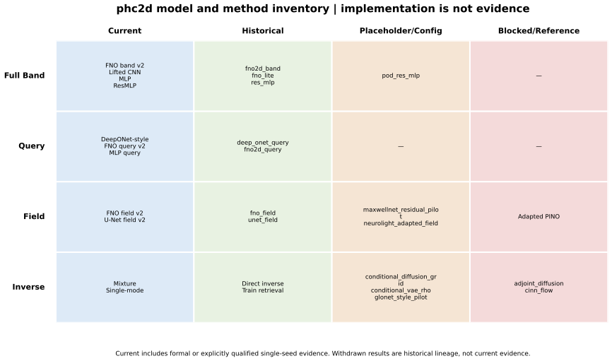

*图 1-1　完整模型和方法覆盖图。位置表示当前证据等级，不表示性能优劣；“implemented”也不自动等于“已有正式结果”。*

精选结果图、学习曲线和 inverse 案例的统一入口为 [`figure_index.md`](assets/phc2d_project_full_introduction_20260724/figure_index.md)。完整大画廊仍保留在原 `runs/`，精选图进入 `docs/reports/assets/` 并通过 SHA-256 manifest 追踪来源。

---

# 2. 研究背景：为什么需要这个项目？

二维光子晶体的能带计算，本质上需要求解周期性介质中的 Maxwell 本征问题：

\[
\nabla\times
\left[
\varepsilon^{-1}(\mathbf r)
\nabla\times\mathbf H
\right]
=
\left(\frac{\omega}{c}\right)^2\mathbf H.
\]

对于给定介电常数分布：

\[
\varepsilon(\mathbf r),
\]

需要在不同 Bloch 波矢 \(\mathbf k\) 下求解多个本征频率：

\[
\omega_n(\mathbf k),
\]

其中 \(n\) 表示能带编号。

传统 MPB、平面波展开或 FEM 方法能够提供可靠结果，但在以下场景中计算成本很高：

- 成百上千个候选晶胞的高通量筛选；
- 同一结构在大量 \(k\) 点上的 Bloch 本征求解；
- 遗传算法和拓扑优化中的反复评价；
- 生成式模型提出的大量候选结构验证；
- 本征场、Maxwell residual 与跨分辨率分析；
- 逆向设计中对候选结构进行真实物理确认。

如果一次逆向设计需要评价成百上千个候选结构，完全依赖真实求解器会成为主要计算瓶颈。

因此，本项目研究：

\[
\text{真实 Maxwell 求解}
\longrightarrow
\text{快速神经代理}
\longrightarrow
\text{多候选逆向设计}
\longrightarrow
\text{真实求解器回放验证}.
\]

---

# 3. 项目解决的四类核心任务

## 3.1 Task 1：Full-band forward prediction

输入二维光子晶体结构：

\[
\rho
\quad\text{或}\quad
\varepsilon(x,y),
\]

直接预测固定高对称路径上的完整能带矩阵：

\[
W_h
=
\{\omega_n(\mathbf k_i)\}
\in
\mathbb R^{N_k\times N_b}.
\]

当前 V2 数据中：

\[
N_k=31,\qquad N_b=10.
\]

即学习：

\[
\mathcal G_{\mathrm{full}}:
\varepsilon(x,y)
\rightarrow
W_h.
\]

该任务适合批量计算完整能带图。

## 3.2 Task 2：Continuous-query band prediction

Full-Wh 模型一次输出固定路径上的全部频率，而 Query 模型把波矢作为显式输入：

\[
\mathcal G_{\mathrm{query}}:
\left(\varepsilon(x,y),\mathbf k\right)
\rightarrow
\{\omega_1,\ldots,\omega_{N_b}\}.
\]

其意义在于：

- 可以查询单个或任意一组 \(k\) 点；
- 将结构编码与波矢坐标分离；
- 支持 \(k\) 点插值和路径分段评估；
- 为未来更密集的 \(k\)-space 查询提供接口；
- 避免把所有任务永久固定为 \(31\times10\) 矩阵回归。

项目设置了 MLP-query、DeepONet-style query 和 FNO-style query 等模型进行比较。

## 3.3 Task 3：TE Bloch 本征场预测

除了频率，项目还研究：

\[
\left(\varepsilon,\mathbf k,n\right)
\rightarrow
\left(\mathbf E_n,\mathbf H_n,\omega_n\right).
\]

当前场模型预测 TE 模式的有效复数分量：

\[
E_x,\quad E_y,\quad H_z,
\]

并使用实部、虚部分通道表示。

该任务用于研究：

- 场分布快速预测；
- Maxwell residual 计算；
- 数据驱动模型与 physics loss 的比较；
- 不同 \(k\) 点上的本征场泛化；
- 跨空间分辨率稳定性；
- 将来可能的场级筛选或逆向优化。

## 3.4 Task 4：Generative inverse design

输入目标能带：

\[
W_h^{*},
\]

输出多个候选结构：

\[
W_h^{*}
\rightarrow
\left\{
\hat\rho^{(1)},
\hat\rho^{(2)},
\ldots,
\hat\rho^{(K)}
\right\}.
\]

与确定性 inverse MLP 不同，项目将逆问题视为一对多问题：

\[
W_h^{*}
\not\rightarrow
\text{唯一结构}.
\]

不同结构可能实现相似能带，因此逆向设计的目标不是逐像素恢复数据集中的原结构，而是找到一个或多个满足目标频谱的可行结构。

---

# 4. 数据与结构表征

当前最完整的主线数据是 10k V2 real-MPB 数据集。

| 内容 | 当前设置 |
|---|---:|
| 结构数量 | 10,000 |
| 结构参数 `rho` | \(10{,}000\times36\) |
| 能带 `Wh` | \(10{,}000\times31\times10\) |
| 训练集 | 6,875 |
| 验证集 | 2,500 |
| 测试集 | 625 |
| 标签来源 | real MPB |
| 主要物理类型 | TE Bloch eigenproblem |
| 高对称路径 | \(\Gamma-X-M-\Gamma\) |

## 4.1 表征一：`rho_wedge`

利用当前 \(p4m\) 对称性，仅保存独立结构自由度：

\[
\rho_{\mathrm{wedge}}
\in
\mathbb R^{36}.
\]

优点是维度低，适合 MLP、结构重建和逆向生成器，也便于执行二值化、Hamming 距离和候选去重。

## 4.2 表征二：`epsilon_grid`

将结构展开成周期性介电常数网格：

\[
\varepsilon(x,y)
\in
\mathbb R^{H\times W}.
\]

该表征更适合 CNN、FNO-inspired spectral encoder 和 field operator。

虽然当前数据有确定的 36 维、31 个 \(k\) 点和 10 条能带，但项目代码通过数据元信息、`DataRepresentationSpec` 和 `TargetSpec` 读取维度，不把这些数字视为永久不变的模型常数。

---

# 5. 前向代理模型

项目不是把 FNO 设为唯一模型，而是比较不同输入表征和归纳偏置。本章按“模型族/完整网络使用二级标题，网络内部结构与训练细节使用三级标题”的规则组织；因此 U-Net 场模型和 FNO 场模型各自占一个独立二级章节；adapted PINO 虽复用 FNO 主干，也单开 5.7 节说明其物理损失与准入边界。

## 5.0 神经网络与神经算子方法在本项目中的区别

神经算子本身仍然是神经网络。二者在本项目中的核心差别，不是“是否使用神经网络”，而是模型主要学习固定维度的向量映射，还是近似学习输入函数/场到输出函数/场的映射，以及结构信息是在空间域、频域还是查询坐标上被共享和混合。

| 比较层面 | 普通神经网络方法 | 神经算子式方法 |
|---|---|---|
| 典型学习对象 | 固定维度的向量到向量，或固定网格上的图像式映射 | 输入函数/场到输出函数/场，或在连续查询坐标上求值的响应函数 |
| 项目代表 | `mlp`、`res_mlp_wide`、`lifted_cnn`、`mlp_query`、`unet_field_v2` | `fno2d_band_v2`、`deep_onet_query_v2`、`fno2d_query_v2`、`fno_field_v2` |
| 结构信息混合 | Linear、局部卷积、多尺度编码和 skip connection | Fourier 模态全局混合，或 Branch/Trunk 与查询坐标条件融合 |
| 当前物理身份 | 数据驱动前向代理 | 同样是数据驱动前向代理，不是 MPB/Maxwell 数值求解器 |
| 当前验证边界 | 由独立 test 指标评价，进入逆向时仍需 real-MPB replay | 除 test 指标外还需检查查询、分辨率迁移和 replay 校准；不能因名称中有 operator 就免除物理验证 |

### 5.0.1 Full-Wh：固定向量回归与频谱全局编码

Full-Wh 任务统一学习结构到完整能带矩阵的映射：

$$
\rho_{\mathrm{wedge}}\ \text{或}\ \varepsilon(x,y)
\longrightarrow
W_h.
$$

`mlp` 和 `res_mlp_wide` 将 `rho_wedge` 作为固定长度向量，通过 Linear block 回归 \(W_h\)；`lifted_cnn` 虽然读取 `epsilon_grid`，但主要通过局部卷积提取空间图案，并在 global average pooling 后压缩为固定向量。它们是本项目中的普通神经网络基线。

`fno2d_band_v2` 则在介电常数网格上执行二维 Fourier 变换、截断谱模态变换和逆变换：

$$
\varepsilon(x,y)
\rightarrow
\mathcal F[\varepsilon]\!\left(k_x,k_y\right)
\rightarrow
\text{spectral-mode mixing}
\rightarrow
\mathcal F^{-1}
\rightarrow
W_h.
$$

这种计算使单个谱卷积能够混合相距较远的空间区域，是它在本项目中最明显的神经算子式特征。不过，`fno2d_band_v2` 最后仍通过 global pooling 输出固定形状的 \(W_h\)，当前也没有完成任意网格分辨率上的零样本迁移证明。因此，本报告将它准确称为 **FNO-inspired band-aware spectral encoder**，而不是已经证明网格无关的通用算子求解器。

### 5.0.2 Query：神经算子思想最直接的体现

Continuous-query 任务学习：

$$
\left(\varepsilon,\mathbf k\right)
\longrightarrow
\omega(\mathbf k),
\qquad
\mathbf k=[k_x,k_y]^{\mathsf T}.
$$

三类 Query 模型的区别主要体现在结构信息与查询坐标 \(\mathbf k\) 的融合位置：

- `mlp_query`：在输入端拼接展开后的结构和波矢分量 \(k_x,k_y\)，再执行固定向量回归；
- `deep_onet_query_v2`：Branch 编码结构，Trunk 编码查询坐标，在公共特征空间做 Hadamard 乘积，再输出该 \(\mathbf k\) 点的 10 条频带；
- `fno2d_query_v2`：先通过 Fourier 层形成结构的全局频谱表征，再由 \(\mathbf k\) 条件产生通道 gate，调节该位置的频带输出。

其中 `deep_onet_query_v2` 最直接对应算子求值形式：

$$
b=\operatorname{Branch}(\varepsilon),
\qquad
t=\operatorname{Trunk}(\mathbf k),
\qquad
\hat\omega(\mathbf k)=\operatorname{Head}(b\odot t).
$$

它近似学习的是从结构函数到可在不同 \(\mathbf k\) 上查询的能带函数。`fno2d_query_v2` 则同时体现频域全局编码和连续查询条件。这是本项目中“神经算子”与普通向量网络差别最清楚的任务。

### 5.0.3 Field：图像式编码器与场到场谱算子

TE 本征场任务学习：

$$
\left(\varepsilon(x,y),k_x,k_y,\mathrm{band}\right)
\longrightarrow
\left(E_x(x,y),E_y(x,y),H_z(x,y),\omega\right).
$$

`unet_field_v2` 使用局部卷积、下采样/上采样、skip connection 和 FiLM 条件调制，属于多尺度图像式场预测网络。`fno_field_v2` 则在 OperatorBlock 中使用截断 Fourier 模态，并在各 block 中保留 \(H\times W\) 网格，直接逐点输出复场的 6 个实通道。后者因而更接近“介电常数场到电磁场”的算子映射：

$$
\mathcal G:
\varepsilon(x,y)
\mapsto
\left(E(x,y),H(x,y)\right).
$$

但是，函数到函数的接口本身不保证更高精度。第 10.5 节的正式结果显示，当前 `unet_field_v2` 的 E/H relative \(L_2\)、frequency MRE 和 Maxwell residual 均优于 data-only `fno_field_v2`。因此，本项目不把“神经算子”当成天然优于普通神经网络的标签，而是通过同数据、同划分和多 seed 对照判断其归纳偏置是否适合具体任务。

adapted PINO 也不是第三类网络。它复用 `fno_field_v2` 的网络主干，只在训练时加入离散 TE Bloch 物理残差；目前 residual 降低尚未转化为逆向候选排序或 real-MPB replay 改善，inverse admission 仍为 blocked。

### 5.0.4 在当前逆向设计闭环中的实际分工

当前可接受的逆向主线并不是让神经算子直接代替物理求解，而是分工如下：

```text
目标能带
   ↓
普通条件生成神经网络生成 K=128 个候选结构
   ↓
fno2d_band_v2 快速预测完整能带并执行主排序
   ↓
fno2d_query_v2 执行跨代理一致性与门禁诊断
   ↓
选择 Top-5
   ↓
real-MPB replay
   ↓
按真实物理误差选择最终结构
```

因此，本项目中的准确边界是：普通神经网络主要完成固定向量回归、局部/多尺度空间编码和条件结构生成；神经算子式模型利用频谱全局混合或 Branch/Trunk 查询机制，近似学习结构函数到能带函数或电磁场函数的映射。二者目前都是低成本数据驱动代理，最终物理裁决仍由 real-MPB replay 完成。

## 5.1 MLP 系列

`mlp` 与 `res_mlp_wide` 都直接学习：
\[
\rho_{\mathrm{wedge}}
\rightarrow
W_h.
\]

二者利用低维对称结构参数，具有训练快、参数利用率高的特点，也是判断卷积或谱算子是否真正带来收益的重要基线。

其中，`mlp` 是无残差连接的同容量基线：输入展平后经过输入线性层、GELU、6 个 MLP block 和输出线性层。每个 block 的主分支为 `Linear -> GELU -> Dropout -> Linear`，并计算

\[
\operatorname{GELU}(F(x)).
\]

在 A1.1 公平消融中，`mlp` 使用 `hidden_dim=256`、`depth=6`、`dropout=0.05`，与 `res_mlp_wide` 的输入、输出、宽度、block 数、每个 block 的线性层数、激活、dropout 和参数量均一致；两者均为 878,646 参数。区别只在于 `res_mlp_wide` 的 block 计算

\[
\operatorname{GELU}(x + F(x)).
\]

因此，`mlp` 是独立的 canonical model，而非 `res_mlp_wide` 的 alias；该对照用于隔离残差连接本身的收益，不应与 `mlp_query` 或确定性 inverse MLP 混为一谈。

### 5.1.1 完整层级与参数构成

当前 A1 输入为 36 维 `rho_wedge`，输出为 \(31\times10\) 的 \(W_h\)。两种模型都执行

```text
rho_wedge [B,36]
  -> Flatten
  -> Linear(36,256) -> GELU
  -> 6 × MLP block
  -> Linear(256,310)
  -> reshape [B,31,10]
```

每个 block 都含两层 `Linear(256,256)`，但 `mlp` 丢弃 block 输入，`res_mlp_wide` 将输入通过 identity shortcut 加到主分支。网络没有 BatchNorm、LayerNorm 或额外的 projection shortcut，因为所有 block 都保持 256 维。参数量可分解为：

| 组成 | 参数量 |
|---|---:|
| 输入 `Linear(36,256)` | 9,472 |
| 6 个双线性 block | 789,504 |
| 输出 `Linear(256,310)` | 79,670 |
| 总计 | **878,646** |

因此这是一项严格的残差连接消融：两者的参数张量数量、宽度、深度、激活、Dropout 和训练协议相同，唯一的函数差异是是否计算 \(x+F(x)\)。

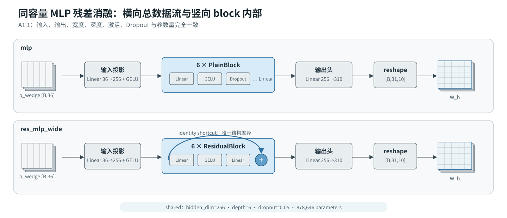

*图 5-1　`mlp` 与 `res_mlp_wide` 的端到端数据流。两条模型路径上下并列，单个 block 的主支与残差旁路在中部放大；深蓝 identity shortcut 是二者唯一的结构差异。*

## 5.2 Lifted CNN

`lifted_cnn` 使用展开后的网格结构：
\[
\varepsilon(x,y)
\rightarrow
W_h.
\]

它用于检验普通局部卷积能否有效提取空间形态特征。

### 5.2.1 输入、张量尺寸与逐层结构

`lifted_cnn` 接收由 `rho_wedge` 展开得到的 `epsilon_grid`。当前 A1 数据中的网格为单通道 \(16\times16\)，但构造器实际读取 `input_shape`，因此网络接口写成一般形式
\[
X_0\in\mathbb R^{B\times C_{\mathrm{in}}\times H\times W}.
\]

如果数据张量只有 `[B,H,W]`，forward 会先补出通道维。随后各层保持空间分辨率不变：

| 阶段 | 运算 | 当前 A1 张量形状 |
|---|---|---|
| 输入 | `epsilon_grid`，必要时 `unsqueeze(1)` | `[B,1,16,16]` |
| 局部特征 1 | `Conv2d(1,12,kernel_size=3,padding=1) -> GELU` | `[B,12,16,16]` |
| 局部特征 2 | `Conv2d(12,12,kernel_size=3,padding=1) -> GELU` | `[B,12,16,16]` |
| 全局汇聚 | `AdaptiveAvgPool2d(1) -> Flatten` | `[B,12]` |
| 输出头 | `Linear(12,310) -> reshape` | `[B,31,10]` |

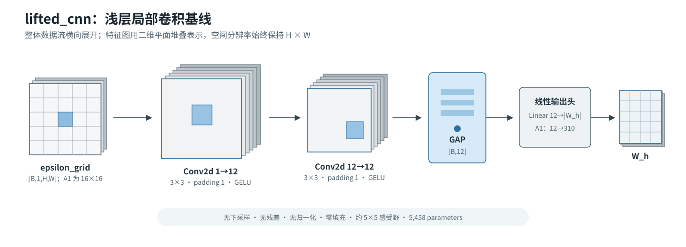

*图 5-2　`lifted_cnn` 的完整网络架构。灰白平面堆叠表示二维卷积特征图；两个卷积层均不改变空间分辨率，GAP 后才压缩为空间无关的 12 维通道摘要。*

其前向计算可以写为

\[
\begin{aligned}
X_1 &= \operatorname{GELU}(\operatorname{Conv}_{3\times3}^{1\to12}(X_0)),\\
X_2 &= \operatorname{GELU}(\operatorname{Conv}_{3\times3}^{12\to12}(X_1)),\\
z &= \operatorname{GAP}(X_2),\\
\hat W_h &= \operatorname{reshape}(W_{\mathrm{head}}z+b_{\mathrm{head}}).
\end{aligned}
\]

这里的输出 310 和 reshape 到 \(31\times10\) 是当前数据目标；代码本身使用 `output_shape` 计算输出维度。名称中的 `lifted` 指输入已经由低维 wedge 表征展开为二维介电常数网格，不表示 CNN 内部另有一个 learned lifting layer。A1 artifact 记录的总参数量为 **5,458**。实现见 [`build_lifted_cnn`](../../src/phc2d/models/baselines.py)，参数与正式测试记录见 [`A1 Forward 公平对照`](../results/forward/a1_forward_query_fair_v1_20260726.md)。

### 5.2.2 该 CNN 能学到什么、不能学到什么

这个基线只有两层局部 3×3 卷积，感受野约为 5×5；它没有 stride/pooling 下采样、U-Net skip、残差块、BatchNorm、Dropout 或多尺度金字塔。卷积使用普通零填充 `padding=1`，不是本征场网络中的 circular padding。最后的 global average pooling 把每个通道压缩为一个标量，因此输出头看不到显式的空间坐标，只能依赖卷积通道统计编码几何形态。

这使它成为一个刻意保持简单的空间卷积基线：如果它优于 MLP，说明二维局部邻域有用；如果落后于 FNO-inspired 模型，也不能据此断言“所有 CNN 都不适合”，只能说明这一浅层、全局平均汇聚的 CNN 在当前协议下不足。当前 A1 使用 MSE 训练、AdamW、batch size 64，validation 选择的学习率为 `1e-3`。

## 5.3 FNO-inspired band-aware spectral encoder

`fno2d_band_v2` 在介电常数网格上进行频域卷积和全局结构编码，再输出完整能带。

准确地说，它是：

> **项目原生的 FNO-inspired、band-aware spectral encoder。**

它不是对标准 FNO 论文或官方实现的忠实复现，因为其输出是能带矩阵而不是保持空间网格的函数场，并包含项目自定义的 band-aware 投影与低秩输出结构。

### 5.3.1 总体数据流

当前 A1 输入为 `[B,1,16,16]` 的 `epsilon_grid`。网络先用 `1×1` 卷积把输入 lift 到 32 个通道，经过 4 个相同结构的 `BandBlock`，再做全局平均汇聚与线性输出：

```text
epsilon_grid [B,1,H,W]
  -> 1×1 lift [B,32,H,W]
  -> 4 × BandBlock [B,32,H,W]
  -> AdaptiveAvgPool2d(1) [B,32]
  -> Linear(32, |Wh|)
  -> reshape Wh
```

当前目标下 `|Wh|=310`，最终输出 `[B,31,10]`；`H`、`W` 与输出 shape 仍由数据规格传入。正式 A1 artifact 记录的参数量为 **389,718**。实现见 [`build_fno2d_band`](../../src/phc2d/models/baselines.py)，参数与正式测试记录同样见 [`A1 Forward 公平对照`](../results/forward/a1_forward_query_fair_v1_20260726.md)。

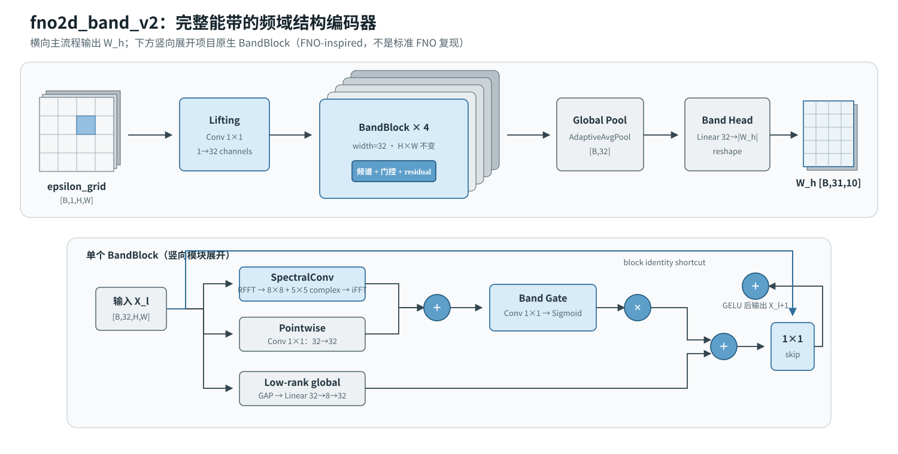

*图 5-3　`fno2d_band_v2` 的横向主数据流与单个 `BandBlock` 的竖向内部结构。上部强调 grid-to-\(W_h\) 的模型身份，下部区分截断谱卷积、局部 1×1 卷积、band gate、低秩全局支路与 block residual。*

### 5.3.2 截断 Fourier 卷积

设第 \(l\) 个 block 的输入为 \(X_l\in\mathbb R^{B\times32\times H\times W}\)。频域支路先执行二维实数 FFT：

\[
\tilde X_l=\operatorname{RFFT2}(X_l).
\]

代码为每个 block 建立两组独立的可训练复数权重：

| 权重 | 当前形状 | 作用区域 |
|---|---:|---|
| `weight_full` | `[32,32,8,8]` complex | 主截断 modes \(8\times8\) |
| `weight_band` | `[32,32,5,5]` complex | 额外的较小 band-aware modes \(5\times5\) |

它们都只作用于 `rfft2` 张量左上角保留的低频区域，并以通道 Einstein summation 完成输入/输出通道混合：

\[
\tilde Y_{b,o,p,q}
=
\sum_i \tilde X_{b,i,p,q}W^{\mathrm{full}}_{i,o,p,q}
+
\sum_i \tilde X_{b,i,p,q}W^{\mathrm{band}}_{i,o,p,q}.
\]

第二项只在 \(p<5,q<5\) 的重叠低频区域存在；其余被保留的 \(8\times8\) 区域只有 `weight_full`。未保留的频率位置置零，再用 `irfft2(..., s=(H,W))` 回到空间域。实现使用 `min(modes,H)` 和 `min(modes,W/2+1)` 裁剪，因此可以接收不同网格分辨率，但可学习的 modes 上限仍由配置决定。

### 5.3.3 一个 BandBlock 内部如何组合

频域结果并不是直接送入下一层。每个 block 还包含局部、门控、低秩全局和残差四部分：

\[
\begin{aligned}
S_l &= \operatorname{SpectralConv}(X_l)+\operatorname{Conv}_{1\times1}(X_l),\\
G_l &= \sigma(\operatorname{Conv}_{1\times1}(S_l)),\\
U_l &= G_l\odot S_l,\\
r_l &= \operatorname{MLP}_{32\to8\to32}(\operatorname{GAP}(X_l)),\\
X_{l+1} &= \operatorname{GELU}\!\left(
\operatorname{Conv}_{1\times1}(U_l+r_l)+X_l
\right).
\end{aligned}
\]

其中 \(r_l\) 在加入二维特征图前 reshape 为 `[B,32,1,1]` 并广播。低秩 MLP 使用 `Linear(32,8) -> ReLU -> Linear(8,32)`；band gate 使用 `1×1 Conv -> Sigmoid`；最后的 shortcut 保证 block 输入能直接进入输出。对应实现骨架为：

```python
h = self.spectral(x) + self.pointwise(x)
h = self.band_gate(h) * h
low_rank = self.low_rank(x).reshape(batch, 32, 1, 1)
h = self.skip(h + low_rank)
out = self.act(h + x)
```

### 5.3.4 为什么称为 FNO-inspired，而不是标准 FNO

它借用了“在 Fourier 空间学习截断谱卷积”的核心思想，但具有三项项目特定改造：一是双复数权重 `weight_full/weight_band`；二是 band gate 与低秩全局通道支路；三是通过 global pooling 和线性 head 输出能带矩阵，而不是输出同一空间网格上的函数场。当前实现也没有标准 FNO 中常见的显式坐标网格拼接。

因此 `fno2d_band_v2` 的准确作用是：用频域全局混合提取结构表征，再回归完整 \(W_h\)。它的 `band-aware` 指额外谱权重、门控和面向能带矩阵的 head，不表示网络在每个 block 内直接逐条求解物理能带。A1 使用 `width=32`、`depth=4`、`modes=(8,8)`、`band_modes=(5,5)`、`fourier_rank=8`，以 MSE 和 AdamW 训练，validation 选择的学习率为 `1e-3`。

## 5.4 Query 模型

Query 任务目前包括：

- `mlp_query`：结构编码与 \(k\) 坐标拼接；
- `deep_onet_query_v2`：采用 DeepONet-style branch/trunk 思想；
- `fno2d_query_v2`：结构的频域编码与 query conditioning。

DeepONet-style 模型学习：

\[
\operatorname{Branch}(\varepsilon)
\odot
\operatorname{Trunk}(\mathbf k)
\rightarrow
\omega(\mathbf k).
\]

它保留了 DeepONet 的核心思想，但没有直接复用官方实现，因此应称为适配模型，而不是 faithful DeepONet reproduction。

当前 A1 query 输入的结构网格为 `[B,1,16,16]`，物理波矢为 `[B,2]`，一次查询输出 10 条能带 `[B,10]`。三种模型真正不同的地方不是输出维度，而是结构信息与 \(k\) 条件在网络何处融合。

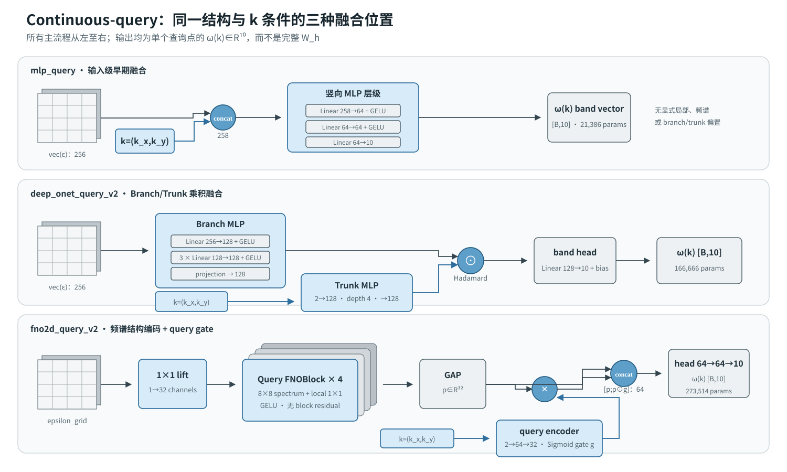

*图 5-4　三种 Continuous-query 网络的结构与条件融合位置。`mlp_query` 在输入端拼接，`deep_onet_query_v2` 在 Branch/Trunk 公共特征空间做 Hadamard 乘积，`fno2d_query_v2` 用 \(k\) 条件产生通道 gate，并保留未门控的结构特征。*

### 5.4.1 `mlp_query`：输入级早期融合

`mlp_query` 直接展平介电常数网格，并与二维 \(k\) 坐标拼接：

\[
u_0=[\operatorname{vec}(\varepsilon);k_x;k_y].
\]

当前网络为 `Linear(258,64) -> GELU -> Dropout(0) -> Linear(64,64) -> GELU -> Linear(64,10)`，参数量 **21,386**。它允许每一个隐藏单元同时看到所有网格像素和 \(k\) 坐标，但没有显式空间局部性、频域算子或 branch/trunk 分解，因此是 query 任务的最低复杂度全连接基线。

### 5.4.2 `deep_onet_query_v2`：Branch/Trunk 乘积融合

Branch 接收展平后的结构，Trunk 只接收 \(k_x,k_y\)。两支均使用 128 宽、depth 4 的 GELU MLP，最后投影到同一个 128 维共享特征空间：

\[
b=\operatorname{Branch}(\varepsilon)\in\mathbb R^{128},\qquad
t=\operatorname{Trunk}(\mathbf k)\in\mathbb R^{128}.
\]

代码中的 `depth=4` 具体表示首个 `Linear -> GELU` 加 3 个 `Linear(128,128) -> GELU`，随后再用一个无激活 Linear 输出 128 维特征。融合是逐元素乘法而非 concat：

\[
h=b\odot t,\qquad
\hat\omega(\mathbf k)=W_{\mathrm{band}}h+b_{\mathrm{learned}}.
\]

`band_head` 为无 bias 的 `Linear(128,10)`，再单独加一个可学习的 10 维 bias；总参数量 **166,666**。这里的 `latent_dim=128` 只是 branch/trunk 的公共特征宽度，与逆向生成器的随机 latent noise 无关。

### 5.4.3 `fno2d_query_v2`：谱结构编码与乘性 query gate

结构侧先用 `1×1` lift 得到 32 通道，再经过 4 个 query FNO block。每个 block 只有一组 `[32,32,8,8]` 复数谱权重，与一个局部 `1×1 Conv` 相加后做 GELU：

\[
X_{l+1}=\operatorname{GELU}\left(
\operatorname{SpectralConv}_{8\times8}(X_l)
+\operatorname{Conv}_{1\times1}(X_l)
\right).
\]

四层之后用 global average pooling 得到 \(p\in\mathbb R^{32}\)。查询侧把二维 \(k\) 坐标编码为 32 维 Sigmoid gate：

\[
g(\mathbf k)=\sigma\left(W_2\operatorname{GELU}(W_1\mathbf k+b_1)+b_2\right),
\]

其中 query encoder 为 `Linear(2,64) -> GELU -> Linear(64,32) -> Sigmoid`。最终不是只使用 \(p\odot g\)，而是保留原始结构特征并拼接门控特征：

\[
h=[p;\,p\odot g(\mathbf k)]\in\mathbb R^{64},
\]

再经 `Linear(64,64) -> GELU -> Linear(64,10)` 输出，参数量 **273,514**。这一路径让 \(k\) 条件以通道门控方式调节结构谱特征，同时保留未门控的结构摘要。它与 `fno2d_band_v2` 不同：没有 `weight_band`、band gate、低秩全局支路或 block residual，输出也是单个 \(k\) 点的 band vector，而不是完整 \(W_h\)。

三种 query 模型均使用 `torch.nn.MSELoss()` 训练；A1 对每个 protocol、模型和 seed 独立进行 validation 学习率选择。模型结构和参数量来自本地运行制品 `runs/20260724/a1_query_fair_v1_202607240803/model_identity_summary.json`，而不是根据名称推测；该原始运行目录不进入 Git。

## 5.5 `unet_field_v2`：条件 U-Net 本征场模型

`unet_field_v2` 是本项目本征场任务中的独立前向模型，不是 5.2 中 `lifted_cnn` 的加深版本。两者解决的任务、输入和输出都不同：

| 对比项 | `lifted_cnn` | `unet_field_v2` |
|---|---|---|
| 任务 | 完整能带矩阵回归 | 给定结构、\(k\) 和 band 的 TE 本征场与频率预测 |
| 输入 | 单通道 `epsilon_grid` | 5 通道周期网格 + 3 维场 context |
| 输出 | \(W_h\) 矩阵 | 6 个场实通道 + 1 个频率 |
| 空间结构 | 两层 3×3 CNN + global average pooling | 三层 encoder/decoder、bottleneck 和跨尺度 skip concat |
| 边界处理 | 普通零填充 | circular padding |
| 条件注入 | 无 | 每层 FiLM 调制 |
| 参数量 | 5,458 | 4,592,263 |

其主数据流和每个 residual stage 的内部层级如下。

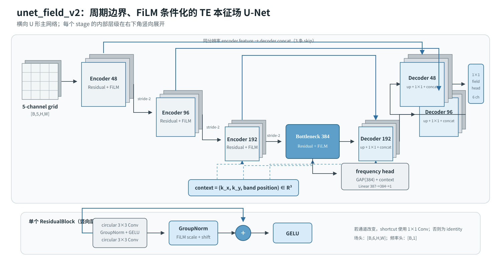

*图 5-5　`unet_field_v2` 的 U 形多尺度结构。三条蓝色 skip 将 encoder 的同分辨率特征送入 decoder；三维 context 同时调制各级 FiLM，并与 bottleneck 全局特征共同进入 frequency head。*

每个 encoder/decoder stage 内部包含 circular-padded 3×3 卷积、GroupNorm、FiLM 条件调制和 residual add。decoder 先双线性上采样，再用 1×1 投影调整通道，与对应 encoder feature 做 skip concat；这使高分辨率局部场细节可以绕过 bottleneck 直接进入重建端。频率头则读取 bottleneck 的全局池化特征和同一 `(kx, ky, band)` context，因此场与频率共享结构编码，但具有不同输出头。

当前 B3 规格为 `grid_channels=5`、`context_dim=3`、`field_channels=6`、基础宽度 48、深度 3，并开启 FiLM；三层 encoder 的特征宽度依次为 48/96/192，bottleneck 宽度为 384。

在 9,216 条 real-MPB operator-style TE 数据的三 seed test 上，`unet_field_v2` 的 E relative \(L_2\) 为 **0.5015 +/- 0.0091**、frequency MRE 为 **1.7591% +/- 0.0475%**、Maxwell residual 为 **2.7183 +/- 0.2413**，三项均优于同期 data-only `fno_field_v2`。这证明当前监督场任务中 U-Net 是更强的精度基线；它不意味着 U-Net 已成为 Full-Wh 代理，也不意味着它已经接入 inverse。

## 5.6 `fno_field_v2`：条件频谱本征场模型

`fno_field_v2` 是与 U-Net 并列的独立本征场模型。它与 5.3 的 `fno2d_band_v2` 都使用截断 Fourier 权重，但不能视为同一个网络。前者保持二维网格并逐点输出场，后者在 global pooling 后输出完整能带矩阵；前者使用正、负第一频轴两组谱权重、GroupNorm 和 context FiLM，后者使用 `weight_full/weight_band`、band gate 与低秩全局支路。

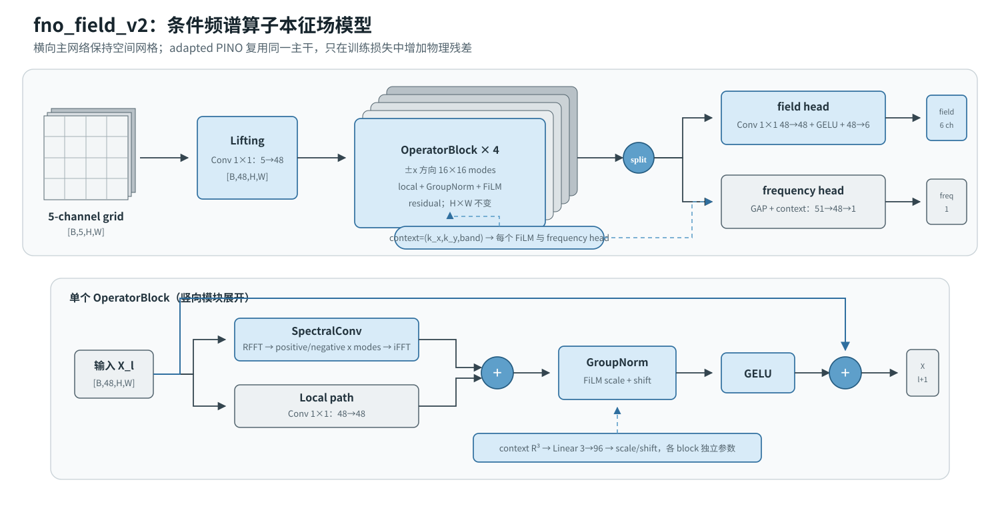

*图 5-6　`fno_field_v2` 的横向主网络与单个 `OperatorBlock`。四个 block 始终保持 \(H\times W\)，场头直接在网格上输出 6 个实通道；频率头只读取全局池化特征和 context。adapted PINO 复用这张图中的网络主干，差异位于训练目标而非网络拓扑。*

设 block 输入为 \(X_l\)，当前 `corrected_spectral_modes=true` 时，谱支路分别学习 RFFT 张量第一频轴的正向低频切片和负向低频切片；两侧均最多保留 \(16\times16\) modes。谱支路与局部 `1×1 Conv` 相加后先经 GroupNorm，再由 `(kx,ky,band)` 经过独立线性层产生通道级 FiLM scale/shift，最后计算

\[
X_{l+1}
=
X_l
+
\operatorname{GELU}
\left(
\operatorname{FiLM}
\left[
\operatorname{GN}
\left(
\operatorname{SpectralConv}(X_l)
+
\operatorname{Conv}_{1\times1}(X_l)
\right)
\right]
\right).
\]

这四个 operator block 不含 `fno2d_band_v2` 的 `weight_band`、Sigmoid band gate 或 32→8→32 低秩支路。其两个输出头分别是 `Conv1×1(48,48) -> GELU -> Conv1×1(48,6)` 和 `GAP -> concat(context) -> Linear(51,48) -> GELU -> Linear(48,1)`；因此场与频率共享算子编码，但不共享最后的预测头。adapted PINO 不是第三种网络架构，而是在该主干上加入 TE Bloch 物理残差的训练制度。

### 5.6.1 本征场任务：从结构与模态条件预测一个 TE 本征对

Full-Wh 模型回答“一个结构在整条固定 $k$ path 上的能带是什么”，Query 模型回答“一个结构在指定 $k$ 点的能带是什么”。本征场任务的目标更细：对一个给定的结构、Bloch 波矢和 band，预测该模态的空间场分布与本征频率：

$$
(\varepsilon, k_x, k_y, b)
\longmapsto
(\widehat E_x,\widehat E_y,\widehat H_z,\widehat f).
$$

当前 B3 数据由 9,216 条 real-MPB TE Bloch eigenfield record 组成，训练/验证/测试按 source structure 隔离为 6,912/1,152/1,152 条。每一条 record 的输入由两部分构成：

| 部分 | 当前张量 | 构造与含义 |
|---|---|---|
| 周期网格 | `[B,5,Nx,Ny]` | 归一化的介电常数 $\varepsilon$ 升采样到场网格，再拼接 $\sin(2\pi x)$、$\cos(2\pi x)$、$\sin(2\pi y)$、$\cos(2\pi y)$。周期坐标避免把单胞边界误写成普通图像边缘。 |
| 模态条件 | `[B,3]` | 归一化的 $(k_x,k_y,b)$；它告诉同一结构应输出哪一个 Bloch 波矢、哪一条 band 的本征模。 |

网络的场头输出 `[B,6,Nx,Ny]`，通道顺序为 `Ex.real`、`Ey.real`、`Hz.real`、`Ex.imag`、`Ey.imag`、`Hz.imag`；评估时再按 TE 极化约束补回 $E_z=H_x=H_y=0$。频率头输出标准化的 $\log f$，还原后始终为正频率。**真实频率不是模型输入**，所以该任务不是把求解器给出的频率直接灌入场网络。

监督损失也不是逐像素 MSE。由于同一本征模可以相差一个全局复相位，代码先用预测与真值电场的复内积对齐相位，再分别计算电场与磁场的相对 $L_2$，并与频率的 z-space MSE 组合：

$$
\mathcal L_{\mathrm{data}}
=
\mathcal L_{\mathrm{phase\text{-}invariant\ field}}
+0.1\,\operatorname{MSE}(\widehat f_z,f_z).
$$

这使 data-only `fno_field_v2` 成为一个有真实 MPB 场标签监督的场代理，而不是 Maxwell 方程的数值求解器。其实现和 TE active-component 编码分别位于 [`models/field.py`](../../src/phc2d/models/field.py) 与 [`forward/field_eigen_v2.py`](../../src/phc2d/forward/field_eigen_v2.py)。

## 5.7 adapted PINO：同一场 FNO 加入 TE Bloch 物理约束

这里的 PINO 是项目原生的 **adapted PINO training regime**，不是新的网络、也不是对文献 PINO 的 faithful reproduction。它保留 5.6 的 `fno_field_v2` 主干、输入和双输出头；与 data-only FNO 的区别只在训练时，额外要求预测场在离散 TE Bloch 本征方程下具有较小残差：

$$
\nabla_{\!k}\times\nabla_{\!k}\times\widehat E
- (2\pi\widehat f)^2\varepsilon\widehat E
\approx 0.
$$

实现以预测的复数 $\widehat E_x,\widehat E_y$ 为输入，在单胞边界应用 Bloch phase wrap 的有限差分；由 curl、curl-curl、介电常数 lifting 与预测频率构造相对残差。它同时记录边界残差和由同一 curl-curl 算子导出的 Rayleigh 频率，因而物理项与模型的频率头可以被独立诊断，而不是引入第二个 surrogate 或 test 标签。

对每个 batch，PINO 总损失的结构为：

$$
\mathcal L
=
\mathcal L_{\mathrm{data}}
+\lambda_{\mathrm{pde}}(e)\,\mathcal L_{\mathrm{TE\ residual}}
+\lambda_{\mathrm{Rayleigh}}\,\mathcal L_{\mathrm{Rayleigh}},
$$

其中 $\mathcal L_{\mathrm{TE\ residual}}$ 是经 solver-floor 标定的 $\log(1+r^2/s_{\mathrm{floor}}^2)$，再加 $0.1$ 倍的场范数约束；dense-frequency supervision 可额外给频率头补充完整训练 $k$ path 上的频率标签。`solver_floor` 只由 validation 的 real-MPB 参考确定，用来使同一有限差分残差可跨网格比较；它不改写 Maxwell 方程，也不使用 test target。

当前 B4 repair 训练按下列方式启用物理项：

1. 前 20 epoch 只训练 $\mathcal L_{\mathrm{data}}$；随后在 20 epoch 内将 $\lambda_{\mathrm{pde}}$ 线性增加到 0.01，避免随机初始场被强 PDE 项立即主导。
2. 在有场监督的 64 网格计算常规 data loss 与物理残差；同一主干还会轮换接收 96 或 128 的周期网格输入，以检查和约束跨分辨率的残差稳定性。高分辨率没有真场标签，因此只能报告频率真值、预测场残差和运行时间，不能声称高分辨率场精度。
3. 当前 `physics_frequency_gradient: detach` 表示残差在数值上仍使用模型预测频率，但 PDE 梯度不回传到 `frequency_head`；场头和共享算子编码仍能得到物理项梯度。这是把“场方程自洽”与“频率头拟合”暂时拆开审计，而不是用真频率替换模型预测。

因此 adapted PINO 想解决的是“预测场既贴近 MPB 标签，又更符合离散 Bloch 本征方程”，而不是直接证明频率更准、更适合候选排序或已经可以做 field inverse。第 10.5 节的匹配对照显示，它相对 data-only FNO 降低了平均 Maxwell residual，但 frequency MRE 反而上升；随后 P4/P5/P6 的 residual-frequency calibration、dense-$k$ 和 64→96/128 迁移门槛仍未通过。故 PINO residual 目前不得进入 inverse reranking，最终物理判定仍是 real-MPB replay。

## 5.8 当前模型身份总表

| 模型 | 输入与输出 | 当前准确定位 |
|---|---|---|
| `mlp` | `rho_wedge -> Wh` | 与残差 MLP 同容量的无残差消融基线 |
| `res_mlp_wide` | `rho_wedge -> Wh` | 低维残差 MLP 强基线 |
| `lifted_cnn` | `epsilon_grid -> Wh` | 空间卷积基线 |
| `fno2d_band_v2` | `epsilon_grid -> Wh` | FNO-inspired band-aware spectral encoder |
| `mlp_query` | `structure + k -> bands` | 坐标条件 MLP query 基线 |
| `deep_onet_query_v2` | `grid + k -> bands` | DeepONet-style branch/trunk 适配 |
| `fno2d_query_v2` | `grid + k -> bands` | 项目原生 query-conditioned spectral encoder |
| `unet_field_v2` | `periodic grid + (kx,ky,band) -> field + frequency` | 带 skip connection 和 FiLM 条件调制的监督场模型 |
| `fno_field_v2` | `periodic grid + (kx,ky,band) -> field + frequency` | 项目原生 FNO-style 场模型 |
| adapted PINO | 与 `fno_field_v2` 相同 | 训练制度名称；在同一主干上加入 TE Bloch 物理残差 |

## 5.9 统一训练目标与选择边界

前述 5.1–5.7 已分别给出各前向代理的逐层结构与 PINO 训练机制。本节只保留跨模型共用的训练协议、场数据损失和物理损失边界，不再把任何完整模型架构嵌套在训练章节中。实现入口见 [`baselines.py`](../../src/phc2d/models/baselines.py)，A1 前向/查询协议分别见 [`a1_forward_fair_v1.yaml`](../../configs/research/a1_forward_fair_v1.yaml)、[`a1_forward_mlp_ablation_v1.yaml`](../../configs/research/a1_forward_mlp_ablation_v1.yaml) 与 [`a1_query_fair_v1.yaml`](../../configs/research/a1_query_fair_v1.yaml)。

### 5.9.1 Full-Wh 与 Query 的训练目标、优化器和选择边界

当前 A1 前向与 query 比较都以逐元素均方误差作为训练目标：

\[
\mathcal L_{\mathrm{MSE}}
=
\frac{1}{B D}
\sum_{i=1}^{B}\sum_{j=1}^{D}
\left(\hat y_{ij}-y_{ij}\right)^2,
\]

其中 \(D=|W_h|\)（Full-Wh）或 \(D=|\omega(\mathbf k)|\)（Query）。前向 runner 的默认 `loss.name` 为 `mse`，query runner 直接实例化 `torch.nn.MSELoss()`；前向框架也支持 `band_aware` 可选损失，但它**不是**此处 A1 配置所声明的训练目标。对应实现见 [`forward/runner.py`](../../src/phc2d/forward/runner.py) 与 [`query/runner.py`](../../src/phc2d/query/runner.py)。

训练/选择协议为：AdamW、`weight_decay=1e-5`、batch size 64、最多 200 epochs、checkpoint epochs 为 10/30/50/100/150/200；每个模型在学习率 \(\{10^{-3},3\times10^{-4},10^{-4}\}\) 和 seed \(\{0,1,2\}\) 上训练。学习率由 validation split 的指定指标选择，最终仅在独立 test split 上汇总；报告的 MRE、MAE、RMSE 与排序违例率是评估量，不应倒写成训练损失。A1 前向指标是 `avg_MRE_bands_2_10_pct`，query 指标是 `query_mre_bands_2_10_pct`。

### 5.9.2 TE 本征场的数据损失与物理损失边界

本征场分支是与 Full-Wh/Query 代理平行的任务：输入为 5 通道周期网格与 3 维 context（归一化的 \(k_x\)、\(k_y\) 与 band 位置），同时预测 6 个实通道表示的 3 个复场分量以及一个归一化频率。数据驱动基线和 adapted PINO 的实现见 [`models/field.py`](../../src/phc2d/models/field.py)、[`field_eigen_v2.py`](../../src/phc2d/forward/field_eigen_v2.py)，相应 B3/B4 配置见 [`field_eigen_te_v2_baseline_9216.yaml`](../../configs/research/field_eigen_te_v2_baseline_9216.yaml) 与 [`field_eigen_te_pino_b4_repair_validation_9216.yaml`](../../configs/research/field_eigen_te_pino_b4_repair_validation_9216.yaml)。

| 模型或训练身份 | 网络身份 | 当前 B3/B4 训练规格 |
|---|---|---|
| `unet_field_v2` | 独立 U-Net，详见 5.5 | B3 data-only；使用相位不变场损失与频率 z-space MSE。 |
| `fno_field_v2` | 独立 FNO-style 场网络，详见 5.6 | B3 data-only；与 U-Net 使用相同数据目标和三 seed 测试协议。 |
| adapted PINO | 复用 5.6 的 `fno_field_v2` 主干，不是另一种网络 | B4 仅为 validation-only repair：`lambda_pde=0.01`，20 epoch warmup + 20 epoch ramp，物理分辨率 64/96/128，频率梯度 `detach`。 |

数据驱动部分不是普通像素 MSE。代码先在复数域按电场内积对齐全局相位，再分别计算电场和磁场的相对 \(L_2\)；其加权平均与频率 z-space MSE 构成

\[
\mathcal L_{\mathrm{data}}
=
1.0\,\mathcal L_{\mathrm{phase\text{-}invariant\ field}}
+0.1\,\operatorname{MSE}(\hat f_z,f_z).
\]

对 adapted PINO，训练损失再加上激活后的 \(\lambda_{\mathrm{pde}}\mathcal L_{\mathrm{TE\ residual}}\)，必要时还会加 dense-frequency 与 Rayleigh-consistency 项；P4/P5 配置中的 PDE 残差按 64/96/128 分辨率加权平均。该分支当前仍有 residual-frequency calibration 和跨分辨率门控，因此这些物理损失的存在不等价于已获准 field inverse 或 inverse reranking。

## 5.10 模型覆盖审计：哪些已经实验，哪些仍未完成

仓库注册表、配置文件和正式运行产物并不处于同一证据等级。下表用于避免“代码中出现过名称”被误读为“已有正式模型结果”。

| 模型或名称 | 当前状态 | 是否进入本文主结果 | 说明 |
|---|---|---|---|
| `mlp`、`res_mlp_wide`、`lifted_cnn`、`fno2d_band_v2` | A1 三 seed 正式测试完成 | 是 | 当前 Full-Wh 公平对照 |
| `mlp_query`、`deep_onet_query_v2`、`fno2d_query_v2` | A1 三协议、三 seed 正式测试完成 | 是 | 当前 Query 公平对照 |
| `unet_field_v2`、`fno_field_v2` | B3 三 seed 正式测试完成 | 是 | 当前 data-only 场模型 |
| adapted PINO | B3 pilot 通过，但 B4/P6 inverse admission blocked | 是，带准入边界 | 与 `fno_field_v2` 共用网络身份，只改变训练制度 |
| `res_mlp`、`fno_lite`、`fno2d_band` | 历史 10k forward 实验完成 | 仅作为历史/代理替换实验 | 已由 A1 的 `*_v2` 或 `res_mlp_wide` 公平协议取代 |
| `deep_onet_query`、`fno2d_query` | 历史 Query 实现/实验 | 不进入当前主表 | 当前主表使用 `*_v2` |
| `unet_field`、`fno_field` | B1/B2 早期场模型 | 不进入当前 B3 主表 | v1 表示和训练协议已被 v2 替代 |
| `pod_res_mlp` | 仅注册占位 | 否 | native POD basis/projection 尚未实现，当前 A1 不使用 POD |
| `conditional_vae_rho` | 历史配置名 | 否，必须按真实实现重命名解释 | 实际执行的是 latent conditional MLP decoder，没有 posterior encoder、\(\mu/\sigma\) 或 KL loss，不是 cVAE |
| `conditional_diffusion_grid` | smoke/decision-gate 配置 | 否 | 没有可进入当前结论的正式训练与 real-MPB replay |
| GLOnet-style pilot | surrogate-objective 训练配方 | 否 | 复用条件生成器，不是已经交付的独立 GLOnet 网络复现 |
| cINN/flow、MaxwellNet、NeurOLight | 计划或参考模型 | 否 | 当前没有完成与主协议可比的正式实现和结果 |

## 5.11 第 5 章网络架构图阅读约定与图件索引

本报告已将网络图放回各模型的技术说明附近，而不是保留为待生成提示词。所有图均为可缩放 SVG：纯白背景、黑灰正文、灰白特征图与低饱和蓝色关键路径。端到端数据流从左至右读取，MLP 的层级采用竖向结构柱，卷积或算子 block 则按其分支关系在图内局部展开。

| 图号 | 模型范围 | 重点 |
|---|---|---|
| 图 5-1 | `mlp` / `res_mlp_wide` | 同容量条件下是否存在 identity shortcut |
| 图 5-2 | `lifted_cnn` | 两层局部卷积、空间尺寸保持与 GAP |
| 图 5-3 | `fno2d_band_v2` | Full-Wh 主流程和 `BandBlock` 五条计算路径 |
| 图 5-4 | 三种 Query 模型 | 结构与 \(k\) 在输入、乘积空间或 gate 处融合 |
| 图 5-5 | `unet_field_v2` | U 形多尺度路径、三条 skip、FiLM 和双输出头 |
| 图 5-6 | `fno_field_v2` / adapted PINO 主干 | 正负频轴谱卷积、FiLM residual block 和双输出头 |

---

# 6. 逆向设计模型、基线与证据边界

本章先定义当前主生成器，再说明非参数检索、确定性回归和 latent generator 等已实现方法的角色。第一版四方法公平结果已经撤销，当前定量证据以 objective-bridge single-mode/mixture 为准。当前主生成器名为：

\[
\texttt{mixture\_conditional\_generator}.
\]

它与另外两种已实现的可训练 inverse 网络的实际结构如下。这里展示的是网络身份，不表示三种网络都已有当前有效的公平结果。

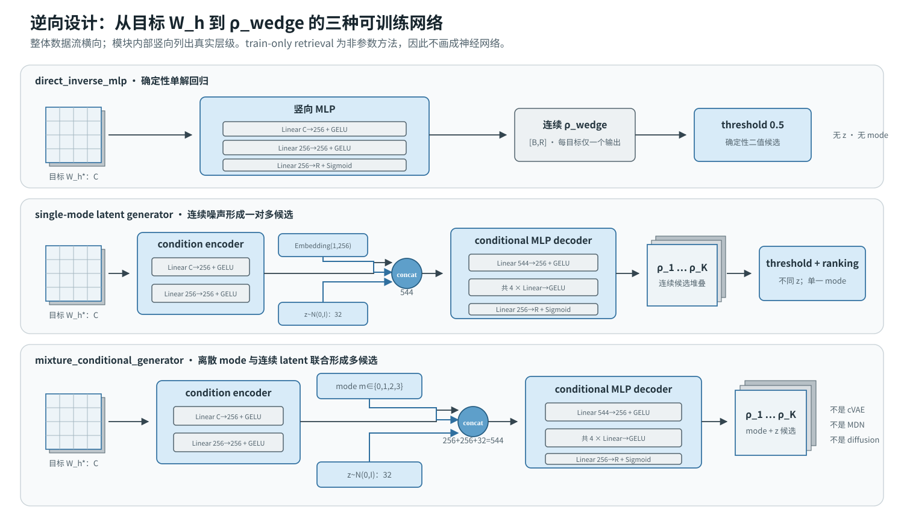

*图 6-1　三种已实现 inverse 网络的横向数据流。`direct_inverse_mlp` 只有确定性 MLP；single-mode 与 mixture 共用 condition encoder 和四层 conditional decoder，前者只有一个可学习 mode embedding，后者有四个 mode embedding。两种生成器都通过独立高斯 \(z\) 产生 \(K\) 个连续候选。*

生成过程可表示为：

\[
\hat\rho
=
G_\theta
\left(
W_h^{*},m,z
\right),
\]

其中：

- \(W_h^{*}\) 是目标能带；
- \(m\) 是离散 mode；
- \(z\) 是连续 latent noise；
- \(\hat\rho\) 是候选结构。

这里的 `mixture` 表示离散 mode 与轮换式 mode sampling，不表示 mixture-density network。

当前模型也不是：

- cVAE；
- diffusion model；
- normalizing flow；
- cINN；
- MaxwellNet；
- 确定性普通 MLP。

它是一个项目原生的、带 mode conditioning 和 latent noise 的多候选条件生成器。

## 6.1 当前逆向流水线中的四类方法

统一 inverse 流水线实现了四类方法：

| 方法 | 从目标到候选的机制 | 可训练 | 多候选来源 |
|---|---|---:|---|
| train-only retrieval | 按目标 \(W_h\) 在 train split 中检索最近频谱并返回对应结构 | 否 | 取最近的 \(K\) 个训练样本 |
| `direct_inverse_mlp` | 确定性 MLP：\(W_h\rightarrow\rho\) | 是 | 每目标只有一个有效输出 |
| single-mode latent generator | 条件编码器 + Gaussian latent MLP decoder，`mode_count=1` | 是 | 不同 latent noise |
| mixture conditional generator | single-mode 架构再加入离散 mode embedding，`mode_count=4` | 是 | mode 与 latent noise 联合变化 |

retrieval 是重要的非参数基线，但不会提出训练库之外的新结构；direct inverse 用于衡量确定性单解回归的下限。第一版 A2 存在训练问题，其四方法数值已从本报告撤销，因此本节只保留方法定义，不再把当时的 retrieval/direct/generator 数字作为当前公平主表。当前可接受的定量结论来自修正训练协议后的 objective-bridge single-mode 与 mixture；二者使用相同宽度、深度和 latent 维度，主要差别是是否具有多个离散 mode。

## 6.2 Mixture 实际网络结构与当前参数

当前主线的实现类是 [`_MixtureConditionalGenerator`](../../src/phc2d/inverse/runner.py)，训练/采样配置分别见 [`inverse_mixture_generator_v2_10000_pretrain.yaml`](../../configs/research/inverse_mixture_generator_v2_10000_pretrain.yaml) 与 [`inverse_mixture_generator_v2_10000_objective.yaml`](../../configs/research/inverse_mixture_generator_v2_10000_objective.yaml)。其输入条件维度 \(C=|W_h|\) 和候选维度 \(R=|\rho_{\mathrm{wedge}}|\) 来自实际数据；当前宽度、深度与潜变量规格如下。

| 组成 | 代码中的运算 | 当前主配置 |
|---|---|---|
| 条件编码器 | `Linear(C,256) -> GELU -> Linear(256,256) -> GELU` | `hidden_dim=256` |
| 离散 mode | `Embedding(mode_count, 256)`，与条件特征处于同一宽度 | `mode_count=4` |
| 连续 latent | 每个候选独立采样 \(z\sim\mathcal N(0,I)\)，与条件/模式特征拼接 | `latent_dim=32` |
| 解码器 | 拼接后的 \(256+256+32=544\) 维向量先进入 256 宽 GELU 层，重复 4 次，再经 `Linear(256,R) -> Sigmoid` | `depth=4`，输出范围为 \((0,1)\) |
| 二值候选 | 神经网络先输出连续 \(\hat\rho\)，后续候选流程按阈值投影 | `threshold=0.5` |

核心解码操作等价于下列代码骨架：

```python
encoded = condition_encoder(flattened_Wh)       # [B, 256]
mode = mode_embedding(mode_ids)                  # [B, 256]
rho_continuous = decoder(cat([encoded, mode, z])) # [B, R], with final Sigmoid
```

预训练的 `reconstruct` 路径将 \(z\) 固定为零，并让 batch 内 mode id 循环；候选采样的 `sample` 路径则把同一个目标 \(W_h^*\) 复制 \(K\) 次，为每份条件输入独立的高斯噪声，并按 mode id 循环。因此 mode 与 noise 都会改变候选，不能把该网络简称为确定性 inverse MLP。另一方面，它也不是 cVAE：代码中没有后验 encoder、\(\mu/\sigma\) 参数化、重参数化采样或 KL 散度项。

## 6.3 训练与采样的运行参数

| 阶段 | 训练时长与优化 | 候选设置 | 物理边界 |
|---|---|---|---|
| 结构重建预训练 | 200 epochs；学习率候选 `1e-3 / 3e-4 / 1e-4`；AdamW；`weight_decay=1e-5`；batch size 64 | 只形成 objective-bridge 的 warm start | 明确 `replay.enabled=false`；不调用 MPB/Meep；该阶段本身不再形成可接受的 inverse 结果 |
| objective-bridge finetune | 50 epochs；固定 LR `1e-4`；AdamW；`weight_decay=1e-5`；batch size 64 | 每目标 \(K=128\)，训练时每条件 16 个候选，排名后 Top-5 | 冻结 surrogate 可微评价；训练阶段不调用 MPB/Meep |

这里的 128 和 Top-5 是该主配置的候选/筛选预算，而不是模型层的固定 shape。真正的 real-MPB replay 只能在候选健康检查和独立 replay 配置满足门槛后启动；它不参与任何一次梯度反传。

---

# 7. Objective-Bridge 生成器如何训练？

逆向模型分为两个阶段。

## 7.1 阶段一：结构重建预训练

首先利用配对数据训练：

\[
W_h
\rightarrow
\rho_{\mathrm{original}}.
\]

预训练损失为：

\[
\mathcal L_{\mathrm{pretrain}}
=
\operatorname{MSE}
\left(
\hat\rho,
\rho_{\mathrm{original}}
\right).
\]

这一阶段让生成器先学会目标能带与合理结构分布之间的基本关系。

实现上，训练批次取配对的 `Wh` 与 `rho_wedge`，调用 `net.reconstruct(xb)`（即零噪声路径），然后执行 `torch.nn.MSELoss()(pred, yb)`。所以这一阶段确实是“还原训练集中的配对结构”，但它不构成对逆问题单解性的假设；后续阶段仍以多候选方式寻找能够实现目标频谱的不同结构。

## 7.2 阶段二：Objective-Bridge finetune

预训练后，以冻结的 Full-Wh surrogate 作为主要可微 objective，并用冻结的 Query surrogate 提供交叉一致性约束。

总目标包含：

\[
\begin{aligned}
\mathcal L_{\mathrm{objective}}
={}&
\lambda_s\mathcal L_{\mathrm{surrogate}}
+\lambda_c\mathcal L_{\mathrm{cross}}\\
&+\lambda_g\mathcal L_{\mathrm{gap}}
+\lambda_r\mathcal L_{\mathrm{reconstruction}}\\
&+\lambda_d\mathcal L_{\mathrm{diversity}}
+\lambda_{bd}\mathcal L_{\mathrm{binary\ diversity}}\\
&+\lambda_z\mathcal L_{\mathrm{latent\ response}}
+\lambda_{\mathrm{col}}\mathcal L_{\mathrm{collision}}.
\end{aligned}
\]

当前主要权重为：

\[
\begin{aligned}
\lambda_s &= 1.0, &
\lambda_c &= 0.2, &
\lambda_g &= 0.2, &
\lambda_r &= 0.03,\\
\lambda_d &= 0.2, &
\lambda_{bd} &= 0.5, &
\lambda_z &= 0.25, &
\lambda_{\mathrm{col}} &= 0.9.
\end{aligned}
\]

各部分作用如下：

| 损失 | 作用 |
|---|---|
| `surrogate loss` | 生成结构的预测能带接近目标，是主要优化目标 |
| `cross-surrogate loss` | 约束 Query 与 Full-Wh 两个代理的预测一致性 |
| `gap loss` | 约束目标与生成结果的带隙描述 |
| `reconstruction loss` | 以较小权重保留结构分布锚点 |
| `diversity loss` | 防止多个连续候选坍缩 |
| `binary diversity loss` | 防止二值化后候选变成同一结构 |
| `latent response loss` | 要求不同 latent noise 真正影响输出 |
| `collision loss` | 惩罚“频谱预测很好但候选相互重复”的情况 |

在当前 objective 配置下，上表各项的可微定义可进一步写为：

\[
\mathcal L_{\mathrm{surrogate}}
=
\operatorname{mean}_{b\ge 2}
\frac{|\hat W_b-W_b^*|}{\max(|W_b^*|,10^{-8})},
\]

即默认从第 2 条能带开始计算相对误差，避免近零分母的第 1 条能带主导目标。`cross-surrogate loss` 使用相同的 bands-aware 相对差，比较主、次两个冻结代理的预测；分母取次代理预测的 detach 版本。`gap loss` 先以可微 soft-min/soft-max 计算相邻带的 complete-gap descriptor，再对预测与目标 descriptor 取 MSE。

对于同一目标的 16 个候选，连续 diversity loss 是“目标 Hamming 距离减去平均两两 L1 距离”的 ReLU hinge（目标 0.05）；binary diversity loss 先用温度 0.08、阈值 0.5 的 soft binarization 再做同类 hinge（目标 0.08）。latent response loss 要求组内候选的平均标准差至少达到 0.04；collision loss 以 soft-binary 最近邻 Hamming 距离为核心，并按候选的 surrogate 质量加权，当前目标最近邻距离为 0.05。精确定义与实现位于 [`inverse/objective.py`](../../src/phc2d/inverse/objective.py)。本配置未启用 fill fraction、binarization 或 total-variation 正则项，因此不应把这些框架可选项写入当前损失公式。

每个 objective batch 先对同一 \(W_h^*\) 生成一组随机 noise/mode 候选，再送入冻结代理。当前可接受的 A2 objective-bridge 以 A1 `fno2d_band_v2` 为主可微 objective/ranker，以 A1 `fno2d_query_v2` 计算 cross-surrogate consistency。随后只把上述损失反传到生成器，所有代理参数保持冻结。两个 surrogate 提供的是可微、低成本的近似物理信号，不能替代 MPB 的物理验收。

需要特别说明：

> **MPB replay 不是训练损失。**

真实 MPB 求解成本高且不参与神经网络反向传播。它位于模型训练、候选生成和代理筛选之后，用作独立的物理验收。

## 7.3 正向代理在逆向训练中的位置

逆向框架内部确实包含正向替代网络。其作用不是生成结构，而是近似

\[
\hat F_\phi:\rho\rightarrow \hat W_h,
\]

从而把生成结构 \(\hat\rho=G_\theta(W_h^*,z,m)\) 再映射回预测频谱，并形成可微闭环：

\[
W_h^*
\xrightarrow{G_\theta}
\hat\rho
\xrightarrow{\hat F_\phi}
\hat W_h
\xrightarrow{\mathcal L(\hat W_h,W_h^*)}
\nabla_\theta.
\]

其中 \(\phi\) 在 inverse 训练时冻结，只有生成器参数 \(\theta\) 更新。因此它更准确的名称是“冻结的正向物理代理”，而不是 inverse 网络内部另一个共同训练的 decoder。

### 7.3.1 四种角色不能混为一谈

| 位置 | 当前作用 | 是否反向传播到生成器 | 是否给出最终物理结论 |
|---|---|---:|---:|
| reconstruction pretrain | 直接比较 \(\hat\rho\) 与配对 \(\rho\) | 是，但不使用 forward surrogate | 否 |
| primary differentiable objective | 计算 \(\hat W_h\) 与目标 \(W_h^*\) 的 bands 2–10 误差 | 是 | 否 |
| secondary/cross surrogate | 检查两个代理是否对候选给出一致响应 | 是或作为门禁诊断，取决于协议 | 否 |
| candidate ranker | 在固定候选池中选出 Top-M | 否，只做推理和排序 | 否 |
| real-MPB replay | 重新求解候选的真实 \(W_h\) | 否 | 是，限已声明的 replay 协议 |

### 7.3.2 当前 Objective-Bridge 使用的确切模型

当前有效的 objective-bridge 冻结的是 A1 validation-selected checkpoint，而不是按模型名称临时猜测：

| 角色 | 模型 | 输入 | 协议 |
|---|---|---|---|
| 主 objective / 主 ranker | `fno2d_band_v2` seed 0，LR `1e-3` | `epsilon_grid` | 直接输出完整 \(W_h\)，按 bands 2–10 MRE 排序 |
| 次代理 | `fno2d_query_v2` seed 0，LR `1e-3` | `epsilon_grid + physical k` | 扫描 all-k 后重建完整 \(W_h\)，用于交叉一致性和诊断 |
| 最终裁判 | real MPB | 二值候选结构 | 不参与训练，仅在 Top-M 上回放 |

对应 checkpoint 路径、SHA-256、warm-start 谱系和角色冻结在 [`a2_inverse_objective_bridge_seed0_v1.yaml`](../../configs/research/a2_inverse_objective_bridge_seed0_v1.yaml) 与 [`a2_inverse_objective_bridge_seed0_test625_v1.yaml`](../../configs/research/a2_inverse_objective_bridge_seed0_test625_v1.yaml)。主表中的 surrogate MRE 来自 `fno2d_band_v2`；`fno2d_query_v2` 只承担 cross-surrogate consistency 与诊断，不是最终物理裁判。

### 7.3.3 可替换边界

通用 rerank runner 支持 `query`、`forward` 和加权 `hybrid` 三种 strategy。一个 forward component 通过 `model_name`、`input_repr`、checkpoint/run lineage 和权重声明，因此可以在**固定候选池**上替换 `res_mlp`、`fno2d_band`、`fno_lite` 等已训练前向代理，而无需重训生成器。

但要回答“哪个代理更适合训练 inverse”，仅替换候选排序器还不够。代理同时影响 objective 梯度、候选池分布和最终 Top-M；严格实验需要固定 generator 初始化、训练预算、target、\(K\)、Top-M、seed 与 MPB budget，分别用不同冻结代理重新 objective-finetune，再做配对 real-MPB replay。仓库目前完成的是“固定旧候选池上的代理替换诊断”和“objective-bridge 的冻结 FNO 主/次代理协议”，尚未完成所有 A1 代理作为 inverse objective 的全矩阵公平消融。

---

# 8. 候选筛选与可信物理闭环

对于每个测试目标，当前主线生成：

$$
K=128
$$

个候选结构。

候选依次经过：

1. 连续值到二值结构的投影；
2. 重复结构删除；
3. 最小 Hamming 距离约束；
4. 合法性和形态检查；
5. frozen `fno2d_band_v2` 主代理预测并排序；
6. frozen `fno2d_query_v2` 计算交叉一致性与门禁诊断；
7. surrogate disagreement 与 gap 指标检查；
8. 综合排序；
9. 选择 Top-5；
10. 对 Top-5 全部执行 real-MPB replay。

因此一次目标的验证流程如下。

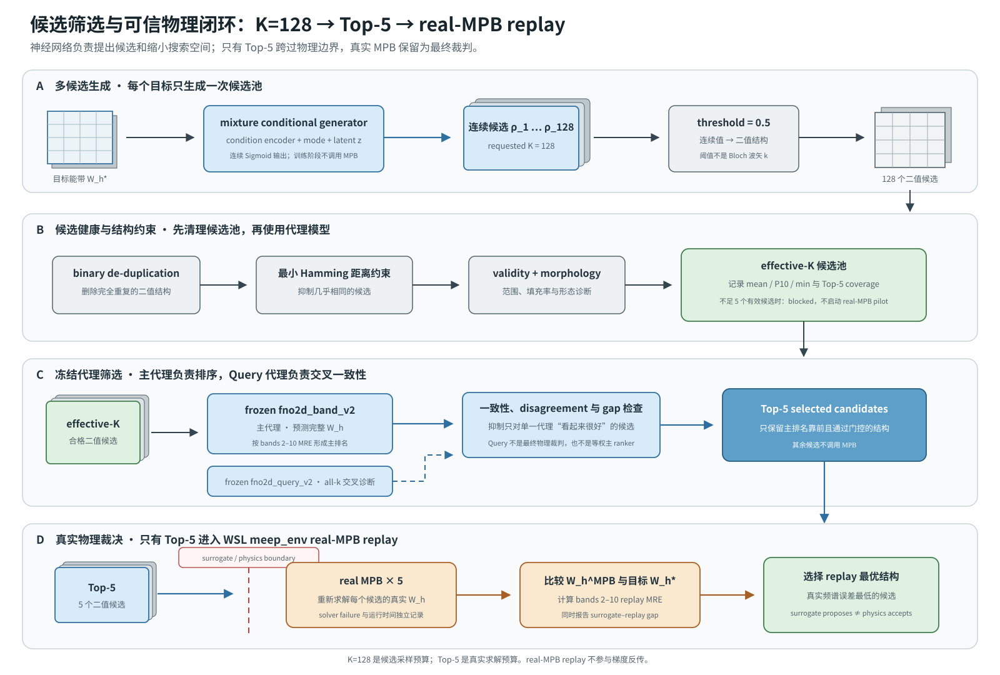

*图 8-1　每个目标先生成 $K=128$ 个连续候选，经 threshold、去重、最小 Hamming 距离和候选健康检查后形成 effective-K 候选池。`fno2d_band_v2` 负责主排名，`fno2d_query_v2` 只承担交叉一致性与门禁诊断；两者不是等权双代理排名。只有 Top-5 跨过 surrogate/physics 边界执行 real-MPB replay，最终按真实 bands 2–10 replay MRE 选择候选。*

这构成项目最重要的可信性增强：

$$
\text{surrogate proposes}
\neq
\text{physics accepts}.
$$

## 8.1 已完成的正向代理替换实验

仓库在 2026-06-30 已对同一批旧 10k inverse candidates 做过固定候选池 rerank，对比五种策略：

| 策略 | 正向代理构成 | Surrogate MRE，bands 2–10 | 24-target real-MPB replay MRE |
|---|---|---:|---:|
| `query_only` | Query surrogate | 16.4807% | **33.2899%** |
| `forward_res_mlp_rho_wedge` | `res_mlp` | **2.7281%** | 33.4565% |
| `forward_fno2d_band_epsilon_grid` | `fno2d_band` | 17.0983% | 33.4565% |
| `forward_fno_lite_epsilon_grid` | `fno_lite` | 11.3007% | 33.4565% |
| `hybrid_query_forward` | Query 与 `res_mlp` 各 0.5 权重 | 9.0941% | 33.4354% |

该实验确实证明了 inverse rerank 的前向代理可以替换，但结果也暴露了两个问题：

1. `res_mlp` 的 surrogate-side 数字最乐观，却没有转化为更低的 real-MPB MRE，说明单看代理预测会严重高估候选质量；
2. 五种策略的候选选择与 `query_only` 高度重叠，190 个策略选择去重后只有 42 个真实结构，说明当时的主要瓶颈是旧候选池质量和多样性，而不是排序器名称。

因此这是一项**历史诊断实验**，不能用其 33% 左右的旧 replay 结果评价当前 A1 `fno2d_band_v2` 或当前 objective-finetuned generator。它回答的是“固定弱候选池时只换 ranker 是否足够”——答案是否定的。当前仍缺的关键实验是：

```text
同一 generator warm start
    × 不同 A1 frozen primary surrogate
    × 相同 objective / target / seed / K / Top-M
    × paired real-MPB replay
```

只有该实验才能把“代理模型本身的贡献”与“生成器、训练目标和候选池变化”分离。历史配置与结果见 [`inverse_surrogate_rerank_v2_10000.yaml`](../../configs/research/inverse_surrogate_rerank_v2_10000.yaml) 和 [`多正向替代模型 rerank 报告`](../results/inverse/inverse_surrogate_rerank_v2_10000_20260630.md)。

---

# 9. MPB replay 到底验证什么？

对于生成结构 \(\hat\rho\)，真实 MPB replay 计算：

\[
\hat W_h^{\mathrm{MPB}}
=
\operatorname{MPB}(\hat\rho),
\]

再比较：

\[
\hat W_h^{\mathrm{MPB}}
\quad\text{与}\quad
W_h^{*}.
\]

它验证的是：

> **候选结构经过真实 Maxwell 本征求解后，是否实现了目标能带。**

它并不要求：

\[
\hat\rho
=
\rho_{\mathrm{original}}.
\]

因为逆向设计通常是多解问题。候选结构与数据集原始结构不同，只要真实 MPB 频谱能够匹配目标，就仍然可能是有效逆向设计结果。

项目同时计算：

\[
\text{surrogate-replay gap}
=
E_{\mathrm{MPB}}
-
E_{\mathrm{surrogate}},
\]

用来衡量代理模型是否对候选结构过于乐观。

---

# 10. 当前主要实验结果

## 10.1 A1 Forward 公平对照

截至文档编制时，10k V2 A1 forward 已完成验证集选择学习率和三 seed 测试聚合。

bands 2-10 neural-surrogate test MRE、模型规模和实测运行开销为：

| 模型 | 输入表征 | 三 seed 测试 MRE | 参数量 | 训练时间/seed | 推理时间 ms/sample |
|---|---|---:|---:|---:|---:|
| `fno2d_band_v2` | `epsilon_grid` | **1.0299% +/- 0.0545%** | 389,718 | 272.71 s | 0.5267 |
| `res_mlp_wide` | `rho_wedge` | 1.3309% +/- 0.0122% | 878,646 | 80.96 s | **0.0064** |
| `lifted_cnn` | `epsilon_grid` | 2.2234% +/- 0.0366% | **5,458** | **39.97 s** | 0.0102 |
| `mlp` | `rho_wedge` | 2.4764% +/- 0.0241% | 878,646 | 65.66 s | 0.0074 |

`mlp` 相对同容量 `res_mlp_wide` 的误差高 1.1455 个百分点；在这三个配对 seed 中残差连接均改善测试 MRE。该结论限于固定 A1 协议下的 neural-surrogate 比较，不是 MPB replay 指标，也不构成一般性统计显著性结论。完整的协议、参数量和逐 seed 结果见 [`A1 Forward 公平对照`](../results/forward/a1_forward_query_fair_v1_20260726.md)。

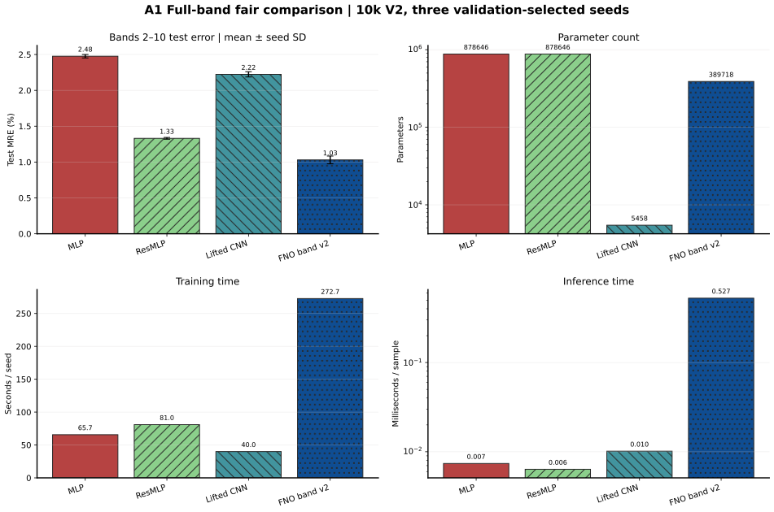

*图 10-1　`mlp`、`res_mlp_wide`、`lifted_cnn` 与 `fno2d_band_v2` 的误差—规模—开销对照。误差、参数量和速度属于不同维度，粗体按每一可比列分别标记。*

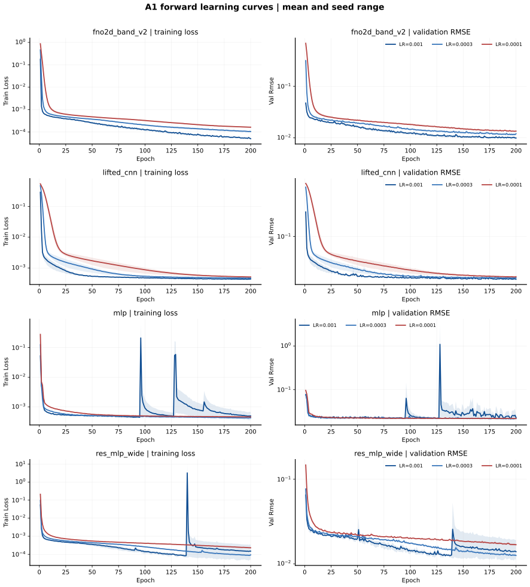

*图 10-2　由冻结 `history.csv` 重建的 A1 学习曲线；独立 A1.1 `mlp` run 已纳入。阴影为三个 seed 的观测范围，不是置信区间。*

10k 数据的 physical-\(k\) path 已通过 5 样本 real-MPB 对齐验证并完成 sidecar promotion。

A1 Query 也已完成 `81 validation / 27 selected-LR test / 9 summary`。三个协议的 validation-selected 三 seed test MRE 为：

| 协议 | `mlp_query` MRE / ordering | `deep_onet_query_v2` MRE / ordering | `fno2d_query_v2` MRE / ordering |
|---|---:|---:|---:|
| all-k | 2.1800% / **0.83%** | 1.7937% / 1.35% | **1.1004%** / 2.96% |
| physical-\(k\) interpolation | 2.2079% / 0.42% | 1.6308% / **0.41%** | **1.0470%** / 2.16% |
| physical held-out segment | 4.2548% / 1.00% | 3.7604% / **0.99%** | **3.6747%** / 9.22% |

`fno2d_query_v2` 在三个协议上 MRE 最低，但 held-out segment 的 ordering violation 为 9.22%，高于 `deep_onet_query_v2` 的 0.99% 和 `mlp_query` 的 1.00%。因此它是当前误差最优 Query 代理，不是所有物理排序指标上的绝对赢家。

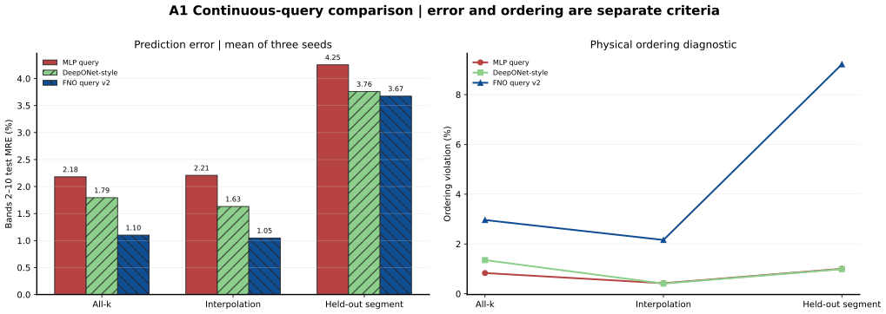

*图 10-3　三种 Query 模型在 all-k、interpolation 和 held-out segment 上的 MRE 与 ordering violation。A1 Query run 只保留最终 validation/test 指标，没有逐 epoch history，因此本报告不补画虚构的 Query 学习曲线。*

## 10.2 A2 Objective-Bridge：100-target 调整验证

第一版 reconstruction-only A2 在训练阶段存在问题，不能代表有效的 inverse 训练结果。本报告撤销该轮四方法数值、统计比较和结果图，不再把它作为历史基线或当前结论。其 reconstruction checkpoint 只保留为 objective-bridge 的 warm start 谱系；warm start 的存在不恢复被撤销结果的证据资格。

修正后的 objective-bridge 固定 seed 0、同一组 100 个 test targets、A1 `fno2d_band_v2` 主 objective/ranker、`fno2d_query_v2` cross-surrogate、\(K=128\)、Top-5 和相同 real-MPB budget。single-mode 与 mixture 均从 warm start 继续训练 50 epochs，LR 为 `1e-4`。当前有效的 100-target 结果为：

| 方法 | Real-MPB mean MRE | 95% bootstrap CI | Median | P10 / P90 | Surrogate MRE | Surrogate–replay gap | Effective K / M |
|---|---:|---|---:|---:|---:|---:|---:|
| objective-bridge single-mode | **2.3986%** | [2.2890%, 2.5102%] | **2.3195%** | **1.7586% / 3.3311%** | **2.2772%** | **0.1213 pp** | **111.55 / 5.00** |
| objective-bridge mixture | 2.5105% | [2.3840%, 2.6406%] | 2.4034% | 1.7832% / 3.5342% | 2.3534% | 0.1571 pp | 107.86 / 5.00 |

在这 100 个配对目标上，mixture 的 replay mean 比 single-mode 高 `0.1120` pp，配对 bootstrap 95% CI 为 `[0.0088, 0.2196]` pp；双侧 sign-test `p=0.3682`。这说明 seed0 下 single-mode 的平均值较低，但单个 seed 不能支持“single-mode 架构普遍优于 mixture”的跨 seed 结论。

该轮先完成固定 20-target real-MPB pilot，solver failure 为 0，当时的 promotion decision 记录为 `promote_full_100`。由于该 decision 的相对改善门槛引用了现已撤销的第一版结果，本报告只保留 pilot 的求解完整性，不再保留其相对改善结论。随后完成的 100-target replay 包含 `1,000` 个 Top-5 方法引用，经结构哈希去重后执行 `718` 个 unique real-MPB solves，复用 `282` 个缓存结果，solver failure 为 0。其证据状态是 `adjustment_pilot_full_100_completed / single_seed_adjustment_pilot`，不是三 seed 正式稳定性证明。

retrieval 与 direct inverse 没有在修正后的 objective-bridge 下重新训练并形成新的完整公平主表，因此本报告不沿用第一版 A2 中冻结带入的数值，也不据此比较生成器与 retrieval/direct。

## 10.3 A2 Objective-Bridge：完整 test625 real-MPB replay

100-target 调整通过后，仓库冻结相同 seed0 checkpoint、主/次代理、候选规则和 solver protocol，不再训练，直接扩展到完整 pure-test split 的 625 个目标。每目标生成 \(K=128\) 个候选并回放 Top-5；当前主结果为：

| 方法 | Real-MPB mean MRE | 95% bootstrap CI | Median | P10 / P90 | Surrogate MRE | Surrogate–replay gap | Effective K / M |
|---|---:|---|---:|---:|---:|---:|---:|
| objective-bridge single-mode | **2.2614%** | [2.2263%, 2.2965%] | **2.2196%** | **1.7264% / 2.8262%** | **2.1434%** | **0.1180 pp** | **112.02 / 5.00** |
| objective-bridge mixture | 2.3916% | [2.3485%, 2.4341%] | 2.3281% | 1.7398% / 3.1373% | 2.2477% | 0.1440 pp | 109.24 / 5.00 |

625-target 配对比较中，mixture 相对 single-mode 的 mean delta 为 `+0.1302` pp，配对 bootstrap 95% CI 为 `[0.0905, 0.1705]` pp，sign-test `p=0.001022`。这是固定 seed0、固定目标和固定预算下的配对证据；由于没有 seeds 1/2 的独立 reconstruction pretrain 与 objective finetune，仍不得声明跨 seed 架构稳定性。

完整 test625 replay 的运行完整性如下：

| 项目 | 结果 |
|---|---:|
| Evidence status | `adjustment_test625_completed / single_seed_adjustment_test625_replay` |
| Test targets | 625 |
| Top-5 method references | 6,250 |
| Unique real-MPB solves | 2,097 |
| Structure-cache reuse | 4,153 |
| Resumed solves | 718 |
| Solver failures | 0 |
| Replay worker wall time | 43,176.95 s |

objective-bridge 的 50-epoch 训练与完整 test625 推理开销为：

| 方法 | Objective train time | Peak GPU memory | 625-target sampling | 625-target ranking |
|---|---:|---:|---:|---:|
| single-mode | 1,820.16 s | 1,432.70 MB | 1.408 s | 221.333 s |
| mixture | 1,622.73 s | 1,432.71 MB | 1.191 s | 215.567 s |

作为独立历史参考，2026-07-06 的 objective-finetuned mixture seed2 在相同 625-target split 上得到 `3.0775%` replay mean MRE、`1.6322%` surrogate MRE、`1.4454 pp` surrogate–replay gap 和 `115.16` effective K。当前 single-mode 与 mixture 相对该历史流程分别改善 `26.52%` 和 `22.29%`，但两者的 seed、主 ranker、secondary surrogate 和训练谱系不同，因此该参考不能用于单因素架构归因，也不进入当前受控主表。

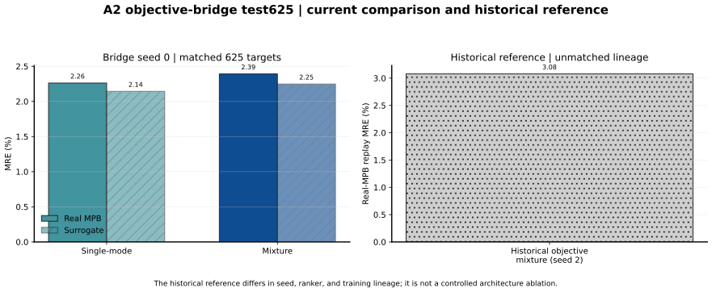

*图 10-4　左侧比较当前 seed0 single-mode/mixture 配对协议，右侧单列 seed2 历史 objective mixture。第一版 reconstruction-only A2 不进入该图和当前结果体系。*

两项 objective-bridge 结果均限于固定 V2 数据分布，不能直接外推为 OOD 泛化或任意目标能带设计能力。当前状态也不证明生成器优于 train-only retrieval，因为有效 bridge 协议没有重新完成 retrieval/direct 的公平对照。

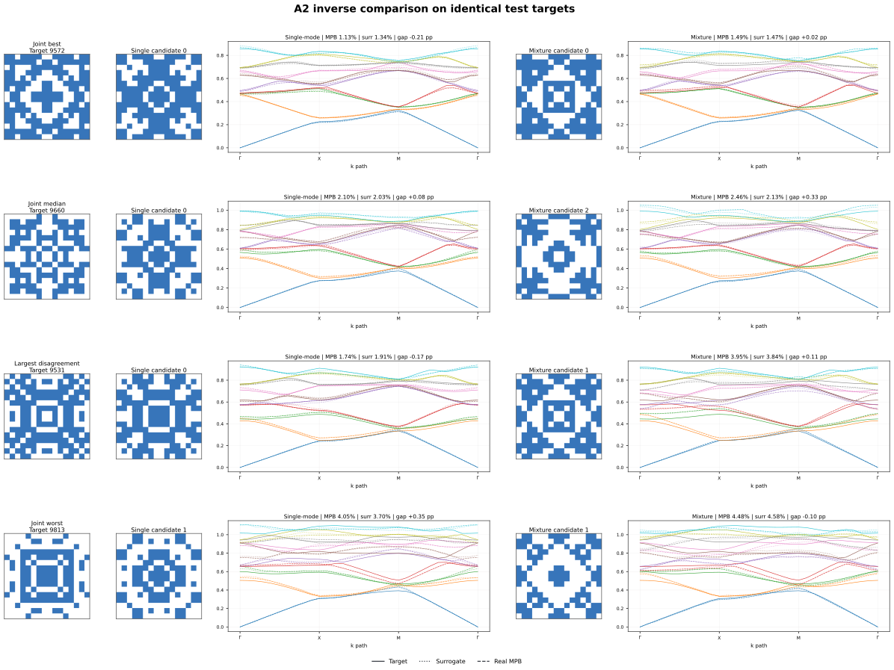

*图 10-5　joint-best、joint-median、largest-disagreement 和 joint-worst 四个相同 target 的配对案例。结构像素差异只用于诊断；inverse 为多解问题，像素接近不等于频谱更优。完整 best/worst、random40、8 目标和单目标页面见[图件索引](assets/phc2d_project_full_introduction_20260724/figure_index.md)。*

## 10.4 七 Surrogate Inverse 筛选的当前状态

仓库已经接入 `mlp`、`res_mlp_wide`、`lifted_cnn`、`fno2d_band_v2`、`mlp_query`、`deep_onet_query_v2` 和 `fno2d_query_v2` 七个候选排名器，并完成 validation100 固定候选池、checkpoint/hash 谱系和小型 real-MPB smoke。它目前**没有形成可接受的七模型排名结果**，原因有两层：

1. 冻结候选池来自第一版已撤销的 reconstruction generator checkpoint；在本报告的新证据规则下，该候选池不能用于代理晋级或后续 objective 训练决策。
2. 即使暂不考虑谱系失效，候选健康度也没有满足 Top-5 pilot 覆盖要求。

| Validation100 candidate health | 结果 |
|---|---:|
| Requested K | 128 |
| Effective K mean | 21.83 |
| Effective K p10 | 5.90 |
| Effective K min | 2 |
| Validity rate mean | 1.00 |
| Unique rate mean | 1.00 |
| Hamming diversity mean | 0.08168 |

固定 pilot 中，target indices `7256`、`7498` 和 `8144` 分别只有 `4`、`4` 和 `2` 个有效候选，低于 Top-5 要求。因此 `pilot_replay_blocked.json` 的状态为 `blocked_candidate_coverage`，20-target real-MPB pilot 没有启动。后续 objective run 也只达到 `preflight_passed / config_ready_surrogate_objective`，尚未训练任何三臂 surrogate-objective generator，更没有 FNO 与 challenger 的三 seed 正式结果。

因此当前不能回答“七个 surrogate 中谁的 inverse replay 最好”。重新启动该路线前，必须先用不属于撤销结果谱系的合格 generator 生成中立候选池，并重新通过 candidate-health、Top-5 coverage、20-target pilot 和 promotion gate。当前证据入口为本地运行目录 `runs/20260731/a2_inverse_surrogate_screen_v1_202607311402`；其中的 strategy-side 数值只属于 blocked 诊断，不进入本报告排行榜。

## 10.5 TE 本征场与 adapted PINO

在 9,216 条 real-MPB operator-style TE Bloch eigenfield 数据上，三 seed 测试结果为：

| 模型/制度 | E relative L2 | H relative L2 | Frequency MRE | Maxwell residual | 参数量 | 训练开销 |
|---|---:|---:|---:|---:|---:|---:|
| `unet_field_v2` | **0.5015 +/- 0.0091** | **0.4765 +/- 0.0079** | **1.7591% +/- 0.0475%** | **2.7183 +/- 0.2413** | 4,592,263 | 6,934.26 s/seed |
| `fno_field_v2` | 0.6925 +/- 0.0048 | 0.6494 +/- 0.0023 | 2.8627% +/- 0.3955% | 6.9342 +/- 1.1039 | 4,735,399 | 1,362.82 s/seed |
| adapted PINO | 0.6856 +/- 0.0045 | 0.6462 +/- 0.0016 | 3.5716% +/- 0.3507% | 4.3301 +/- 0.8327 | 4,735,399 | 1,428.54 s/new seed |

这里仅对完全匹配的 `fno_field_v2` 主干计算 adapted PINO 的变化量：

| PINO 相对 data-only FNO | E relative L2 | H relative L2 | Frequency MRE | Maxwell residual mean |
|---|---:|---:|---:|---:|
| 相对变化 | -1.00% | -0.49% | +24.76% | -37.55% |

粗体只标记三行完全可比表格中的全局最优；PINO 的 residual 改善写入独立 delta 表，不再与 U-Net 的全局最优混为一谈。PINO seed 0 复用 validation-selected checkpoint，`1,428.54 s/new seed` 是 seed 1/2 的平均新增训练时间。其 Maxwell residual median 相对匹配 FNO 降低约：

\[
37.48\%.
\]

但是它的 frequency MRE 反而升高，说明 residual 改善并不自动等价于频率预测改善。

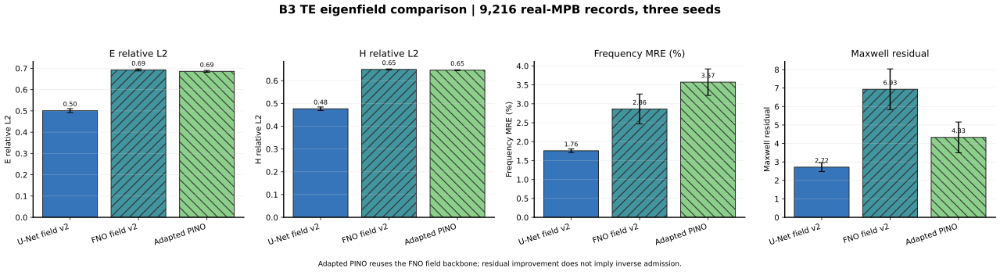

*图 10-6　U-Net、data-only FNO 与 adapted PINO 的四项指标。PINO 与 FNO 共用网络主干，因而该图比较的是网络+训练制度组合，不是三个彼此独立的架构。*

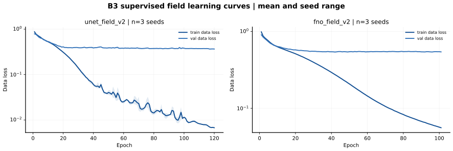

*图 10-7　B3 data-only U-Net/FNO 的训练与 validation data loss。P4/P5/P6 PINO 学习曲线保留在[完整学习曲线索引](assets/phc2d_project_full_introduction_20260724/figure_index.md)，并保持 partial history 标注。*

最新 P4/P5 修复候选已经通过 frequency cross-check，但以下门槛仍然受阻：

- residual 与真实频率误差的排序校准；
- 64 到 96/128 分辨率的 zero-shot 稳定性；
- physics residual reranking；
- field-physics inverse 接入。

当前 `candidate_selection.json` 中：

```text
eligible_candidates = []
selected_candidate = null
inverse_status = blocked
```

因此 PINO 分支可以作为受限的本征场研究结果，但还不能接入逆向设计、候选重排或宣称 field inverse 成功。

2026-07-29 的 P6 seed0 target-residual pilot 进一步确认了这一边界：P6A/P6B 的 target-residual 与频率误差 Spearman 分别为 `-0.4014` 和 `-0.3424`；选择低 residual 四分位结构反而使频率 MRE 恶化 `22.03%` 和 `25.33%`。因此 `physics_target_residual_64_ready`、`pino_inverse_adapter_preflight_ready` 和 `pino_inverse_rerank_64_ready` 均保持 `blocked`，PINO residual 不得加入当前 FNO 候选排序。

---

# 11. 相对于 POD-DeepONet 类基线的推进

| 方向 | POD-DeepONet 类基线 | 当前 `phc2d` |
|---|---|---|
| 真实数据来源 | FEM band solver | real MPB band/field solver |
| 结构输入 | 固定低维像素参数 | `rho_wedge` 与 `epsilon_grid` 多表征 |
| 前向输出 | 固定 band map | Full-Wh + Query + eigenfield |
| 波矢处理 | 固定 \(k\)-grid | 显式 physical-\(k\) query |
| 前向模型 | POD-DeepONet | MLP、CNN、DeepONet-style、FNO-inspired |
| 逆向模型 | 单一监督 inverse | mode + latent 多候选生成器 |
| 候选数量 | 通常单候选 | 当前每目标 128 候选 |
| 可信筛选 | 单代理或无筛选 | Query + Full-Wh 双代理 |
| 多样性 | 较弱 | 去重、Hamming、latent、collision 约束 |
| 最终验证 | surrogate/FEM 抽样 | Top-5 real-MPB replay |
| 场物理 | 通常不涉及 | U-Net/FNO field + adapted PINO 门控 |
| 证据管理 | 论文实验表 | 配置、运行目录、指标、谱系与裁决文件 |

项目可能凝练出的核心方法贡献是：

> **Replay-Calibrated Hierarchical Inverse Design：多模态候选生成、双代理分层筛选、结构多样性约束与真实 MPB 回放校准相结合的二维光子晶体逆向设计框架。**

---

# 12. 当前创新点

## 12.1 从固定能带矩阵回归扩展到双任务代理

项目同时研究：

\[
\varepsilon
\rightarrow
W_h
\]

和：

\[
(\varepsilon,\mathbf k)
\rightarrow
\omega(\mathbf k).
\]

Full-Wh 模型适合完整能带快速计算，Query 模型适合灵活波矢查询，两者还可以在逆向筛选中互相交叉检查。

## 12.2 从单解 inverse 转向多候选生成

项目显式承认：

\[
W_h^{*}
\rightarrow
\rho
\]

是高度非唯一问题，通过 mode 和 latent noise 为同一目标提出多个候选，而不是只输出一个平均化结构。

## 12.3 从单一 surrogate 转向主代理排序与交叉代理抗投机门控

一个生成器可能利用某个代理模型的薄弱区域。当前 objective-bridge 以 Full-Wh `fno2d_band_v2` 作为主要可微 objective 和候选 ranker，再用 Query `fno2d_query_v2` 施加 cross-surrogate consistency。两者不是对 Top-M 简单等权投票：前者负责主排序，后者负责发现和抑制只对单一网络“看起来很好”的候选。

## 12.4 从 surrogate 指标转向 real-MPB 验收

项目不把低神经网络 loss 直接称为物理成功，而是明确区分：

```text
surrogate-side result
        !=
real-MPB replay result
        !=
field-physics result
```

## 12.5 将结构多样性纳入训练和采样

通过二值去重、最小 Hamming 距离、latent response 和 collision loss，避免生成器重复提出同一个候选。

## 12.6 建立受门控的本征场物理分支

项目没有因为 Maxwell residual 下降就直接启动 physics inverse，而是要求同时通过：

- 频率一致性；
- 场误差；
- residual-error calibration；
- unseen-\(k\)；
- 跨分辨率；
- 固定预算真实求解器收益。

这使场物理模型的接入更加可审计。

---

# 13. 当前边界与尚未完成的工作

项目目前不能宣称：

1. 已忠实复现标准 FNO、DeepONet、PINO 或 MaxwellNet；
2. 当前 mixture generator 是 cVAE、diffusion 或 normalizing flow；
3. 当前生成器已经在公平预算下优于 train-only retrieval；
4. 已经完成 OOD 结构、OOD 目标或跨结构族泛化；
5. adapted PINO 已经可以用于 inverse reranking；
6. 已经完成 field-level inverse design；
7. 625-target 结果能够直接推广到任意器件、任意材料或 PCSEL；
8. 100k 数据规模一定能够继续提升性能。

后续工作不能只列研究方向，还需要固定前置条件、验收门槛和证据产物。建议按以下顺序推进：

| 优先级 | 下一步任务 | 当前阻碍 | 固定条件与最小门槛 | 完成后必须形成的证据 |
|---|---|---|---|---|
| P0 | 重建七 surrogate inverse screen 的中立候选谱系 | 当前 validation100 候选来自已撤销的 reconstruction checkpoint，且三个目标不足 Top-5 | 使用修正后的 generator 谱系；记录 validity、effective-K、Hamming 和每目标 Top-5 coverage；coverage 不足时禁止启动 replay | candidate-health 报告、冻结候选 manifest、blocked/promote 决策 |
| P0 | 完成不同 A1 primary surrogate 的 objective-train + paired replay 消融 | 固定旧候选池只回答 ranker 替换，不能回答 objective 代理贡献 | 固定 generator warm start、target、seed、\(K\)、Top-M、训练预算和 MPB budget；每个 surrogate 必须重新 finetune | surrogate/replay 分离主表、配对统计、运行时间、谱系和失败分析 |
| P0 | 完成 single-mode 与 mixture 的跨 seed 稳定性 | 当前 100-target 与 test625 只有 seed0 | seeds 1/2 必须具有独立 reconstruction、objective finetune、采样和 replay 谱系 | 三 seed 聚合、配对置信区间、cross-seed 结论与正式 A2 状态 |
| P1 | 完成 \(K\)、effective-K、Top-M 和 mode-count 消融 | 当前无法分离候选预算与离散 mode 的贡献 | 相同目标、seed 和总 MPB budget；同时报告采样、排序与 replay 开销 | 预算—精度—多样性曲线和推荐运行点 |
| P1 | 修复 PINO residual-error calibration 与跨分辨率退化 | P6 residual 与真实频率误差负相关，96/128 zero-shot 未过线 | 先通过 frequency fidelity、dense-\(k\)、64→96/128 和 residual-error calibration；任一失败继续 blocked | candidate selection、跨分辨率指标、准入裁决和失败案例 |
| P2 | 建立 OOD 结构族与目标能带协议 | 当前结果只覆盖 V2 同分布 pure-test targets | 冻结 generator/fill-ratio/morphology/gap 等 OOD 元数据与分层 target；采用 WSL `meep_env` replay | OOD benchmark、分层 replay、域内/域外差距和适用范围 |
| P2 | 决定是否实现真正的 cVAE、flow/cINN 或 diffusion | 当前生成器已能产生多候选，但架构增益尚未与预算因素分离 | 仅在 P0/P1 的候选与 replay 协议稳定后立项；不得沿用误导性配置名代替实现 | 新架构实现、同预算基线、正式 replay 与模型身份审计 |
| P3 | 扩展到复杂形态、多材料、制造约束和 PCSEL 相关结构 | 当前数据、表示和 solver protocol 均针对现有 p4m/TE 主线 | 每次扩展先定义数据 schema、结构合法性、solver 配置和 OOD 边界 | 新数据说明、基线、物理验证与适用范围声明 |

所有 P0–P3 任务都必须继续区分 surrogate evaluation、WSL `meep_env` real-MPB replay 和 field-physics 证据；工程测试通过不能替代研究验收。

---

# 14. 总结

本项目可以概括为：

> **一个面向二维光子晶体的多表征神经算子与回放校准生成式逆向设计平台：以真实 MPB 数据为基础，用 Full-Wh、连续波矢 Query 和本征场代理模型加速 Maxwell 响应预测，通过条件多候选生成、结构多样性约束、主代理排序与交叉代理一致性门控完成逆向搜索，最终由真实 MPB replay 判断候选结构是否真正实现目标能带。**

项目形成的研究路线是：

```text
Real MPB solver
        |
        v
Multi-representation dataset
        |
        v
Full-band / Query / Field neural surrogates
        |
        v
Multi-candidate conditional generator
        |
        v
Primary-surrogate ranking
        +
Cross-surrogate consistency and morphology gates
        |
        v
Top-M real-MPB replay
        |
        v
Physically verified inverse design
```

项目当前最成熟的成果是：

- 10k V2 数据上的前向代理；
- 625 个纯测试目标上的 seed0 objective-bridge 生成式逆向设计；
- single-mode 与 mixture 共 `6,250` 个 Top-5 方法引用，经结构去重后完成 `2,097` 个 unique real-MPB solves；
- 明确区分 surrogate、solver replay 和 field-physics 的证据体系。

场物理与 adapted PINO 已取得阶段性结果，但仍处于严格准入门控之下。

---

# 附录 A：主要证据入口

| 证据 | 路径 |
|---|---|
| 模型与证据清单 | [`phc2d_model_inventory_v1.yaml`](phc2d_model_inventory_v1.yaml) |
| 精选结果图、学习曲线和 inverse 图件索引 | [`assets/phc2d_project_full_introduction_20260724/figure_index.md`](assets/phc2d_project_full_introduction_20260724/figure_index.md) |
| 精选图件来源与 SHA-256 | [`assets/phc2d_project_full_introduction_20260724/artifact_manifest.json`](assets/phc2d_project_full_introduction_20260724/artifact_manifest.json) |
| 研究计划权威 | [`../planning/fno_generative_network_adjustment_plan_20260617.md`](../planning/fno_generative_network_adjustment_plan_20260617.md) |
| 当前研究计划 | [`../planning/fno_generative_network_adjustment_plan_20260617.md`](../planning/fno_generative_network_adjustment_plan_20260617.md) |
| 当前 gate 与 TODO | [`../planning/research_todo_20260617.md`](../planning/research_todo_20260617.md) |
| 历史 40-target inverse gate | [`../results/inverse_retrain_v2_10000_20260706.md`](../results/inverse/inverse_retrain_v2_10000_20260706.md)（历史诊断，不属于当前 objective-bridge） |
| 历史 seed2 objective mixture 625-target | [`../results/inverse_mpb_replay_mixture_v2_10000_test625_20260706.md`](../results/inverse/inverse_mpb_replay_mixture_v2_10000_test625_20260706.md)（仅作跨谱系参考） |
| 历史 seed2 replay artifacts | `runs/20260706/inverse_mpb_replay_mixture_v2_10000_test625_summary_20260706224424`（本地） |
| B3 field / PINO | [`../results/field_eigen_te_b3_v2_pino_20260720.md`](../results/field-physics/field_eigen_te_b3_v2_pino_20260720.md) |
| B4 dense-k gate | [`../results/field_eigen_te_b4_dense_k_admission_20260722.md`](../results/field-physics/field_eigen_te_b4_dense_k_admission_20260722.md) |
| B4 candidate selector | `runs/20260723/field_eigen_te_b4_repair_validation_selector_202607231500`（本地） |
| A1 Forward artifacts | `runs/20260724/a1_forward_fair_v1_202607240020`（本地） |
| A1 Forward/Query 正式报告 | [`../results/forward/a1_forward_query_fair_v1_20260726.md`](../results/forward/a1_forward_query_fair_v1_20260726.md) |
| 第一版 reconstruction-only A2（已撤销） | [`../results/inverse/a2_inverse_single_seed_formal_20260727.md`](../results/inverse/a2_inverse_single_seed_formal_20260727.md)（仅保留问题定位与 warm-start 谱系） |
| A2 100-target objective-bridge 报告 | [`../results/inverse/a2_inverse_objective_bridge_seed0_v1_20260727.md`](../results/inverse/a2_inverse_objective_bridge_seed0_v1_20260727.md) |
| A2 100-target objective-bridge artifacts | `runs/20260727/a2_inverse_objective_bridge_seed0_v1_202607271804`（本地） |
| A2 625-target objective bridge | `runs/20260728/a2_inverse_objective_bridge_seed0_test625_v1_202607280842`（本地） |
| 七 surrogate inverse screen（blocked） | `runs/20260731/a2_inverse_surrogate_screen_v1_202607311402`（本地） |
| 多正向代理 rerank 诊断 | [`../results/inverse/inverse_surrogate_rerank_v2_10000_20260630.md`](../results/inverse/inverse_surrogate_rerank_v2_10000_20260630.md) |
| P6 seed0 target-residual gate | [`../results/field-physics/field_eigen_te_p6_seed0_target_residual_pilot_20260729.md`](../results/field-physics/field_eigen_te_p6_seed0_target_residual_pilot_20260729.md) |
| Physical-\(k\) validation | `runs/20260724/k_path_physical_validation_v2_10000_a1_202607240017`（本地） |

说明：

- 文档中的“已完成”“通过”“blocked”和“物理验证”等状态均按当前运行产物解释；
- `result_withdrawn` 只保留实现身份、问题定位和谱系追踪，不进入当前数值、方法比较或结论；
- Windows 本地 smoke 不作为正式 MPB/Meep 验收；
- 正式物理验证环境为 WSL `Ubuntu` + conda `meep_env`；
- bands 2-10 MRE 是当前 inverse 与 replay 的 headline 指标，full-band MRE 仅作为辅助诊断。

---

# 附录 B：全模型逐项审计

本附录逐项列出实时注册表的 17 个模型；“已实现”只说明统一代码路径可构建，不能替代训练、测试或物理回放证据。

| # | Canonical model | 模型族/任务 | 实现状态 | 证据状态 | 报告位置 |
|---:|---|---|---|---|---|
| 1 | `mlp` | MLP / Full-band | implemented | formal | 5.1、10.1 |
| 2 | `res_mlp` | ResMLP / Full-band | implemented | historical | 5.10、8.1 |
| 3 | `res_mlp_wide` | ResMLP / Full-band | implemented | formal | 5.1、10.1 |
| 4 | `pod_res_mlp` | POD-MLP / Full-band | placeholder | no_result | 5.10 |
| 5 | `lifted_cnn` | CNN / Full-band | implemented | formal | 5.2、10.1 |
| 6 | `fno_lite` | neural operator / Full-band | implemented | historical | 5.10 |
| 7 | `fno2d_band` | neural operator / Full-band | implemented | historical | 5.10 |
| 8 | `fno2d_band_v2` | neural operator / Full-band | implemented | formal | 5.3、10.1 |
| 9 | `mlp_query` | MLP / Query | implemented | formal | 5.4、10.1 |
| 10 | `deep_onet_query` | DeepONet-style / Query | implemented | historical | 5.10 |
| 11 | `deep_onet_query_v2` | DeepONet-style / Query | implemented | formal | 5.4、10.1 |
| 12 | `fno2d_query` | neural operator / Query | implemented | historical | 5.10 |
| 13 | `fno2d_query_v2` | neural operator / Query | implemented | formal | 5.4、10.1 |
| 14 | `unet_field` | U-Net / Field | implemented | historical | 5.10 |
| 15 | `unet_field_v2` | U-Net / Field | implemented | formal | 5.5、10.5 |
| 16 | `fno_field` | neural operator / Field | implemented | historical | 5.10 |
| 17 | `fno_field_v2` | neural operator / Field | implemented | formal | 5.6、10.5 |

非注册表方法和训练制度单独登记如下：

| Canonical method/regime | 类型 | 实现状态 | 证据状态 | 边界 |
|---|---|---|---|---|
| `train_only_nearest_neighbor` | retrieval baseline | implemented | result_withdrawn | 第一版 A2 数值已撤销；需在修正协议下重新形成公平结果 |
| `direct_inverse_mlp` | deterministic inverse | implemented | result_withdrawn | 第一版 A2 数值已撤销；需在修正协议下重新训练和回放 |
| `single_mode_generator` | latent inverse generator | implemented | single_seed_bridge | 当前有效结果为 objective-bridge 100-target 与 test625 replay |
| `mixture_conditional_generator` | multimode inverse generator | implemented | single_seed_bridge | 当前有效结果为 objective-bridge 100-target 与 test625 replay；不得改称 cVAE 或 diffusion |
| `adapted_pino` | `fno_field_v2` training regime | implemented | blocked | field pilot 有结果；inverse/rerank admission blocked |

配置、可行性或文献参考项如下；它们用于规划边界，不计入“17 个注册模型”，也不进入当前正式排行榜：

| 名称 | 当前身份 | 禁止误写为 |
|---|---|---|
| `conditional_vae_rho` | 历史误导性配置名 | 已实现 cVAE |
| `conditional_diffusion_grid` | configured-only decision gate | 已完成 diffusion 训练与 replay |
| GLOnet-style pilot | 复用现有生成器的训练配方 | 独立 faithful GLOnet 网络 |
| NeurOLight | feasibility/reference | 已完成 B3 可比复现 |
| MaxwellNet | feasibility/reference | 已完成 driven-field 复现 |
| cINN / normalizing flow | literature/reference | 已接入统一运行时 |
| AdjointDiffusion | literature/reference | 已实现或已有结果 |

程序化结构生成器属于数据流水线组件，不计入神经网络模型数量。机器可审计的逐项字段、源路径和 SHA-256 以 [`phc2d_model_inventory_v1.yaml`](phc2d_model_inventory_v1.yaml) 为准。
