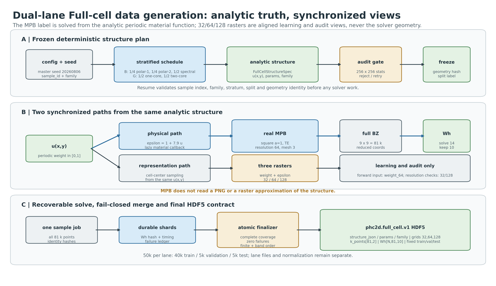
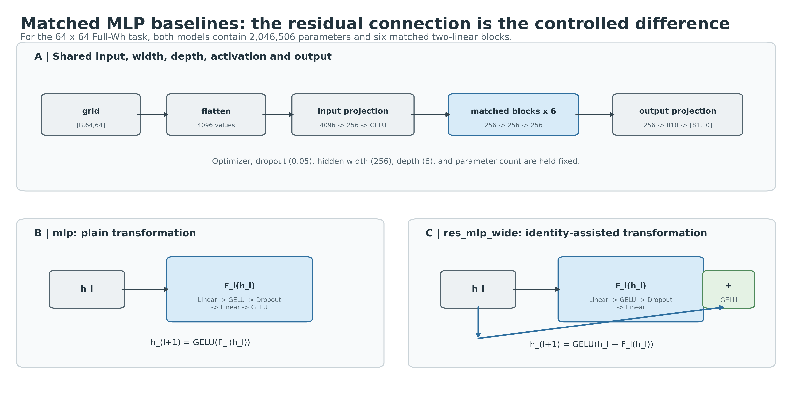
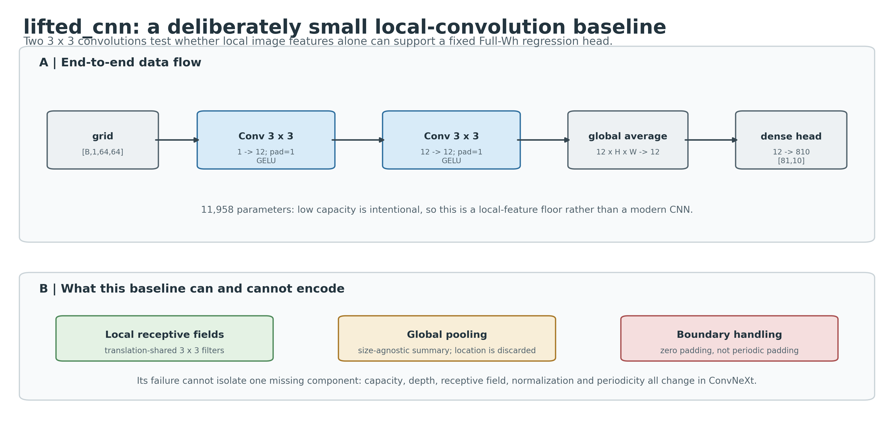
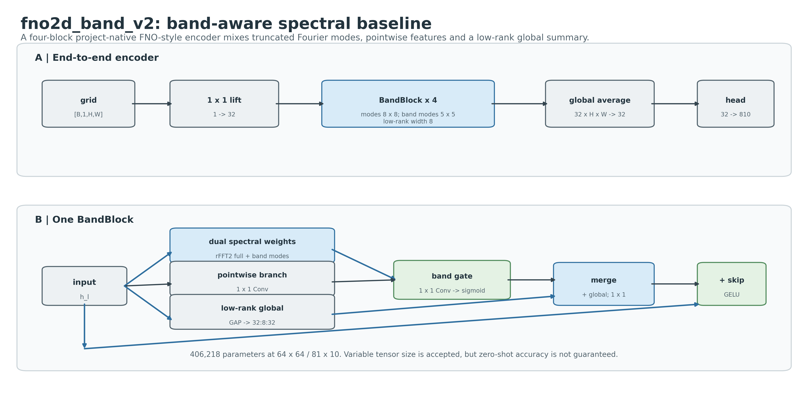
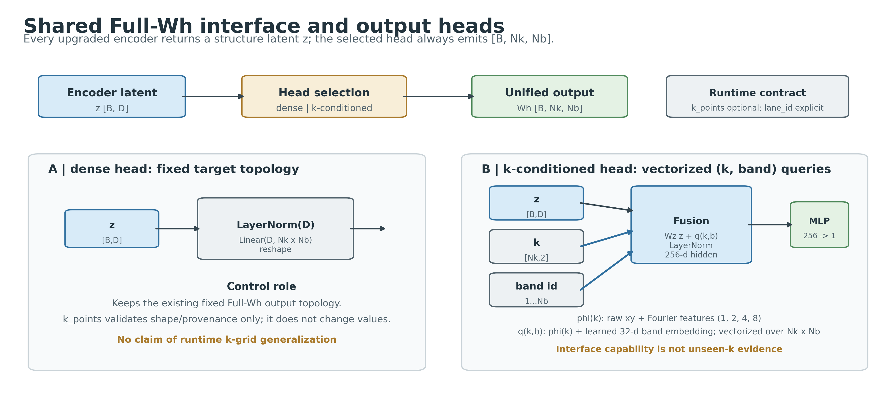
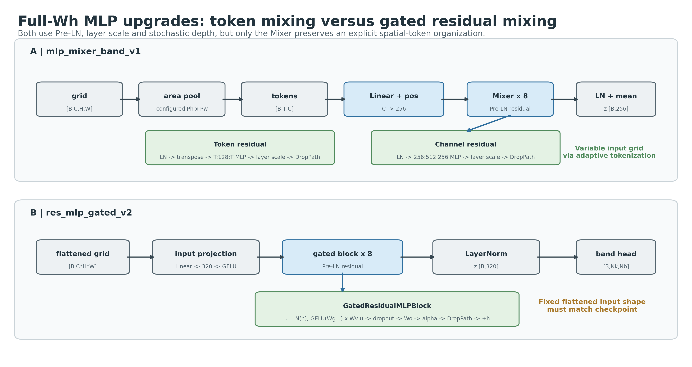
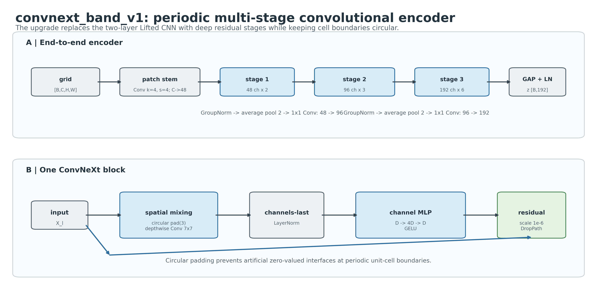
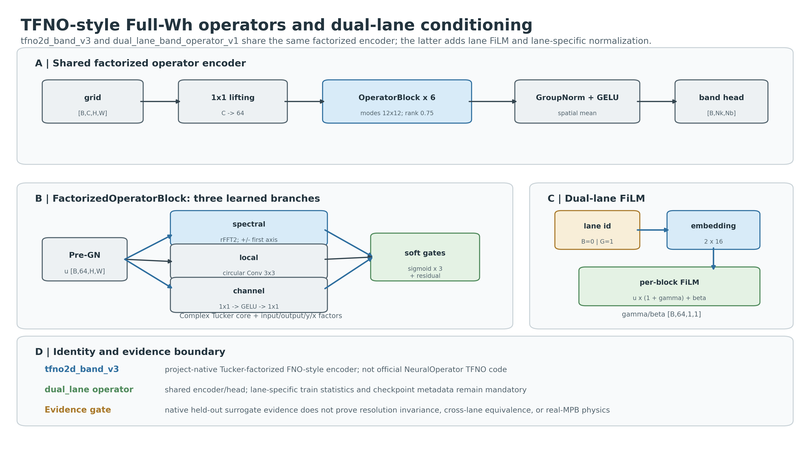
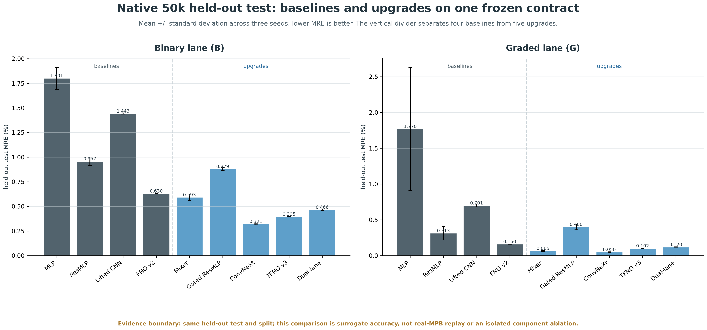
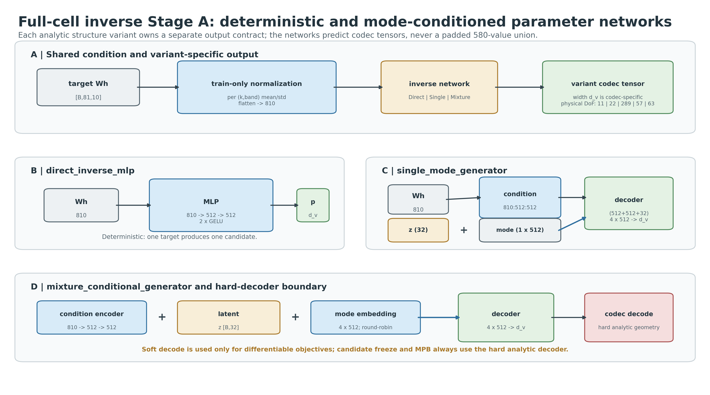

<!--
  Draft full-cell forward and inverse model report for the unified phc2d workspace.
  Author: fangtoast
  Email: fangtoast@foxmail.com
  Copyright (c) 2026 fangtoast. All rights reserved.
-->

<a id="full-cell-forward-inverse-model-report"></a>

# 全胞双路线正向与逆向模型报告

| Metadata | Value |
|---|---|
| Status | Draft，待项目负责人审阅 |
| Document role | 带日期的全胞双路线方法架构与结果综合报告 |
| Primary layer | L2 方法架构；读取 L3 结果作为结构解释证据 |
| Evidence updated through | 2026-08-10 |
| Audience | 项目负责人、模型开发者、实验执行者与论文整理人员 |
| Owner | 研究生维护，导师审阅模型身份、结果解释与下一 gate |
| Reading time | 45 minutes |

本文因数据集、任务和模型集合已经改变而新建，不覆盖 [2026-07-24 项目完整介绍](phc2d_project_full_introduction_20260724.md)。本文只回答当前**全胞、全布里渊区、双路线**问题：数据如何从解析结构生成并经 real-MPB 形成训练合同，四个原始 baseline 和五个升级正向网络分别如何计算，升级组件带来了什么可观测收益，以及解析参数逆向网络当前做到哪一步。

本文不把旧 p4m 的 `31×10` 任务混入当前 `81×10` 主结果，不把训练重叠 monitor 当成 held-out test，不把 32/128 直接输入诊断称为物理分辨率不变性，也不把 surrogate 改善称为 real-MPB replay 通过。Query、Field、adapted PINO 和历史 inverse 分支仍属于项目的其他任务，完整身份见[模型清单](phc2d_model_inventory_v1.yaml)，不在本文逐网展开。

## 一、结论先行

1. 当前正向主任务是 `material_weight_grid_64 → Wh[81,10]`。每个样本先冻结可回放的解析周期结构，real-MPB 直接读取解析材料函数；`32/64/128` 栅格是同一结构的同步重采样，不是 MPB 几何真值。binary 与 graded 两条 50k 数据路线各使用 `40k/5k/5k` train/validation/test；模型选择不能访问 test。
2. 四个 baseline 中，`fno2d_band_v2` 是最强基线：50k held-out test 的 B/G lane MRE 分别为 `0.6296%/0.1602%`。这个结论延续了 10k 主矩阵中 FNO 在七种表征均最低的趋势。
3. 五个升级模型中，`convnext_band_v1` 在 native 64×64 held-out test 两条 lane 都最优，B/G MRE 为 `0.3212%/0.0500%`；相对 `fno2d_band_v2` 分别改善 `48.98%/68.75%`。
4. `mlp_mixer_band_v1` 的 native 精度略逊于 ConvNeXt，但在 32/128 零样本输入分辨率诊断中四项总体最好，是当前“精度—分辨率输入稳定性—计算成本”之间最有价值的备选。
5. `tfno2d_band_v3` 相对 FNO v2 的 B/G 误差降低 `37.27%/36.36%`，证明因子化频谱升级是正结果；但训练约需 5 小时、吞吐较低，且精度仍逊于 ConvNeXt。
6. `res_mlp_gated_v2` 是必须保留的负结果：B lane 只小幅改善，G lane 明确退化。更深、门控、Pre-LN、layer scale 和 DropPath 并不会自动克服展平表示的限制。
7. `dual_lane_band_operator_v1` 两条 lane 均优于旧 FNO，但没有达到“一个联合模型替代两个最佳独立模型”的精度和存储门；lane FiLM 不能被描述成已经解决 domain shift。
8. 50k 验证最终为五个升级模型都选择了 `dense` 输出头。因此当前结果证明的是**编码器升级**，不证明 `k_conditioned` 头优于 dense，也不证明任意未见 k 点泛化。
9. 逆向 Stage A 的 codec、CPU 合同和小规模 runner smoke 已存在，但正式配置仍引用双路线 10k 数据，`forward_surrogate_status=not_trained`，正式 45-run N40 Stage A、Stage B、候选冻结与 real-MPB replay 均未完成。50k 正向成功不能自动升级这些状态。

## 二、任务与数据合同为什么已经改变

### 2.1 从旧 p4m 到当前全胞任务

| 证据阶段 | 结构/数据 | 输入 | 输出 | 本文角色 |
|---|---|---|---|---|
| A1 p4m 10k | 对称约化 V2 数据 | `rho_wedge[36]` 或 `epsilon_grid[16,16]` | `Wh[31,10]` | 历史方法证据；只用于解释残差与频谱路线起点 |
| 全胞双路线 10k | binary + graded，多结构族、全 BZ | `material_weight_grid_{32,64,128}` | `Wh[81,10]` | baseline 扩展与表征/分辨率实验 |
| 全胞双路线 50k | binary + graded，全 BZ | 主训练字段 `material_weight_grid_64` | `Wh[81,10]` | 当前 baseline 与升级模型主证据 |
| 当前逆向配置 | 双路线 10k 解析结构 | 条件 `Wh[81,10]` | 变体专属 analytic parameter codec tensor | 已实现/预检，尚未迁移到 50k 正式训练 |

因此，旧报告中的 Query `k` 点任务、p4m wedge 输入和 `31×10` 输出都不能直接替代当前全胞模型说明。当前正向问题统一写为

$$
\mathcal{G}_{\theta}^{(r)}:
x^{(r)}\in\mathbb{R}^{C\times H\times W}
\longmapsto
\widehat{W}h\in\mathbb{R}^{N_k\times N_b},
$$

其中路线 $r\in\{B,G\}$，当前主合同为 `C=1, H=W=64, Nk=81, Nb=10`。这些数值来自数据 schema 和配置，不是模型代码中的永久常量。

### 2.2 当前 50k 数据账本

| Route | 数据文件 | SHA-256 | 主字段 | Split | 语义 |
|---|---|---|---|---|---|
| B | `data/full_cell_binary_bz9_50000_xingyi_v1.h5` | `e2d99e0...13f00` | `material_weight_grid_64` | 40k/5k/5k | binary medium 的真实 `Wh` 标签 |
| G | `data/full_cell_graded_bz9_50000_xingyi_v1.h5` | `172786bc...8a46` | `material_weight_grid_64` | 40k/5k/5k | continuous graded medium 的真实 `Wh` 标签 |

两条路线共享冻结 k-grid，`k_points_sha256=f5de7ced...a5173`，但结构分布、材料函数和 train normalization 分开。B 与 G 的 held-out test index hash 也不同，不能把同一样本序号误当成成对结构。

### 2.3 数据生成总链路

当前数据链路由[生成入口](https://github.com/fangtoast/phc2d/blob/master/src/phc2d/data/full_cell_generation.py)、[结构与 HDF5 合同](https://github.com/fangtoast/phc2d/blob/master/src/phc2d/data/full_cell.py)、[双路线生成器](https://github.com/fangtoast/phc2d/blob/master/src/phc2d/generators/full_cell.py)、[解析材料 MPB 求解器](https://github.com/fangtoast/phc2d/blob/master/src/phc2d/solvers/full_cell.py)和[可恢复分片收尾器](https://github.com/fangtoast/phc2d/blob/master/src/phc2d/data/full_cell_hpc.py)共同定义。50k 的冻结参数来自 [B route 配置](https://github.com/fangtoast/phc2d/blob/master/configs/research/full_cell_binary_bz9_50000_xingyi_v1.yaml)与 [G route 配置](https://github.com/fangtoast/phc2d/blob/master/configs/research/full_cell_graded_bz9_50000_xingyi_v1.yaml)。完整逻辑是：

1. 根据 lane、样本序号和固定 schedule 确定结构 family/variant；由 `master_seed + sample_id + generator_family` 的 SHA-256 派生样本 RNG seed。
2. 生成解析参数，构造 `FullCellStructureSpec`，在 `256×256` 审计栅格上检查材料占比、灰度、连通性、最小特征和高频能量；不合格则在固定 RNG 序列内重试。
3. 写入并冻结 `sample_plan.jsonl`；恢复时重新校验样本序号、family、stratum、split 与 `geometry_hash`，而不是重新抽样。
4. 同一解析结构分成两条同步路径：一条通过 `epsilon_at(x,y)` 直接供 MPB 材料回调求解；另一条在 cell center 重采样出 `32/64/128` 的 weight/epsilon 栅格。
5. 每个样本作为一个包含全部 81 个 k 点的求解任务，真实 MPB 返回 `Wh[81,10]`；分片完整、零失败、shape/finite/band-order 门通过后才原子化合并 HDF5。
6. HDF5 冻结结构身份、解析参数、三种栅格、k-grid、`Wh` 和互斥 split；后续模型只能按各自字段合同读取，不能从 PNG 或预览图反推结构。



**图 2-1｜数据生成链路。** 物理标签路径与学习表征路径共享同一份解析结构。蓝色路径表示 real-MPB 标签求解，灰/黄色路径表示栅格化与审计；这张图说明代码合同，不额外宣称新的数据验收结果。

### 2.4 两条结构分布怎样采样

#### 2.4.1 G route：连续渐变介质

G route 只有 `graded_rbf_fourier` family，但按一个和两个空气势阱分成两个 stratum，各占 50%。50k schedule 因而是 `25,000 + 25,000`。在归一化周期晶胞 $[-0.5,0.5)^2$ 上，材料权重为

$$
u_G(x,y)=\sigma\!\left(
\frac{
-\sum_{j=1}^{J} A_j G_j^{\mathrm{periodic}}(x,y)
+\lambda\sum_m c_m\phi_m(x,y)-b
}{T}
\right),\qquad J\in\{1,2\}.
$$

负 RBF 项形成空气势阱，高材料背景由偏置 $b$ 托起；$b$ 通过 80 次二分搜索，使平均材料权重逼近随机目标。当前 50k 冻结范围不是早期草案值，而是：椭圆核尺度 `0.08–0.22a`、轴比 `0.75–1.33`、空气势阱幅值 `0.90–1.40`、Fourier cutoff `3`、Fourier 强度 `0.03–0.10`、温度 `0.08–0.16`、目标平均材料权重 `0.60–0.78`。

候选只有同时满足下列门禁才被接受：平均材料权重落在目标范围的 `±0.01` 容差内；`u≥0.60` 占比至少 35%；`u≤0.10` 占比至少 1%；最小值不高于 0.05、最大值不低于 0.90；`0.05<u<0.95` 的灰度比例至少 20%；高频能量比例不高于 5%。因此 G route 是真实连续材料场，不是二值图像经过模糊得到的伪渐变数据。

#### 2.4.2 B route：二值空气孔与自由形状

B route 按四步循环冻结 schedule：`polar_hole_1`、`polar_hole_2`、`spectral_threshold`、`spectral_threshold`。50k 对应单孔 `12,500`、双孔 `12,500`、低通阈值自由形状 `25,000`。

- `binary_polar_holes` 在高介电背景中放置一个或两个星形空气孔。每个孔的边界为

  $$
  r(\theta)=r_0\exp\left[\sum_{m=2}^{5}
  \left(a_m\cos m\theta+b_m\sin m\theta\right)\right],
  $$

  其中单孔 `r0=0.14–0.25a`，双孔每孔 `r0=0.10–0.18a`，系数标准差为 `0.12/m`。双孔中心距必须位于两孔最大外接半径和的 `0.60–1.50` 倍之间；孔边缘另保留 `0.03a` 晶胞边界余量。
- `binary_spectral_threshold` 先生成 cutoff `8` 的周期实 Fourier 随机场，频率包络为 $\exp[-(|k|/k_c)^4]$，其中 `kc=2.5–4.5`；再按随机空气目标占比与 `±0.03` 分位扰动确定阈值，最终严格输出 $u_B\in\{0,1\}$。

极坐标 family 的空气占比门为 `0.10–0.50`，周期空气连通分量为 `1..hole_count`；频谱 family 的空气占比门为 `0.07–0.53`，周期连通分量为 `1–3`。两者最小空气连通分量等效直径都不得低于 `0.04a`。这些门在 `256×256` 审计栅格上执行，目的在于阻止退化、碎裂或不可分辨结构进入物理解算。

### 2.5 从解析结构到 real-MPB 标签

两条路线共享统一材料映射

$$
\epsilon(x,y)=\epsilon_{\mathrm{air}}+
(\epsilon_{\mathrm{material}}-\epsilon_{\mathrm{air}})u(x,y)
=1+7.9u(x,y).
$$

MPB 的 `default_material` 是惰性材料函数；求解器在查询位置直接调用 `structure.epsilon_at(x,y)`。这意味着真实标签对应解析周期结构，而不是 `material_weight_grid_64` 或某张 PNG 的像素近似。栅格点位于每个像素 cell center：$x_j=-0.5+(j+0.5)/n$，32/64/128 三个分辨率都从同一 `FullCellStructureSpec` 独立重采样。

完整方形第一布里渊区采用

$$
k_{ij}=(i/9,j/9),\qquad i,j=-4,\ldots,4,
$$

共 81 个 centered、无边界重复的 MPB reduced reciprocal coordinates。每个结构在 square lattice、`a=1`、TE、solver resolution `64`、`mesh_size=3`、tolerance `1e-7` 下求解。求解器请求 10 条目标 band，并额外计算 4 条 guard band；对频率升序后保留前 10 条，得到 MPB 无量纲频率 `a/lambda` 的 `Wh[81,10]`。这里的 64 是 MPB 离散分辨率，与神经网络输入的 `material_weight_grid_64` 语义不同，不能把二者混作同一个“分辨率实验”。

### 2.6 样本身份、固定 split 与可恢复计算

样本 ID 固定为 `{experiment_id}_{index:06d}`，样本随机数由 master seed `20260806`、sample ID 与 family 的 SHA-256 前 8 字节派生，再收缩到 32-bit seed。因此增加 worker 数、改变任务完成顺序或恢复中断任务都不应改变结构。

split 也不是按生成顺序切片。实现先按 `graded_core_1/2`、`polar_hole_1/2`、`spectral_threshold` 分层，再按 `SHA256(sample_id)` 的稳定排序在每层分配 train/validation/test，最后以确定性 largest-remainder 修正精确总数。每条 50k lane 均为 `40,000/5,000/5,000`，且三个 index 集必须恰好覆盖全部样本一次、彼此不重叠。

集群执行把一个结构的全部 81 个 k 点作为最小物理 job。每个分片保存 sample identity、参数 hash、geometry hash、`Wh` hash、求解时间和 solver metadata。finalizer 只有在 frozen plan hash 一致、所有 shard 覆盖无缺口、失败数为 0、输出有限且 band 升序时才写正式 HDF5；中间结果写入 `.incomplete`，成功后原子替换，避免半成品被训练 loader 当成正式数据。

### 2.7 HDF5 字段与模型消费关系

| 字段 | Shape / 类型 | 生成语义 | 当前消费方式 |
|---|---|---|---|
| `sample_id` | `[N]` string | 稳定样本身份 | split、回放和 provenance 对齐 |
| `family_id` / `material_kind` | `[N]` string | generator family 与 binary/continuous 语义 | 分层审计、variant 路由 |
| `structure_json` | `[N]` string | 可完整重建的 `FullCellStructureSpec` | inverse codec 和 real-MPB replay 的解析真值 |
| `params` / `param_mask` | `[N,P]` | lane 内补齐的数值参数与有效位 | 审计/兼容字段；不能替代 variant 专属 codec |
| `material_weight_grid_32/64/128` | `[N,R,R]` | 同一 $u(x,y)$ 的三种重采样 | 正向主训练使用 `_64`；`_32/_128` 用于分辨率诊断 |
| `epsilon_grid_32/64/128` | `[N,R,R]` | 由同一 weight 线性映射的介电栅格 | 物理可视化、表征与一致性审计 |
| `k_points` / `k_grid_index` | `[81,2]` | 物理 reduced coordinate 与整数网格索引 | 输出坐标合同、query/热图对齐 |
| `Wh` | `[N,81,10]` | real-MPB TE 完整二维 BZ 标签 | 正向 target；逆向 condition |
| `idx_train/val/test` | 三个一维 index | family-stratified 固定互斥划分 | normalization、模型选择与最终测试隔离 |

训练代码当前读取 `material_weight_grid_64` 作为主输入，但 HDF5 仍保留解析结构与 32/128 栅格，所以“模型训练字段”不等于“物理结构真值”。两条 lane 分文件、分 normalization、分 test hash；`dual_lane_band_operator_v1` 只共享网络参数，不会把两个 HDF5 变成逐样本配对数据。

### 2.8 数据门禁与证据边界

数据链路分四层门禁，后一级不能反向替代前一级：

1. **结构门：** 参数可重建、稳定 seed、周期材料函数、拓扑/灰度/频谱统计通过。
2. **求解器 oracle：** 均匀空气/材料与规则圆孔对照确认材料函数编码、频率排序和重复性。
3. **规模生成门：** frozen sample plan、全部真实 MPB shard、零失败、正式 HDF5、manifest/metrics/results/history/provenance 齐全。
4. **跨环境物理门：** 集群生成数据需在 WSL `Ubuntu` + `meep_env` 固定抽取 8 个分层结构、每个 9 个代表 k 点复算 bands 2–10；合同门限为 median MRE `≤0.5%`、P95 `≤1%`。

正向训练完成或 held-out MRE 降低只证明 surrogate 学习结果，不能替代上述 real-MPB 数据验收。反过来，数据通过物理门也不证明网络精度、跨分辨率泛化或逆向 replay 已通过。

### 2.9 训练目标与 headline 指标

训练使用 train split 拟合的逐 `(k,band)` 标准化，并最小化完整矩阵 normalized MSE。模型选择和 headline 报告使用 bands 2–10 MRE：

$$
\operatorname{MRE}_{2:10}(\%)=
100\cdot\frac{1}{N N_k 9}
\sum_{i,k,b=2}^{10}
\frac{|\widehat{W}h_{ikb}-W h_{ikb}|}
{\max(|W h_{ikb}|,\varepsilon)}.
$$

Band 1 仍保存在输出和逐 band 诊断中，但不参与 headline selection。所有正式对比均为三个 seed；promotion 使用预注册直接基线和 10,000 次 paired bootstrap。

## 三、正向模型总览

| Model | 路线角色 | 空间组织 | 主混合机制 | 64×64/81×10 参数量 | 当前证据状态 |
|---|---|---|---|---:|---|
| `mlp` | baseline | 完全展平 | 六个 plain 两层 MLP block | 2,046,506 | 50k held-out baseline |
| `res_mlp_wide` | baseline | 完全展平 | 六个 identity residual MLP block | 2,046,506 | 50k held-out baseline |
| `lifted_cnn` | baseline | 二维网格 | 两层 3×3 卷积 + GAP | 11,958 | 50k held-out baseline |
| `fno2d_band_v2` | 强 baseline | 二维网格/频域 | 四个 band-aware spectral block | 406,218 | 50k held-out baseline |
| `mlp_mixer_band_v1` | MLP upgrade | 16×16 tokens | token MLP + channel MLP | 2,918,186 | promoted |
| `res_mlp_gated_v2` | ResMLP upgrade | 完全展平 | 八个 gated residual block | 6,508,010 | regressed |
| `convnext_band_v1` | CNN upgrade | 多尺度二维网格 | 周期 depthwise 7×7 + channel MLP | 2,298,138 | promoted；native 最优 |
| `tfno2d_band_v3` | FNO upgrade | 二维网格/频域 | 六个 Tucker-factorized operator block | 2,690,652 | promoted |
| `dual_lane_band_operator_v1` | joint B/G | 二维网格/频域 | TFNO + lane embedding/FiLM | 2,703,740 | joint replacement not met |

参数量是 `dense` 头和当前 shape 下的动态构建结果。`k_conditioned` 头的参数量不同；模型代码仍必须从 metadata 读取 shape。

## 四、四个 baseline：原理、层级与局限

### 4.1 `mlp`：固定拓扑的全连接参照

当前全胞配置把 `64×64` 网格展平为 4096 维，经 `4096→256` 输入投影后进入六个 matched plain blocks，最后由 `256→810` 映射并 reshape 为 `[81,10]`。第 $l$ 个 block 为

$$
F_l(h)=W_{l,2}\operatorname{Dropout}
\left(\operatorname{GELU}(W_{l,1}h+b_{l,1})\right)+b_{l,2},
\qquad
h_{l+1}=\operatorname{GELU}(F_l(h_l)).
$$

隐藏宽度 256、block 数 6、dropout 0.05。它提供“容量足够但没有空间归纳偏置、归一化或残差捷径”的参照。展平后二维邻接关系只存在于输入索引顺序中，网络并不知道周期边界或局部平移共享。

### 4.2 `res_mlp_wide`：同容量残差对照

`res_mlp_wide` 与 `mlp` 拥有相同输入、输出、宽度、block 数、每块线性层、dropout 和总参数量；唯一受控差异是

$$
h_{l+1}=\operatorname{GELU}(h_l+F_l(h_l)).
$$

identity path 缩短梯度路径，使 block 可以学习对已有表示的增量修正。旧 A1 p4m 实验中二者同为 878,646 参数，residual 使 MRE 从 `2.4764%` 降到 `1.3309%`，三个配对 seed 均改善；这是当前证据中最接近单组件消融的结果。全胞 50k 中 ResMLP 仍明显优于 plain MLP，但固定展平输入和缺少空间共享的限制没有改变。



**图 4-1｜MLP 与 ResMLP。** 上半部分冻结共同层级，下半部分只突出 residual identity path；这张图解释受控差异，不将旧 p4m 数值直接迁移为全胞结论。

### 4.3 `lifted_cnn`：局部卷积能力下界

网络为

```text
[B,1,H,W]
  -> Conv2d(1,12,3,pad=1) -> GELU
  -> Conv2d(12,12,3,pad=1) -> GELU
  -> AdaptiveAvgPool2d(1) -> [B,12]
  -> Linear(12, Nk*Nb) -> [B,Nk,Nb]
```

两层 3×3 卷积提供局部平移共享，GAP 允许张量 shape 变化，但仅 11,958 个参数、有限感受野和零填充边界使其更适合作为“最小局部图像模型”而不是现代 CNN。它与 ConvNeXt 的差异同时包括容量、深度、kernel、归一化、残差、周期 padding 和正则化，不能把二者结果差全部归因于某一个组件。



**图 4-2｜Lifted CNN。** 图中同时标出局部卷积、全局池化和非周期零填充三项身份。

### 4.4 `fno2d_band_v2`：band-aware 频谱强基线

输入先由 `1×1 Conv` lifting 到 32 通道，然后通过四个 `BandBlock`。每个 block 有四个关键部分：

1. 对 `rFFT2` 的低频窗口学习 `8×8` full spectral weights；
2. 对 `5×5` band-focused 窗口叠加第二组复权重；
3. 以 `1×1 Conv` 提供局部/逐点通道路径，并以 sigmoid `band_gate` 调制合并特征；
4. 从 residual 输入执行 `GAP→Linear(32,8)→ReLU→Linear(8,32)`，把低秩全局摘要广播回空间，再经 `1×1 skip` 和 identity residual 后 GELU。

可写成

$$
u_l=\mathcal{F}^{-1}\!\left(R_{8\times8}\odot\mathcal{F}(h_l)
+R_{5\times5}^{band}\odot\mathcal{F}(h_l)\right)+W_{1\times1}h_l,
$$

$$
h_{l+1}=\operatorname{GELU}
\left(h_l+W_s\left[\sigma(W_g u_l)\odot u_l+L_r(h_l)\right]\right).
$$

四块后执行 GAP 和 `Linear(32,810)`。它接收不同空间 shape 只是接口事实；50k 的 64→32/128 诊断已经表明，张量可运行不等于准确率分辨率不变。



**图 4-3｜`fno2d_band_v2`。** full/band 频谱权重、逐点路径、低秩全局路径和 residual 同时存在；该模型是项目原生 FNO-style baseline，不是外部官方实现的逐行复刻。

## 五、五个升级模型：新增组件与精确结构

### 5.1 共享 forward 接口与两类输出头

所有升级网络统一调用

```python
forward(x, *, k_points=None, lane_id=None) -> Wh  # [B,Nk,Nb]
```

独立模型拒绝非空 `lane_id`；联合模型要求合法的 `lane_id∈{0,1}`。编码器只负责产生结构 latent `z[B,D]`，输出头有两种：

- `dense`：`LayerNorm(D)→Linear(D,Nk*Nb)→reshape`，固定当前 k-grid 拓扑；
- `k_conditioned`：将原始二维 k 坐标、频率 `(1,2,4,8)` 的正余弦特征和 32 维 band embedding 融合成 256 维 query，再与结构投影相加并逐 `(k,band)` 预测。

`k_conditioned` 在接口上支持 k-grid 重排或子集查询，但只有新 k 真值实验才能证明泛化。50k 选择阶段五个模型全部选择 `dense`，所以本轮不能宣称 query head 带来收益。



**图 5-1｜共享输出头。** dense 是本轮获选头；右侧只展示已实现的查询接口，不代表 unseen-k 证据。

### 5.2 `mlp_mixer_band_v1`：把空间 token mixing 与通道 mixing 分开

默认结构为：

```text
grid [B,C,H,W]
  -> adaptive area pool to 16×16
  -> 256 tokens [B,256,C]
  -> Linear(C,256) + learned position [1,256,256]
  -> 8 × MixerBlock
  -> LayerNorm -> token mean -> z[B,256]
  -> Full-Wh head
```

每个 block 包含两条 Pre-LN residual：

$$
H'=H+\operatorname{DropPath}
\left(\alpha_t\,\operatorname{MLP}_{token}(\operatorname{LN}(H)^\top)^\top\right),
$$

$$
H_{out}=H'+\operatorname{DropPath}
\left(\alpha_c\,\operatorname{MLP}_{channel}(\operatorname{LN}(H'))\right).
$$

token MLP 为 `256→128→256`（这里 256 是 token 数），channel MLP 为 `256→512→256`；两路使用 GELU、dropout 0.05、layer scale `1e-4`，DropPath 从 0 线性增加到 0.1。自适应 pooling 固定 token 数，因此 32/64/128 输入共享同一 checkpoint；代价是所有输入都先被归一到固定 token 网格。

### 5.3 `res_mlp_gated_v2`：更深的 Pre-LN 门控残差 MLP

结构为 `flatten→Linear(input_dim,320)→GELU→8×GatedBlock→LayerNorm→head`。block 计算

$$
u=\operatorname{LN}(h),\quad
g=\operatorname{GELU}(W_gu)\odot W_vu,\quad
h'=h+\operatorname{DropPath}(\alpha W_o\operatorname{Dropout}(g)),
$$

其中 `W_g,W_v:320→640`，`W_o:640→320`，layer scale 初值 `1e-4`，最大 DropPath 0.1。相比 baseline ResMLP，它增加 Pre-LN、门控乘法、宽度 320、八个 block、扩张层、layer scale 和 stochastic depth；但仍完全展平，所以 checkpoint 与输入像素数绑定。



**图 5-2｜Mixer 与 Gated ResMLP。** 两者都增强优化稳定性，但只有 Mixer 保留显式 token 组织和可变输入 shape 接口。

### 5.4 `convnext_band_v1`：周期 block 的多尺度卷积编码器

端到端层级为：

```text
[B,1,H,W]
  -> Conv2d(k=4,s=4): 1 -> 48
  -> Stage 1: 2 × ConvNeXtBlock(48)
  -> GroupNorm(1,48) -> AvgPool2d(2) -> Conv1x1: 48 -> 96
  -> Stage 2: 3 × ConvNeXtBlock(96)
  -> GroupNorm(1,96) -> AvgPool2d(2) -> Conv1x1: 96 -> 192
  -> Stage 3: 6 × ConvNeXtBlock(192)
  -> spatial mean -> LayerNorm(192) -> head
```

每个 block 先对空间做 circular padding，再执行 7×7 depthwise convolution；随后转成 channels-last，执行 LayerNorm 和 `D→4D→D` channel MLP，最后乘通道 layer scale `1e-6`、DropPath，并加 identity residual。输入高宽必须能被 `4×2²=16` 整除。

这里需要精确区分：周期性来自每个 7×7 depthwise block 的 circular padding；stem 是无 padding 的 `4×4/stride 4` patch projection，downsample 是 GroupNorm、平均池化和 `1×1` 投影，不应笼统写成每一层都使用 circular convolution。



**图 5-3｜`convnext_band_v1`。** 它把最小 CNN 的两层局部卷积升级为深层、多尺度、残差和周期 block；本轮 native 精度最优。

### 5.5 `tfno2d_band_v3`：Tucker 因子化的三分支频谱算子

模型以 `1×1 Conv` lifting 到 64 通道，串联六个 `FactorizedOperatorBlock`，最后 GroupNorm、GELU、空间均值和 Full-Wh head。每个 block 先做 8 组 GroupNorm，然后并行计算：

- spectral branch：`rFFT2` 后分别处理第一频率轴正、负窗口，最大 modes 为 `12×12`；
- local branch：circular padding 的 3×3 convolution；
- channel branch：`1×1 Conv(64,128)→GELU→1×1 Conv(128,64)`。

频谱复权重不是完整四维张量，而由 input/output channel factors、y/x mode factors 和 complex Tucker core 重建；rank fraction 为 0.75。三分支分别乘可学习 sigmoid gate，按 gate 和归一化后合并，通过最大 0.1 的 DropPath 加回 residual 并 GELU。

`tfno2d_band_v3` 是项目原生 Tucker-factorized FNO-style 模型，不是 NeuralOperator 官方 TFNO 的忠实复刻；结果只能按这个 canonical identity 报告。

### 5.6 `dual_lane_band_operator_v1`：共享 TFNO 与 lane FiLM

联合模型复用 TFNO v3 的 64 通道、六 block、`12×12` modes 和 0.75 rank，并新增：

1. `Embedding(2,16)`，B/G lane 分别编码为 0/1；
2. 每个 operator block 中以 `Linear(16,128)` 产生 64 维 `γ` 与 64 维 `β`；
3. 在 Pre-GroupNorm 特征之后执行 `u' = u⊙(1+γ)+β`；
4. 保存并复用 lane-specific train normalization 与 checkpoint metadata。

它不是把 B/G 输入混为一个 normalization，也不是两个模型 checkpoint 的简单拼接。lane FiLM 只让共享算子按路线调整中间特征；是否足以替代两个独立模型必须由 joint gate 判断。



**图 5-4｜TFNO 与 lane-conditioned operator。** 图中同时标出 Tucker 因子化、频谱/局部/通道三分支和 per-block FiLM。

## 六、结果整理：从 baseline 到升级模型

### 6.1 `docs/results/forward` 的四份报告应怎样阅读

| 报告 | 数据/协议 | 可支持的结论 | 不应用于 |
|---|---|---|---|
| [A1 Forward/Query](../results/forward/a1_forward_query_fair_v1_20260726.md) | p4m 10k，`31×10` | FNO、ResMLP、CNN、MLP 的历史起点；同容量 residual 消融 | 当前全胞绝对排名 |
| [全胞双路线 10k](../results/forward/full_cell_dual_lane_forward_training_20260806.md) | `81×10`，七种表征，84 个主训练 run | FNO 七个 validation 波次均最低；32/64/128 独立重训和跨表征诊断 | 50k 升级 promotion；零样本分辨率结论 |
| [全胞双路线 50k baseline](../results/forward/full_cell_dual_lane_50000_forward_training_20260808.md) | 17 波、204/204 runs、906 evaluation cells | 40k checkpoint 的 held-out test、旧 10k checkpoint 迁移、输入分辨率诊断 | 把 50k final-fit monitor 称为 winner |
| [50k 升级评估](../results/forward/full_cell_forward_model_upgrade_50k_evaluation_20260810.md) | 五模型、两头选择、native/cross-lane/resolution | 升级 promotion、联合替代判定、资源与负结果 | real-MPB 或 inverse replay |

### 6.2 同一 frozen 50k held-out test 的九模型主表

| Model | B lane MRE mean ± std | G lane MRE mean ± std | 结论 |
|---|---:|---:|---|
| `mlp` | 1.8007% ± 0.1112% | 1.7701% ± 0.8598% | plain baseline；G seed 波动很大 |
| `res_mlp_wide` | 0.9575% ± 0.0434% | 0.3131% ± 0.0943% | residual baseline，明显优于 plain MLP |
| `lifted_cnn` | 1.4427% ± 0.0064% | 0.7012% ± 0.0212% | 小容量局部 baseline |
| `fno2d_band_v2` | 0.6296% ± 0.0016% | 0.1602% ± 0.0005% | 最强原始 baseline |
| `mlp_mixer_band_v1` | 0.5927% ± 0.0314% | 0.0646% ± 0.0046% | promoted |
| `res_mlp_gated_v2` | 0.8792% ± 0.0165% | 0.4001% ± 0.0388% | G lane 退化，不推广 |
| `convnext_band_v1` | **0.3212% ± 0.0079%** | **0.0500% ± 0.0041%** | 两条 native lane 共同最优 |
| `tfno2d_band_v3` | 0.3950% ± 0.0023% | 0.1019% ± 0.0016% | promoted；频谱正结果 |
| `dual_lane_band_operator_v1` | 0.4665% ± 0.0076% | 0.1196% ± 0.0030% | 优于旧 FNO，但 joint replacement 未通过 |



**图 6-1｜同协议九模型比较。** 四个 baseline 与五个升级模型使用同一冻结 test/split；图只代表 surrogate accuracy，不是组件级因果消融或物理 replay。

### 6.3 升级组件与收益：能推断什么

| 对照 | 新增结构包 | B/G 相对改善 | 证据支持的解释 | 不能推出 |
|---|---|---:|---|---|
| `mlp → Mixer` | 自适应 tokenization、位置参数、token/channel 分解、Pre-LN residual、layer scale、DropPath | 67.08% / 96.35% | 保留空间 token 组织的整套 Mixer 设计在当前任务有效；且零样本输入分辨率更稳 | 不能把收益只归因于 token mixing；容量和训练动力学也改变 |
| `ResMLP → Gated ResMLP` | 320 宽、8 blocks、Pre-LN、GEGLU-style gate、layer scale、DropPath | 8.18% / -27.81% | 更深门控包不稳定地改善，固定展平表示仍是风险；负结果反对“加深必然更好” | 不能说 gating 普遍无效；尚无逐组件消融 |
| `Lifted CNN → ConvNeXt` | 48/96/192 多阶段、11 residual blocks、7×7 depthwise、channel MLP、周期 padding、LN/GN、layer scale/DropPath | 77.74% / 92.86% | 深层周期多尺度卷积包对 native Full-Wh 映射高度有效 | 不能单独归因于 circular padding 或 large kernel |
| `FNO v2 → TFNO v3` | 32→64 通道、4→6 blocks、8→12 modes、正负频率窗口、Tucker factorization、GN、局部/通道分支、soft gates | 37.27% / 36.36% | 更高容量的因子化三分支算子在两 lane 均形成稳定正收益 | 不能说 TFNO 优于所有 CNN；本轮仍逊于 ConvNeXt且更贵 |
| `独立 TFNO → dual lane` | lane embedding、per-block FiLM、共享 encoder/head | 相对旧 FNO更好；相对最佳独立模型退化 45.22% / 139.00% | 共享表征可工作，但不足以取代 lane-specific 最优模型 | 不能说联合训练已解决 domain shift 或节省存储 |

这里“结构带来的好处”是基于预注册直接基线的**结构包关联解释**，不是每个组件的独立因果效应。只有 A1 的 plain/residual MLP 对照在参数量和大部分结构上严格匹配；其他升级同时改变多项因素，后续若要写论文级组件归因，仍需额外 ablation。

### 6.4 Native 最优与分辨率输入稳定性不是同一件事

| Model | B@32 | B@128 | G@32 | G@128 |
|---|---:|---:|---:|---:|
| `mlp_mixer_band_v1` | **0.6627%** | **0.5863%** | **0.0742%** | **0.0639%** |
| `dual_lane_band_operator_v1` | 0.7142% | 0.7032% | 0.2071% | 0.3193% |
| `tfno2d_band_v3` | 1.0542% | 0.8960% | 0.1960% | 0.5088% |
| `convnext_band_v1` | 3.5978% | 3.4842% | 2.9905% | 1.6050% |
| `res_mlp_gated_v2` | N/A | N/A | N/A | N/A |

这些模型均只在 64×64 上训练。Mixer 的 adaptive pooling 使 token 统计更稳定，与其四项最好结果一致；ConvNeXt 的 stem/downsample 与训练分辨率形成更强耦合，native 最佳但直接改 shape 明显退化。该诊断只改变输入 raster 的采样尺寸，不能替代同一解析结构的 MPB 网格收敛或物理 `64→128` 标签复算。

### 6.5 Cross-lane 说明结构分布不可互换

独立模型直接跨 lane 的 MRE 均远高于 native：ConvNeXt 的 B→G/G→B 为 `2.3806%/2.8664%`，Mixer 为 `3.7476%/2.5361%`，Gated ResMLP 为 `5.8125%/5.4645%`，TFNO 为 `7.2218%/2.5860%`。更多 epoch 在 baseline 50k 实验中也没有修复这一现象。

因此，B/G 应继续维护各自 train normalization、checkpoint identity 和 native test。联合模型因训练时同时见过两条 lane，不适用“cross-lane”定义，不能填成零误差。

### 6.6 精度与资源共同决定首选模型

| Model | 训练时间 B/G | 峰值显存 | 推理吞吐 B/G | 解释 |
|---|---:|---:|---:|---|
| `convnext_band_v1` | 0.44/0.39 h | 821 MiB | 7,335/7,202 samples/s | native 最准且资源均衡 |
| `mlp_mixer_band_v1` | 0.68/0.77 h | 2,901/2,276 MiB | 7,019/8,078 | 分辨率输入诊断最好 |
| `res_mlp_gated_v2` | 0.21/0.19 h | 659 MiB | 9,821/9,623 | 最快，但 G 精度退化 |
| `tfno2d_band_v3` | 4.98/5.12 h | 6,037/6,781 MiB | 1,446/1,484 | 正向精度改善但成本高 |
| `dual_lane_band_operator_v1` | 7.33 h joint | 6,450 MiB | 1,499/1,547 | 未实现精度/存储替代 |

当前推荐因此分两种：native 64×64 主代理选 ConvNeXt；需要直接接受多种输入 raster shape 的诊断/备选优先保留 Mixer。TFNO 适合作为不同归纳偏置的辅助 ranker，而不是只因“operator”名称自动成为主模型。

## 七、逆向网络：解析参数输出而不是统一 padded vector

### 7.1 五个结构变体与 codec

HDF5 `params` 为跨结构族 padding 的存储表，不能直接作为统一网络输出。每个变体必须使用独立 codec、模型和输出宽度：

| Variant | 样本数（当前 10k 配置） | HDF5 原宽度 | 物理可学习自由度 | 固定/重算内容 |
|---|---:|---:|---:|---|
| `binary_polar_holes_1` | 2,500 | 16 | 11 | hole count、mode order 固定 |
| `binary_polar_holes_2` | 2,500 | 31 | 22 | hole count、mode order 固定 |
| `binary_spectral_threshold` | 5,000 | 580 | 289 | 288 个 `(mx,my)` 与生成辅助字段固定/重算 |
| `graded_rbf_fourier_1` | 5,000 | 106 | 57 | 48 个 `(mx,my)` 固定，材料分数重算 |
| `graded_rbf_fourier_2` | 5,000 | 112 | 63 | 48 个 `(mx,my)` 固定，材料分数重算 |

“物理自由度”不一定等于网络 codec tensor 宽度：周期中心、角度等可能展开为 sin/cos 或其他受约束编码。网络输出先由变体 codec 反变换，hard decoder 再恢复完整 `FullCellStructureSpec`；越界、形态非法或 provenance 缺失必须 fail closed。

### 7.2 三个 trainable Stage-A 网络

条件 `Wh[81,10]` 按对应路线 train split 的逐 `(k,band)` mean/std 标准化后展平为 810 维。

#### `direct_inverse_mlp`

`810→512→GELU→512→GELU→d_v`，无 latent、mode count 为 1。每个目标只产生一个确定性解析参数候选，是一对一 inverse baseline。

#### `single_mode_generator`

条件编码器为 `810→512→GELU→512→GELU`；另有一个 512 维 mode embedding 和 32 维随机 latent。三者拼接为 1056 维，经过四层宽度 512 的 GELU decoder 后输出 `d_v`。它允许同一目标通过不同 latent 产生多个候选，但只有一个 learned mode。

#### `mixture_conditional_generator`

与 single-mode 使用相同条件编码器、32 维 latent 和四层 decoder，但 mode embedding 为 `4×512`。候选按四个 mode round-robin 覆盖，每个目标默认 `K=128`，即每个 mode 32 个候选。它是项目原生 mode-conditioned latent MLP，不是 cVAE、normalizing flow 或 diffusion。



**图 7-1｜三个 Stage-A 网络。** 每个变体独立训练，输出 codec tensor `d_v`；图同时标出 soft objective 与 hard analytic geometry 的边界。

### 7.3 为什么需要 Stage A、Stage B 与 replay 三道门

| Stage | 作用 | 当前状态 |
|---|---|---|
| Codec/Stage-A preflight | 验证参数编码、hard/soft decode、shape、梯度、checkpoint 恢复 | CPU/小规模 WSL 证据已有；不是正式训练 |
| Stage A supervised | 学习 `Wh→analytic params`；200 epochs，三方法×五变体×三 seeds，共 45 runs | 正式 N40 45-run 未执行 |
| Stage B objective bridge | 从 Stage-A warm start，冻结 primary/auxiliary forward ensemble，以 soft decoder 反传并通过 candidate-health gate | 未执行；需更新 forward admission 与配置 |
| Candidate freeze/rank | hard decode、合法性、去重、主代理排名、辅代理一致性 | 未执行 |
| real-MPB replay | 8-target smoke，再到 1,000 validation 和 1,000 test/route | 未执行，且每级需单独授权 |

当前 inverse 正式配置仍指向 `full_cell_binary_bz9_10000_xingyi_v1.h5` 与 `full_cell_graded_bz9_10000_paracloud_m9_v1.h5`，并显式写有 `forward_surrogate_status: not_trained`。虽然 2026-08-10 已产生新的 50k forward promotion 结果，但在以下事项完成前，Stage B 仍不能自动打开：

1. 决定 inverse 使用 10k 还是迁移到 50k，并冻结每个变体的新 split/覆盖关系；
2. 指定 primary/auxiliary ranker：例如 native 主模型 ConvNeXt 与不同归纳偏置的 Mixer/TFNO ensemble；
3. 更新配置中的 dataset hashes、normalization provenance、checkpoint manifests 和 forward status；
4. 对 soft analytic decoder 与新 ranker完成梯度、candidate health 和三 seed ensemble 完整性预检；
5. 重新确认 replay 目标、预算与显式授权。

### 7.4 Candidate-health 与真实逆向成功标准

生成器的 `best_of_k_surrogate_mre` 只有在以下硬门同时通过时才有意义：解析解码成功率和合法率均为 1.0；`effective_k_mean≥64`、`effective_k_p10≥32`；四 mode 覆盖完整；latent gradient、权重变化和 candidate std 有限且非零；主辅代理 disagreement 受控；geometry/raster hash 与 lineage 完整。

最终报告必须分开：

- `best_of_k_surrogate_mre_bands_2_10_pct`；
- `best_of_k_replay_mre_bands_2_10_pct`；
- `surrogate_replay_gap_bands_2_10_pct`；
- candidate sampling、ranking、MPB replay 与总 wall time。

没有 real-MPB replay 时，只能说“代理筛选候选较好”，不能说“已找到物理上满足目标的结构”。

## 八、当前模型选择与下一 gate

### 8.1 正向使用建议

| 使用情景 | 建议模型 | 原因 | 仍需保留的对照 |
|---|---|---|---|
| native 64×64 主预测 | `convnext_band_v1` | 两 lane held-out MRE 最低、显存和吞吐均衡 | `fno2d_band_v2`、Mixer |
| 输入 raster shape 诊断 | `mlp_mixer_band_v1` | 32/128 直接输入四项总体最稳 | 不能称物理分辨率不变 |
| inverse 辅助 ranker 多样性 | `tfno2d_band_v3` 或 Mixer | 与 ConvNeXt 归纳偏置不同，且 native 已通过 promotion | 必须冻结三 seed ensemble 与 disagreement gate |
| 联合部署探索 | `dual_lane_band_operator_v1` | 单模型可覆盖 B/G，但当前不满足替代门 | 两个独立最佳模型仍是正式参照 |
| 负结果/消融 | `res_mlp_gated_v2` | 证明更深门控展平网络不自动改善 | 不应从报告删除 |

### 8.2 仍未完成

- graded threshold proxy 已冻结为 `convnext_band_v1`、G lane、dense head、3 seeds×5 thresholds，但提交被 `AssocMaxSubmitJobLimit` 阻塞；无 job ID、无 GPU 计算、无结果。
- `k_conditioned` 头没有被选中，仍缺 unseen-k 或改变 k-grid 的正式真值评估。
- ConvNeXt 各新增组件没有逐项 ablation；当前只能解释整套结构包的收益。
- 50k forward 尚未进入 full-cell inverse Stage B；inverse 正式 45-run Stage A 也未执行。
- 所有正向 headline 都是 surrogate held-out test；未产生升级模型驱动的 real-MPB inverse replay。

## 九、证据、图件与复核入口

### 9.1 机器源

- 50k 数据生成配置：[binary](https://github.com/fangtoast/phc2d/blob/master/configs/research/full_cell_binary_bz9_50000_xingyi_v1.yaml)与[graded](https://github.com/fangtoast/phc2d/blob/master/configs/research/full_cell_graded_bz9_50000_xingyi_v1.yaml)。
- 解析结构、生成、MPB 与 HDF5 实现：[`full_cell.py`](https://github.com/fangtoast/phc2d/blob/master/src/phc2d/data/full_cell.py)、[`full_cell_generation.py`](https://github.com/fangtoast/phc2d/blob/master/src/phc2d/data/full_cell_generation.py)、[`generators/full_cell.py`](https://github.com/fangtoast/phc2d/blob/master/src/phc2d/generators/full_cell.py)、[`solvers/full_cell.py`](https://github.com/fangtoast/phc2d/blob/master/src/phc2d/solvers/full_cell.py)与[`full_cell_hpc.py`](https://github.com/fangtoast/phc2d/blob/master/src/phc2d/data/full_cell_hpc.py)。
- 50k native 九模型表：`runs/20260810/full_cell_upgrade_50k_evaluation_20260810085944/native_test_summary.csv`，SHA-256 `36e282e9...0207`。
- promotion 判定：同 run 的 `promotion_decisions.csv`，SHA-256 `4b633b93...a8b`。
- 正式状态：同 run 的 `results.json`，SHA-256 `18e6d331...2402`。
- baseline 实现：[`src/phc2d/models/baselines.py`](https://github.com/fangtoast/phc2d/blob/master/src/phc2d/models/baselines.py)。
- 升级实现：[`src/phc2d/models/full_cell_upgrades.py`](https://github.com/fangtoast/phc2d/blob/master/src/phc2d/models/full_cell_upgrades.py)。
- inverse Stage-A 实现：[`src/phc2d/inverse/full_cell_training.py`](https://github.com/fangtoast/phc2d/blob/master/src/phc2d/inverse/full_cell_training.py)。
- 图件来源与 hashes：[图件索引](assets/full_cell_forward_inverse_report_20260810/figure_index.md)与[机器来源索引](assets/full_cell_forward_inverse_report_20260810/source_index.csv)。

### 9.2 计划与详细结果

- [全胞双路线数据生成实现、求解器 oracle 与试点记录](../results/data-provenance/full_cell_dual_lane_pilot_20260803.md)
- [全胞正向升级实现规格](../planning/full_cell_forward_inverse_training/full_cell_forward_model_upgrade_implementation_plan.md)
- [全胞正向 10k/50k 验证方案](../planning/full_cell_forward_inverse_training/full_cell_forward_model_upgrade_10k_50k_training_validation_plan.md)
- [全胞 inverse extension plan](../planning/full_cell_forward_inverse_training/full_cell_inverse_design_extension_plan.md)
- [50k baseline 完整结果](../results/forward/full_cell_dual_lane_50000_forward_training_20260808.md)
- [50k 升级完整结果](../results/forward/full_cell_forward_model_upgrade_50k_evaluation_20260810.md)

## 十、人工理解记录

- **解决了什么问题：** 在新全胞 50k 数据与当前 inverse 10k 状态并存的情况下，建立一份从解析结构生成、real-MPB 标签、HDF5 字段到逐模型架构与结果都可追溯的综合文档。
- **为什么采用这个方案：** 必须先区分解析物理真值、三分辨率学习表征与固定 split，再在同一 shape 和 held-out test 下解释四个 baseline 与五个升级模型；否则容易把栅格近似、数据变化和网络结构收益混为一谈。
- **改变了项目哪一层：** 主要改变 L2 方法架构文档；读取但不修改 L3 实验结果，不改变模型、数据、checkpoint 或物理 gate。
- **使用什么证据验证：** 数据生成/MPB/HDF5 源码、两条 50k 冻结配置、registry 与模型结构、`docs/results/forward` 四份报告、50k machine summaries、图件渲染测试、文档链接与来源哈希审计。
- **最大风险、未知或下一 gate：** ConvNeXt 组件尚无逐项 ablation；threshold proxy 受 QoS 阻塞；inverse 尚未迁移/冻结 50k ranker，也没有正式 Stage A/B 或 real-MPB replay。人类负责人需先确认本报告的模型解释和 inverse 数据选择，再授权后续实验。

## 附录 A：项目清单中的范围外模型

本报告是“全胞双路线正向与逆向”专题，不是项目全模型报告。下表逐项对齐 `phc2d_model_inventory_v1.yaml` 中未在本专题九模型主表或 full-cell Stage-A 架构中展开的条目。`out_of_scope` 表示该模型属于 V2、Query、Field/PINO、历史 inverse 或占位研究方向；不表示项目中不存在该名字，也不表示它已有可用于当前 `Wh[81,10]` 合同的结果。

| 精确模型名 | 所属范围 | 本报告状态 |
|---|---|---|
| `res_mlp` | V2/通用正向基线；本专题使用独立的 `res_mlp_wide` 身份 | `out_of_scope` |
| `fno2d_band` | 早期 Full-Wh FNO 身份 | `out_of_scope` |
| `fno_lite` | 轻量 FNO 历史/基线条目 | `out_of_scope` |
| `pod_res_mlp` | POD/历史正向路线 | `out_of_scope` |
| `mlp_query` | Continuous Query | `out_of_scope` |
| `deep_onet_query` | 早期 Query DeepONet | `out_of_scope` |
| `deep_onet_query_v2` | V2 Query 公平协议 | `out_of_scope` |
| `fno2d_query` | 早期 Query FNO | `out_of_scope` |
| `fno2d_query_v2` | V2 Query 公平协议 | `out_of_scope` |
| `fno_field` | 早期本征场 FNO | `out_of_scope` |
| `fno_field_v2` | Field/adapted-PINO 主干 | `out_of_scope` |
| `unet_field` | 早期本征场 U-Net | `out_of_scope` |
| `unet_field_v2` | 本征场监督模型 | `out_of_scope` |
| `neurolight_adapted_field` | `NeurOLight` Field 适配/清单占位 | `out_of_scope` |
| `maxwellnet_residual_pilot` | `MaxwellNet` 物理 residual pilot | `out_of_scope` |
| `train_only_nearest_neighbor` | V2 `train-only retrieval` 基线 | `out_of_scope` |
| `single_mode_generator` | V2 `single-mode generator` 报告角色 | `out_of_scope` |
| `mixture_conditional_generator` | V2 `mixture conditional generator`；不是 cVAE/diffusion | `out_of_scope` |
| `conditional_vae_rho` | inverse 清单占位/未形成当前全胞结果 | `out_of_scope` |
| `conditional_diffusion_grid` | inverse diffusion 清单条目 | `out_of_scope` |
| `cinn_flow` | `cINN/flow` 清单条目 | `out_of_scope` |
| `adjoint_diffusion` | `AdjointDiffusion` 研究方向/清单条目 | `out_of_scope` |
| `glonet_style_pilot` | `GLOnet-style pilot` 清单条目 | `out_of_scope` |

项目级覆盖应读取[模型目录](../参考/模型目录.md)和完整 inventory；本附录只消除“专题未写到 = 项目不存在”的歧义，不为任何范围外模型升级训练或验证状态。
