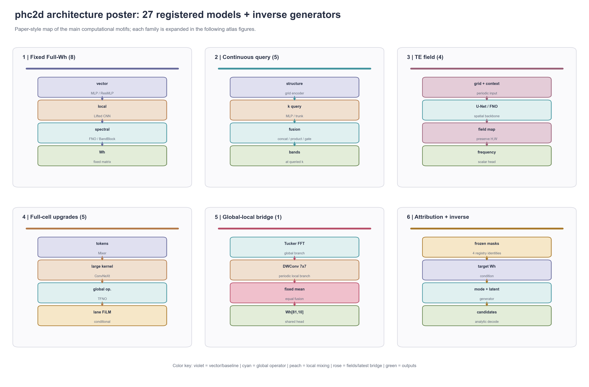
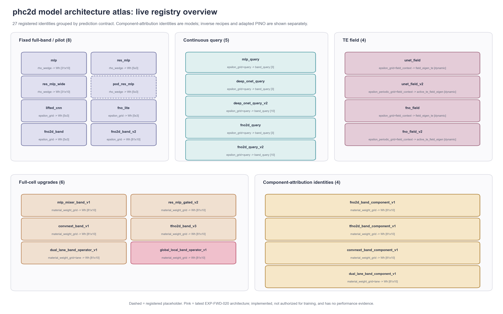
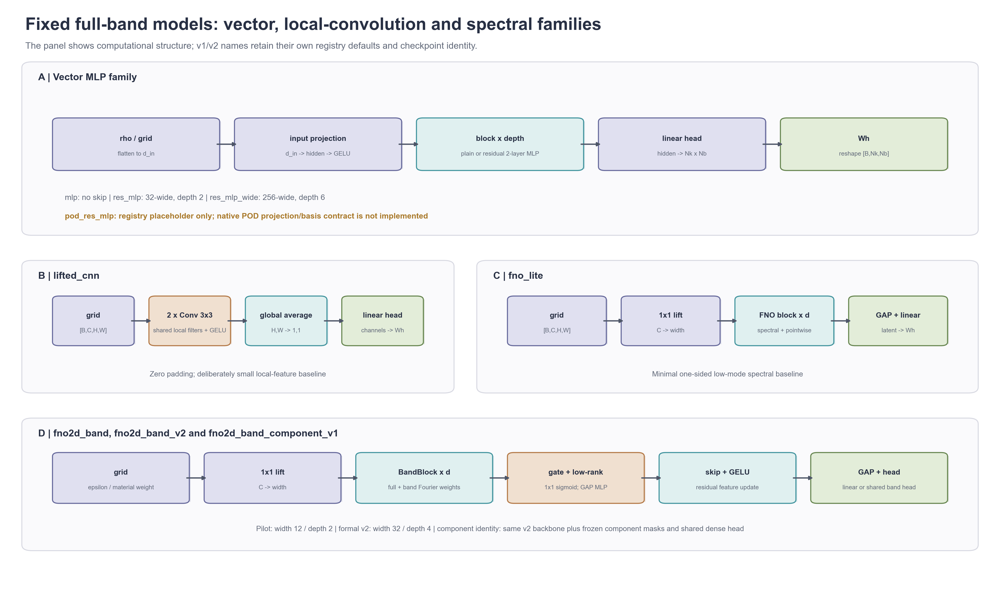
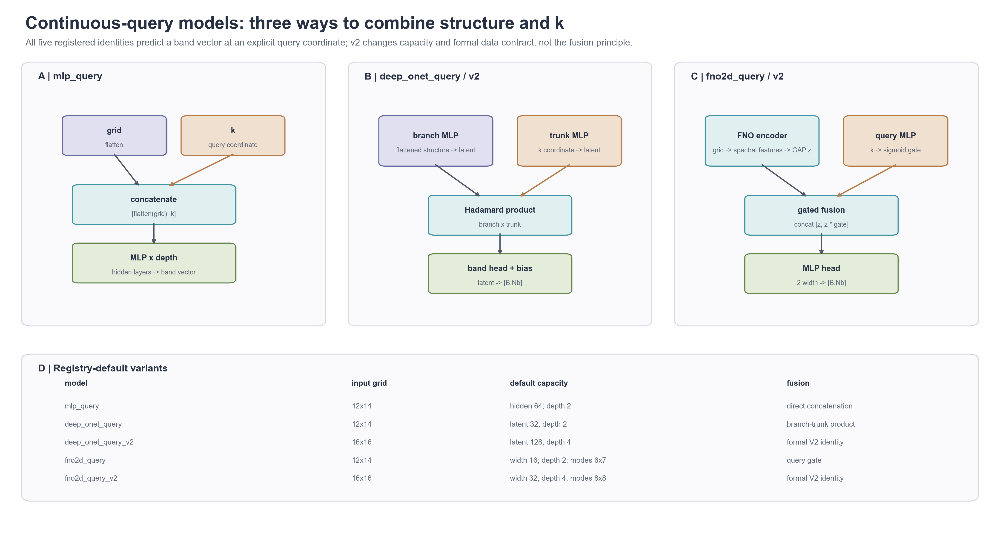
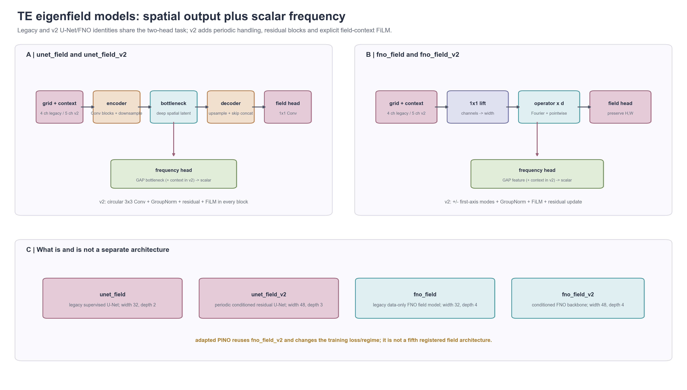
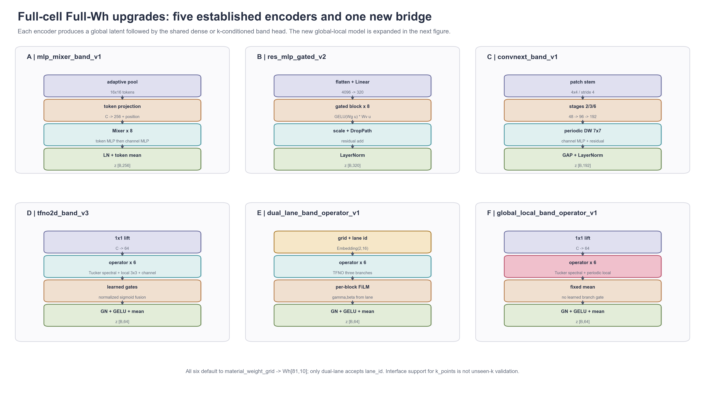
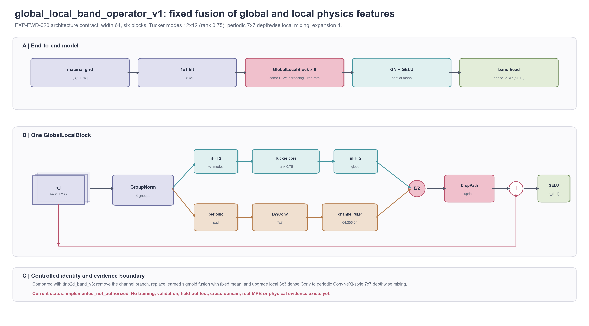
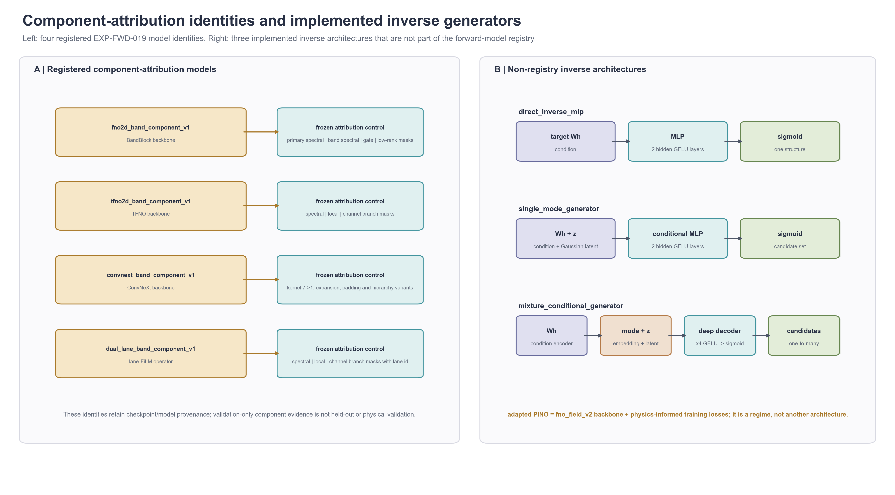

<!--
  Registry-complete model architecture atlas for phc2d.
  Author: fangtoast
  Email: fangtoast@foxmail.com
  Copyright (c) 2026 fangtoast. All rights reserved.
-->

# 模型结构图谱

结论：当前 `phc2d` 注册表包含 **27 个模型身份**，可归为固定 Full-Wh、连续查询、TE 场预测、全胞升级和组件归因五组。最新 `global_local_band_operator_v1` 是其中独立注册的全胞 Full-Wh 模型：它用固定等权方式融合 Tucker 频谱分支与周期 ConvNeXt 式大核局部分支。该模型目前只有实现与工程合同，状态为 `implemented_not_authorized`，没有训练、性能或物理验证证据。

本页只回答“模型怎样计算”。图中的默认维度来自当前 registry；结构细节以当前实现为准。模型结构图不证明精度、泛化、分辨率不变性或 real-MPB 物理有效性。

## 0. 论文式结构总图



[SVG](assets/model_architecture_atlas_20260909/figure_0_model_architecture_poster.svg) · [PDF](assets/model_architecture_atlas_20260909/figure_0_model_architecture_poster.pdf) · [TIFF](assets/model_architecture_atlas_20260909/figure_0_model_architecture_poster.tiff)

总图采用分区模块、彩色立体卡片、显式箭头和家族级缩略结构，便于论文或汇报中先讲整体，再进入后续细图。它不把组件数量或示意块数量解释为实际网络层数。

## 1. 当前注册表总览



[SVG](assets/model_architecture_atlas_20260909/figure_1_model_registry_overview.svg) · [PDF](assets/model_architecture_atlas_20260909/figure_1_model_registry_overview.pdf) · [TIFF](assets/model_architecture_atlas_20260909/figure_1_model_registry_overview.tiff)

| 分组 | 数量 | 模型身份 |
|---|---:|---|
| 固定 Full-Wh / pilot | 8 | `mlp`、`res_mlp`、`res_mlp_wide`、`pod_res_mlp`、`lifted_cnn`、`fno_lite`、`fno2d_band`、`fno2d_band_v2` |
| 连续查询 | 5 | `mlp_query`、`deep_onet_query`、`deep_onet_query_v2`、`fno2d_query`、`fno2d_query_v2` |
| TE 场预测 | 4 | `unet_field`、`unet_field_v2`、`fno_field`、`fno_field_v2` |
| 全胞升级 | 6 | `mlp_mixer_band_v1`、`res_mlp_gated_v2`、`convnext_band_v1`、`tfno2d_band_v3`、`dual_lane_band_operator_v1`、`global_local_band_operator_v1` |
| 组件归因 | 4 | `fno2d_band_component_v1`、`tfno2d_band_component_v1`、`convnext_band_component_v1`、`dual_lane_band_component_v1` |

`pod_res_mlp` 是注册占位符，原生 POD basis/projection 合同尚未实现；不能把它写成可训练完成的当前模型。

## 2. 固定 Full-Wh 模型



[SVG](assets/model_architecture_atlas_20260909/figure_2_forward_band_models.svg) · [PDF](assets/model_architecture_atlas_20260909/figure_2_forward_band_models.pdf) · [TIFF](assets/model_architecture_atlas_20260909/figure_2_forward_band_models.tiff)

这组模型的共同任务是“结构表示 → 固定拓扑能带矩阵”。其中 MLP 先展平输入，`lifted_cnn` 只保留浅层局部卷积，FNO 系列则在二维网格上引入截断 Fourier 模式。`fno2d_band` / `fno2d_band_v2` 的 BandBlock 还包含 band-specific 频谱权重、门控、低秩全局摘要与残差更新。

## 3. 连续查询模型



[SVG](assets/model_architecture_atlas_20260909/figure_3_query_models.svg) · [PDF](assets/model_architecture_atlas_20260909/figure_3_query_models.pdf) · [TIFF](assets/model_architecture_atlas_20260909/figure_3_query_models.tiff)

三种融合原则分别是直接拼接、DeepONet branch/trunk 逐元素乘积，以及结构 FNO latent 的显式 query gate。`v2` 身份主要改变正式数据合同与默认容量，不改变对应的融合原则。

## 4. TE 本征场模型



[SVG](assets/model_architecture_atlas_20260909/figure_4_field_models.svg) · [PDF](assets/model_architecture_atlas_20260909/figure_4_field_models.pdf) · [TIFF](assets/model_architecture_atlas_20260909/figure_4_field_models.tiff)

四个注册模型都同时输出空间场与标量频率。`v2` U-Net 使用周期卷积、残差、GroupNorm 和 context FiLM；`fno_field_v2` 使用正负第一轴频谱模式、GroupNorm、FiLM 与残差更新。adapted PINO 复用 `fno_field_v2` backbone，只改变训练损失与训练方案，因此不是第五个独立场架构。

## 5. 全胞升级模型



[SVG](assets/model_architecture_atlas_20260909/figure_5_full_cell_upgrades.svg) · [PDF](assets/model_architecture_atlas_20260909/figure_5_full_cell_upgrades.pdf) · [TIFF](assets/model_architecture_atlas_20260909/figure_5_full_cell_upgrades.tiff)

六个模型分别从 token mixing、gated residual MLP、周期 ConvNeXt、Tucker 频谱算子、lane FiLM 和全局—局部固定融合六条路径构造全局 latent，再接共享 band head。默认任务合同均为 `material_weight_grid → Wh[81,10]`；只有 `dual_lane_band_operator_v1` 接收 `lane_id`。

## 6. 最新全局—局部混合神经算子



[SVG](assets/model_architecture_atlas_20260909/figure_6_global_local_band_operator_v1.svg) · [PDF](assets/model_architecture_atlas_20260909/figure_6_global_local_band_operator_v1.pdf) · [TIFF](assets/model_architecture_atlas_20260909/figure_6_global_local_band_operator_v1.tiff)

默认端到端结构为：

`material_weight_grid [B,1,H,W] → 1×1 lift (1→64) → 6×GlobalLocalBlock → GroupNorm → GELU → spatial mean → dense band head → Wh[B,81,10]`

单个 `GlobalLocalBlock` 的更新为：

1. 对输入特征执行 8 组 GroupNorm；
2. 全局分支对正负第一轴低频模式执行 Tucker 分解频谱卷积；
3. 局部分支执行周期 padding、`7×7` depthwise convolution 和 `64→256→64` channel MLP；
4. 两个分支固定等权平均，不使用可学习 sigmoid gate；
5. 经 DropPath 后与 block 输入做残差相加，再执行 GELU。

与 `tfno2d_band_v3` 相比，它删除 channel 分支，把可学习 sigmoid 融合改为固定平均，并把局部 `3×3` dense convolution 改为周期 ConvNeXt 式 `7×7` depthwise mixing。该差异来自 EXP-FWD-019 的组件信号，但目前不能写成已验证的性能提升。

## 7. 组件归因与逆向生成器



[SVG](assets/model_architecture_atlas_20260909/figure_7_component_and_inverse_models.svg) · [PDF](assets/model_architecture_atlas_20260909/figure_7_component_and_inverse_models.pdf) · [TIFF](assets/model_architecture_atlas_20260909/figure_7_component_and_inverse_models.tiff)

四个组件归因身份是当前正式 registry 的一部分，用于保持模型/检查点 provenance 与冻结 mask 合同。右侧三个逆向生成器已经实现，但不属于 forward 模型 registry：`direct_inverse_mlp` 产生单一结构，`single_mode_generator` 用条件与随机 latent 产生候选，`mixture_conditional_generator` 进一步加入离散 mode embedding。

## 复现与审计

全部图件由 [`src/phc2d/plot/model_architecture_atlas.py`](../../src/phc2d/plot/model_architecture_atlas.py) 使用 Python/matplotlib 生成。程序在绘图前强制核对 27 个 registry 身份，若出现漏画或陈旧身份会失败关闭。每张图提供可编辑文本 SVG、PDF、PNG 预览与 600 dpi LZW TIFF；[产物清单](assets/model_architecture_atlas_20260909/atlas_manifest.json)记录模型覆盖范围与 SHA-256。

生成命令：

```powershell
$env:PYTHONPATH='src'
.\.venv\Scripts\python.exe -m phc2d.plot.model_architecture_atlas `
  --output-dir docs/reports/assets/model_architecture_atlas_20260909 `
  --formats png svg pdf tiff
```

证据边界：这些图只对应 L2 方法架构与 L4 实现合同。除图中文字明确引用的既有身份状态外，它们不新增任何训练、held-out test、cross-domain、real-MPB、real-Meep 或物理接受证据。
