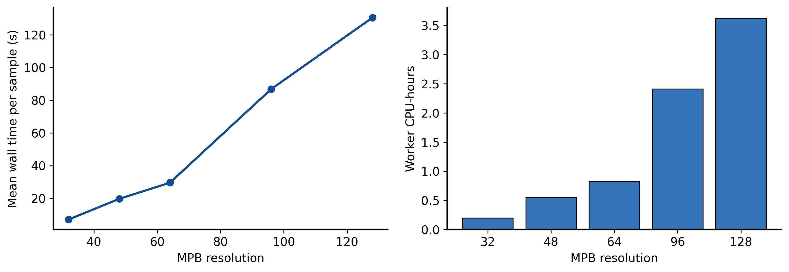
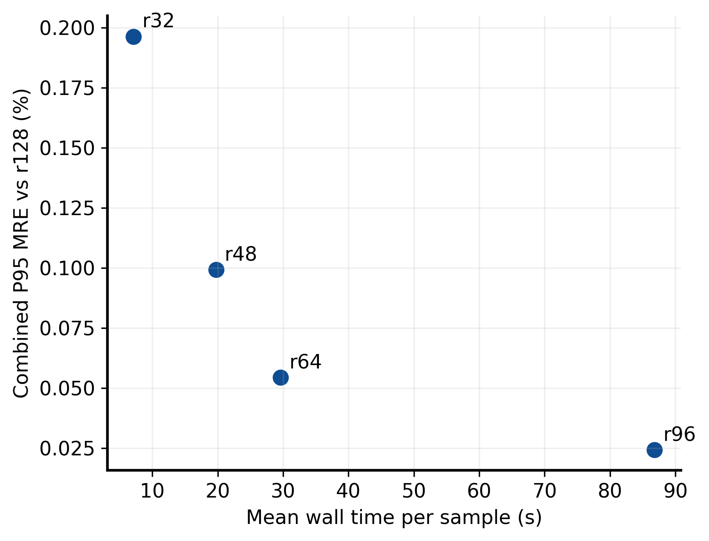
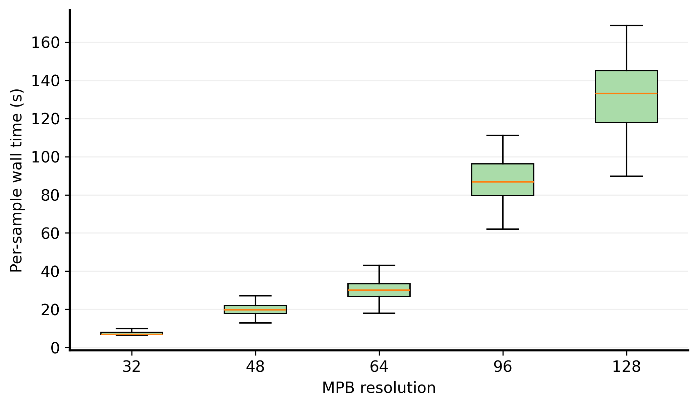
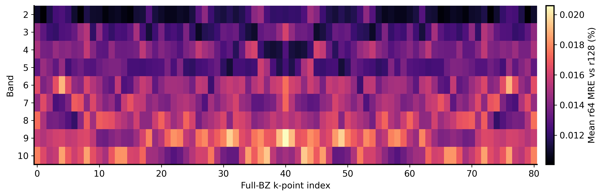
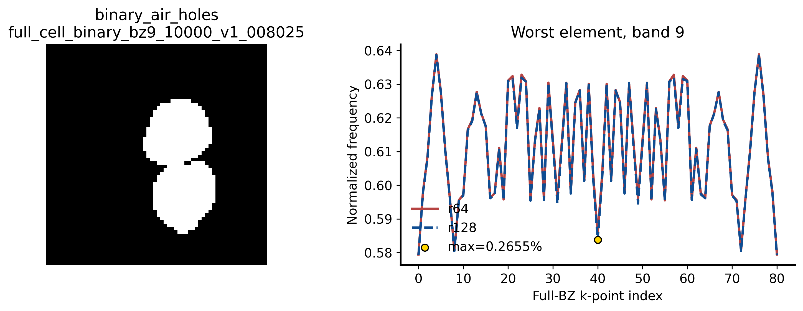

<!--
  Full-cell MPB resolution convergence result.
  Author: fangtoast
  Email: fangtoast@foxmail.com
  Copyright (c) 2026 fangtoast. All rights reserved.
-->

# 全胞 MPB 分辨率收敛与耗时验证

## 结论

本轮数值验证技术门通过，推荐全胞正式数据生成继续使用 **MPB `resolution=64`**。该结论来自 B/G 双路线各 50 个冻结结构、`32/48/64/96/128` 五档 resolution、全部 81 个 full-BZ k 点和 10 条能带的星仪 real-MPB 计算，并已由本机 WSL `Ubuntu` + conda `meep_env` 对 Stage-B 原数组完成固定小样本交叉复算。

`resolution=128` 仅是本轮数值参考，不是解析真值。`resolution=32/48` 虽通过候选误差门，但提交前规则只允许从 `[64,96]` 中推荐，因此不进入正式推荐。本文是 Draft 证据；将 `64` 写入后续 64+64 正式数据合同仍需项目负责人确认冻结。

三个计划不存在目标冲突，执行依赖顺序为：可复用接口重构 → 新数据实现与小样本 smoke → 本轮 MPB 分辨率验证 → 冻结 resolution → 64+64 正式试点。本轮只关闭“求解器 resolution”门，不替代新生成器的数据质量验收。

## 冻结合同与 provenance

| 项目 | 值 |
|---|---|
| Stage-B 代码 commit | `09358420ed690dee1884ba9d71a915a603729e2b` |
| 星仪 Slurm job | `6964080`，`COMPLETED/0:0` |
| 节点 / partition | `cnode2451` / `xyfree` |
| Meep / MPB | `1.33.0-beta` / `1.12.0` |
| 结构 | B 50 + G 50；五个冻结 strata |
| 求解矩阵 | 100 structures × 5 resolutions = 500 独立 shard |
| k / bands | 81 full-BZ k points；求解 10 bands，比较 bands 2–10 |
| reference | `resolution=128` |
| B 数据 SHA-256 | `1f131f2bda7ccb1f1736809bdf6bafd534096cb275e22ce3e56fc5d910530c2f` |
| G 数据 SHA-256 | `d16d838e098215c05dc299bf7c4bbc8c6bc00f6ef35b9772546aa4e7c2b8b728` |
| Stage-B NPZ SHA-256 | `e5bd3586c34b7dca7936ec16620a008aea0e228fd004a6e7c6ed71284ff47a2f` |

矩阵审计结果为 `500/500` computed、0 failed、0 NaN/Inf；`sample_manifest.csv` 100 行、`job_manifest.csv` 与 `timing.csv` 各 500 行。10 个数组均为 `(50,81,10)`，每个 resolution 恰有 100 个结构。

## 收敛结果

所有数值均为相对 `r128` 的 bands 2–10 MRE，表内使用百分数。

| lane | resolution | median | P95 | P99 | max | 门限结论 |
|---|---:|---:|---:|---:|---:|---|
| B | 32 | 0.079011% | 0.236468% | 0.342132% | 0.751593% | 通过 |
| B | 48 | 0.035907% | 0.118843% | 0.162291% | 0.447162% | 通过 |
| B | **64** | **0.020207%** | **0.071935%** | **0.110326%** | **0.265484%** | 通过 |
| B | 96 | 0.007548% | 0.030480% | 0.043946% | 0.068719% | 通过 |
| G | 32 | 0.008679% | 0.023331% | 0.032876% | 0.065970% | 通过 |
| G | 48 | 0.003535% | 0.009539% | 0.013519% | 0.027811% | 通过 |
| G | **64** | **0.001755%** | **0.004751%** | **0.006779%** | **0.014054%** | 通过 |
| G | 96 | 0.000467% | 0.001413% | 0.002803% | 0.009942% | 通过 |
| combined | 32 | 0.019865% | 0.196311% | 0.289534% | 0.751593% | 通过 |
| combined | 48 | 0.008084% | 0.099219% | 0.142147% | 0.447162% | 通过 |
| combined | **64** | **0.004190%** | **0.054480%** | **0.094907%** | **0.265484%** | 通过并推荐 |
| combined | 96 | 0.001203% | 0.024352% | 0.037523% | 0.068719% | 通过 |

冻结门限为 combined median `≤0.10%`、combined P95 `≤0.50%`、B/G 各自 P95 `≤0.75%`。r64 三项分别为 `0.004190%`、`0.054480%`、B `0.071935%` / G `0.004751%`，均留有明确余量。


## 耗时与资源

| resolution | 100 结构 worker time | 每结构均值 | 相对 r64 |
|---:|---:|---:|---:|
| 32 | 712.12 s | 7.12 s | 0.24× |
| 48 | 1,972.40 s | 19.72 s | 0.67× |
| 64 | 2,958.98 s | 29.59 s | 1.00× |
| 96 | 8,684.54 s | 86.85 s | 2.94× |
| 128 | 13,056.61 s | 130.57 s | 4.41× |

500 个 shard 的 solver time 合计 27,384.66 s，即 7.61 worker CPU-hours；runner wall time 为 1,833.39 s，Slurm 总历时 31 分 44 秒，峰值 RSS 为 8,205,044 KiB（约 7.82 GiB）。r96 相对 r64 把 combined P95 从 `0.054480%` 降至 `0.024352%`，但每结构耗时升至约 2.94 倍；r64 已通过冻结门，因此按预注册规则优先推荐 r64。







## 分层与最坏样本审查

r64 的 band × k 平均误差没有出现非有限值或 band-order 违规。最大单元素误差为 `0.265484%`，来自 B 路线样本 `full_cell_binary_bz9_10000_v1_008025` 的 band 9；r64/r128 曲线保持贴合，其结构图与误差点已单独展示。该 max 不是 P95 门限的替代指标，但未发现需要追加 r160/r192 的异常趋势。





六张图由已下载 Stage-B NPZ 与 timing 做本地只读后处理；源路径、NPZ 哈希和图件职责记录在 `docs/reports/assets/full_cell_mpb_resolution_convergence_20260817/source_index.csv`。它们不是第二次求解，也未改写超算 run。

## WSL 交叉验收

WSL run 为 `runs/20260817/full_cell_resolution_convergence_wsl_cross_acceptance_v1_202608171505/`。它从 Stage-B 冻结清单内按 strata 哈希排序固定抽取 B/G 各 8 个结构，在 r64 与 r128 各重算 9 个代表 k 点，共 32 个 real-MPB 作业、2,592 个被比较元素，失败数为 0。

| scope | median MRE | P95 MRE | max MRE | `0.5% / 1%` 门 |
|---|---:|---:|---:|---|
| B r64 | 0 | `1.0907e-7` | `1.2682e-6` | 通过 |
| B r128 | 0 | `1.0641e-7` | `1.0969e-6` | 通过 |
| G r64 | 0 | `1.0660e-7` | `4.9289e-7` | 通过 |
| G r128 | 0 | `1.0281e-7` | `5.9634e-7` | 通过 |
| combined | 0 | `1.0651e-7` | `1.2682e-6` | 通过 |

这些数值是相对误差而非百分数。WSL 环境报告 Meep `1.33.0-beta`、MPB `1.12.0`，validation boundary 为 `wsl_meep_env_real_mpb`，状态为 `wsl_cross_environment_acceptance_pass`。

## 失败与恢复记录

- Stage-A 首次 job `6963379` 因节点缺少 `/usr/bin/time` 在调用 MPB 前退出；commit `204de42` 仅修正计时兼容，重跑 `6963829` 完成 80/80。
- Stage-B 首次 job `6964012` 因旧分层函数未从 structure parameters 读取孔洞/核数量，在 0 shard 处 fail-closed；commit `0935842` 修正分层来源，随后 job `6964080` 复用同一物理合同完成 500/500。
- 两次失败均未产生可混入最终矩阵的求解 shard；最终统计只来自 retry run。

## 证据边界与下一步

本结果证明：对当前 B/G 结构分布、TE、81 full-BZ k 点和 bands 2–10，r64 相对 r128 已满足预注册数值误差门，并能在 WSL real-MPB 环境复现。它不证明任意新结构分布都自动收敛，也不等于 64+64 新数据的生成、质量抽检或正式验收已经完成。

下一步由项目负责人确认是否把 `resolution=64` 从 provisional 状态冻结进 64+64 试点合同；确认后再按《全胞新数据生成实现与64加64试点计划》提交新数据作业，不需要为本轮追加 r160/r192。

## 人工理解记录

```text
解决了什么问题：给出 B/G 双路线 full-cell MPB resolution 的正式数值收敛、耗时和跨环境复现证据。
为什么采用这个方案：100 结构覆盖五个 strata，以 r128 为数值参考；r64/r96 按预注册门选最小可接受成本。
改变了项目哪一层/哪一模块：主要更新 L3 实验与证据状态；未改变生成器、物理合同或模型实现。
使用什么证据验证：星仪 jobs 6963829/6964080、500 个 Stage-B shard、完整 NPZ/timing/manifest、六类图件和 WSL 32-job real-MPB 交叉复算。
最大风险、未知或下一 gate：r128 不是解析真值；新生成器分布仍需自己的 64+64 数据质量门，r64 最终冻结需项目负责人确认。
```
