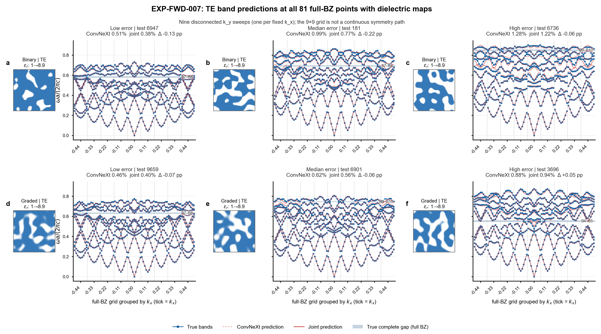
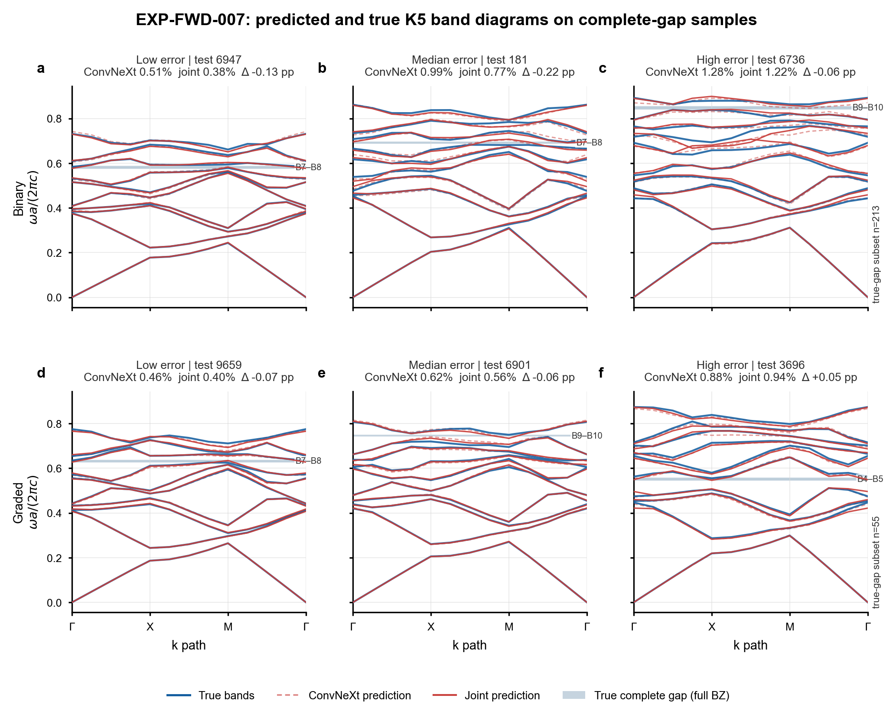
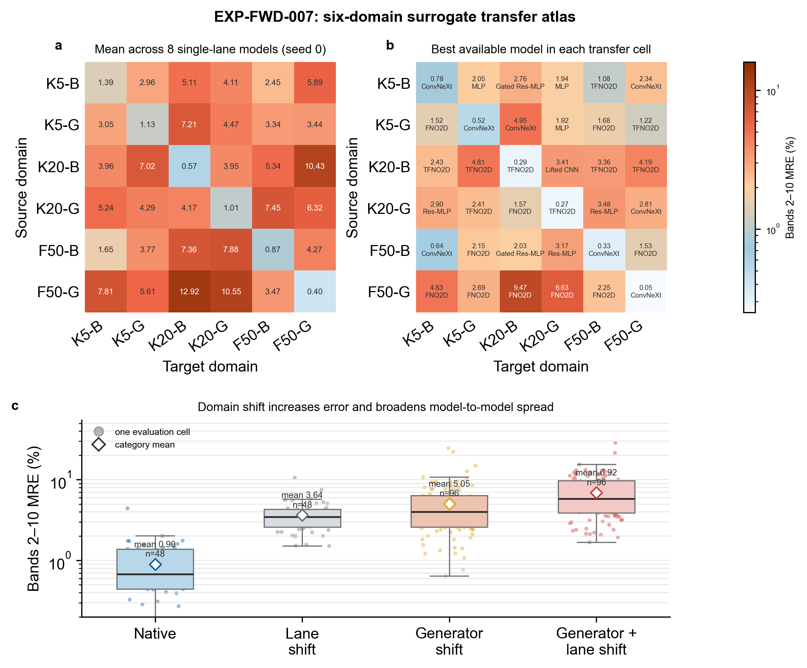
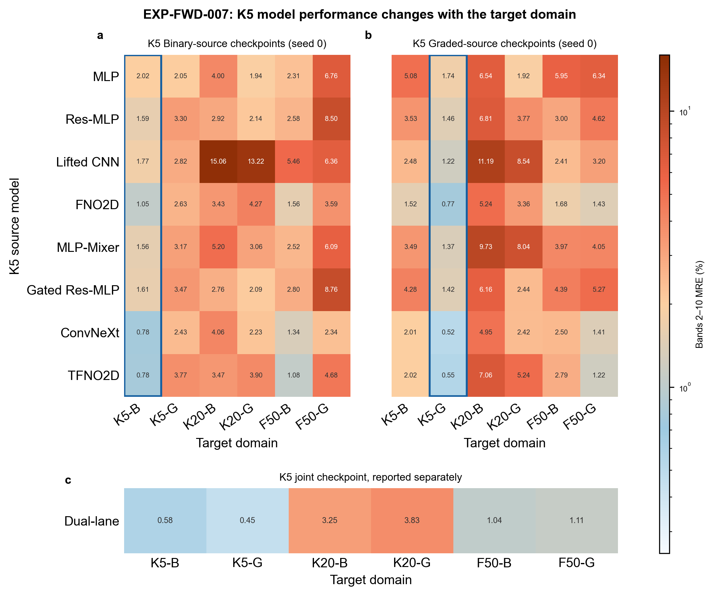

<!--
  EXP-FWD-007 evidence page.
  Author: fangtoast
  Email: fangtoast@foxmail.com
  Copyright (c) 2026 fangtoast. All rights reserved.
-->

# EXP-FWD-007：K5训练与六域验证

**结论：K5 的 17 个训练任务和六域 510-cell held-out surrogate 重推均已完成，且旧 272-cell 子矩阵数值回归通过；但这不是 real-MPB/物理验证，也尚不能发布模型 promotion。** K5 native 的最低 MRE 来自 ConvNeXt（B `0.7789%`、G `0.5169%`）；跨路线的最低项却分别是 MLP 的 B→G `2.0544%` 和 FNO 的 G→B `1.5178%`，不支持“一个模型跨域普遍最优”的说法。计划要求的 paired-bootstrap 与资源汇总文件未生成，故本页保持 Draft，结果只作方向性迁移诊断。

## 证据状态

| 门 | 观察到的证据 | 状态 |
|---|---|---|
| K5 训练 | 17/17 checkpoint；admission A `15/15`、admission B `2/2`、W1 `8/8`、W2 `8/8`、W3 `1/1` | 通过 |
| 六域预检 | 54/54 去重模型身份在 N40 GPU 预检通过 | 通过 |
| 六域推理 | 85 个 checkpoint × 6 个目标域 = 510/510 cells；10/10 shards | 通过 |
| 完整性 | 无缺失、重复、OOM 或 nonfinite；所有 cell 为 `completed` | 通过 |
| 旧证据回归 | 272/272 cells 通过；最大预测绝对差 `3.5763e-7 ≤ 1e-6` | 通过 |
| 统计与资源制品 | 没有生成计划中的 paired-bootstrap/resource 汇总 | 未闭合；不作 promotion |
| WSL real-MPB / inverse | 未执行 | 不适用；不得由本页升级 |

原始证据位于 N40 的 `runs/20260824/EXP-FWD-007_K5_20260824080309` 与 `runs/20260824/EXP-FWD-007_six_domain_20260824162756`。后者保存 `evaluation_cells.csv`、逐 band/k 指标、dataset/checkpoint/test-cache manifests、分片计划和 `legacy_272_numeric_regression.csv`；正文不复制 510 行原始结果。

## 冻结协议与可比性

| 项目 | 冻结值 |
|---|---|
| 目标 | `Wh[N,81,10]`，64×64 输入，bands 2–10 MRE 为主指标 |
| 域 | K5-B/G、K20-B/G 均为 10,000 样本（test=1,000）；F50-B/G 均为 50,000 样本（test=5,000） |
| 模型来源 | K5 17 + K20 17 + F50 51 = 85 个唯一 checkpoint |
| 评估 | 每个 cell 使用源 checkpoint 的 normalizer；joint 源按目标 lane 选择 B/G normalizer 并传入 `lane_id`；无微调或重拟合 |
| 训练选择 | seed 0、最多 100 epoch、patience 15；validation 冻结前不读取 held-out test |
| 部署链 | K5 training commit `3ea2b3c`；评估逻辑冻结 `82d82ef`；提交入口部署 `2e09433` |

K5 Binary 与 Graded 数据哈希分别为 `7d2c6bef…2ea86b6`、`eb140534…0e6af20`；F50 两个目标域按 `Wh[50000,81,10]` 与 5,000-sample test 合同冻结。K5/K20 是独立随机样本，因而 K5↔K20 差异混合了 cutoff 与分布改变，不能解释为 paired-K 因果效应；F50 checkpoint 的训练预算也不同，跨 family 结果只作迁移诊断。

## K5 训练与曲线

17 个任务均满足 `1 ≤ stop_epoch ≤ 100`、`best_epoch ≤ stop_epoch`。早停在 MLP/Mixer/Gated 路线较早触发（最早 best epoch 3），而 Lifted CNN、ConvNeXt、TFNO 和 joint 的若干路线运行至 epoch 100；完整 `history.csv`、17 条 PNG/PDF 曲线和 `curve_manifest.csv` 已保存在训练 run 中。

### K5 各模型六域细表

下表给出 K5 的每个正式 checkpoint 对六个 held-out 目标域的 bands 2–10 MRE，共 17 × 6 = 102 个 cells；`best / stop` 来自冻结的 validation 训练曲线。术语中 **Binary（B）** 与 **Graded（G）** 始终表示数据路线，表头中的“目标”表示被测试的数据域，而非训练来源。为避免混读，B 源与 G 源分表；每张表中前三列都是 Binary 目标域，后三列都是 Graded 目标域。该表是模型级核查入口，不以跨行最低值构成 promotion。

#### Binary 源模型（B）

这些模型只在 **K5-Binary** 上训练：前三列是 **同路线 Binary 迁移**，后三列是 **Binary→Graded 跨路线迁移**。

| 模型 | best / stop | 目标 Binary: K5 | 目标 Binary: K20 | 目标 Binary: F50 | 目标 Graded: K5 | 目标 Graded: K20 | 目标 Graded: F50 |
|---|---:|---:|---:|---:|---:|---:|---:|
| `mlp` | 3 / 18 | 2.0168% | 4.0013% | 2.3064% | 2.0544% | 1.9387% | 6.7601% |
| `res_mlp_wide` | 44 / 59 | 1.5866% | 2.9161% | 2.5826% | 3.2960% | 2.1417% | 8.4970% |
| `lifted_cnn` | 30 / 45 | 1.7708% | 15.0588% | 5.4605% | 2.8206% | 13.2188% | 6.3626% |
| `fno2d_band_v2` | 84 / 99 | 1.0512% | 3.4283% | 1.5566% | 2.6336% | 4.2747% | 3.5909% |
| `mlp_mixer_band_v1` | 6 / 21 | 1.5555% | 5.2029% | 2.5224% | 3.1688% | 3.0624% | 6.0902% |
| `res_mlp_gated_v2` | 6 / 21 | 1.6094% | 2.7583% | 2.7951% | 3.4746% | 2.0895% | 8.7639% |
| `convnext_band_v1` | 100 / 100 | 0.7789% | 4.0609% | 1.3360% | 2.4341% | 2.2274% | 2.3434% |
| `tfno2d_band_v3` | 100 / 100 | 0.7803% | 3.4701% | 1.0766% | 3.7671% | 3.9040% | 4.6821% |

#### Graded 源模型（G）

这些模型只在 **K5-Graded** 上训练：前三列是 **Graded→Binary 跨路线迁移**，后三列是 **同路线 Graded 迁移**。

| 模型 | best / stop | 目标 Binary: K5 | 目标 Binary: K20 | 目标 Binary: F50 | 目标 Graded: K5 | 目标 Graded: K20 | 目标 Graded: F50 |
|---|---:|---:|---:|---:|---:|---:|---:|
| `mlp` | 5 / 20 | 5.0762% | 6.5407% | 5.9515% | 1.7434% | 1.9193% | 6.3424% |
| `res_mlp_wide` | 32 / 47 | 3.5350% | 6.8051% | 3.0003% | 1.4604% | 3.7669% | 4.6159% |
| `lifted_cnn` | 98 / 100 | 2.4803% | 11.1905% | 2.4066% | 1.2215% | 8.5446% | 3.1950% |
| `fno2d_band_v2` | 88 / 100 | 1.5178% | 5.2404% | 1.6790% | 0.7709% | 3.3573% | 1.4321% |
| `mlp_mixer_band_v1` | 10 / 25 | 3.4850% | 9.7263% | 3.9717% | 1.3684% | 8.0383% | 4.0470% |
| `res_mlp_gated_v2` | 17 / 32 | 4.2767% | 6.1612% | 4.3929% | 1.4228% | 2.4404% | 5.2657% |
| `convnext_band_v1` | 99 / 100 | 2.0116% | 4.9473% | 2.5006% | 0.5169% | 2.4201% | 1.4092% |
| `tfno2d_band_v3` | 98 / 100 | 2.0164% | 7.0637% | 2.7943% | 0.5489% | 5.2361% | 1.2231% |

#### 联合来源模型（J）

联合模型没有单一训练路线：对每个目标域选择对应的 Binary/Graded normalizer 与 `lane_id`。

| 模型 | best / stop | 目标 Binary: K5 | 目标 Binary: K20 | 目标 Binary: F50 | 目标 Graded: K5 | 目标 Graded: K20 | 目标 Graded: F50 |
|---|---:|---:|---:|---:|---:|---:|---:|
| `dual_lane_band_operator_v1` | 100 / 100 | 0.5805% | 3.2451% | 1.0373% | 0.4488% | 3.8289% | 1.1094% |

K20/F50 的既有 68 个 checkpoint 对应其余 408 个 cells；逐 checkpoint、逐 band、逐 k、R²、MAE、RMSE、band-order、吞吐和 normalizer/lane 记录保留在同一 six-domain run 的 `evaluation_cells.csv`、`per_band_metrics.csv` 与 `per_k_metrics.csv`，以免在结果页复制 510 行机器证据。

| K5 native 汇总 | B MRE | G MRE |
|---|---:|---:|
| 4 个 baseline 平均 | 1.6064% | 1.2990% |
| 4 个单路线升级平均 | 1.1810% | 0.9642% |
| 最低单模型（ConvNeXt） | 0.7789% | 0.5169% |
| joint（单独报告，不进入 B→G/G→B 泛化结论） | 0.5805% | 0.4488% |

该汇总只描述 K5 seed-0 native held-out 表现；joint 使用不同训练路线，不能作为单路线升级的替代排名。

## K5 内路线迁移

| 方向 | 最低模型 / MRE | baseline 平均 | 单路线升级平均 |
|---|---:|---:|---:|
| B→G | MLP / 2.0544% | 2.7012% | 3.2112% |
| G→B | FNO / 1.5178% | 3.1523% | 2.9474% |

路线迁移显著弱于 native，且最佳模型随方向改变。joint 在 K5-B/G 目标上的 MRE 为 `0.5805%/0.4488%`，但它只作为联合源的独立结果，不能用于证明 B→G 或 G→B 泛化。

## K5 到 K20 与 F50 的迁移

下表只汇总 K5 的 8 个单路线来源 checkpoint；joint 另列，避免混入单路线结论。

| K5 目标域与迁移类型 | cells | bands 2–10 MRE 均值 |
|---|---:|---:|
| K20-B，同路线跨生成器 | 8 | 5.1121% |
| K20-B，生成器+路线改变 | 8 | 7.2094% |
| K20-G，同路线跨生成器 | 8 | 4.4654% |
| K20-G，生成器+路线改变 | 8 | 4.1072% |
| F50-B，同路线跨生成器 | 8 | 2.4545% |
| F50-B，生成器+路线改变 | 8 | 3.3371% |
| F50-G，同路线跨生成器 | 8 | 3.4413% |
| F50-G，生成器+路线改变 | 8 | 5.8863% |

在 K5 来源这一切片中，变更路线通常会增加误差，但 K20-G 是例外，提示数据分布与模型交互不能用单一“路线更难”的结论概括。

## 六域总体迁移图景

| 比较类型（seed-0 共同来源集合） | cells | MRE 均值 |
|---|---:|---:|
| native | 48 | 0.8970% |
| 同 family 跨路线 | 48 | 3.6431% |
| 跨生成器、同路线 | 96 | 5.0474% |
| 生成器+路线均改变 | 96 | 6.9221% |
| joint source family（单独报告） | 18 | 2.0284% |

这组均值与具体模型排名不同：它只说明在本次 source/target 组合上，native 最低，而同时改变生成器与路线的平均迁移负担最大。F50 的 seed 1/2 共 204 cells 保留为补充；不伪装为与 K5/K20 配对的 seed-matched 比较。

## 图形化阅读

图 1 使用全部 `9×9=81` 个 full-BZ 点，并在每个能带谱左侧放置同一测试样本的二维介质分布。两套数据的冻结 MPB 元数据均明确标记为 `TE`；介质图由模型实际输入的 64×64 material grid 按 `ε_r=1+7.9w` 换算，白色对应 `ε_r=1.0`，蓝色对应 `ε_r=8.9`。横轴将 81 点分成 9 个固定 `k_x` 的 `k_y` 扫描段，段与段之间不连线，因此不会把二维 full-BZ 网格伪装成连续高对称路径。

蓝点/蓝线是真实 TE 能带，红色虚线是 ConvNeXt 预测，红色实线是 joint 预测；阴影仍使用全部 81 点判定的真实 complete gap。该图是查看 full-BZ 拟合与结构对应关系的主图。

图 2 使用相同 6 个样本，只抽取其中的 Γ–X–M–Γ 高对称路径，便于阅读传统能带走向。每行分别从 Binary 与 Graded 的“真实存在 full-BZ complete gap”测试子集中，按 joint sample MRE 选择低误差、中位误差和高误差样本；Binary 子集为 `213/1000`，Graded 子集为 `55/1000`。负 `Δ` 表示 joint 相对 ConvNeXt 改善。

在 6 个代表样本中，joint 改善了 5 个，但 Graded 高误差样本从 `0.88%` 退化到 `0.94%`，说明联合方案不是逐样本单调占优。更关键的是，这些真实完整带隙分别位于 B4–B5、B7–B8 或 B9–B10，没有一个位于 B1–B2；因此，能指示第一阶 Bragg 区域的 B1–B2 弱先验不能替代 Bands 1–10 最大完整带隙搜索。

图 3 将 seed-0 共同来源集合压缩为三层证据。左上是每个 source→target 组合上 8 个单路线模型的平均 MRE；右上是每格可达到的最低 MRE 及对应模型；下方保留全部单路线 evaluation cells。颜色使用对数标尺，但格内数字仍是原始百分比。对角线 native 均值为 `0.40%–1.39%`，而同时改变生成器与路线的总体均值上升到 `6.92%`，且分布明显变宽。右上模型名随 source/target 组合变化，直接说明不存在一个在全部迁移方向上都占优的模型。

图 4 只放大本页的 K5 来源 checkpoint。蓝框标出各路线的 native 目标域；joint 模型单列，不参与 8 个单路线模型的排名。Binary-source 与 Graded-source 的 native 最低值都来自 ConvNeXt，分别为 `0.7789%` 与 `0.5169%`，但跨路线最低模型分别变为 MLP（Binary→Graded，`2.0544%`）与 FNO2D（Graded→Binary，`1.5178%`）。这组图支持“native 强、迁移退化明显、最佳架构依赖迁移方向”，不支持“ConvNeXt 是六域通用最优”。

可编辑矢量图与绘图源数据：

- [六域迁移图谱 SVG](assets/exp_fwd_007_six_domain_20260831/exp_fwd_007_six_domain_transfer_atlas.svg)
- [K5 模型图谱 SVG](assets/exp_fwd_007_six_domain_20260831/exp_fwd_007_k5_model_landscape.svg)
- [K5 真实值与预测值能带图 SVG](assets/exp_fwd_007_six_domain_20260831/exp_fwd_007_k5_gap_sample_band_diagrams.svg)
- [K5 能带图逐点源数据](assets/exp_fwd_007_six_domain_20260831/source_data_exp_fwd_007_band_diagrams.csv)
- [K5 81 点 full-BZ TE 能带与介质图 SVG](assets/exp_fwd_007_six_domain_20260831/exp_fwd_007_k5_full_bz_81_with_dielectric_te.svg)
- [K5 81 点 full-BZ 能带源数据](assets/exp_fwd_007_six_domain_20260831/source_data_exp_fwd_007_full_bz_81_band_diagrams.csv)
- [6 个二维介质图源数据](assets/exp_fwd_007_six_domain_20260831/source_data_exp_fwd_007_selected_dielectric_maps.csv)
- [六域 source→target 汇总](assets/exp_fwd_007_six_domain_20260831/source_data_six_domain_matrix.csv)
- [K5 来源模型逐 cell 数据](assets/exp_fwd_007_six_domain_20260831/source_data_k5_source_models.csv)
- [seed-0 域偏移逐 cell 数据](assets/exp_fwd_007_six_domain_20260831/source_data_seed0_shift_cells.csv)

## 限制与下一决策

1. 本页是 held-out surrogate 证据，不是 WSL real-MPB replay、物理验证或 inverse 成功。
2. 缺少计划中的 10,000 次 paired-bootstrap 和资源汇总制品；在补齐且审计通过前，不发布显著性、总体排名或 promotion 结论。
3. 训练/评估已完成并保留原始证据；任何后续修复必须使用新的 derivative run，不覆盖本次 510-cell 结果或旧 272-cell 证据。

相关协议：[EXP-FWD-007](../../../experiments/research/EXP-FWD-007-K5训练与六域验证.md)。
