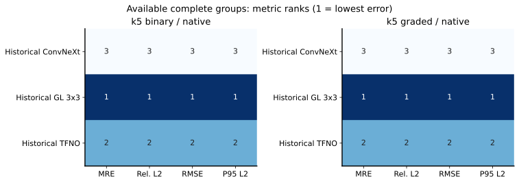
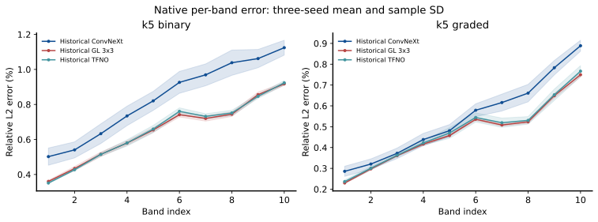
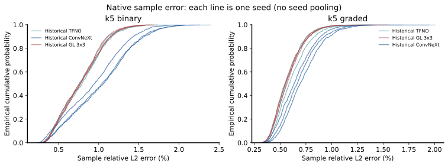

<!--
  Audited initial spectral metric supplement, with full-scope gaps retained.
  Author: fangtoast
  Email: fangtoast@foxmail.com
  Copyright (c) 2026 fangtoast. All rights reserved.
-->

# EXP-FWD-031 多指标补充评价

历史 K5-Binary、K5-Graded 原域的 GL 3×3、TFNO、ConvNeXt 已完成 18 个单元、6 组三 seed 的多指标补算。两域中，MRE、相对 L²、MAE、全局 RMSE 和 L² P95 的三 seed 均值排序一致：GL 3×3、TFNO、ConvNeXt。GL 与 TFNO 差距较小，该排序是描述性结果。

标题中的 EXP-FWD-031 标识补充评价任务，已计算模型仍来自 EXP-FWD-026，不是 031 新模型的测试结果。完整目标为 1,176 个单元，当前总体状态为 **partial**，Draft 待作者审核。

## 当前覆盖与来源

| 范围 | 预期单元 | 当前已补算 |
|---|---:|---:|
| 13 配置四域矩阵，含原域对角一次 | 624 | 18 |
| 12K/24K 新几何 | 312 | 0 |
| 3×3/7×7 混合训练五分支独立四域测试 | 240 | 0 |
| 合计 | 1,176 | 18 |

历史部分全部 960 个单元已定位到 NPY 或 HDF5 预测文件；文件定位与完成补算分别记录。031 的 216 个原始测试记录已找齐，未发现完整预测数组，需要冻结推理补导出。

本轮核对已下载 18 个单元的预测、真值和样本索引文件 SHA、冻结 split 顺序、样本数，并读取对应数据文件的 k 点身份。全部通过原 Band 1–10 MRE 的绝对差不超过 `1e-5` 个百分点回归门，未重训或重选 checkpoint。每域每 checkpoint 使用 1,000 个 frozen test 结构。

公式和单位见[频谱多指标合同](../../参考/频谱多指标合同.md)，范围与失败门见[补充评价协议](https://github.com/fangtoast/phc2d/blob/master/experiments/research/EXP-FWD-031-多指标补充评价.md)。原 MRE 证据见[四域完整报告](../../reports/EXP-FWD-031四域完整测试结果_20261029.md)。

## 相对 L² 与尾部误差

下表均为百分数，`均值 ± 样本标准差` 来自 seed 0/1/2、`ddof=1`。P95 在每个 seed 内计算后汇总，未混池。

| 测试域 | 历史模型 | 相对 L² 均值（%） | 逐结构 L² P95（%） |
|---|---|---:|---:|
| K5-Binary | GL 3×3 | 0.7775 ± 0.0112 | 1.2343 ± 0.0170 |
| K5-Binary | TFNO | 0.7825 ± 0.0148 | 1.2590 ± 0.0289 |
| K5-Binary | ConvNeXt | 0.9985 ± 0.0573 | 1.6550 ± 0.0767 |
| K5-Graded | GL 3×3 | 0.5807 ± 0.0072 | 0.8476 ± 0.0105 |
| K5-Graded | TFNO | 0.5908 ± 0.0227 | 0.8690 ± 0.0409 |
| K5-Graded | ConvNeXt | 0.6873 ± 0.0325 | 1.0219 ± 0.0445 |

相对 L² 是逐结构能带矩阵范数比的平均。它的数值大于对应 MRE，来自指标定义和权重的差异；逐 band 输出保留低频与高频误差的差别。

## 验证与下一道门

真实数组补算运行于 WSL Ubuntu 的 `meep_env`。定向合同与兼容性测试为 34 passed、2 skipped；跳过项需要当前 WSL 环境未安装的 NeuralOperator。公式、异常输入、索引顺序、文件哈希、MRE 回归、三 seed 完整性、分片合并及原域失败阻断跨域均有测试。031 的 36 个 checkpoint 已通过只读权重 SHA、完成标记和源数据路径预检；7×7 对应的 192 个 HDF5 文件均存在。上述工程和文件预检不代表其余单元已经评价。

文档严格审计通过；MkDocs 严格构建仍被既有未入导航页面和历史出站链接等 50 条警告阻塞。本轮新增页面与链接未出现在这些警告中。

未补算单元在完整清单中保留 blocked，不用已算两域代替四域等权平均。下一道门是取得远端资源授权后，优先完成 031 的 36 个原域冻结推理及回归，同时复用历史预测进行 CPU 补算；36 项全部通过后才扩至 031 的 216 项。

本页没有新增独立 MPB/Meep 复算或分辨率收敛证据，不声称模型统计显著优越。“爱森”论文的身份与公式尚未确定，本次不宣称严格复现其评价口径。
