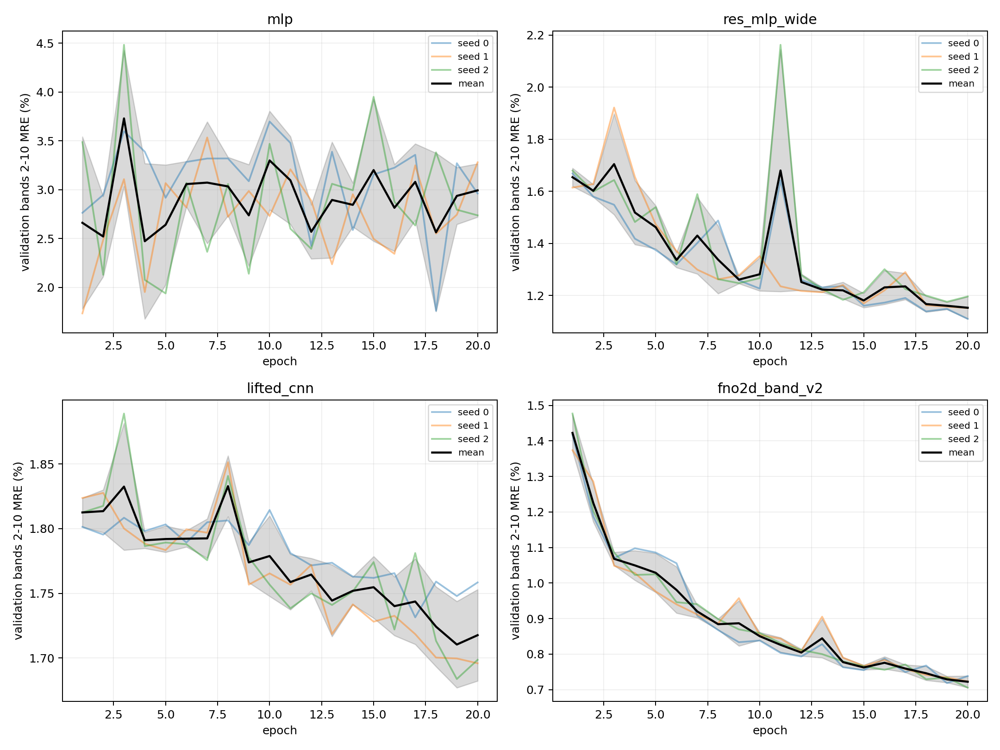
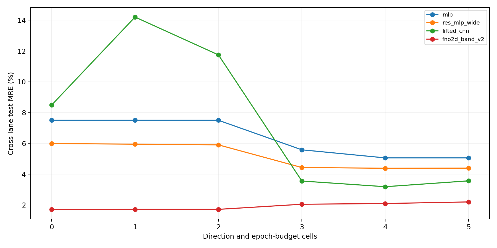
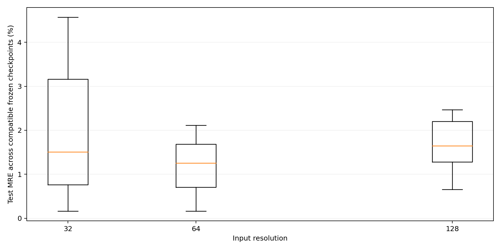

<!--
  Full-cell dual-lane 50k forward training and frozen-evaluation report.
  Author: fangtoast
  Email: fangtoast@foxmail.com
  Copyright (c) 2026 fangtoast. All rights reserved.
-->

<a id="full-cell-50000-forward-report"></a>

# 全胞双路线 50k 正向训练与冻结评估完整报告

| Metadata | Value |
|---|---|
| Status | Draft，待项目负责人人工审阅 |
| Primary layer | L3 experiment/evidence |
| Audience | 项目负责人、研究人员与后续 inverse 执行人员 |
| Owner | 研究生维护，导师审阅科学主张与 promotion gate |
| Report date | 2026-08-08 |
| Last reviewed | Pending human review |
| Training platform | N40 `gpu_4090`，单任务 1×RTX4090、6 CPU、60,000 MB，FP32 |
| Training deployment | `7498511` |
| Evaluation/finalizer deployment | 正式推理 `9be28d1`；兼容制品 `31d7ff0`；标准 run 制品 `f132934` |
| Training campaign | `runs/20260807/full_cell_forward_50k_17wave_campaign_202608071737/` |
| Evaluation campaign | `runs/20260808/full_cell_forward_50k_evaluation_campaign_20260808162200/` |
| Reading time | 12 minutes |

本文报告 binary 与 graded 两套 50k full-cell 数据上的 17 波正式训练、旧 10k checkpoint 迁移、40k held-out test、双向跨路线评估和零样本输入分辨率测试。它不包含 M9 real-MPB、inverse replay 或 threshold 结构的真实物理结论。

## 一、结论先行

1. **17 波训练完整结束。** 204/204 个独立单 GPU run 成功，0 failed；每个 run 均保留 checkpoint、完整 `history.csv`、训练曲线、metrics、results 和 provenance。训练累计 `65.83` GPU-hours，按任务 wall time 求和为 `72.60` GPU-hours。
2. **40k held-out test 中 FNO 在全部 12 个“方向 × epoch”组均为四模型最低三 seed 均值。** binary 同域 test 从 20 epoch 的 `0.7092%` 降至 100 epoch 的 `0.6296%`，200 epoch 与 100 epoch 相同；continuous 从 `0.2090%` 降至 `0.1644%` 和 `0.1602%`。
3. **跨路线误差明显高于同域。** FNO 的 binary→continuous 为 `1.7092/1.7171/1.7171%`，continuous→binary 为 `2.0489/2.0960/2.1996%`（20/100/200 epoch）。更多 epoch 没有改善跨路线泛化。
4. **旧 10k checkpoint 已在新 50k test 上完成冻结迁移。** 102/102 个原生训练分辨率 checkpoint 齐全；84 个 64-resolution 主矩阵 checkpoint 同时完成跨表征/跨路线评估。10k 与当前 40k 的 72 个配对比较中，40k 有 65 个 MRE CI 全部低于 0、7 个全部高于 0。
5. **64-trained 模型不能被默认视为分辨率不变。** CNN/FNO 共 78 个 checkpoint bundle 完成 32/64/128 直接输入；156 个相对 64 的 paired comparisons 中，151 个 MRE 95% CI 完全高于 0，2 个低于 0，3 个跨 0。尤其 FNO 在连续路线的 128 输入上从约 `0.16%` 上升到约 `0.65%`。
6. **50k final-fit 只形成训练重叠 monitor。** 它们覆盖全部 50k 样本，不能在原 HDF5 的 `idx_val`/`idx_test` 上形成无偏 validation、test 或冠军选择。t0.3–t0.7 也只有 50k/100-epoch final-fit monitor，不进入无泄漏 test 表。

## 二、数据、split 与 checkpoint 角色

| 数据 | 大小 | SHA-256 | 训练/评估角色 |
|---|---:|---|---|
| binary 50k | 1,252,024,424 bytes | `e2d99e0...5213f00` | 40k train + 5k val + 5k test；另有 50k final-fit |
| graded 50k | 6,053,630,385 bytes | `172786bc...38a46` | 40k train + 5k val + 5k test；另有 50k final-fit |

40k checkpoint 使用互斥 validation 选择 `best_validation`，随后只读冻结 checkpoint 在 5k test 上推理。50k final-fit 保存最后 epoch checkpoint，`selection_split=none_final_fit`；旧 `idx_val`/`idx_test` 与训练集重叠，只能是 `training-overlap monitor`。

旧 10k 模型迁移时始终复用 checkpoint 内的 10k train normalization；40k 模型同理复用各自 source normalization。906 个正式推理 cell 均记录 `source_normalization_reused=true`、`fine_tuned=false`、`selection_influence=false`。

## 三、17 波训练结果与曲线

### 3.1 每波次最低三 seed 均值

| 方法/epoch | 最低模型 | MRE mean (%) | 证据角色 |
|---|---|---:|---|
| binary 40k / 20 | FNO | 0.71578 | validation |
| binary 40k / 100 | FNO | 0.63603 | validation |
| binary 40k / 200 | FNO | 0.63603 | validation |
| continuous 40k / 20 | FNO | 0.21177 | validation |
| continuous 40k / 100 | FNO | 0.16643 | validation |
| continuous 40k / 200 | FNO | 0.16227 | validation |
| binary 50k / 20 | FNO | 0.66487 | training-overlap monitor only |
| binary 50k / 100 | FNO | 0.50885 | training-overlap monitor only |
| binary 50k / 200 | FNO | 0.48428 | training-overlap monitor only |
| continuous 50k / 20 | FNO | 0.19935 | training-overlap monitor only |
| continuous 50k / 100 | FNO | 0.16324 | training-overlap monitor only |
| continuous 50k / 200 | FNO | 0.15907 | training-overlap monitor only |
| t0.3 50k / 100 | FNO | 0.76909 | training-overlap monitor only |
| t0.4 50k / 100 | FNO | 0.63614 | training-overlap monitor only |
| t0.5 50k / 100 | FNO | 0.58370 | training-overlap monitor only |
| t0.6 50k / 100 | FNO | 0.54853 | training-overlap monitor only |
| t0.7 50k / 100 | FNO | 0.53707 | training-overlap monitor only |

这里的“最低模型”只对 40k validation 波具有选择含义。50k 行仅按数值排序展示 monitor，**不得称 winner**。

### 3.2 训练曲线完整性

17 个 wave aggregation 均有四模型 × 三 seed 的完整曲线 PNG/PDF。下图展示首个 40k/20-epoch 波；其余 16 张曲线的远端相对路径、大小和 SHA-256 见[图件索引](../../reports/assets/full_cell_dual_lane_50000_forward_training_20260808/figure_index.md)。



## 四、40k checkpoint 的独立 50k test

### 4.1 FNO 的三种 epoch 预算

| Source → target | 20 epoch | 100 epoch | 200 epoch |
|---|---:|---:|---:|
| binary → binary | 0.70924 ± 0.00852 | 0.62965 ± 0.00156 | 0.62965 ± 0.00156 |
| binary → continuous | 1.70920 ± 0.24671 | 1.71709 ± 0.25599 | 1.71709 ± 0.25599 |
| continuous → binary | 2.04892 ± 0.13885 | 2.09599 ± 0.19069 | 2.19963 ± 0.04849 |
| continuous → continuous | 0.20900 ± 0.00270 | 0.16441 ± 0.00077 | 0.16016 ± 0.00055 |

同域结果支持 continuous 在 200 epoch 仍有小幅收益，而 binary 在当前 early-stopping checkpoint 规则下 100/200 epoch 得到同一冻结 best checkpoint。跨路线结果不随 epoch 增加而改善；因此不能把“更长训练”当成 domain-shift 修复。

### 4.2 100-epoch 四模型双向对照

| 模型 | binary→binary | binary→continuous | continuous→binary | continuous→continuous |
|---|---:|---:|---:|---:|
| `mlp` | 1.80067 ± 0.11121 | 7.50121 ± 0.02425 | 5.05906 ± 1.00664 | 1.77011 ± 0.85981 |
| `res_mlp_wide` | 0.96381 ± 0.03673 | 5.94926 ± 0.20385 | 4.38566 ± 0.18544 | 0.32651 ± 0.07548 |
| `lifted_cnn` | 1.46636 ± 0.00370 | 14.20304 ± 7.08532 | 3.18788 ± 0.55657 | 0.76812 ± 0.02780 |
| `fno2d_band_v2` | **0.62965 ± 0.00156** | **1.71709 ± 0.25599** | **2.09599 ± 0.19069** | **0.16441 ± 0.00077** |



## 五、旧 10k checkpoint → 新 50k test

102 个旧 checkpoint 均按原生训练分辨率完成迁移：84 个 64-resolution 主矩阵 checkpoint，加 18 个 32/128-resolution 独立重训 checkpoint。64-resolution 各表征中 FNO 的 50k native-test MRE 为：

| 表征 | MRE mean ± std (%) |
|---|---:|
| binary | 0.80306 ± 0.00136 |
| continuous | 0.21679 ± 0.00551 |
| t0.3 | 1.70279 ± 0.00464 |
| t0.4 | 1.56242 ± 0.00136 |
| t0.5 | 1.41698 ± 0.02042 |
| t0.6 | 1.25763 ± 0.01299 |
| t0.7 | 1.25093 ± 0.00616 |

关键双向迁移中，旧 FNO 的 binary→continuous 为 `1.70664 ± 0.16293%`，continuous→binary 为 `2.09444 ± 0.08802%`。完整 504 个旧跨表征 cell 和三 seed 汇总保存在 `cross_evaluation_cells.csv` 与 `legacy_cross_evaluation_summary.csv`。

## 六、64→32/128 零样本输入分辨率

本实验保持同一 checkpoint、同一 test IDs、同一 `Wh` 和 source normalization，只替换 HDF5 中的 `material_weight_grid_32/64/128`。MLP/ResMLP 的 156 个 32/128 项被记录为 `not_applicable_architecture_shape_mismatch`，没有 resize、补零或重建第一层。

40k FNO 的结果如下：

| 路线 / epoch | r32 | r64 | r128 |
|---|---:|---:|---:|
| binary / 20 | 0.73766 | **0.70924** | 1.30239 |
| binary / 100 | 0.66376 | **0.62965** | 1.30451 |
| binary / 200 | 0.66376 | **0.62965** | 1.30451 |
| continuous / 20 | 0.20902 | **0.20900** | 0.78079 |
| continuous / 100 | 0.16444 | **0.16441** | 0.66556 |
| continuous / 200 | 0.16018 | **0.16016** | 0.65329 |



这不是 MPB 分辨率收敛，也不是重新训练。结果表明当前 FNO/CNN 架构虽然能接受不同空间 shape，但权重并没有自动获得可靠的输入分辨率不变性。

## 七、执行、统计与制品审计

| 项目 | 结果 |
|---|---:|
| 训练波次 / runs | 17 / 204 |
| 训练失败 | 0 |
| checkpoint sources | 174（旧 102 + 当前 40k 72） |
| GPU evaluation shards | 8，作业 `5396172_[0-7]` |
| shard elapsed | 4分47秒–5分56秒 |
| 实际推理 cells | 906/906 |
| 架构不适用 cells | 156/156 |
| paired bootstrap comparisons | 300，500 replicates/项 |
| finalizer | 初次 `5396173`、兼容制品 `5396261`、标准 run 制品 `5396315`；均 `COMPLETED/0:0` |
| 推理时间求和 | 848.22 s |
| shard wall time 求和 | 934.59 s |

正式评估目录包含：`campaign_manifest.yaml`、`campaign_status.json`、`legacy_checkpoint_manifest.csv`、`training_wave_manifest.csv`、`evaluation_plan.csv`、`cross_evaluation_manifest.csv`、`evaluation_cells.csv`、`cross_evaluation_cells.csv`、`seed_summary.csv`、`paired_comparisons.csv`、`resource_summary.csv`、`failed_tasks.csv`、`run.log`、`run.meta.json`、`config.resolved.yaml`、`history.csv`、`metrics.json`、`results.json`、日志和图件。完成状态必须同时满足 906/906、0 failed、全部 shard/finalizer 终态与这些标准产物齐全。`5396261` 与 `5396315` 只重建汇总制品，没有重新执行 GPU 推理；最终一次峰值 RSS 约 179 MiB，而初次汇总约 5.8 GiB。

## 八、证据边界与人工理解记录

- 本轮按负责人明确指示，不把本地 WSL 物理 replay 设为训练完成条件；这不产生新的跨环境物理验收主张。
- t0.3–t0.7 使用阈值化输入预测原 graded `Wh`，仍是 proxy；未运行阈值结构的 real-MPB。
- 50k final-fit 没有独立外部 test，不能与 40k held-out test 混表形成精度提升结论。
- test 结果只用于冻结后报告，不回流调参、挑 epoch 或重训。
- 本报告为 AI 整理的 Draft；项目负责人需人工确认 checkpoint 角色、跨路线解释、分辨率结论以及是否准入 inverse。

```text
解决了什么问题：
完成 50k 双路线 17 波正向训练及旧/新 checkpoint 的共同 test、双向交叉和零样本分辨率证据。

为什么采用这个方案：
40k 保留无泄漏 validation/test，50k 只做 final-fit；评估按 checkpoint bundle 分到 8 张 GPU，避免样本级作业和重复模型加载。

改变了项目哪一层/哪一模块：
Primary layer 为 L3 实验与证据；新增最小 L4 sharded evaluation/finalizer 支撑，不改变模型或物理数据定义。

使用什么证据验证：
17/17 waves、204/204 runs、906/906 evaluation cells、156 个明确 N/A、300 个 paired bootstrap、Slurm 终态及标准制品审计。

最大风险、未知或下一 gate：
50k final-fit 缺独立外部 test，threshold 缺 real-MPB；下一 gate 是人工接受 Forward 证据后决定 inverse 准入。
```

[↑ 回顶部](#full-cell-50000-forward-report)
