

<!--
  Full-cell dual-lane forward training evidence report.
  Author: fangtoast
  Email: fangtoast@foxmail.com
  Copyright (c) 2026 fangtoast. All rights reserved.
-->

# 全胞双路线正向训练完整实验报告

本文是 **L3 实验与证据层**的完整结果报告。它展示全部 4 个模型、3 个 seed、7 个主训练波次、分辨率独立重训、跨数据测试和训练曲线；不再只展示 validation 胜者。

**目录：** [一、结论与口径](#forward-summary) · [二、实验覆盖](#forward-coverage) · [三、完整主矩阵](#forward-main-matrix) · [四、训练曲线](#forward-curves) · [五、跨数据测试](#forward-cross) · [六、分辨率重训](#forward-resolution) · [七、冻结后测试](#forward-test) · [八、证据边界](#forward-boundary)

| Metadata | Value |
|---|---|
| Status | Draft，待人工负责人审阅 |
| Report date | 2026-08-06 |
| Training environment | N40 `gpu_4090`，NVIDIA GeForce RTX 4090，PyTorch 2.1.2+cu118，FP32 |
| Training source snapshot | `c746078`；后处理补丁见 `6e15ac0` |
| Formal training | 84 个主矩阵 run + 18 个分辨率重训 run = 102/102 完成 |
| Cross evaluation | 576/576 inference cells 完成 |
| Physical validation | threshold real-MPB 未执行；后续 MPB/Meep 只能在 M9 执行 |

## 一、结论与口径

1. **完整模型结果已纳入。** 主矩阵中 `mlp`、`res_mlp_wide`、`lifted_cnn`、`fno2d_band_v2` 的 84 个逐 seed validation 结果全部列出，不再只保留每波次胜者。
2. **32/64/128 不是零样本分辨率迁移。** 三个分辨率的结果都来自该分辨率下从头独立训练的模型；不是把 64 分辨率 checkpoint 直接拿到 32 或 128 上测试。18 个额外 run 是 3 个已冻结候选 × 32/128 × 3 seeds；64 的 9 个 run 来自主矩阵。
3. **三类训练阶段均完整覆盖。** binary-native 为 12 runs，graded-continuous 为 12 runs，graded-threshold 五波次为 60 runs；每个波次都严格是 4 models × 3 seeds。
4. **跨数据测试明确区分方向。** 报告分别展示 binary-trained → graded-test、graded-trained → binary-test，以及 graded 内部 6×6 迁移；所有跨数据推理保留源模型 normalization，且不影响模型选择。
5. **训练图像已纳入。** 七个波次各有一张四模型学习曲线图，每张同时显示 seed 0/1/2 和均值。
6. **test 仍只对冻结胜者执行。** 这是预先约定的 validation-only 选择协议，不代表非胜者结果被删除。非胜者完整证据位于 validation 主矩阵；若现在补做所有非胜者 test，会改变冻结后的确认性测试边界。

102 个训练 run 均为 `COMPLETED/0:0` 和 `formal_training_success`。终局审计逐项检查必需制品、checkpoint SHA-256、history、metrics 有限性，得到 `audited_runs=102`、`error_count=0`。

[↑ 回顶部](#full-cell-forward-report)

---

## 二、实验覆盖与数据口径

### 2.1 三类主训练阶段

| 阶段 | 输入表征 | 波次数 | 每波次 | 正式 runs | 是否完整展示 |
|---|---|---:|---:|---:|---|
| binary native | binary | 1 | 4 models × 3 seeds | 12 | 是 |
| graded continuous | continuous | 1 | 4 models × 3 seeds | 12 | 是 |
| graded threshold | t0.3、t0.4、t0.5、t0.6、t0.7 | 5 | 4 models × 3 seeds | 60 | 是 |
| **合计** | 7 个训练表征 | 7 | — | **84** | **84/84** |

后续阶段包括 576 个跨数据 inference cells、18 个 32/128 分辨率独立重训 run，以及冻结胜者的 9-checkpoint test。跨数据评估不是新的训练阶段。

### 2.2 数据与固定划分

| 路线 | HDF5 | Dataset SHA-256 | Train / val / test hash |
|---|---|---|---|
| binary | `data/full_cell_binary_bz9_10000_xingyi_v1.h5` | `1f131f2b...530c2f` | `b87806ed...a96878e` / `8b40be08...20eba1` / `f9287656...0eba1` |
| graded | `data/full_cell_graded_bz9_10000_paracloud_m9_v1.h5` | `d16d838e...b8b728` | `34f595c4...d61fd` / `2b750661...400305` / `c54196a2...b75b61` |

两套数据均使用 HDF5 内冻结的 `idx_train`、`idx_val`、`idx_test`。normalization 只由**源训练路线的 train split**估计。跨数据测试不使用目标 test 数据重新校准 normalization。

[↑ 回顶部](#full-cell-forward-report)

---

## 三、完整主矩阵：4 模型 × 3 seeds × 7 表征

下图和下表均使用 bands 2–10 validation MRE（%），越低越好。热图颜色使用对数尺度以同时看清 `0.22%` 与 `3%` 附近的差异，格内标注仍为原始百分数。

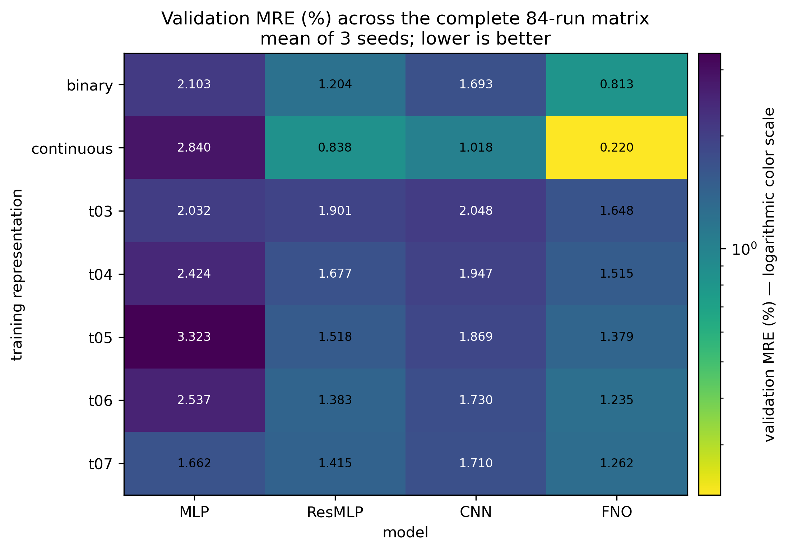

| 表征 | 模型 | seed 0 | seed 1 | seed 2 | mean ± std |
|---|---|---:|---:|---:|---:|
| binary | `mlp` | 2.42439 | 1.69907 | 2.18615 | 2.10320 ± 0.36971 |
| binary | `res_mlp_wide` | 1.17376 | 1.22994 | 1.20783 | 1.20384 ± 0.02830 |
| binary | `lifted_cnn` | 1.71571 | 1.68136 | 1.68101 | 1.69269 ± 0.01993 |
| binary | `fno2d_band_v2` | 0.81060 | 0.81459 | 0.81396 | **0.81305 ± 0.00214** |
| continuous | `mlp` | 3.29745 | 1.81675 | 3.40480 | 2.83966 ± 0.88749 |
| continuous | `res_mlp_wide` | 0.69419 | 0.59230 | 1.22894 | 0.83847 ± 0.34197 |
| continuous | `lifted_cnn` | 1.01003 | 1.01928 | 1.02420 | 1.01784 ± 0.00720 |
| continuous | `fno2d_band_v2` | 0.21394 | 0.22478 | 0.22246 | **0.22039 ± 0.00571** |
| t03 | `mlp` | 2.03672 | 2.04060 | 2.01907 | 2.03213 ± 0.01148 |
| t03 | `res_mlp_wide` | 1.97681 | 1.85958 | 1.86810 | 1.90149 ± 0.06536 |
| t03 | `lifted_cnn` | 2.04348 | 2.04946 | 2.05147 | 2.04813 ± 0.00416 |
| t03 | `fno2d_band_v2` | 1.65531 | 1.63726 | 1.65158 | **1.64805 ± 0.00953** |
| t04 | `mlp` | 3.40401 | 1.95331 | 1.91590 | 2.42441 ± 0.84856 |
| t04 | `res_mlp_wide` | 1.75692 | 1.64855 | 1.62531 | 1.67693 ± 0.07024 |
| t04 | `lifted_cnn` | 1.90593 | 1.97378 | 1.96005 | 1.94659 ± 0.03588 |
| t04 | `fno2d_band_v2` | 1.51808 | 1.51632 | 1.51031 | **1.51491 ± 0.00407** |
| t05 | `mlp` | 3.40209 | 3.24786 | 3.31836 | 3.32277 ± 0.07721 |
| t05 | `res_mlp_wide` | 1.52352 | 1.52472 | 1.50580 | 1.51801 ± 0.01060 |
| t05 | `lifted_cnn` | 1.82264 | 1.89511 | 1.88920 | 1.86898 ± 0.04024 |
| t05 | `fno2d_band_v2` | 1.38002 | 1.38541 | 1.37010 | **1.37851 ± 0.00776** |
| t06 | `mlp` | 1.86934 | 2.34730 | 3.39516 | 2.53727 ± 0.78045 |
| t06 | `res_mlp_wide` | 1.37080 | 1.38450 | 1.39276 | 1.38268 ± 0.01109 |
| t06 | `lifted_cnn` | 1.69884 | 1.78350 | 1.70767 | 1.73000 ± 0.04654 |
| t06 | `fno2d_band_v2` | 1.22686 | 1.23569 | 1.24224 | **1.23493 ± 0.00772** |
| t07 | `mlp` | 1.64284 | 1.68083 | 1.66177 | 1.66181 ± 0.01900 |
| t07 | `res_mlp_wide` | 1.42123 | 1.40100 | 1.42182 | 1.41468 ± 0.01185 |
| t07 | `lifted_cnn` | 1.68199 | 1.76314 | 1.68596 | 1.71036 ± 0.04575 |
| t07 | `fno2d_band_v2` | 1.26214 | 1.26867 | 1.25459 | **1.26180 ± 0.00704** |

这里可以看到胜者之外的重要信息：ResMLP 在所有表征上通常是第二名；MLP 在 continuous、t04、t06 上的 seed 波动明显；CNN 的跨 seed 稳定性通常好于 MLP，但 validation MRE 未胜过 FNO。FNO 在七个波次均为最低三 seed 均值，因此才进入后续分辨率消融。

主矩阵机器源为 `runs/20260806/full_cell_forward_main_campaign_20260806/main_matrix_leaderboard.csv`，SHA-256 为 `e8715090...b6131`；选择阶段未访问 test。

[↑ 回顶部](#full-cell-forward-report)

---

## 四、训练曲线：七个波次、全部模型

每张图的四个面板依次为 MLP、ResMLP、CNN、FNO；彩色线是 seed 0/1/2，黑线是跨 seed 均值，灰带是 seed 范围。不同模型可能因 early stopping 拥有不同的有效 epoch 长度，曲线只画实际存在的 history。

### 4.1 Binary native

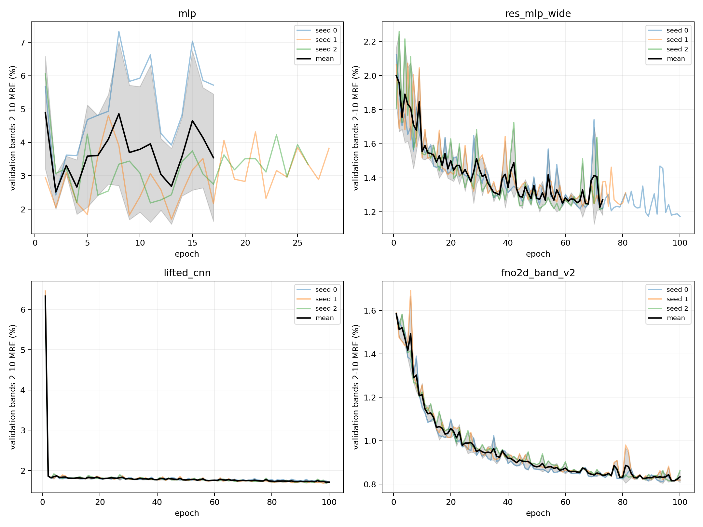

### 4.2 Graded continuous

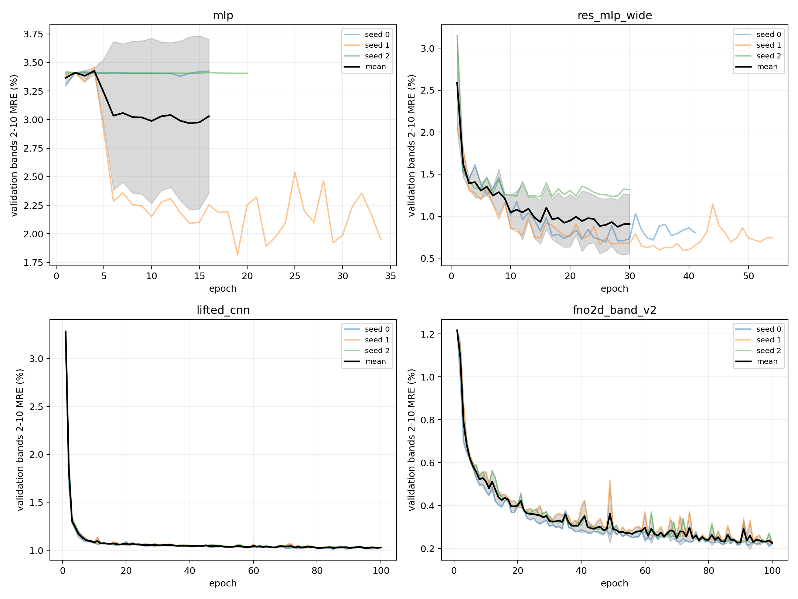

### 4.3 Graded threshold t0.3

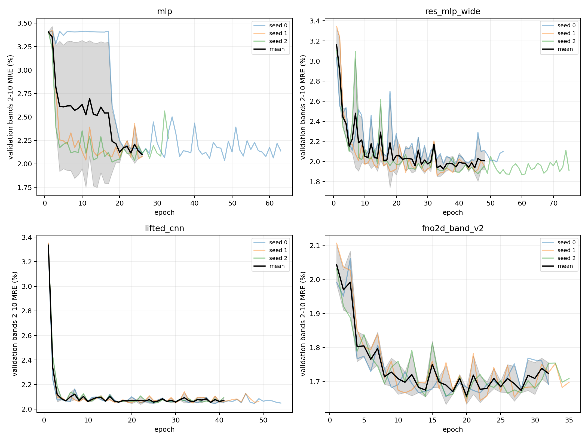

### 4.4 Graded threshold t0.4

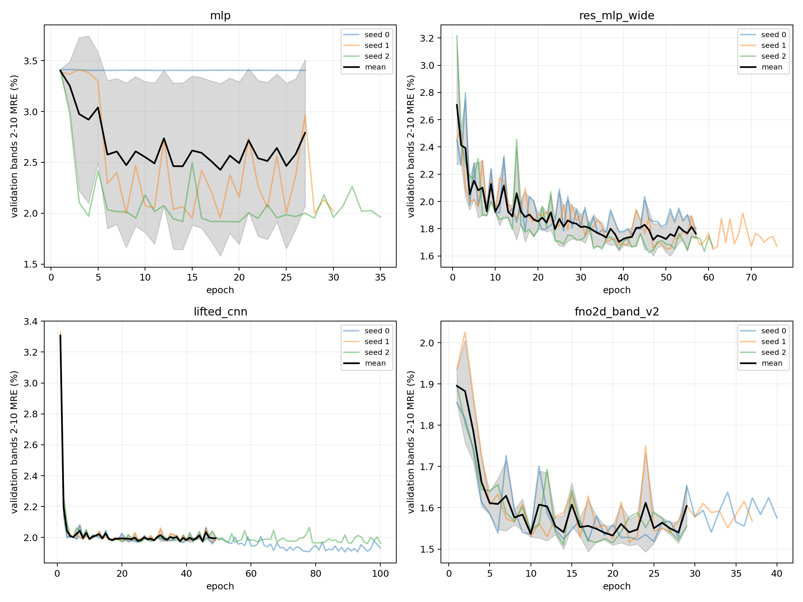

### 4.5 Graded threshold t0.5

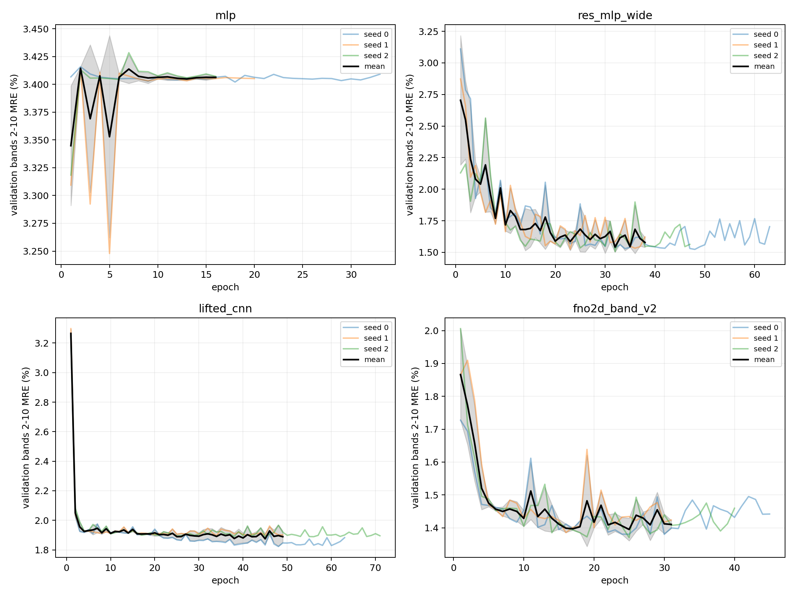

### 4.6 Graded threshold t0.6

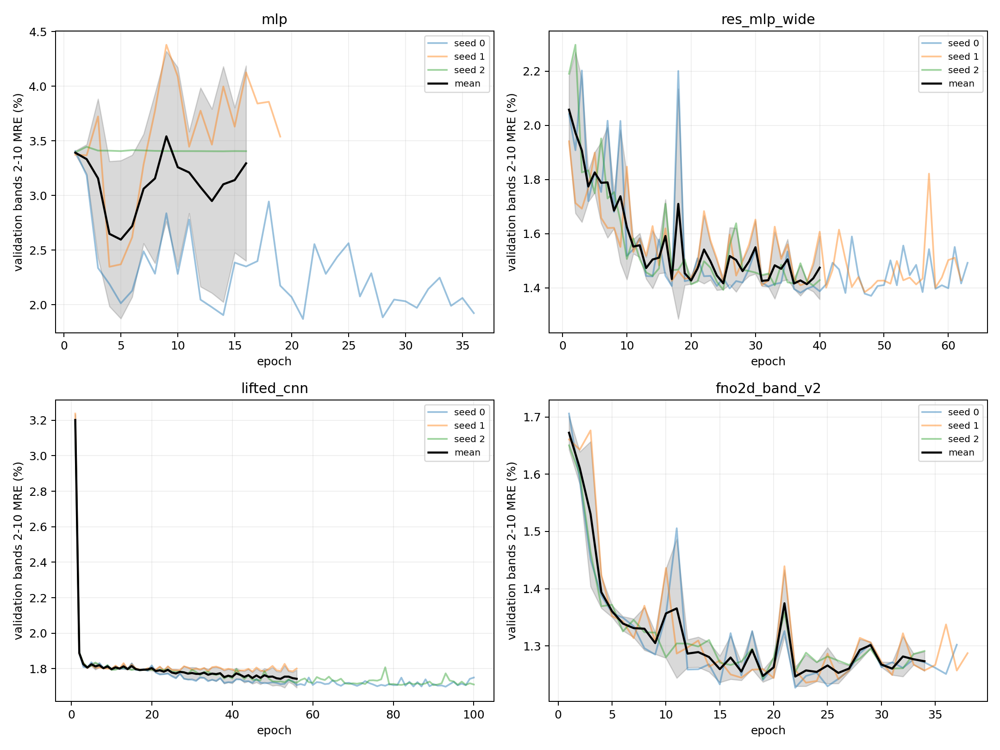

### 4.7 Graded threshold t0.7

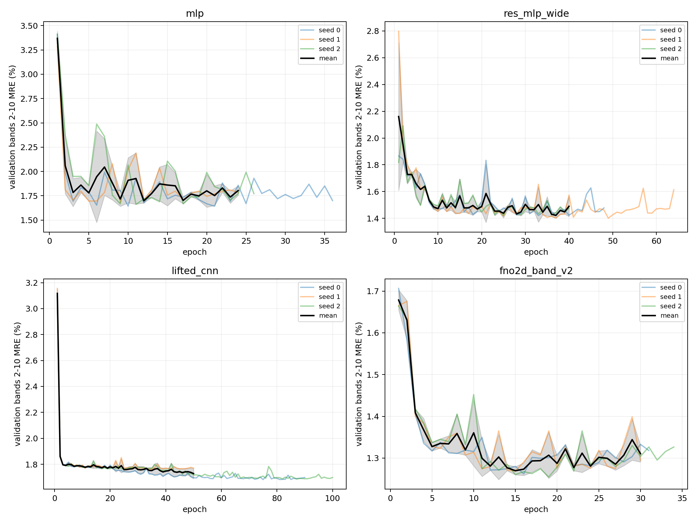

PNG/PDF、原始 wave 路径和 SHA-256 见[精选图件索引](../../reports/assets/full_cell_dual_lane_forward_training_20260806/figure_index.md)。完整 history 和未精选图仍保留在对应 `runs/20260806/*wave_aggregation_20260806/`。

[↑ 回顶部](#full-cell-forward-report)

---

## 五、跨数据测试：明确源数据、目标数据和方向

跨数据评估的基本单位是“源表征训练得到的 checkpoint，在目标表征 test split 上推理”。它不是重新训练，也不重新估计 normalization。总计由三部分组成：

| 路径 | 计算式 | Cells | 用途 |
|---|---:|---:|---|
| graded 内部迁移 | 4 models × 3 seeds × 6 source × 6 target | 432 | continuous/t03–t07 之间迁移 |
| binary → graded | 4 models × 3 seeds × 6 targets | 72 | binary 模型在 graded 数据上的 OOD |
| graded → binary | 4 models × 6 sources × 3 seeds | 72 | graded 模型在 binary 数据上的 OOD |
| **合计** | — | **576/576** | `failed_cells=0` |

### 5.1 双路线方向性结果

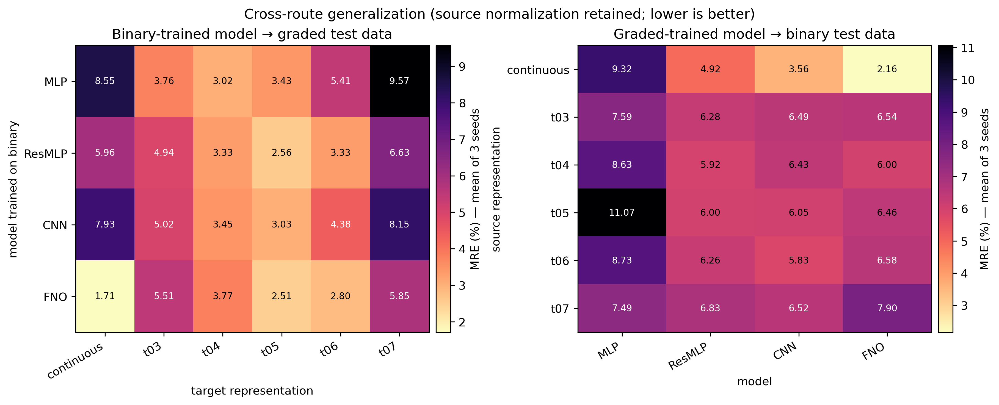

**Binary-trained → graded-test，三 seed mean MRE（%）：**

| 模型 | continuous | t03 | t04 | t05 | t06 | t07 |
|---|---:|---:|---:|---:|---:|---:|
| `mlp` | 8.55 | 3.76 | 3.02 | 3.43 | 5.41 | 9.57 |
| `res_mlp_wide` | 5.96 | 4.94 | 3.33 | 2.56 | 3.33 | 6.63 |
| `lifted_cnn` | 7.93 | 5.02 | 3.45 | 3.03 | 4.38 | 8.15 |
| `fno2d_band_v2` | 1.71 | 5.51 | 3.77 | 2.51 | 2.80 | 5.85 |

**Graded-trained → binary-test，三 seed mean MRE（%）：**

| 源表征 | MLP | ResMLP | CNN | FNO |
|---|---:|---:|---:|---:|
| continuous | 9.32 | 4.92 | 3.56 | 2.16 |
| t03 | 7.59 | 6.28 | 6.49 | 6.54 |
| t04 | 8.63 | 5.92 | 6.43 | 6.00 |
| t05 | 11.07 | 6.00 | 6.05 | 6.46 |
| t06 | 8.73 | 6.26 | 5.83 | 6.58 |
| t07 | 7.49 | 6.83 | 6.52 | 7.90 |

这些数值与同域 validation 不应横向混为一谈。它们显示明显的方向性 domain shift：例如 continuous-trained FNO 在 binary test 上为 `2.16%`，远高于其 continuous 同域 validation `0.22%`；binary-trained FNO 在 continuous test 上为 `1.71%`，也远高于 binary 同域 validation `0.81%`。

### 5.2 Graded 内部 6×6

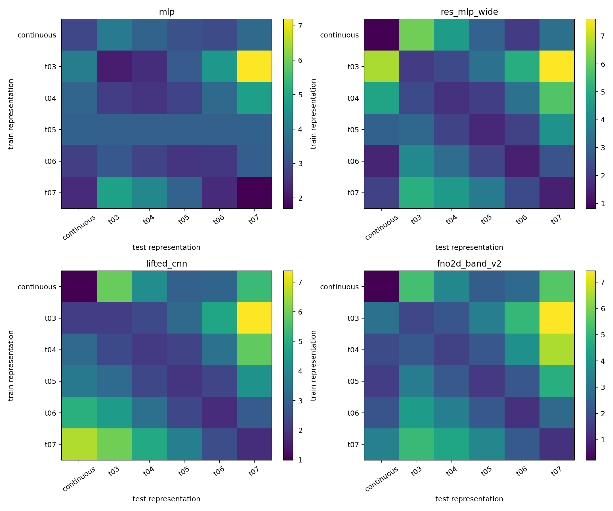

图中每个模型独立成面板，行是训练表征，列是测试表征。对角线是同表征 test，非对角线是跨表征迁移。原始 576 cell 表和 192 行三 seed 汇总分别为 `cross_evaluation_cells.csv` 与 `cross_evaluation_summary.csv`；后者 SHA-256 为 `45f58683...0361f`。全部结果 `selection_influence=false`，不参与模型、阈值或分辨率选择。

[↑ 回顶部](#full-cell-forward-report)

---

## 六、分辨率比较：三种分辨率均独立训练

这里的实验问题是“同一冻结配置在不同 raster 分辨率下**重新训练**后，validation 表现如何”，不是“64 训练后能否零样本迁移到 32/128”。具体组成如下：

| 分辨率 | 来源 | 独立训练数 | checkpoint 是否来自该分辨率 |
|---:|---|---:|---|
| 32 | 额外消融波次 | 3 配置 × 3 seeds = 9 | 是 |
| 64 | 84-run 主矩阵中的对应 FNO | 3 配置 × 3 seeds = 9 | 是 |
| 128 | 额外消融波次 | 3 配置 × 3 seeds = 9 | 是 |

因此统计比较涉及 27 个分辨率对应 checkpoint，其中新增正式训练为 18 runs；不存在 64 checkpoint 直接改变输入尺寸后的测试结果。

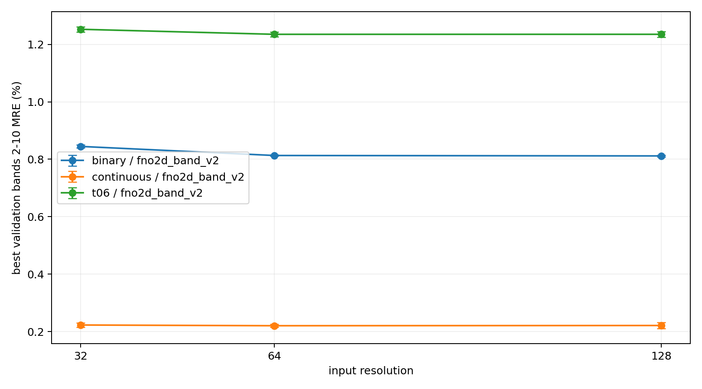

| 路线 / 表征 | r32 MRE (%) | r64 MRE (%) | r128 MRE (%) | 冻结分辨率 |
|---|---:|---:|---:|---:|
| binary / binary | 0.84461 ± 0.00503 | 0.81305 ± 0.00214 | **0.81154 ± 0.00313** | 128 |
| graded / continuous | 0.22289 ± 0.00737 | **0.22039 ± 0.00571** | 0.22116 ± 0.01068 | 64 |
| graded / t0.6 | 1.25241 ± 0.00880 | **1.23493 ± 0.00772** | 1.23497 ± 0.00997 | 64 |

`acceptance.meta.json` 记录 `test_executed_during_selection=false`。binary 的 r128 优势很小，但仍按预设的三 seed validation 均值规则冻结；continuous 与 t0.6 保留 r64。

[↑ 回顶部](#full-cell-forward-report)

---

## 七、冻结后 test：只确认预先选定的三类胜者

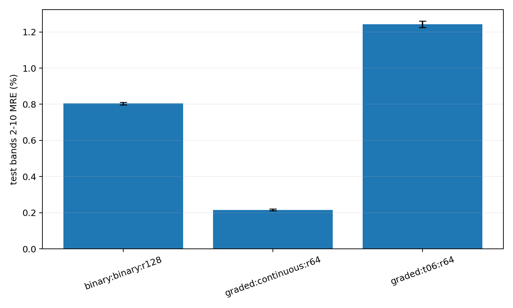

| 路线 / 表征 | Model | Resolution | Test MRE mean ± std (%) | MAE mean | RMSE mean |
|---|---|---:|---:|---:|---:|
| binary / binary | `fno2d_band_v2` | 128 | 0.80394 ± 0.00705 | 0.004236 | 0.006929 |
| graded / continuous | `fno2d_band_v2` | 64 | 0.21579 ± 0.00494 | 0.001084 | 0.001778 |
| graded / t0.6 | `fno2d_band_v2` | 64 | 1.24295 ± 0.01729 | 0.006043 | 0.008274 |

最终测试保存 9 行 seed 指标、90 行 per-band、729 行 per-k、3 份 prediction NPZ 和 4 行 bootstrap 结果。continuous 减 t0.6 的 paired bootstrap MRE 差为 `-1.02716` 个百分点，95% CI 为 `[-1.07225, -0.98238]`。

这张表只回答“冻结胜者在未参与选择的 test 上是否维持表现”。MLP、ResMLP、CNN 没有执行确认性 test，因此不能从本报告推断它们的 test 排名；它们的完整比较证据是第三节的 validation 主矩阵和第五节的跨数据推理。

[↑ 回顶部](#full-cell-forward-report)

---

## 八、异常、证据边界与下一 gate

### 8.1 异常与排除项

1. 消融 admission probe 一次提交 18 个作业时触发 `AssocMaxSubmitJobLimit`；审计后只补交缺失 3 个，没有重复训练。正式消融按 `12 + 6` 节流完成。
2. 曾启动本机 WSL checkpoint CPU 推理复核。人工负责人要求停止本地 replay 后，相关进程已终止；不完整目录没有 `results.json`，不进入任何结论。
3. 102 个正式训练 run 没有失败、非零退出、缺失制品或非有限值，也没有自动重启、取消或恢复。

### 8.2 物理证据边界

- t0.3–t0.7 是固定 threshold raster 输入对原 graded `Wh` 标签的 proxy 训练，不是阈值结构重新求解得到的 `Wh_threshold_MPB`。
- 本轮没有执行 threshold analytic codec、M9 preflight、M9 pilot 或 real-MPB replay。
- 所有后续 MPB/Meep 只能在 M9 上执行，并须由人工负责人另行授权；不得在本地 replay。
- continuous 优于 t0.6 的结论仅适用于当前代理标签，不证明阈值二值结构具有相同真实物理响应。

### 8.3 可追溯制品

| 证据 | 路径 |
|---|---|
| 84-run 主矩阵 | `runs/20260806/full_cell_forward_main_campaign_20260806/` |
| 7 个 wave aggregation 与 history | `runs/20260806/*wave_aggregation_20260806/` |
| 576-cell 跨数据评估 | `runs/20260806/full_cell_forward_cross_eval_20260806/` |
| 分辨率验收 | `runs/20260806/full_cell_forward_resolution_acceptance_20260806/` |
| 冻结后 test | `runs/20260806/full_cell_forward_final_test_20260806/` |
| 精选图、源路径与 SHA-256 | [figure_index.md](../../reports/assets/full_cell_dual_lane_forward_training_20260806/figure_index.md) |

### 8.4 人工理解记录

解决了什么问题：把原先偏重胜者的摘要扩展为可审计的完整实验矩阵，补齐非胜者、逐 seed、训练曲线、跨数据方向和独立分辨率训练口径。

为什么采用这个方案：validation-only 选择和冻结后 test 保持原协议不变，同时把所有选择前证据完整公开，避免“只展示胜者”造成选择偏差观感。

改变了项目哪一层：L3 实验与证据；未改变模型、训练配置、L0/L1 研究目标或 M9 物理验证规则。

最大风险、未知或下一 gate：threshold proxy 尚无 M9 real-MPB 验证；人工负责人需要先审阅本 Draft，再决定是否接受 Forward 冻结结果及是否授权 M9 物理 gate。

[↑ 回顶部](#full-cell-forward-report)
