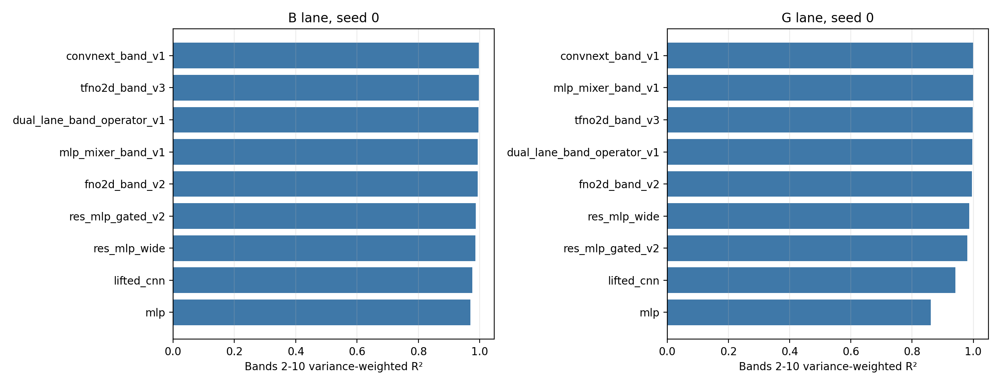
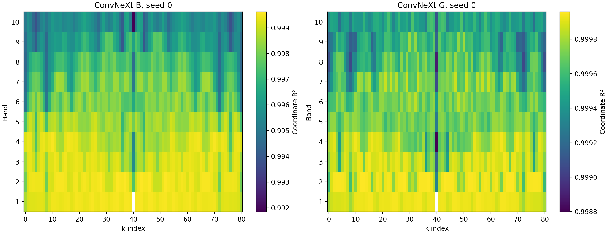

<!--
  Seed-0 R2 supplement for the Full-Wh upgrade 50k experiment.
  Author: fangtoast
  Email: fangtoast@foxmail.com
  Copyright (c) 2026 fangtoast. All rights reserved.
-->

# 全胞前向 50K 模型决定系数补充评估（2026-08-19）

本文回答一个限定问题：2026-08-10 的 Full-Wh 50K 冻结模型若采用 Xin 等 POST 论文使用的决定系数定义，native held-out test 上的 $R^2$ 表现如何。本文只补算 **seed 0**，不替代原报告的三 seed MRE，也不重新执行模型选择。

## 一、结论

`convnext_band_v1` 在两条 native lane 的主 R²口径上仍为第一：B lane 为 **0.997287**，G lane 为 **0.999627**。B lane 的第二名是 `tfno2d_band_v3`（0.996781），G lane 的第二名是 `mlp_mixer_band_v1`（0.999267）。这一排序与原 MRE 结果的主要结论一致。

所有模型在 bands 2–10 的 729 个坐标上均没有负 R²。每个评估单元只有 `(k index=41, band=1)` 的目标方差为零，因此该坐标按协议标记为 `undefined_zero_target_variance`；它不进入 bands 2–10 主指标，也没有被填成 0 或 1。

这些数值不能与 POST 的 `log Q`/`SE` 数值直接排名。两项工作使用相同的决定系数公式，但预测对象、输出维数、物理求解器和数据分布不同；本结果只说明当前 Full-Wh 测试分布上的拟合程度。

## 二、指标互通方式

POST 对一个标量目标沿测试样本计算：

$$
R^2=1-\frac{\sum_i(y_i-\hat y_i)^2}{\sum_i(y_i-\bar y)^2}.
$$

本项目每个样本输出 `Wh[81,10]`，因此先对每个坐标 $j=(k,\mathrm{band})$ 沿 5,000 个 held-out 样本计算同式的 $R_j^2$，再以各坐标目标方差加权：

$$
R_{\mathrm{vw}}^2=1-\frac{\sum_j\mathrm{SSE}_j}{\sum_j\mathrm{SST}_j}.
$$

主指标只使用 bands 2–10，与原实验的 checkpoint 选择及 MRE 主口径一致；bands 1–10 全矩阵 R²作为补充。该做法会独立中心化每个输出坐标，避免把不同 k 点和能带之间的均值差异混入分母。

## 三、冻结测试协议

| 项目 | 合同 |
|---|---|
| Parent campaign | `runs/20260810/full_cell_upgrade_50k_evaluation_20260810085944` |
| R² campaign | `runs/20260819/full_cell_upgrade_50k_r2_seed0_202608191658` |
| Seed | `0` |
| 范围 | 4 个基线、4 个独立升级模型、1 个联合模型；B/G 共 18 cells |
| Checkpoint | 17 个冻结 checkpoint；联合模型分别评估 B/G |
| Split | 每条 lane 固定 40k/5k/5k；只读取 5,000 held-out test |
| Runtime | N40 `gpu_4090`，1×RTX 4090，6 CPU，60,000 MB，FP32 |
| Slurm | `5421177`，`COMPLETED/0:0`，1 分 56 秒 |
| 选择影响 | 无；不重新选择 checkpoint，不修改 promotion |

执行前重新校验两套 HDF5、test split、k points、父 campaign 和 17 个 checkpoint 的哈希。R²重放同时复算 MRE，并要求与父 campaign 的同一 `evaluation_id` 在 $10^{-6}$ 个百分点内一致；18/18 单元通过。

## 四、Native seed 0 结果

| Lane | 模型 | Bands 2–10 $R_{\mathrm{vw}}^2$ | Full matrix $R_{\mathrm{vw}}^2$ | 坐标中位数 | 坐标 P05 | 原口径 MRE |
|---|---|---:|---:|---:|---:|---:|
| B | `convnext_band_v1` | **0.997287** | 0.997317 | 0.998054 | 0.994951 | 0.3268% |
| B | `tfno2d_band_v3` | 0.996781 | 0.996813 | 0.997330 | 0.994856 | 0.3937% |
| B | `dual_lane_band_operator_v1` | 0.995533 | 0.995574 | 0.995794 | 0.993290 | 0.4736% |
| B | `mlp_mixer_band_v1` | 0.993321 | 0.993343 | 0.993553 | 0.990519 | 0.5603% |
| B | `fno2d_band_v2` | 0.992965 | 0.993016 | 0.993002 | 0.990322 | 0.6303% |
| B | `res_mlp_gated_v2` | 0.987202 | 0.987073 | 0.986836 | 0.977410 | 0.8690% |
| B | `res_mlp_wide` | 0.985176 | 0.984852 | 0.986200 | 0.967553 | 0.9990% |
| B | `lifted_cnn` | 0.976173 | 0.975958 | 0.977320 | 0.960718 | 1.4355% |
| B | `mlp` | 0.969559 | 0.969009 | 0.969001 | 0.948782 | 1.7508% |
| G | `convnext_band_v1` | **0.999627** | 0.999630 | 0.999695 | 0.999301 | 0.0461% |
| G | `mlp_mixer_band_v1` | 0.999267 | 0.999273 | 0.999372 | 0.998658 | 0.0699% |
| G | `tfno2d_band_v3` | 0.998151 | 0.998166 | 0.998547 | 0.996258 | 0.1035% |
| G | `dual_lane_band_operator_v1` | 0.997441 | 0.997464 | 0.998218 | 0.994632 | 0.1231% |
| G | `fno2d_band_v2` | 0.995725 | 0.995762 | 0.996733 | 0.991153 | 0.1602% |
| G | `res_mlp_wide` | 0.987307 | 0.987362 | 0.989152 | 0.979239 | 0.3100% |
| G | `res_mlp_gated_v2` | 0.980499 | 0.980553 | 0.980462 | 0.967619 | 0.4437% |
| G | `lifted_cnn` | 0.941376 | 0.941318 | 0.941858 | 0.894057 | 0.6894% |
| G | `mlp` | 0.861721 | 0.861599 | 0.860096 | 0.799033 | 1.3971% |

## 五、逐坐标诊断

ConvNeXt 的 B lane 坐标 R²在 bands 2–10 的中位数为 0.998054、P05 为 0.994951、最小值为 0.991840；G lane 分别为 0.999695、0.999301 和 0.998799。B lane 随 band 提高出现更明显的 R²下降，与原逐 band MRE 中高阶 band 误差增大的观察一致。

热图是代理模型误差统计，不是电磁场、MPB 网格收敛图或物理模式图。完整坐标表、逐 band 表及精选图件哈希见 [`source_index.csv`](../../reports/assets/full_cell_upgrade_50k_r2_seed0_20260819/source_index.csv)。

## 六、资源与证据边界

- 18 个单元纯推理合计 28.21 秒，campaign 计算阶段 35.94 秒。
- PyTorch 峰值已分配显存为 560.73 MiB；N40 五秒监控的显存峰值为 1,646 MiB，GPU utilization 峰值为 98%。
- R²不改变原报告的 `convnext_band_v1` promotion，也不能挽回 `res_mlp_gated_v2` 在 G lane 的原 MRE 负结果。
- 本次没有训练、multi-seed 统计、cross-lane、32/128 输入诊断、real-MPB replay 或 inverse replay。
- 本结果状态为 `surrogate_held_out`；`physically_verified=false`。

## 七、人工理解记录

- **本文回答的问题：** POST 使用的标准 R²能否迁移到 `Wh[81,10]`，以及 seed 0 的 native 模型结果如何。
- **最关键结论：** 公式互通；逐坐标中心化后，ConvNeXt 在 B/G 两条 lane 均为最高 R²。
- **最容易误读的边界：** 0.99 以上的 Full-Wh R²不能与 POST 的标量 `log Q`/`SE` R²直接比较，也不是物理验证。
- **保留的局限：** 单 seed 结果不说明训练稳定性；稳定性仍应读取原三 seed MRE 报告。

[返回 50K 升级模型主报告](full_cell_forward_model_upgrade_50k_evaluation_20260810.md) · [返回正向代理结果](README.md)
