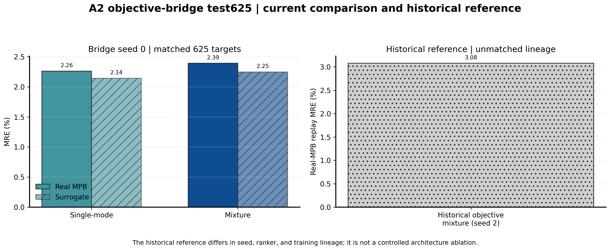

<!--
  Human-readable result for EXP-INV-004.
  Author: fangtoast
  Email: fangtoast@foxmail.com
  Copyright (c) 2026 fangtoast. All rights reserved.
-->

# EXP-INV-004｜Objective-Bridge seed0 100/625 replay

## 一句话结论

Objective-Bridge 的 seed0 single-mode 和 mixture 已完成完整 Test625 real-MPB replay，mean MRE 为 **2.2614%/2.3916%**；它证明修复后的生成器可进入真实回放，但不证明跨 seed 稳定或严格击败检索基线。

## 核心结果

| Test625 方法 | replay mean MRE | 95% bootstrap CI | surrogate–replay gap |
|---|---:|---:|---:|
| historical mixture seed2 | 3.0775% | [2.9700%, 3.1856%] | 1.4454 pp |
| bridge single-mode seed0 | **2.2614%** | **[2.2263%, 2.2965%]** | **0.1180 pp** |
| bridge mixture seed0 | 2.3916% | [2.3485%, 2.4341%] | 0.1440 pp |

## 与基线相比

相对 historical mixture seed2，bridge single-mode/mixture 的 mean MRE 分别低 **26.52%/22.29%**，paired wins 为 474/625 和 438/625。但该历史基线使用不同 seed 与旧 ranker，`historical_baseline_protocol_matched=false`。在严格配对的 100-target pilot 中，retrieval 的 1.5214% 仍优于 bridge single-mode/mixture 的 2.3986%/2.5105%。

## 解释与限制

主要科研含义是 Objective-Bridge 显著修复了生成器自身的 surrogate–replay gap，使结果不再只停留在代理模型排序。限制同样明确：证据只有 seed0，historical seed2 只能用于诊断；PINO/field 没有参与 ranker，也没有 physics-aware rerank 收益。

## 决策

**需要额外验证：** 保留 bridge single-mode 作为当前 seed0 候选，但在论文中只报告 seed0 solver replay。下一 gate 是冻结相同协议补齐跨 seed，并与 retrieval 或其他 baseline 做协议匹配的 paired replay；在此之前不主张普遍优越性。

## 关键设置

| 项目 | 设置 |
|---|---|
| 数据/目标 | V2 10k；`Wh[31,10]`；完整冻结 Test625 |
| 候选 | 每目标 `K=128`，有效 Top-M 均值 5 |
| ranker | 冻结 A1 forward FNO seed0；Query FNO 仅作诊断 |
| replay | real-MPB；test MPB 不参与 checkpoint 选择 |
| 证据边界 | seed0；100-target pilot + Test625 |

## 证据入口

- experiment spec：[100-target 协议](https://github.com/fangtoast/phc2d/blob/main/experiments/research/a2_inverse_objective_bridge_seed0_v1.md) · [Test625 扩展](https://github.com/fangtoast/phc2d/blob/main/experiments/research/a2_inverse_objective_bridge_seed0_test625_v1.md)
- config：[100-target](https://github.com/fangtoast/phc2d/blob/main/configs/research/a2_inverse_objective_bridge_seed0_v1.yaml) · [Test625](https://github.com/fangtoast/phc2d/blob/main/configs/research/a2_inverse_objective_bridge_seed0_test625_v1.yaml)
- runs：[run 与 replay 产物索引](../results/inverse/a2_inverse_objective_bridge_seed0_v1_20260727.md)，源目录为 `runs/20260727/a2_inverse_objective_bridge_seed0_v1_202607271804/` 与 `runs/20260728/a2_inverse_objective_bridge_seed0_test625_v1_202607280842/`
- raw metrics：[aggregate 指标说明](../results/inverse/a2_inverse_objective_bridge_seed0_v1_20260727.md)，核心文件为各 run 的 `aggregate/metrics.json`、`main_table.csv` 与 `paired_comparisons.csv`
- figures：[当前对照图及 provenance](../reports/assets/phc2d_project_full_introduction_20260724/figure_index.md)
