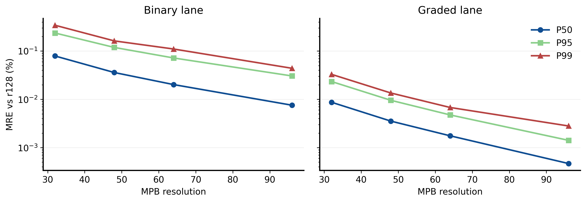

<!--
  Human-readable result for EXP-PHY-001.
  Author: fangtoast
  Email: fangtoast@foxmail.com
  Copyright (c) 2026 fangtoast. All rights reserved.
-->

# EXP-PHY-001｜全胞 MPB 分辨率收敛与跨环境验收

## 一句话结论

对当前 B/G 冻结结构分布，MPB `resolution=64` 相对 r128 的 combined P95 MRE 为 **0.05448%**，通过预注册数值门并完成 WSL real-MPB 交叉验收；继续提高到 r96 的成本收益不足。

## 核心结果

| resolution | combined median MRE | combined P95 MRE | 每结构均值耗时 | 结论 |
|---:|---:|---:|---:|---|
| 32 | 0.019865% | 0.196311% | 7.12 s | 通过，但不在预注册候选集 |
| 48 | 0.008084% | 0.099219% | 19.72 s | 通过，但不在预注册候选集 |
| **64** | **0.004190%** | **0.054480%** | **29.59 s** | **通过并推荐** |
| 96 | 0.001203% | 0.024352% | 86.85 s | 更准，但成本约 2.94× r64 |
| 128 | reference | reference | 130.57 s | 数值参考，不是解析真值 |

## 与基线相比

r128 是本轮数值参考。r64 的 B/G P95 MRE 分别为 **0.071935%/0.004751%**，均显著低于预注册的 0.75% lane 门。r96 将 combined P95 进一步降至 0.024352%，但每结构耗时升至 r64 的约 2.94 倍；r64 已满足所有接受门，因此按最小可接受成本规则胜出。

## 解释与限制

该结果说明当前全胞 B/G 数据分布无需用 r96/r128 才能获得稳定 MPB 标签，r64 是精度与成本的合理折中。r128 不是解析真值；结论只覆盖当前 TE、81 个 full-BZ k 点、bands 2–10 和冻结的 100 个结构，不能自动外推到新生成器或新结构分布。

## 决策

**继续：** 将 `resolution=64` 作为后续全胞数据合同的推荐设置，不追加 r160/r192。新生成器分布仍需自己的小样本质量门；项目负责人负责最终冻结该设置。

## 关键设置

| 项目 | 设置 |
|---|---|
| 结构 | B 50 + G 50；五个冻结 strata |
| 分辨率 | 32/48/64/96/128 |
| 物理任务 | TE；81 个 full-BZ k 点；10 bands |
| 主比较 | bands 2–10 MRE，相对 r128 |
| 交叉验收 | WSL `Ubuntu` + `meep_env`；32 个 real-MPB 作业，0 失败 |

## 证据入口

- experiment spec：[分辨率收敛协议](https://github.com/fangtoast/phc2d/blob/main/experiments/research/full_cell_resolution_convergence_xingyi.md)
- config：[Stage A](https://github.com/fangtoast/phc2d/blob/main/configs/research/full_cell_resolution_convergence_xingyi_stage_a_v1.yaml) · [Stage B](https://github.com/fangtoast/phc2d/blob/main/configs/research/full_cell_resolution_convergence_xingyi_stage_b_v1.yaml)
- runs：[求解与交叉验收索引](../results/data-provenance/全胞MPB分辨率收敛验证_20260817.md)，源目录包括 `runs/20260817/full_cell_resolution_convergence_xingyi_stage_b_retry1_202608171428/` 与 `runs/20260817/full_cell_resolution_convergence_wsl_cross_acceptance_v1_202608171505/`
- raw metrics：[收敛、耗时与 WSL 指标说明](../results/data-provenance/全胞MPB分辨率收敛验证_20260817.md)，包括 `convergence_metrics.json`、`timing.csv` 与交叉验收 `metrics.json`
- figures：[图件与 source index](../reports/assets/full_cell_mpb_resolution_convergence_20260817/source_index.csv)
